::: {.fiche n="0.1" etat="a-revoir"}
Intention : Cover. A strong map as background image, preferably by Marc or a student. [PPT 1, 2] [Uses the CLC map]
Experience : none
Request :
Note : I made this map, and it has become rather iconic in IGN visuals.
:::

## How to use this handout

::: {.fiche n="0.2" etat="a-revoir"}
Intention : The shared user guide (levels, exercises, bonuses), without the revision system. Here almost every slide asks you to try before reading. Thanks to the M2 Geopolitics students, authors of several maps made in one week of cartography teaching. [new]
Experience : none
Request :
:::

This course is practised more than read: almost every slide asks you to **try before reading**. Change a setting, watch the map change.

- The **icon** in front of each title gives the level: **core**, to master; **support**, to consolidate; **further**, to go beyond. A slide without an icon is an example.
- **Exercises**: answer first, then click.
- The **+** button at the top right opens a "Going further" bonus.

[Thanks to the M2 Geopolitics students: several maps in this course are theirs, made after a single week of cartography teaching.]{.a-retenir}

## What you will be able to do

::: {.fiche n="0.3" etat="a-revoir"}
Intention : Choose the right visual variable for a dataset; anticipate what a choice (classes, colours, sizes) makes the map say; lay out a readable map. [PPT 3]
Experience : none
Request :
:::

By the end of this course, you will be able to:

1. **choose** the visual variable that suits a dataset;
2. **anticipate** what a choice of classes, colours or sizes makes the map say;
3. **lay out** a map that is understood at first glance.

[Every map is a series of choices. Each one changes the message.]{.a-retenir}

## Course map

::: {.fiche n="0.4" etat="a-revoir"}
Intention : The six parts and the key to the three levels.
Experience : links to each slide
Request :
:::

::: {.carte-du-cours}
:::

## A map is a message {.intercalaire}

::: {.fiche n="1.0" etat="a-revoir"}
Intention : Drawing up the map, then laying it out. [PPT 3, 4]
Experience : none
Request :
:::

Drawing up the map, then laying it out.

## Five seconds

::: {.fiche n="1.1" etat="a-revoir"}
Intention : Opening with an experience: a map is shown for five seconds, then hidden; what do we remember? A good map passes the test, a working map does not. [new] Santa Claus's wanderings (Marc), and a working map of Gaza.
Experience : the image hides itself after 5 s ("flash" brick); question: what was the message?
Request :
:::

Each map is shown for five seconds only. Look, then say what you remember.

:::: {.columns}
::: {.column width="50%"}
::: {.flash duree="5"}
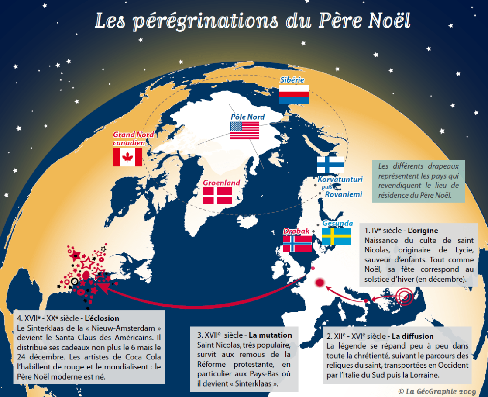{height="250" fig-alt="Map: the wanderings of Santa Claus"}
:::
:::
::: {.column width="50%"}
::: {.flash duree="5"}
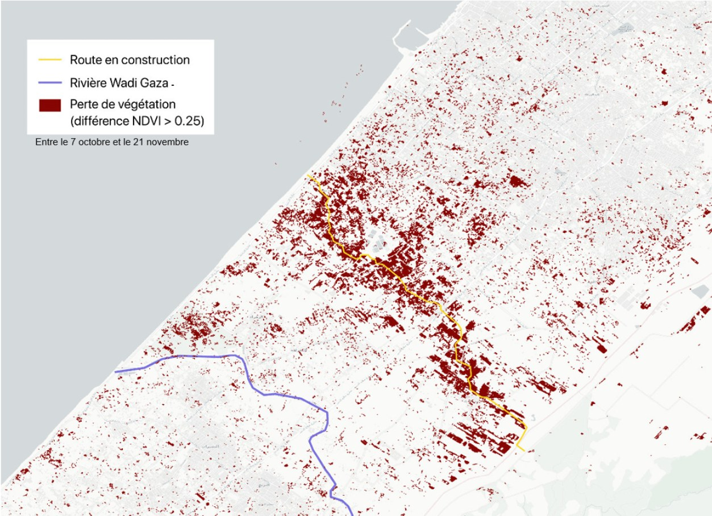{height="250" fig-alt="Working map: vegetation loss in the Gaza Strip"}
:::
:::
::::

:::: {.columns}
::: {.column width="35%"}
::: {.question}
**What was the message of each map?**
:::
:::
::: {.column width="65%"}
::: {.reponse}
Left, the journey of a legend, from Saint Nicholas to Santa Claus: understood in five seconds. Right, a working map with no title: red patches, but of what? You have to read the legend.
:::
:::
::::

## Drawing up, laying out {.socle}

::: {.fiche n="1.2" etat="a-revoir"}
Intention : Cartographic drawing (representing the information itself) and layout (organising the blocks around it: title, legend, scale…). [PPT 3]
Experience : sort eight decisions into "drawing up" or "layout"
Request :
:::

Making a map means two jobs:

- **drawing up** the map: representing the information itself, on the map;
- **laying it out**: organising around it the blocks needed to read it.

::: {.classer}
### Drawing up

- Choosing the visual variable
- Setting the classes
- Choosing the fill colours
- Adjusting the symbol size

### Layout

- Writing the title
- Placing the legend
- Placing the scale and the source
- Balancing the blocks on the page
:::

## Seeing, then understanding {.socle}

::: {.fiche n="1.3" etat="a-revoir"}
Intention : Semiology, "the set of rules for using a graphic system of signs to convey information" (Béguin and Pumain). Graphic understanding (seeing, the signifier) and mental understanding (looking, the signified). The four original text slides fit in one. [PPT 9, 10, 11, 12]
Experience : question on a spectacular figure that is hard to read (the circular flow graph)
Request :
:::

:::: {.columns}
::: {.column width="55%"}
**Graphic semiology**: "the set of rules for using a graphic system of signs to convey information" (Béguin and Pumain).

Reading a map means first **seeing** (shapes, colours), then **understanding** (the message).

::: {.question}
This figure is very easy to **see**. **What do you understand?**
:::

::: {.reponse}
Not much without reading the text: rail flows between Florida counties. The image strikes, the message does not get through.
:::
:::
::: {.column width="45%"}
::: {.centre}
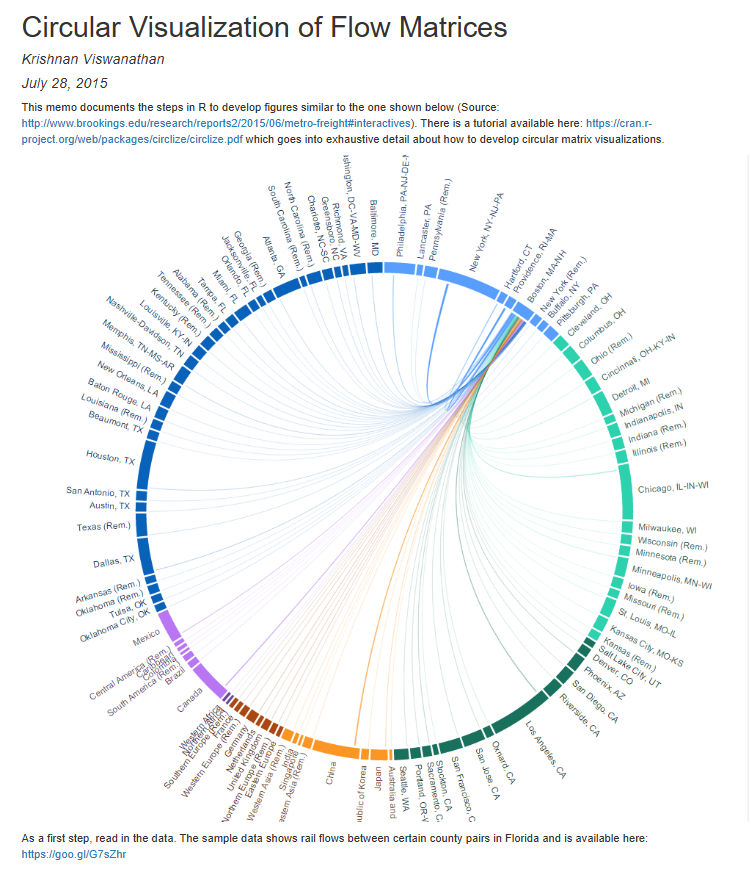{height="430" fig-alt="Circular flow graph between counties"}
:::
:::
::::

## What the eye can see {.intercalaire}

::: {.fiche n="2.0" etat="a-revoir"}
Intention : The constraints of the reader and of the medium. [PPT 5]
Experience : none
Request :
:::

The limits of the eye, and of the medium.

## Perception thresholds {.appui}

::: {.fiche n="2.1" etat="a-revoir"}
Intention : At 30 cm, the eye resolves about 0.1 mm; a dot must be at least 0.2 mm, a line 0.1 mm; separating two lines, telling two sizes apart. The four slides of figures become an experiment. [PPT 6, 7, 8]
Experience : slider: thin a line and a dot until they vanish on screen; read their size on paper
Request :
:::

::: {.curseur min="0.02" max="0.6" pas="0.01" valeur="0.3" unite="mm" etiquette="Line width on paper" schema="images/schemas/en/seuils.svg" hauteur="200"}
- The dot is `{2*x|2}` mm across; the line is `{x/0.1|1}` times the 0.1 mm threshold
:::

At 30 cm, the eye resolves a detail of about **0.1 mm**. Below that, a line vanishes; a dot needs at least **0.2 mm**. Separating two neighbouring lines, or telling two sizes apart, takes a sufficient gap as well.

[A screen is not paper: the experiment gives an order of magnitude. Print your map to check.]{.legende}

## Size is relative {.appui}

::: {.fiche n="2.2" etat="a-revoir"}
Intention : The Ebbinghaus illusion: the same circle looks smaller when surrounded by large circles. Consequence: on a proportional symbol map, the neighbourhood fools the eye. [PPT 19]
Experience : slider: adjust the right circle until it looks equal to the left one, then the answer reveals the gap
Request :
:::

::: {.curseur min="12" max="50" pas="1" valeur="42" unite="" etiquette="Size of the right orange circle" schema="images/schemas/en/ebbinghaus.svg" hauteur="230"}
:::

:::: {.columns}
::: {.column width="50%"}
::: {.question}
Adjust the right orange circle until it **looks** equal to the left one.
:::
:::
::: {.column width="50%"}
::: {.reponse}
The left circle measures 30 (the dashed outline). People often stop below that: surrounded by large circles, a circle looks smaller.
:::
:::
::::

## A colour never stands alone {.appui}

::: {.fiche n="2.3" etat="a-revoir"}
Intention : Adelson's checkerboard: two squares of the same grey look different. Simultaneous contrast: a colour changes with its surroundings. Consequence: a fill does not read the same everywhere on the map. [PPT 29, 27, 28]
Experience : question (are A and B the same grey?), then the answer joins the two squares with two bars; slider: the background hue changes, the red word advances, recedes, vibrates
Request :
:::

:::: {.columns}
::: {.column width="55%"}
::: {.schema fichier="images/schemas/en/adelson.svg" hauteur="250"}
:::

::: {.question}
**Is A darker than B?**
:::

::: {.reponse}
No: the same grey. The eye corrects for the shadow, and judges each square by its neighbours.
:::
:::
::: {.column width="45%"}
::: {.curseur min="0" max="360" pas="1" valeur="90" unite="°" etiquette="Background hue" schema="images/schemas/en/un-mot.svg" hauteur="160"}
:::

The red word does not change. Depending on the background, it **advances**, **recedes** or **vibrates**.

[A colour is always read against its neighbours.]{.a-retenir}
:::
::::

## Visual variables {.intercalaire}

::: {.fiche n="3.0" etat="a-revoir"}
Intention : Bertin's vocabulary: seven variables, three implantations. [PPT 12, 14]
Experience : none
Request :
:::

Jacques Bertin's vocabulary.

## Point, line, area {.socle}

::: {.fiche n="3.1" etat="a-revoir"}
Intention : The three implantations: the point (only its centre locates), the line (boundary or network, continuous or not), the area. Link with the primitives of "GIS: Basics". [PPT 13]
Experience : none
Request :
:::

::: {.schema fichier="images/schemas/en/primitives.svg" hauteur="170"}
:::

- The **point**: only its centre locates. It is qualitative if its shape or colour changes, quantitative if its size changes.
- The **line**: a boundary between two areas, or the course of a network; continuous or dashed, to say permanent or intermittent.
- The **area**: a zone, as a flat fill, a pattern or a texture.

[These are the primitives of "GIS: Basics", seen by the cartographer: the implantations.]{.legende}

## Seven variables {.socle}

::: {.fiche n="3.2" etat="a-revoir"}
Intention : Shape, size, orientation, colour, value, texture (grain, pattern), dynamics; a drawn table crossing variables and implantations, instead of the text slides. [PPT 14, 16, 17, 18, 20, 21, 36]
Experience : diagram: each cell of the table shows the variable in its implantation
Request :
:::

:::: {.columns}
::: {.column width="68%"}
::: {.schema fichier="images/schemas/en/variables.svg" hauteur="440"}
:::
:::
::: {.column width="32%"}
To vary a sign, we have **seven visual variables**: shape, size, orientation, colour, value, texture (grain, pattern)…

… and, on screen, **dynamics**: blinking, changing, moving.

[Each variable works in all three implantations, but not equally well.]{.a-retenir}
:::
::::

## What each variable can say {.socle}

::: {.fiche n="3.3" etat="a-revoir"}
Intention : Differentiate, order, quantify, associate: the table of properties from the old deck. Size is the only one that quantifies; value orders; colour and shape differentiate. [PPT 15, 37]
Experience : sort six variables by what they can say; bonus: the full table of properties
Request :
:::

A variable can **differentiate** (this is not that), **order** (this is more than that), **quantify** (this is twice that). Sort each variable by what it says best.

::: {.classer}
### Differentiate

- Shape
- Colour (hue)
- Orientation

### Order

- Value
- Texture (grain)

### Quantify

- Size
:::

[Size is the only variable that quantifies: a circle twice as large says "twice as much".]{.a-retenir}

::: {.plus titre="The table of properties"}
::: {.centre}
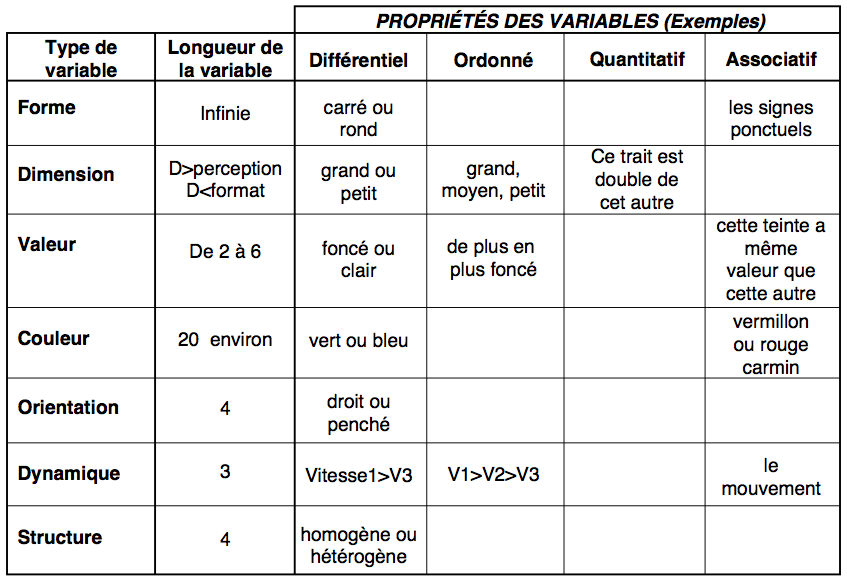{height="430" fig-alt="Table of the properties of visual variables: differential, ordered, quantitative, associative (in French)"}
:::
:::

## Quantifying: the radius trap {.socle}

::: {.fiche n="3.4" etat="a-revoir"}
Intention : A proportional symbol is proportional by its area, not its radius: if the radius doubles, the area quadruples. [new]
Experience : two maps side by side, radius-proportional and area-proportional; question: which one exaggerates? Computed values.
Request :
:::

:::: {.columns}
::: {.column width="50%"}
::: {.schema fichier="images/schemas/en/cercles-rayon.svg" hauteur="280"}
:::
[A. Radius proportional to the value]{.legende}
:::
::: {.column width="50%"}
::: {.schema fichier="images/schemas/en/stock-cercles.svg" hauteur="280"}
:::
[B. Area proportional to the value]{.legende}
:::
::::

::: {.qcm .serre}
Both maps show the same clear-cut areas. Which one exaggerates the high values?

- [x] A, radius proportional
    - Yes. Between 245 ha and 25 ha, the circle's area is multiplied by 96 instead of 9.8: the eye compares areas.
- [ ] B, area proportional
    - No: that is the rule. The circle's area follows the value.
:::

## Too small, too large {.appui}

::: {.fiche n="3.5" etat="a-revoir"}
Intention : Symbol scaling: too small, nothing shows; too large, they overlap and hide the base map. There is a right setting. [PPT 38]
Experience : slider: vary the scale factor of the circles on a map, from too small to too large; bonus: the example from the old deck
Request :
:::

::: {.curseur min="0.2" max="3" pas="0.05" valeur="0.3" unite="×" etiquette="Circle scale" schema="images/schemas/en/cercles-echelle.svg" hauteur="380"}
:::

Too small, the circles disappear; too large, they overlap and hide the territory. Look for the setting where the largest circle stays within its municipality, or nearly.

::: {.plus titre="Too small, too large, the right choice"}
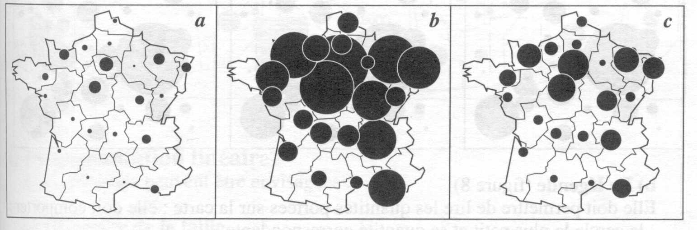{fig-alt="Three maps of France in proportional circles: too small, too large, the right choice"}

[Source: É. Blin and J.-P. Bord, *Initiation géo-graphique*]{.legende}
:::

## Ordering: how many steps? {.socle}

::: {.fiche n="3.6" etat="a-revoir"}
Intention : Value (light to dark) orders, but the eye only tells a limited number of steps apart: about 2 in yellow, 3 in green, 4 in blue or orange, 5 in red or purple, 6 in grey (notes of the old deck). [PPT 15, notes]
Experience : seven steps in five hues; question: in which hue can you tell them all apart?
Request :
:::

:::: {.columns}
::: {.column width="62%"}
::: {.schema fichier="images/schemas/en/paliers.svg" hauteur="330"}
:::
:::
::: {.column width="38%"}
**Value**, from light to dark, orders. But the eye only tells a few steps apart.

::: {.question}
Each band has seven steps. **In which hue can you tell them all apart?**
:::

::: {.reponse}
Usually, in grey only. About 2 steps can be read in yellow, 3 in green, 4 in blue or orange, 5 in red or purple, 6 in grey.
:::
:::
::::

## Differentiating is not ordering {.socle}

::: {.fiche n="3.7" etat="a-revoir"}
Intention : Colour (hue) differentiates, it does not order: a rainbow palette on ordered data blurs the reading. The same map in rainbow and in a value gradient. [PPT 22, 37]
Experience : compare: slider between the two versions; question: in the rainbow, is green more or less than yellow?
Request :
:::

:::: {.columns}
::: {.column width="62%"}
::: {.comparer}
- 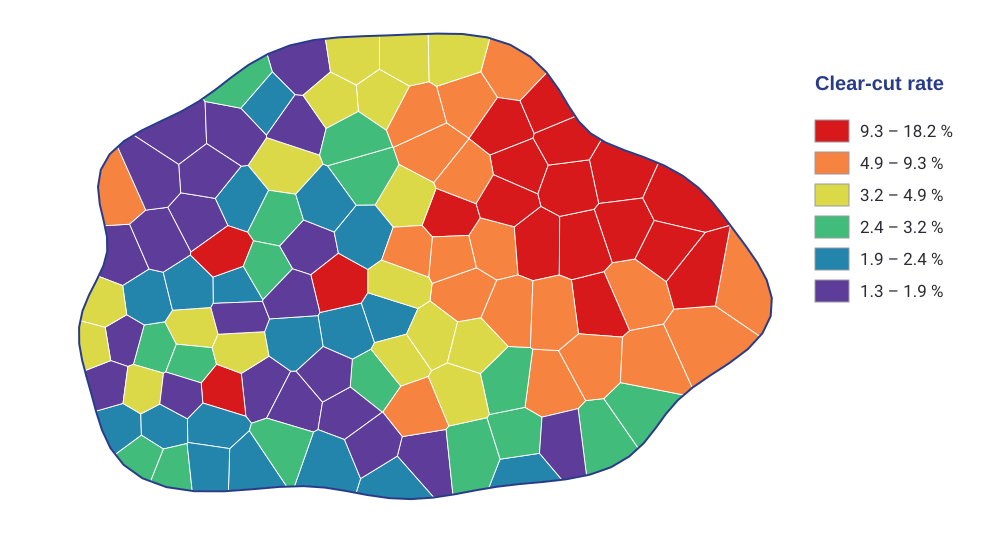
- 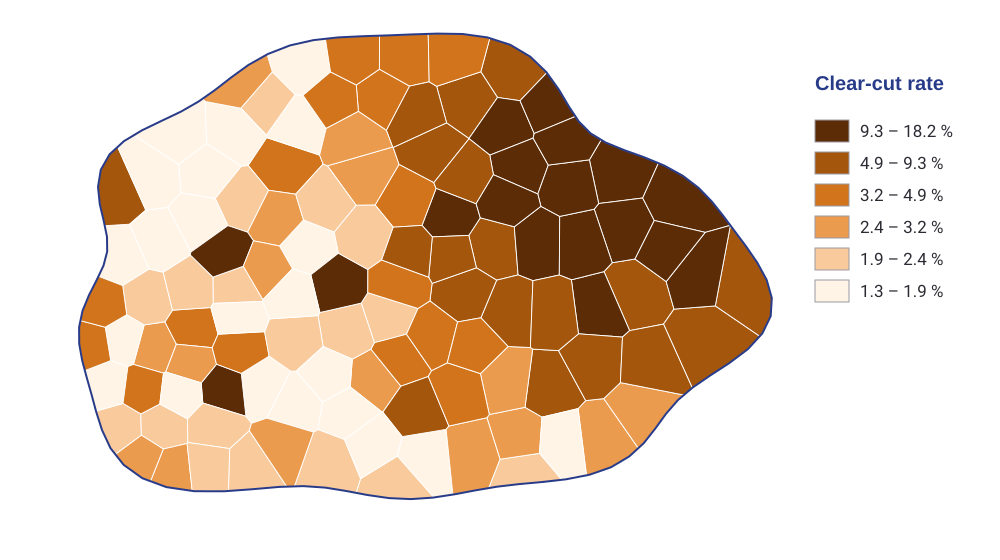
:::
:::
::: {.column width="38%"}
::: {.question}
On the rainbow map, without reading the legend: **is green more or less than yellow?**
:::

::: {.reponse}
Impossible without the legend: hues have no order. In a gradient, the darkest is the highest, and the hotspot leaps out.
:::

[Ordered data calls for an ordered variable: value.]{.a-retenir}
:::
::::

## Orientation, texture, dynamics {.veille}

::: {.fiche n="3.8" etat="a-revoir"}
Intention : Three less common variables: orientation (3 or 4 steps for a point), texture (patterns), dynamics (blinking, changing, moving, on screen, sparingly). [PPT 20, 21, 34, 35, 36]
Experience : scroll through three examples, including the animated map of the 1960 US election
Request :
:::

:::: {.columns}
::: {.column width="38%"}
- **Orientation**: 3 or 4 steps for a point (0°, 45°, 90°, 135°), 2 for a line.
- **Texture**: patterns that differentiate areas; some vibrate, others read well.
- **Dynamics**, on screen only: blinking, changing, moving. Use sparingly: movement must not lose the reader.
:::
::: {.column width="62%"}
::: {.defiler commande="haut"}
- 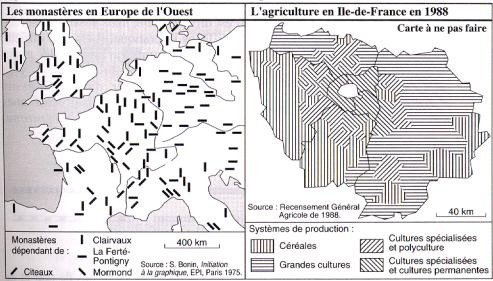
- 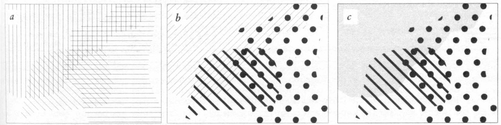
- 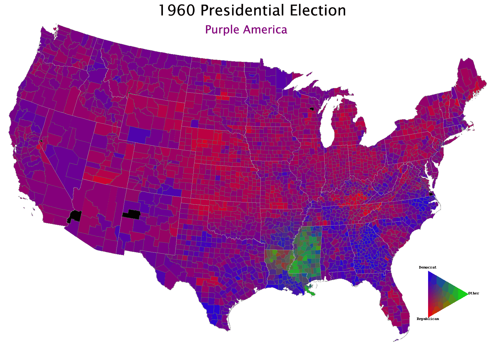
:::
:::
::::

## Colour {.intercalaire}

::: {.fiche n="4.0" etat="a-revoir"}
Intention : A sensation, ways of producing it, codes. [PPT 22]
Experience : none
Request :
:::

A sensation, ways of producing it, codes.

## Hue, saturation, value {.appui}

::: {.fiche n="4.1" etat="a-revoir"}
Intention : Additive (RGB, the screen) and subtractive (CMYK, print) synthesis; a conversion changes colours. The HSL or HSV model: hue, saturation, value. The colour solid in 3D, animated (Marc's request), with the original views as a bonus. [PPT 23, 24, 25, 26]
Experience : the colour solid rotates; three sliders (hue, saturation, value) move the chosen cube ("couleur3d" brick); question: why does a printed map look duller than on screen?
Request :
:::

::: {.couleur3d style="--hauteur-couleur: 300px"}
:::

:::: {.columns}
::: {.column width="50%"}
::: {.question}
**Why does a printed map look duller than on screen?**
:::
:::
::: {.column width="50%"}
::: {.reponse}
A screen adds up lights (RGB); a printer layers inks that hold some back (CMYK). The most vivid screen colours do not exist in ink.
:::
:::
::::

::: {.plus titre="The colour solid"}
:::: {.columns}
::: {.column width="50%"}
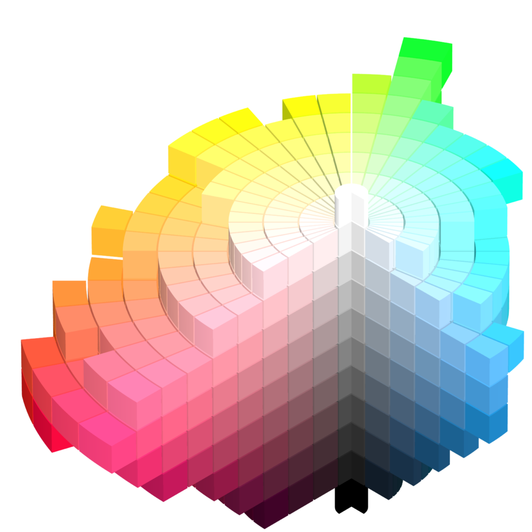{height="380" fig-alt="Cross-section of the colour solid"}
:::
::: {.column width="50%"}
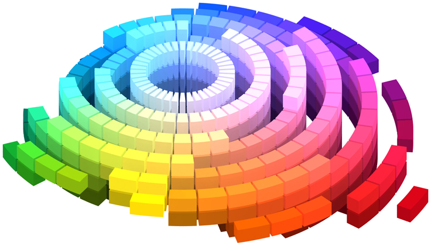{fig-alt="The rings of the colour solid"}

**Hue** turns around the axis, **saturation** moves away from the axis, **value** rises from black to white.
:::
::::
:::

## Codes to respect {.socle}

::: {.fiche n="4.2" etat="a-revoir"}
Intention : Warm and cool colours; conventional codes (water in blue, forest in green, red for danger); codes that change across cultures and trades; harmony and contrast. [PPT 30, 31, 32, 33]
Experience : sort colours into the themes they evoke; question: a forest map in red, what does the reader understand?
Request :
:::

:::: {.columns}
::: {.column width="55%"}
**Warm** colours advance and catch the eye; **cool** colours recede. Readers come with **codes**: water in blue, forest in green, danger in red. These codes vary across cultures (white for mourning in Asia) and trades.

::: {.classer}
### Water

- Blue

### Vegetation

- Green

### Danger, alert

- Red

### Relief

- Bistre
:::
:::
::: {.column width="45%"}
::: {.question}
A map of French forests colours the massifs bright red. **What does the reader understand?**
:::

::: {.reponse}
That something is wrong: a fire, a danger, an alert. Against the code, you fight the reader at every glance. Unless it is intended: red can say precisely that a forest is in danger.
:::
:::
::::

## A map for every eye {.appui}

::: {.fiche n="4.3" etat="a-revoir"}
Intention : A notable share of men do not tell red from green well: a red–green palette loses its message. Choose palettes that hold up. [new]
Experience : compare: the same map seen normally and seen by a deuteranope eye (Machado simulation, 2009)
Request :
:::

:::: {.columns}
::: {.column width="62%"}
::: {.comparer}
- 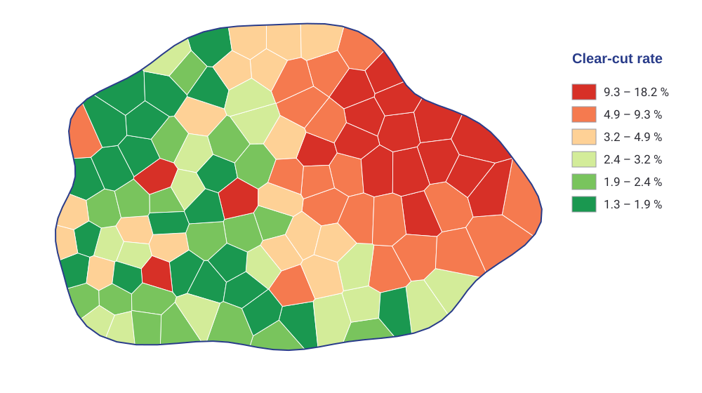
- 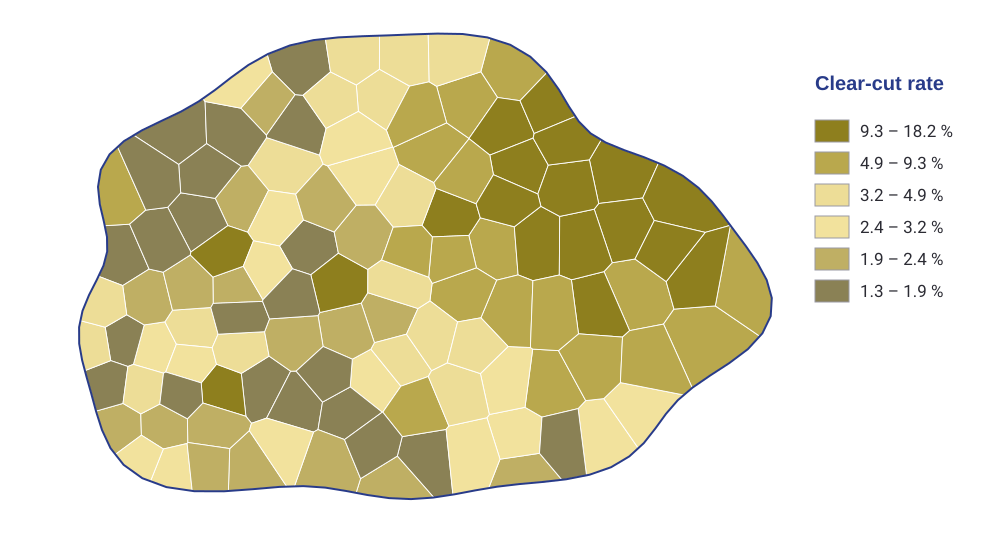
:::
:::
::: {.column width="38%"}
About **one man in twelve** and one woman in two hundred, in Europe, have trouble telling red from green.

Drag the slider: with a red–green palette, the low and high classes merge. The map says the opposite of what it means.

[Prefer a value gradient, or a blue–red diverging palette.]{.a-retenir}
:::
::::

## The consequences of choices {.intercalaire}

::: {.fiche n="5.0" etat="a-revoir"}
Intention : The same data can say different things: the heart of the course. [new]
Experience : none
Request :
:::

The same data can say very different things.

## Which variable for which data? {.socle}

::: {.fiche n="5.1" etat="a-revoir"}
Intention : The data drives the variable: qualitative (differentiate: shape, colour), ordered (value), quantitative stock (size), rate (value, in classes). The example maps from the old deck and the Hurricane Irma map are used here. [PPT 39 to 43]
Experience : sort six forest datasets by variable; bonus: the example maps in a scroll
Request :
:::

The **data** drives the **variable**. Sort each dataset by the variable that represents it best.

::: {.classer}
### Colour or shape

- The dominant species of each stand
- The type of forest track

### Value

- The age class of the stands
- The forest cover rate of each municipality

### Size

- The standing timber volume per municipality
- The burnt area of each fire
:::

::: {.plus titre="Example maps: what else could have been chosen?"}
::: {.defiler commande="haut"}
- 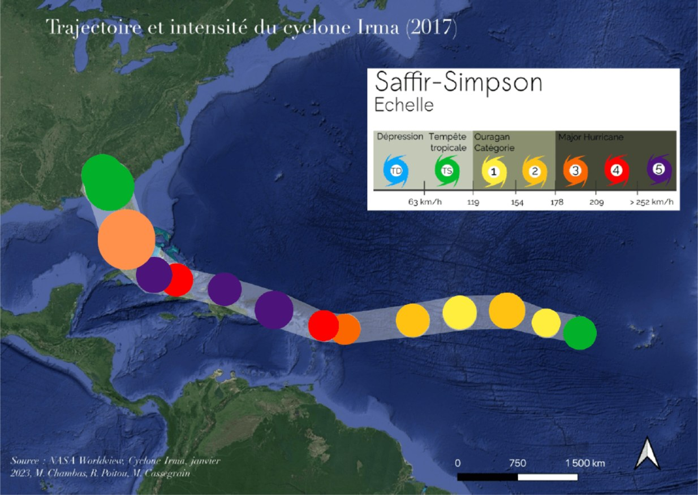
- 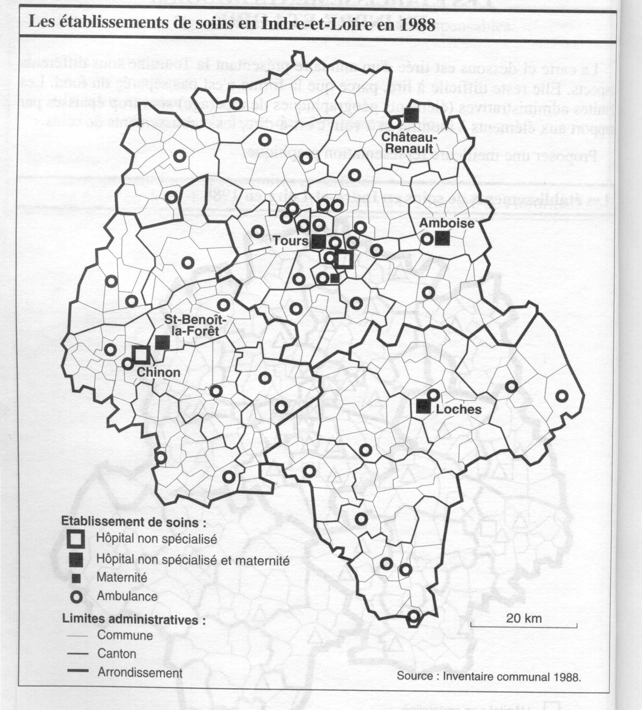
- 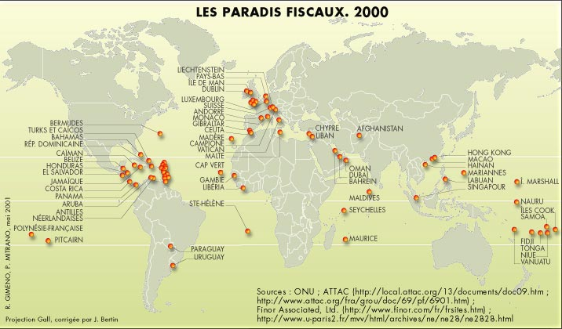
- 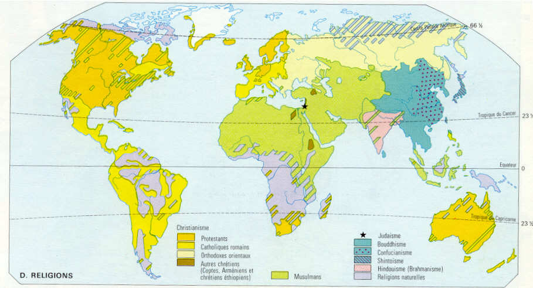
- 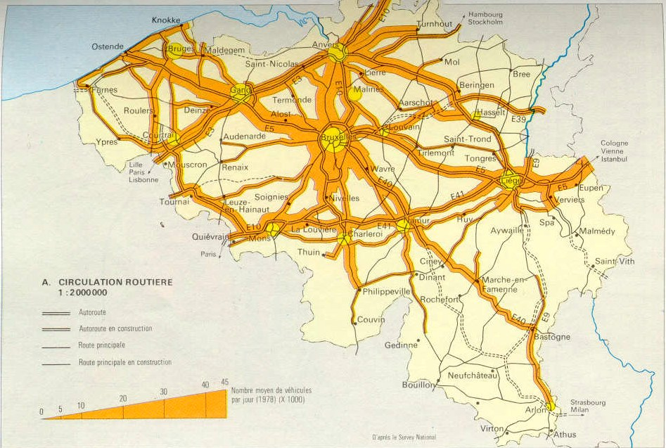
:::
:::

## Stock or rate? {.socle}

::: {.fiche n="5.2" etat="a-revoir"}
Intention : The most common mistake: a stock (a population, a clear-cut area) as a colour fill. Large municipalities look the strongest because they are large. A stock is shown with proportional symbols, a rate with fills. [new]
Experience : the same data as fills and as circles; multiple choice: which is right? Bonus: the map of US counties
Request :
:::

:::: {.columns}
::: {.column width="50%"}
::: {.schema fichier="images/schemas/en/stock-aplats.svg" hauteur="260"}
:::
[A. Clear-cut area as fills]{.legende}
:::
::: {.column width="50%"}
::: {.schema fichier="images/schemas/en/stock-cercles.svg" hauteur="260"}
:::
[B. The same data as circles]{.legende}
:::
::::

::: {.qcm .serre}
A clear-cut area, in hectares, is a **stock**. Which map is right?

- [ ] A, the fills
    - No: as a fill, a large municipality looks strong because it is large. A fill needs a rate: the share of the forest that was cut.
- [x] B, the circles
    - Yes: a stock is shown by size, a rate by value.
:::

::: {.plus titre="Land does not vote"}
:::: {.columns}
::: {.column width="60%"}
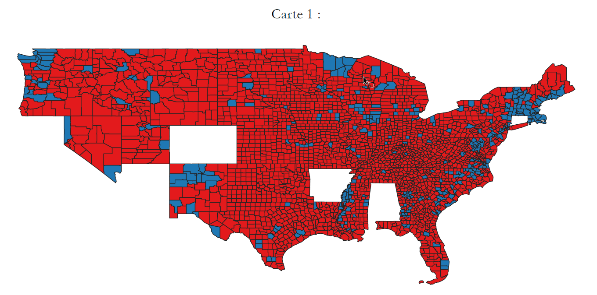{fig-alt="Results of a US election by county, as fills"}
:::
::: {.column width="40%"}
The results of a US election, county by county, as fills. The colour that dominates the map is that of the largest counties, not that of the most voters. The same trap as map A.
:::
::::
:::

## One dataset, several maps {.socle}

::: {.fiche n="5.3" etat="a-revoir"}
Intention : Classification: the choice of method (equal intervals, quantiles, natural breaks) and of the number of classes changes the map's message. The central activity of the course. First version on a fictional territory; the Vosges clear-cut map from the practical will replace it. [new]
Experience : live map ("atelier" brick): the student changes the method, the number of classes and the palette; the map recolours and the histogram shows the breaks
Request :
:::

Change the method, the number of classes, the palette: the histogram shows where the breaks fall.

::: {.atelier donnees="donnees/territoire.json" variable="taux" unite="%" methode="egales" classes="5" palette="sequentielle" style="--hauteur-atelier: 370px"}
[Fictional territory and data, simulated for this course. Rate = clear-cut area / forest area.]{.legende}
:::

## Making a map lie {.appui}

::: {.fiche n="5.4" etat="a-revoir"}
Intention : By changing the classification only, a problem appears or disappears. Mark Monmonier, *How to Lie with Maps*. The cartographer is responsible for the message. [new]
Experience : a map where only the classification method changes (Marc's request); question: which map worries, which reassures?
Request :
:::

Same data, same colours, same number of classes: only the **method** changes.

::: {.atelier donnees="donnees/territoire.json" variable="taux" unite="%" methode="egales" classes="5" palette="sequentielle" reglages="methode" histogramme="non" style="--hauteur-atelier: 290px"}
:::

:::: {.columns}
::: {.column width="35%"}
::: {.question}
**Which method worries, which reassures?**
:::
:::
::: {.column width="65%"}
::: {.reponse}
Equal intervals: 72 of the 110 municipalities in light, all looks under control. Quantiles: 44 in dark, all looks affected. Neither is false: the cartographer chooses, and must say so (Monmonier, 1991).
:::
:::
::::

## The cartographic project {.appui}

::: {.fiche n="5.5" etat="a-revoir"}
Intention : Structuring the message: an overall reading, then a detailed reading; topographic, thematic maps; analysis, synthesis maps. [PPT 44] Maps by Marc and students: Hong Kong (topographic and thematic), the Les Saintes wind farm (analysis), submarine forces in the Indo-Pacific and Pacific seabed (synthesis); the Réunion map for the overall reading.
Experience : scroll through the four maps; sort each by type
Request :
:::

:::: {.columns}
::: {.column width="58%"}
::: {.defiler commande="haut"}
- 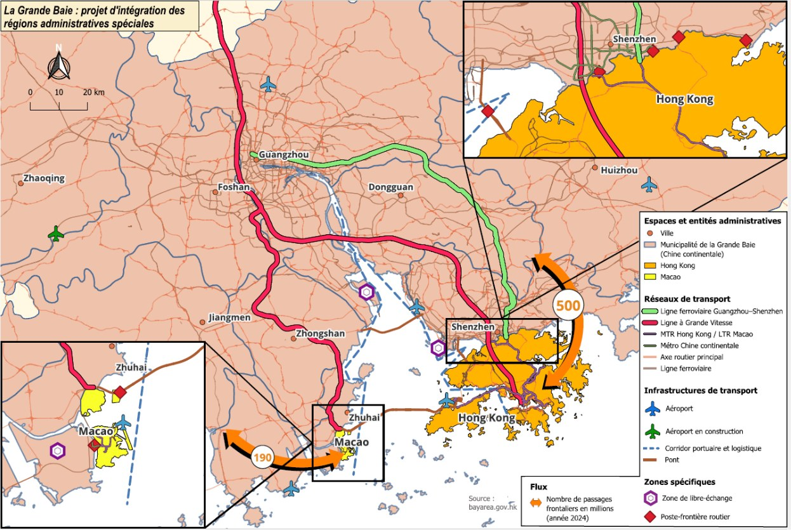
- 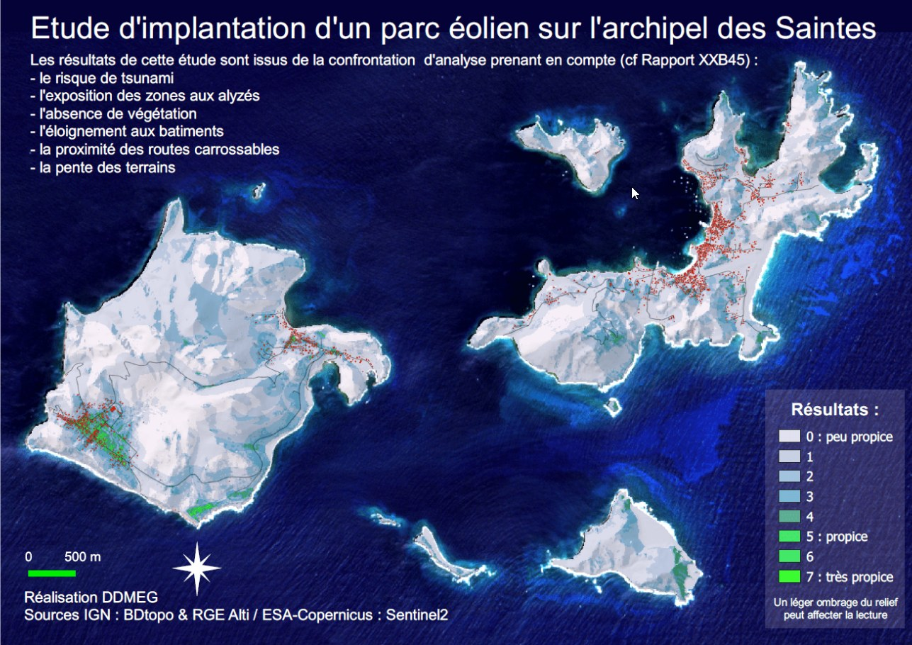
- 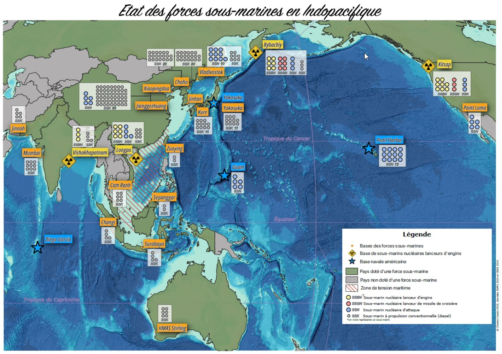
- 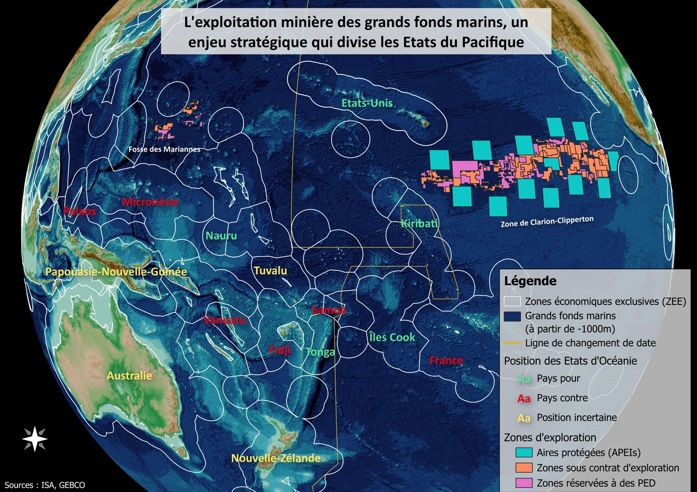
:::
:::
::: {.column width="42%"}
A map is read in two stages: an **overall reading**, at a glance (the Réunion map on the cover), then a **detailed reading**. It can **inventory**, **analyse** a question, or offer a **synthesis**.

::: {.classer}
### Topographic and thematic

- 1. Hong Kong

### Analysis

- 2. Les Saintes

### Synthesis

- 3. The Indo-Pacific
- 4. The seabed
:::
:::
::::

## Layout {.intercalaire}

::: {.fiche n="6.0" etat="a-revoir"}
Intention : Organising what surrounds the map. [PPT 45]
Experience : none
Request :
:::

Organising what surrounds the map.

## What a map carries {.socle}

::: {.fiche n="6.1" etat="a-revoir"}
Intention : Title, legend, scale, source and date, author; orientation when it is not obvious to all; optional elements (grid, declination…). [PPT 50, 51, 52, 56] Alice Jouanjan's 2030 Olympics map (M2 Geopolitics): the scale is missing.
Experience : clickable zones on the map: find the title, the legend, the orientation, the author and the source; question: which element is missing?
Request :
:::

:::: {.columns}
::: {.column width="40%"}
::: {.zones image="images/jo-2030.jpg" alt="Map of snow forecasts for the 2030 Winter Olympics resorts" hauteur="430"}
- [x] 0,93,68,7 : The title: it gives the theme, the place and the date.
- [x] 52,84,44,10 : The legend.
- [x] 94,0,6,5 : The orientation: a north arrow.
- [x] 70,94,30,6 : The author, the date and the data source.
- [ ] 20,35,40,30 : This is the map itself. Look around it.
:::
:::
::: {.column width="60%"}
A published map carries:

- a **title**: the theme, the place, the date;
- a **legend** and a **scale**;
- the **source**, the **date**, the **author**;
- the **orientation**, if it is not obvious.

Find them on the map.

::: {.question}
**Which element is missing from this map?**
:::

::: {.reponse}
The scale: are the venues 10 or 100 km apart?
:::
:::
::::

## Ranking and grouping {.appui}

::: {.fiche n="6.2" etat="a-revoir"}
Intention : List the elements, rank them by importance, group them into blocks, limit their number; balance, alignment, symmetry, golden ratio. [PPT 46, 47, 48, 49]
Experience : multiple choice on four drawn layouts (which one is balanced?); bonus: two successful student layouts
Request :
:::

::: {.schema fichier="images/schemas/en/mises-en-page.svg" hauteur="200"}
:::

:::: {.columns}
::: {.column width="50%"}
1. **List** the elements.
2. **Rank** them by importance.
3. **Group** elements of the same kind into blocks, and **limit** their number.
4. **Balance** and align the blocks.
:::
::: {.column width="50%"}
::: {.qcm .serre}
Which layout is balanced?

- [x] A
    - Yes: a title at the top, the map at the centre of gravity, an aligned legend, the scale and source at the foot.
- [ ] B
    - No: scattered blocks, the title lost at the bottom.
- [ ] C
    - No: too many blocks, the map is hemmed in.
- [ ] D
    - No: the map, the main object, is too small.
:::
:::
::::

::: {.plus titre="Two student layouts"}
:::: {.columns}
::: {.column width="50%"}
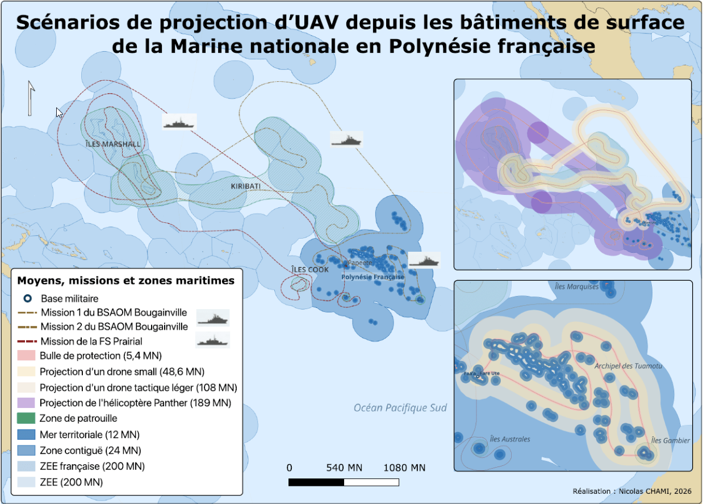{fig-alt="Map of UAV deployment scenarios in French Polynesia"}
:::
::: {.column width="50%"}
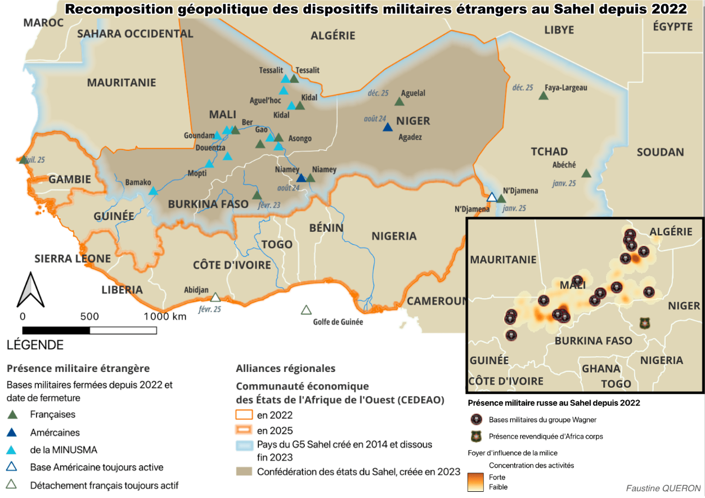{fig-alt="Map of the reorganisation of military deployments in the Sahel"}
:::
::::
Insets that each have a role, a legend structured by theme, a title that says it all.
:::

## The legend {.socle}

::: {.fiche n="6.3" etat="a-revoir"}
Intention : Group by theme, give the unit, symbols the same size as on the map, a continuous reading from maximum to minimum; one legend per implantation. [PPT 53, 54, 55]
Experience : put a jumbled class legend back in order
Request :
:::

:::: {.columns}
::: {.column width="50%"}
The **legend** decodes the message:

- group elements of the same kind, under a heading;
- give the **unit**;
- draw symbols **at the same size** as on the map;
- read in one go, from **highest to lowest**, usually top to bottom;
- separate the implantations: points, lines, areas.
:::
::: {.column width="50%"}
::: {.ordre}
Put this legend back in reading order, from top to bottom.

1. Clear-cut rate (%)
2. 9.3 – 18.2
3. 4.9 – 9.3
4. 3.2 – 4.9
5. 1.3 – 3.2
:::
:::
::::

## Two finished maps

::: {.fiche n="6.4" etat="a-revoir"}
Intention : Two finished student maps: the whole course applied. No level label. Waiting for the "before" version of the Sahel map, for a real before / after. [student maps]
Experience : scroll through the two maps; question: name three choices that make the map readable
Request :
:::

:::: {.columns}
::: {.column width="62%"}
::: {.defiler commande="haut"}
- 
- 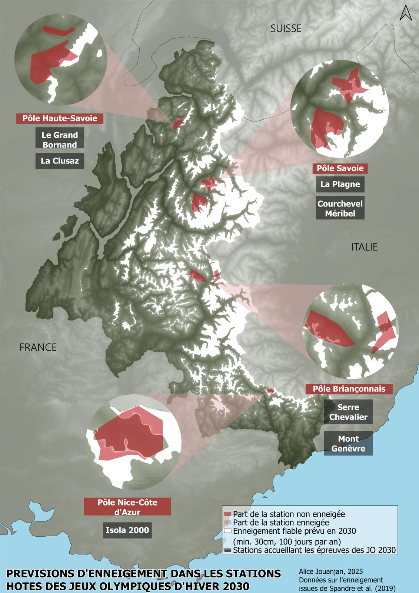
:::
:::
::: {.column width="38%"}
::: {.question}
**Name three choices that make these maps readable.**
:::

::: {.reponse}
For example: a title giving the theme, the place and the date; a quiet base map that lets the theme stand out; a legend grouped by theme; insets that enlarge what matters; few colours, each with a meaning.
:::
:::
::::

## Key points

::: {.fiche n="7.1" etat="a-revoir"}
Intention : The core slides, in one list; and the sentence from the old deck: do not tire the reader, look for visual effects that help reading. [PPT 57]
Experience : links to each slide
Request :
:::

::: {.carte-du-cours niveaux="socle"}
:::

[Do not tire the reader; look for visual effects that help reading.]{.a-retenir}

## Your turn {.fin}

::: {.fiche n="7.2" etat="a-revoir"}
Intention : The bridge to the cartography practical: laying out one's map in QGIS.
Experience : none
Request :
:::

Over to the practical: your map of clear-cuts in the Vosges, from classification to layout.

## Sources and credits {.petit}

::: {.fiche n="7.3" etat="a-revoir"}
Intention : Bertin, Béguin and Pumain, Blin and Bord, Monmonier; the maps by Marc and the students, with their consent. [new]
Experience : none
Request :
:::

:::: {.columns}
::: {.column width="50%"}
| Document | Origin |
|---|---|
| Graphic semiology | Jacques Bertin, *Sémiologie graphique*, 1967 |
| Definition of semiology | M. Béguin and D. Pumain, *La représentation des données géographiques* |
| Examples, thresholds, patterns | É. Blin and J.-P. Bord, *Initiation géo-graphique*, 1995 |
| Making a map lie | M. Monmonier, *How to Lie with Maps*, University of Chicago Press, 1991 |
| Adelson's checkerboard | Edward H. Adelson, 1995 |
| Colour-blindness simulation | G. Machado *et al.*, 2009 |
| Fictional territory | data simulated for this course |
:::
::: {.column width="50%"}
| Document | Origin |
|---|---|
| Réunion, CORINE Land Cover; Santa Claus | Marc Poupée |
| 2030 Olympics | Alice Jouanjan, M2 Geopolitics, 2025 |
| Other student maps | M2 Geopolitics students, to be completed |
| Gaza, Irma, USA, circular flows | to be completed |
| 1960 election, orientation, patterns, examples | old deck, to be completed |
| Colour solid | old deck, to be completed |
| Diagrams and live map | made for this course |
:::
::::
