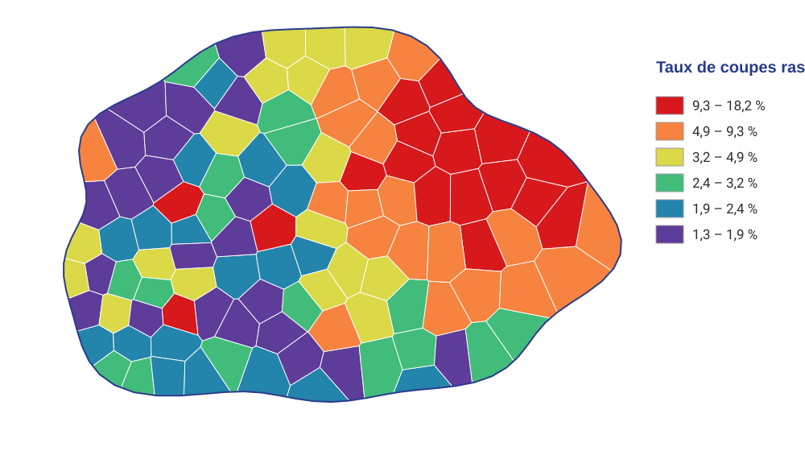
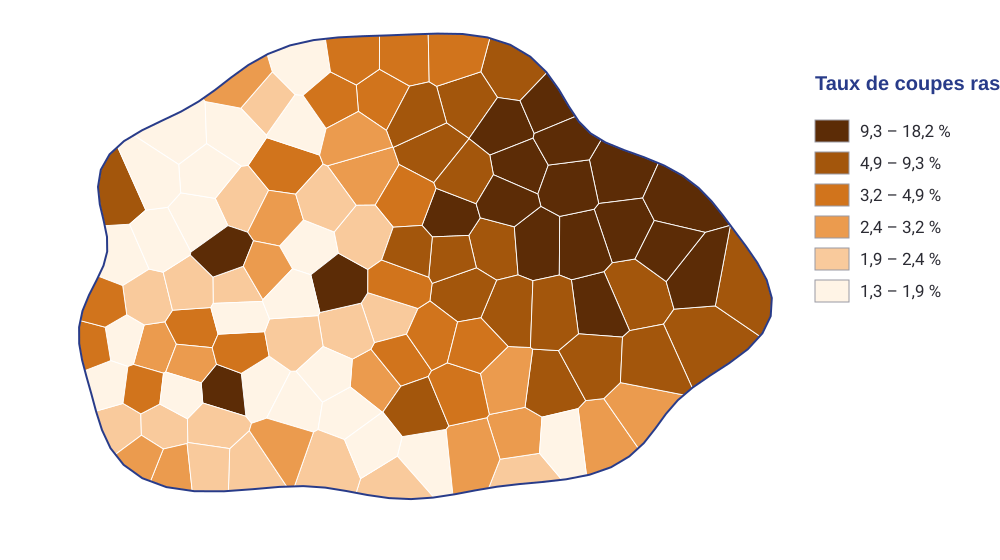
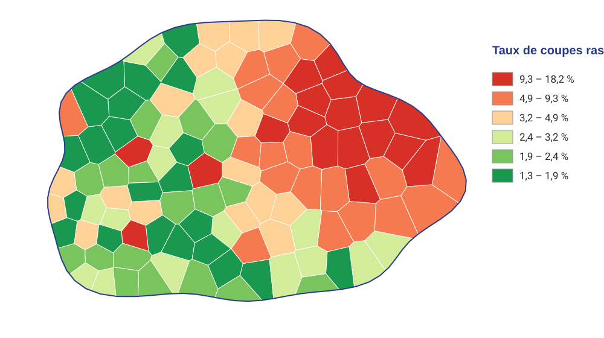
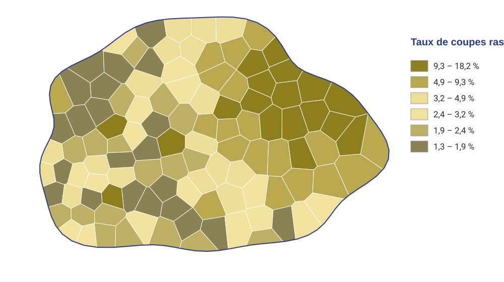

::: {.fiche n="0.1" etat="a-revoir"}
Intention : Couverture. Une carte forte en image de fond, plutôt une carte de Marc ou d'étudiant. [PPT 1, 2] [Utlisation de la Carte MAP-CLC]
Expérience : aucune
Demande :
Note : C'est une carte dont je suis l'auteur et qui est devenu assez iconique dans les visuels IGN.
:::

## Comment lire ce support

::: {.fiche n="0.2" etat="a-revoir"}
Intention : Le mode d'emploi commun (niveaux, exercices, bonus), sans le système de révision. Ici, presque chaque diapo demande d'essayer avant de lire. Remerciement aux étudiants du M2 Géopolitique, auteurs de plusieurs cartes, produites en une semaine d'enseignement de cartographie. [nouvelle]
Expérience : aucune
Demande :
:::

Ce cours se pratique plus qu'il ne se lit : presque chaque diapo vous demande d'**essayer avant de lire**. Changez un réglage, regardez la carte changer.

- Le **pictogramme** devant chaque titre donne le niveau : **socle**, à maîtriser ; **appui**, pour consolider ; **veille**, pour aller plus loin. Une diapo sans pictogramme est un exemple.
- Les **exercices** : répondez d'abord, puis cliquez.
- Le bouton **+** en haut à droite ouvre un bonus « Pour aller plus loin ».

[Merci aux étudiants du M2 Géopolitique : plusieurs cartes de ce cours sont les leurs, réalisées après une seule semaine d'enseignement de la cartographie.]{.a-retenir}

## Ce que vous saurez faire

::: {.fiche n="0.3" etat="a-revoir"}
Intention : Choisir la bonne variable visuelle pour une donnée ; anticiper ce qu'un choix (classes, couleurs, tailles) fait dire à la carte ; mettre en page une carte lisible. [PPT 3]
Expérience : aucune
Demande :
:::

À la fin de ce cours, vous saurez :

1. **choisir** la variable visuelle qui convient à une donnée ;
2. **anticiper** ce qu'un choix de classes, de couleurs ou de tailles fait dire à la carte ;
3. **mettre en page** une carte que l'on comprend du premier coup d'œil.

[Toute carte est une suite de choix. Chacun change le message.]{.a-retenir}

## Carte du cours

::: {.fiche n="0.4" etat="a-revoir"}
Intention : Les six parties et la légende S / A / V.
Expérience : liens vers chaque diapo
Demande :
:::

::: {.carte-du-cours}
:::

## Une carte est un message {.intercalaire}

::: {.fiche n="1.0" etat="a-revoir"}
Intention : Rédiger la carte, puis la mettre en page. [PPT 3, 4]
Expérience : aucune
Demande :
:::

Rédiger la carte, puis la mettre en page.

## Cinq secondes

::: {.fiche n="1.1" etat="a-revoir"}
Intention : Ouverture par l'expérience : on montre une carte cinq secondes, puis on la cache ; qu'en a-t-on retenu ? Une bonne carte passe ce test, une carte de travail non. [nouvelle] Les pérégrinations du père Noël (Marc), et une carte de travail sur Gaza.
Expérience : l'image s'efface d'elle-même après 5 s (brique « flash ») ; question : quel était le message ?
Demande :
:::

Chaque carte ne s'affiche que cinq secondes. Regardez, puis dites ce que vous en avez retenu.

:::: {.columns}
::: {.column width="50%"}
::: {.flash duree="5"}
{height="250" fig-alt="Carte : les pérégrinations du père Noël"}
:::
:::
::: {.column width="50%"}
::: {.flash duree="5"}
{height="250" fig-alt="Carte de travail : perte de végétation dans la bande de Gaza"}
:::
:::
::::

:::: {.columns}
::: {.column width="35%"}
::: {.question}
**Quel était le message de chaque carte ?**
:::
:::
::: {.column width="65%"}
::: {.reponse}
À gauche, le parcours d'une légende, de saint Nicolas au père Noël : compris en cinq secondes. À droite, une carte de travail sans titre : des taches rouges, mais quoi ? Il faut lire la légende.
:::
:::
::::

## Rédiger, mettre en page {.socle}

::: {.fiche n="1.2" etat="a-revoir"}
Intention : La rédaction cartographique (représenter l'information elle-même) et la mise en page (organiser les blocs autour : titre, légende, échelle…). [PPT 3]
Expérience : classer huit décisions en « rédaction » ou « mise en page »
Demande :
:::

Faire une carte, c'est deux métiers :

- la **rédaction cartographique** : représenter l'information elle-même, sur la carte ;
- la **mise en page** : organiser autour d'elle les blocs qui permettent de la lire.

::: {.classer}
### Rédaction

- Choisir la variable visuelle
- Fixer les classes
- Choisir les couleurs des aplats
- Régler la taille des symboles

### Mise en page

- Écrire le titre
- Placer la légende
- Placer l'échelle et la source
- Équilibrer les blocs sur la page
:::

## Voir, puis comprendre {.socle}

::: {.fiche n="1.3" etat="a-revoir"}
Intention : La sémiologie, « ensemble des règles qui permettent l'utilisation d'un système graphique de signes pour la transmission d'une information » (Béguin et Pumain). Compréhension graphique (voir, le signifiant) et compréhension mentale (regarder, le signifié). Les quatre diapos de texte d'origine tiennent en une. [PPT 9, 10, 11, 12]
Expérience : question sur une figure spectaculaire et difficile à lire (le graphe circulaire de flux)
Demande :
:::

:::: {.columns}
::: {.column width="55%"}
La **sémiologie graphique** : « l'ensemble des règles qui permettent l'utilisation d'un système graphique de signes pour la transmission d'une information » (Béguin et Pumain).

Lire une carte, c'est d'abord **voir** (les formes, les couleurs), puis **comprendre** (le message).

::: {.question}
Cette figure se **voit** très bien. **Que comprenez-vous ?**
:::

::: {.reponse}
Pas grand-chose sans lire le texte : des flux ferroviaires entre comtés de Floride. L'image frappe, le message ne passe pas.
:::
:::
::: {.column width="45%"}
::: {.centre}
{height="430" fig-alt="Graphe circulaire de flux entre des comtés"}
:::
:::
::::

## Ce que l'œil peut voir {.intercalaire}

::: {.fiche n="2.0" etat="a-revoir"}
Intention : Les contraintes de l'utilisateur et du support. [PPT 5]
Expérience : aucune
Demande :
:::

Les contraintes de l'œil, et du support.

## Les seuils de perception {.appui}

::: {.fiche n="2.1" etat="a-revoir"}
Intention : À 30 cm, l'œil discrimine environ 0,1 mm ; un point doit faire au moins 0,2 mm, un trait 0,1 mm ; séparer deux traits, différencier deux tailles. Les quatre diapos de chiffres deviennent une expérience. [PPT 6, 7, 8]
Expérience : curseur : on affine un trait et un point jusqu'à ce qu'ils disparaissent à l'écran ; on lit leur taille sur papier
Demande :
:::

::: {.curseur min="0.02" max="0.6" pas="0.01" valeur="0.3" unite="mm" etiquette="Épaisseur du trait sur papier" schema="images/schemas/seuils.svg" hauteur="200"}
- Le point fait `{2*x|2}` mm de diamètre ; le trait vaut `{x/0.1|1}` fois le seuil de 0,1 mm
:::

À 30 cm, l'œil distingue un détail d'environ **0,1 mm**. En dessous, un trait disparaît ; un point doit faire au moins **0,2 mm**. Pour séparer deux traits voisins, ou distinguer deux tailles, il faut encore un écart suffisant.

[L'écran n'est pas le papier : l'expérience donne un ordre de grandeur. Imprimez votre carte pour vérifier.]{.legende}

## La taille est relative {.appui}

::: {.fiche n="2.2" etat="a-revoir"}
Intention : L'illusion d'Ebbinghaus : un même cercle paraît plus petit entouré de grands cercles. Conséquence : sur une carte en symboles proportionnels, le voisinage trompe l'œil. [PPT 19]
Expérience : curseur : régler le cercle de droite pour qu'il paraisse égal à celui de gauche, puis la réponse révèle l'écart
Demande :
:::

::: {.curseur min="12" max="50" pas="1" valeur="42" unite="" etiquette="Taille du cercle orange de droite" schema="images/schemas/ebbinghaus.svg" hauteur="230"}
:::

:::: {.columns}
::: {.column width="50%"}
::: {.question}
Réglez le cercle orange de droite pour qu'il **paraisse** égal à celui de gauche.
:::
:::
::: {.column width="50%"}
::: {.reponse}
Le cercle de gauche mesure 30 (le pointillé). On s'arrête souvent en dessous : entouré de grands cercles, un cercle paraît plus petit.
:::
:::
::::

## Une couleur ne vit pas seule {.appui}

::: {.fiche n="2.3" etat="a-revoir"}
Intention : L'échiquier d'Adelson : deux cases de même gris paraissent différentes. Le contraste simultané : une couleur change avec son voisinage. Conséquence : un aplat ne se lit pas pareil sur toute la carte. [PPT 29, 27, 28]
Expérience : question (A et B sont-elles du même gris ?), puis la réponse relie les deux cases par deux bandes ; curseur : la teinte du fond change, le mot rouge avance, recule, vibre
Demande :
:::

:::: {.columns}
::: {.column width="55%"}
::: {.schema fichier="images/schemas/adelson.svg" hauteur="250"}
:::

::: {.question}
**A est-elle plus foncée que B ?**
:::

::: {.reponse}
Non : le même gris. L'œil corrige l'ombre, et juge chaque case par ses voisines.
:::
:::
::: {.column width="45%"}
::: {.curseur min="0" max="360" pas="1" valeur="90" unite="°" etiquette="Teinte du fond" schema="images/schemas/un-mot.svg" hauteur="160"}
:::

Le mot rouge ne change pas. Selon le fond, il **avance**, **recule** ou **vibre**.

[Une couleur se lit toujours par rapport à ses voisines.]{.a-retenir}
:::
::::

## Les variables visuelles {.intercalaire}

::: {.fiche n="3.0" etat="a-revoir"}
Intention : Le vocabulaire de Bertin : sept variables, trois implantations. [PPT 12, 14]
Expérience : aucune
Demande :
:::

Le vocabulaire de Jacques Bertin.

## Point, ligne, surface {.socle}

::: {.fiche n="3.1" etat="a-revoir"}
Intention : Les trois implantations : le point (seul son centre localise), la ligne (limite ou réseau, continue ou non), la surface. Lien avec les primitives de « GIS : Basics ». [PPT 13]
Expérience : aucune
Demande :
:::

::: {.schema fichier="images/schemas/primitives.svg" hauteur="170"}
:::

- Le **point** : seul son centre localise. Il est qualitatif si sa forme ou sa couleur change, quantitatif si sa taille change.
- La **ligne** : une limite entre deux surfaces, ou le tracé d'un réseau ; continue ou discontinue, pour dire le permanent ou l'intermittent.
- La **surface** : une zone, en aplat, en trame ou en texture.

[Ce sont les primitives de « GIS : Basics », vues par le cartographe : les implantations.]{.legende}

## Sept variables {.socle}

::: {.fiche n="3.2" etat="a-revoir"}
Intention : Forme, taille, orientation, couleur, valeur, structure (grain, trame), dynamisme ; un tableau dessiné croisant variables et implantations, à la place des diapos de texte. [PPT 14, 16, 17, 18, 20, 21, 36]
Expérience : schéma : chaque case du tableau montre la variable dans son implantation
Demande :
:::

:::: {.columns}
::: {.column width="68%"}
::: {.schema fichier="images/schemas/variables.svg" hauteur="440"}
:::
:::
::: {.column width="32%"}
Pour faire varier un signe, on dispose de **sept variables visuelles** : la forme, la taille, l'orientation, la couleur, la valeur, la structure (le grain, la trame)…

… et, à l'écran, le **dynamisme** : clignoter, changer, se déplacer.

[Chaque variable fonctionne dans les trois implantations, mais pas aussi bien.]{.a-retenir}
:::
::::

## Ce que chaque variable sait dire {.socle}

::: {.fiche n="3.3" etat="a-revoir"}
Intention : Différencier, ordonner, quantifier, associer : le tableau des propriétés de l'ancien support. La taille est la seule à quantifier ; la valeur ordonne ; la couleur et la forme différencient. [PPT 15, 37]
Expérience : classer six variables selon ce qu'elles savent dire ; bonus : le tableau complet des propriétés
Demande :
:::

Une variable peut **différencier** (ceci n'est pas cela), **ordonner** (ceci est plus que cela), **quantifier** (ceci est deux fois cela). Rangez chaque variable selon ce qu'elle sait dire de mieux.

::: {.classer}
### Différencier

- La forme
- La couleur (la teinte)
- L'orientation

### Ordonner

- La valeur
- La structure (le grain)

### Quantifier

- La taille
:::

[La taille est la seule variable qui quantifie : un cercle deux fois plus grand dit « deux fois plus ».]{.a-retenir}

::: {.plus titre="Le tableau des propriétés"}
::: {.centre}
{height="430" fig-alt="Tableau des propriétés des variables visuelles : différentiel, ordonné, quantitatif, associatif"}
:::
:::

## Quantifier : le piège du rayon {.socle}

::: {.fiche n="3.4" etat="a-revoir"}
Intention : Un symbole proportionnel est proportionnel par sa surface, pas par son rayon : si le rayon double, la surface quadruple. [nouvelle]
Expérience : deux cartes côte à côte, rayon proportionnel et surface proportionnelle ; question : laquelle exagère ? Valeurs calculées.
Demande :
:::

:::: {.columns}
::: {.column width="50%"}
::: {.schema fichier="images/schemas/cercles-rayon.svg" hauteur="280"}
:::
[A. Rayon proportionnel à la valeur]{.legende}
:::
::: {.column width="50%"}
::: {.schema fichier="images/schemas/stock-cercles.svg" hauteur="280"}
:::
[B. Surface proportionnelle à la valeur]{.legende}
:::
::::

::: {.qcm .serre}
Les deux cartes montrent les mêmes surfaces de coupes rases. Laquelle exagère les fortes valeurs ?

- [x] A, le rayon proportionnel
    - Oui. Entre 245 ha et 25 ha, la surface du cercle est multipliée par 96 au lieu de 9,8 : l'œil compare des surfaces.
- [ ] B, la surface proportionnelle
    - Non : c'est la règle. La surface du cercle suit la valeur.
:::

## Trop petits, trop grands {.appui}

::: {.fiche n="3.5" etat="a-revoir"}
Intention : L'échelle des symboles : trop petits, on ne voit rien ; trop grands, ils se recouvrent et masquent le fond. Il y a un bon réglage. [PPT 38]
Expérience : curseur : on fait varier le facteur d'échelle des cercles sur une carte, du trop petit au trop grand ; bonus : l'exemple de l'ancien support
Demande :
:::

::: {.curseur min="0.2" max="3" pas="0.05" valeur="0.3" unite="×" etiquette="Échelle des cercles" schema="images/schemas/cercles-echelle.svg" hauteur="380"}
:::

Trop petits, les cercles ne se voient plus ; trop grands, ils se recouvrent et cachent le territoire. Cherchez le réglage où le plus grand cercle reste dans sa commune, ou presque.

::: {.plus titre="Trop petits, trop grands, le bon choix"}
{fig-alt="Trois cartes de France en cercles proportionnels : trop petits, trop grands, le bon choix"}

[Source : É. Blin et J.-P. Bord, *Initiation géo-graphique*]{.legende}
:::

## Ordonner : combien de paliers ? {.socle}

::: {.fiche n="3.6" etat="a-revoir"}
Intention : La valeur (du clair au foncé) ordonne, mais l'œil ne distingue qu'un nombre limité de paliers : environ 2 en jaune, 3 en vert, 4 en bleu ou orangé, 5 en rouge ou violet, 6 en gris (notes de l'ancien support). [PPT 15, notes]
Expérience : sept paliers dans cinq teintes ; question : dans quelle teinte les distinguez-vous tous ?
Demande :
:::

:::: {.columns}
::: {.column width="62%"}
::: {.schema fichier="images/schemas/paliers.svg" hauteur="330"}
:::
:::
::: {.column width="38%"}
La **valeur**, du clair au foncé, ordonne. Mais l'œil ne distingue qu'un petit nombre de paliers.

::: {.question}
Chaque bande a sept paliers. **Dans quelle teinte les distinguez-vous tous ?**
:::

::: {.reponse}
Le plus souvent, en gris seulement. On compte environ 2 paliers lisibles en jaune, 3 en vert, 4 en bleu ou en orangé, 5 en rouge ou en violet, 6 en gris.
:::
:::
::::

## Différencier n'est pas ordonner {.socle}

::: {.fiche n="3.7" etat="a-revoir"}
Intention : La couleur (la teinte) différencie, elle n'ordonne pas : une palette arc-en-ciel sur une donnée ordonnée brouille la lecture. La même carte en arc-en-ciel et en dégradé de valeur. [PPT 22, 37]
Expérience : comparer : curseur entre les deux versions ; question : dans l'arc-en-ciel, le vert est-il plus ou moins que le jaune ?
Demande :
:::

:::: {.columns}
::: {.column width="62%"}
::: {.comparer}
- 
- 
:::
:::
::: {.column width="38%"}
::: {.question}
Sur la carte en arc-en-ciel, sans lire la légende : **le vert est-il plus ou moins que le jaune ?**
:::

::: {.reponse}
Impossible sans la légende : les teintes n'ont pas d'ordre. En dégradé, le plus foncé est le plus fort, et le foyer saute aux yeux.
:::

[Une donnée ordonnée demande une variable ordonnée : la valeur.]{.a-retenir}
:::
::::

## Orientation, structure, dynamisme {.veille}

::: {.fiche n="3.8" etat="a-revoir"}
Intention : Trois variables d'usage plus rare : l'orientation (3 ou 4 paliers pour un point), la structure (trames, poncifs), le dynamisme (clignotement, mutation, déplacement, sur écran, avec parcimonie). [PPT 20, 21, 34, 35, 36]
Expérience : défiler trois exemples, dont la carte animée des élections américaines de 1960
Demande :
:::

:::: {.columns}
::: {.column width="38%"}
- L'**orientation** : 3 ou 4 paliers pour un point (0°, 45°, 90°, 135°), 2 pour une ligne.
- La **structure** : des trames qui différencient les surfaces ; certaines vibrent, d'autres se lisent bien.
- Le **dynamisme**, à l'écran seulement : clignoter, changer, se déplacer. À utiliser avec parcimonie : le mouvement ne doit pas perdre le lecteur.
:::
::: {.column width="62%"}
::: {.defiler commande="haut"}
- 
- 
- 
:::
:::
::::

## La couleur {.intercalaire}

::: {.fiche n="4.0" etat="a-revoir"}
Intention : Une sensation, des modes de fabrication, des codes. [PPT 22]
Expérience : aucune
Demande :
:::

Une sensation, des modes de fabrication, des codes.

## Teinte, saturation, valeur {.appui}

::: {.fiche n="4.1" etat="a-revoir"}
Intention : Synthèse additive (RVB, l'écran) et soustractive (CMJN, l'impression) ; une conversion change les couleurs. Le modèle TSL ou TSV : teinte, saturation, valeur. Le solide des couleurs en 3D, animé (demande de Marc), avec les vues d'origine en bonus. [PPT 23, 24, 25, 26]
Expérience : le solide des couleurs tourne ; trois curseurs (teinte, saturation, valeur) déplacent le cube choisi (brique « couleur3d ») ; question : pourquoi la carte imprimée paraît-elle plus terne qu'à l'écran ?
Demande :
:::

::: {.couleur3d style="--hauteur-couleur: 300px"}
:::

:::: {.columns}
::: {.column width="50%"}
::: {.question}
**Pourquoi une carte imprimée paraît-elle plus terne qu'à l'écran ?**
:::
:::
::: {.column width="50%"}
::: {.reponse}
L'écran additionne des lumières (RVB), l'imprimante superpose des encres qui en retiennent (CMJN). Les couleurs les plus vives de l'écran n'existent pas en encre.
:::
:::
::::

::: {.plus titre="Le solide des couleurs"}
:::: {.columns}
::: {.column width="50%"}
{height="380" fig-alt="Solide des couleurs en coupe"}
:::
::: {.column width="50%"}
{fig-alt="Les anneaux du solide des couleurs"}

La **teinte** tourne autour de l'axe, la **saturation** s'éloigne de l'axe, la **valeur** monte du noir au blanc.
:::
::::
:::

## Des codes à respecter {.socle}

::: {.fiche n="4.2" etat="a-revoir"}
Intention : Couleurs chaudes et froides ; codes conventionnels (l'eau en bleu, la forêt en vert, le rouge pour le danger) ; codes qui changent selon les cultures et les métiers ; harmonie et contraste. [PPT 30, 31, 32, 33]
Expérience : classer des couleurs dans les thèmes qu'elles évoquent ; question : une carte de la forêt en rouge, qu'est-ce que le lecteur comprend ?
Demande :
:::

:::: {.columns}
::: {.column width="55%"}
Les couleurs **chaudes** avancent et attirent l'œil ; les **froides** reculent. Le lecteur arrive avec des **codes** : l'eau en bleu, la forêt en vert, le danger en rouge. Ces codes varient selon les cultures (le blanc du deuil en Asie) et les métiers.

::: {.classer}
### L'eau

- Bleu

### La végétation

- Vert

### Le danger, l'alerte

- Rouge

### Le relief

- Bistre
:::
:::
::: {.column width="45%"}
::: {.question}
Une carte de la forêt française colorie les massifs en rouge vif. **Que comprend le lecteur ?**
:::

::: {.reponse}
Qu'il y a un problème : un incendie, un danger, une alerte. Contre le code, il faut se battre avec le lecteur à chaque regard. Sauf si c'est voulu : le rouge peut justement dire une forêt en danger.
:::
:::
::::

## Une carte pour tous les yeux {.appui}

::: {.fiche n="4.3" etat="a-revoir"}
Intention : Une part notable des hommes ne distingue pas bien le rouge du vert : une palette rouge-vert perd son message. Choisir des palettes qui tiennent. [nouvelle]
Expérience : comparer : la même carte vue normalement et vue par un œil deutéranope (simulation de Machado, 2009)
Demande :
:::

:::: {.columns}
::: {.column width="62%"}
::: {.comparer}
- 
- 
:::
:::
::: {.column width="38%"}
Environ **un homme sur douze** et une femme sur deux cents, en Europe, distinguent mal le rouge du vert.

Faites glisser le curseur : avec une palette rouge-vert, les classes faibles et fortes se confondent. La carte dit le contraire de ce qu'elle veut dire.

[Préférez un dégradé de valeur, ou une palette divergente bleu-rouge.]{.a-retenir}
:::
::::

## Les conséquences des choix {.intercalaire}

::: {.fiche n="5.0" etat="a-revoir"}
Intention : La même donnée peut dire des choses différentes : le cœur du cours. [nouvelle]
Expérience : aucune
Demande :
:::

La même donnée peut dire des choses très différentes.

## Quelle variable pour quelle donnée ? {.socle}

::: {.fiche n="5.1" etat="a-revoir"}
Intention : La donnée commande la variable : qualitative (différencier : forme, couleur), ordonnée (valeur), quantitative de stock (taille), de taux (valeur, en classes). Les cartes d'exemple de l'ancien support et la carte du cyclone Irma servent ici. [PPT 39 à 43]
Expérience : classer six données forestières dans leur variable ; bonus : les cartes d'exemple en défilé
Demande :
:::

La **donnée** commande la **variable**. Rangez chaque donnée selon la variable qui la représente le mieux.

::: {.classer}
### Couleur ou forme

- L'essence dominante de chaque peuplement
- Le type de piste

### Valeur

- La classe d'âge des peuplements
- Le taux de boisement de chaque commune

### Taille

- Le volume de bois sur pied par commune
- La surface brûlée de chaque incendie
:::

::: {.plus titre="Des cartes d'exemple : qu'aurait-on pu choisir d'autre ?"}
::: {.defiler commande="haut"}
- 
- 
- 
- 
- 
:::
:::

## Stock ou taux ? {.socle}

::: {.fiche n="5.2" etat="a-revoir"}
Intention : L'erreur la plus fréquente : un stock (une population, une surface de coupes) en aplat de couleur. Les grandes communes paraissent les plus fortes parce qu'elles sont grandes. Un stock se représente en symboles proportionnels, un taux en aplats. [nouvelle]
Expérience : la même donnée en aplats et en cercles ; QCM : laquelle est juste ? Bonus : la carte des comtés américains
Demande :
:::

:::: {.columns}
::: {.column width="50%"}
::: {.schema fichier="images/schemas/stock-aplats.svg" hauteur="260"}
:::
[A. Surface de coupes rases en aplats]{.legende}
:::
::: {.column width="50%"}
::: {.schema fichier="images/schemas/stock-cercles.svg" hauteur="260"}
:::
[B. La même donnée en cercles]{.legende}
:::
::::

::: {.qcm .serre}
Une surface de coupes rases, en hectares, est un **stock**. Quelle carte est juste ?

- [ ] A, les aplats
    - Non : en aplat, une grande commune paraît forte parce qu'elle est grande. Pour un aplat, il faut un taux : la part de la forêt coupée.
- [x] B, les cercles
    - Oui : un stock se représente par une taille, un taux par une valeur.
:::

::: {.plus titre="La surface ne vote pas"}
:::: {.columns}
::: {.column width="60%"}
{fig-alt="Résultats d'une élection américaine par comté, en aplats"}
:::
::: {.column width="40%"}
Les résultats d'une élection américaine, comté par comté, en aplats. La couleur qui domine la carte est celle des comtés les plus vastes, pas celle du plus grand nombre d'électeurs. Le même piège que la carte A.
:::
::::
:::

## Une donnée, plusieurs cartes {.socle}

::: {.fiche n="5.3" etat="a-revoir"}
Intention : La discrétisation : le choix de la méthode (amplitudes égales, effectifs égaux, seuils naturels) et du nombre de classes change le message de la carte. L'activité centrale du cours. Première version sur un territoire fictif ; la carte des coupes rases des Vosges du TP la remplacera. [nouvelle]
Expérience : carte vivante (brique « atelier ») : l'étudiant change la méthode, le nombre de classes et la palette ; la carte se recolore et l'histogramme montre les seuils
Demande :
:::

Changez la méthode, le nombre de classes, la palette : l'histogramme montre où tombent les seuils.

::: {.atelier donnees="donnees/territoire.json" variable="taux" unite="%" methode="egales" classes="5" palette="sequentielle" style="--hauteur-atelier: 370px"}
[Territoire et données fictifs, simulés pour ce cours. Taux = surface de coupes rases / surface forestière.]{.legende}
:::

## Faire mentir une carte {.appui}

::: {.fiche n="5.4" etat="a-revoir"}
Intention : En changeant seulement la discrétisation, on fait apparaître ou disparaître un problème. Mark Monmonier, *How to Lie with Maps*. Le cartographe est responsable du message. [nouvelle]
Expérience : une carte où seule la méthode de discrétisation change (demande de Marc) ; question : quelle carte inquiète, laquelle rassure ?
Demande :
:::

Mêmes données, mêmes couleurs, même nombre de classes : seule la **méthode** change.

::: {.atelier donnees="donnees/territoire.json" variable="taux" unite="%" methode="egales" classes="5" palette="sequentielle" reglages="methode" histogramme="non" style="--hauteur-atelier: 290px"}
:::

:::: {.columns}
::: {.column width="35%"}
::: {.question}
**Quelle méthode inquiète, laquelle rassure ?**
:::
:::
::: {.column width="65%"}
::: {.reponse}
Amplitudes égales : 72 communes sur 110 en clair, tout paraît maîtrisé. Effectifs égaux : 44 communes en foncé, tout paraît touché. Aucune n'est fausse : le cartographe choisit, et doit le dire (M. Monmonier, 1991).
:::
:::
::::

## Le projet cartographique {.appui}

::: {.fiche n="5.5" etat="a-revoir"}
Intention : Structurer le message : une lecture globale, puis une lecture fine ; cartes topographiques, thématiques ; de traitement, de synthèse. [PPT 44] Cartes de Marc et d'étudiants : Hong Kong (topographique et thématique), parc éolien des Saintes (traitement), forces sous-marines en Indopacifique et fonds marins du Pacifique (synthèse) ; la carte de La Réunion pour la lecture globale.
Expérience : défiler les quatre cartes ; classer chacune par type
Demande :
:::

:::: {.columns}
::: {.column width="58%"}
::: {.defiler commande="haut"}
- 
- 
- 
- 
:::
:::
::: {.column width="42%"}
Une carte se lit en deux temps : une **lecture globale**, d'un coup d'œil (la carte de La Réunion en couverture), puis une **lecture fine**. Elle peut **inventorier**, **traiter** une question, ou en faire la **synthèse**.

::: {.classer}
### Topographique et thématique

- 1. Hong Kong

### Traitement

- 2. Les Saintes

### Synthèse

- 3. L'Indopacifique
- 4. Les fonds marins
:::
:::
::::

## La mise en page {.intercalaire}

::: {.fiche n="6.0" etat="a-revoir"}
Intention : Organiser ce qui entoure la carte. [PPT 45]
Expérience : aucune
Demande :
:::

Organiser ce qui entoure la carte.

## Ce que porte une carte {.socle}

::: {.fiche n="6.1" etat="a-revoir"}
Intention : Titre, légende, échelle, source et date, auteur ; l'orientation quand elle n'est pas évidente pour tous ; des éléments facultatifs (quadrillage, déclinaison…). [PPT 50, 51, 52, 56] La carte des JO 2030 d'Alice Jouanjan (M2 Géopolitique) : il y manque l'échelle.
Expérience : zones à cliquer sur la carte : trouver le titre, la légende, l'orientation, l'autrice et la source ; question : quel élément manque ?
Demande :
:::

:::: {.columns}
::: {.column width="40%"}
::: {.zones image="images/jo-2030.jpg" alt="Carte des prévisions d'enneigement dans les stations des JO d'hiver 2030" hauteur="430"}
- [x] 0,93,68,7 : Le titre : il dit le thème, le lieu et la date.
- [x] 52,84,44,10 : La légende.
- [x] 94,0,6,5 : L'orientation : une flèche nord.
- [x] 70,94,30,6 : L'autrice, la date et la source des données.
- [ ] 20,35,40,30 : C'est la carte elle-même. Cherchez autour.
:::
:::
::: {.column width="60%"}
Une carte publiée porte :

- un **titre** : le thème, le lieu, la date ;
- une **légende** et une **échelle** ;
- la **source**, la **date**, l'**auteur** ;
- l'**orientation**, si elle n'est pas évidente.

Trouvez-les sur la carte.

::: {.question}
**Quel élément manque à cette carte ?**
:::

::: {.reponse}
L'échelle : les pôles sont-ils à 10 ou à 100 km les uns des autres ?
:::
:::
::::

## Hiérarchiser et regrouper {.appui}

::: {.fiche n="6.2" etat="a-revoir"}
Intention : Faire l'inventaire des éléments, les classer par importance, regrouper en pavés, en limiter le nombre ; équilibre, alignement, symétrie, nombre d'or. [PPT 46, 47, 48, 49]
Expérience : QCM sur quatre mises en page dessinées (laquelle est équilibrée ?) ; bonus : deux mises en page d'étudiants réussies
Demande :
:::

::: {.schema fichier="images/schemas/mises-en-page.svg" hauteur="200"}
:::

:::: {.columns}
::: {.column width="50%"}
1. Faire l'**inventaire** des éléments.
2. Les **classer** par importance.
3. **Regrouper** les éléments de même nature en pavés, et en **limiter** le nombre.
4. **Équilibrer** et aligner les pavés.
:::
::: {.column width="50%"}
::: {.qcm .serre}
Quelle mise en page est équilibrée ?

- [x] A
    - Oui : un titre en tête, la carte au centre de gravité, une légende alignée, l'échelle et la source en pied.
- [ ] B
    - Non : des pavés épars, le titre en bas, perdu.
- [ ] C
    - Non : trop de pavés, la carte est cernée.
- [ ] D
    - Non : la carte, l'objet principal, est trop petite.
:::
:::
::::

::: {.plus titre="Deux mises en page d'étudiants"}
:::: {.columns}
::: {.column width="50%"}
{fig-alt="Carte des scénarios de projection d'UAV en Polynésie française"}
:::
::: {.column width="50%"}
{fig-alt="Carte de la recomposition des dispositifs militaires au Sahel"}
:::
::::
Des encarts qui ont chacun un rôle, une légende structurée par thèmes, un titre qui dit tout.
:::

## La légende {.socle}

::: {.fiche n="6.3" etat="a-revoir"}
Intention : Regrouper par thème, préciser l'unité, même taille de symboles que sur la carte, lecture continue du maximum au minimum ; une légende par implantation. [PPT 53, 54, 55]
Expérience : remise en ordre d'une légende de classes en désordre
Demande :
:::

:::: {.columns}
::: {.column width="50%"}
La **légende** décrypte le message :

- regrouper les éléments de même nature, sous un titre ;
- préciser l'**unité** ;
- dessiner les symboles **à la même taille** que sur la carte ;
- se lire d'un trait, du **plus fort au plus faible**, en général de haut en bas ;
- séparer les implantations : points, lignes, surfaces.
:::
::: {.column width="50%"}
::: {.ordre}
Remettez cette légende dans l'ordre de lecture, de haut en bas.

1. Taux de coupes rases (%)
2. 9,3 – 18,2
3. 4,9 – 9,3
4. 3,2 – 4,9
5. 1,3 – 3,2
:::
:::
::::

## Deux cartes abouties

::: {.fiche n="6.4" etat="a-revoir"}
Intention : Deux cartes d'étudiants abouties : tout le cours appliqué. Sans étiquette de niveau. En attente de la version « avant » de la carte du Sahel, pour un vrai avant / après. [cartes d'étudiants]
Expérience : défiler les deux cartes ; question : relevez trois choix qui rendent la carte lisible
Demande :
:::

:::: {.columns}
::: {.column width="62%"}
::: {.defiler commande="haut"}
- 
- 
:::
:::
::: {.column width="38%"}
::: {.question}
**Relevez trois choix qui rendent ces cartes lisibles.**
:::

::: {.reponse}
Par exemple : un titre qui dit le thème, le lieu et la date ; un fond discret qui laisse ressortir le thème ; une légende regroupée par thèmes ; des encarts qui agrandissent ce qui compte ; peu de couleurs, chacune avec un sens.
:::
:::
::::

## À retenir

::: {.fiche n="7.1" etat="a-revoir"}
Intention : Les diapos du socle, en une liste ; et la phrase de l'ancien support : ne pas fatiguer le lecteur, chercher des effets visuels qui aident à la lecture. [PPT 57]
Expérience : liens vers chaque diapo
Demande :
:::

::: {.carte-du-cours niveaux="socle"}
:::

[Ne pas fatiguer le lecteur ; chercher les effets visuels qui aident à la lecture.]{.a-retenir}

## À vous {.fin}

::: {.fiche n="7.2" etat="a-revoir"}
Intention : Le pont vers le TP de cartographie : mettre en page sa carte dans QGIS.
Expérience : aucune
Demande :
:::

Place au TP : votre carte des coupes rases des Vosges, de la discrétisation à la mise en page.

## Sources et crédits {.petit}

::: {.fiche n="7.3" etat="a-revoir"}
Intention : Bertin, Béguin et Pumain, Blin et Bord, Monmonier ; les cartes de Marc et des étudiants, avec leur accord. [nouvelle]
Expérience : aucune
Demande :
:::

:::: {.columns}
::: {.column width="50%"}
| Document | Origine |
|---|---|
| Sémiologie graphique | Jacques Bertin, *Sémiologie graphique*, 1967 |
| Définition de la sémiologie | M. Béguin et D. Pumain, *La représentation des données géographiques* |
| Exemples, seuils, trames | É. Blin et J.-P. Bord, *Initiation géo-graphique*, 1995 |
| Faire mentir une carte | M. Monmonier, *How to Lie with Maps*, University of Chicago Press, 1991 |
| Échiquier d'Adelson | Edward H. Adelson, 1995 |
| Simulation du daltonisme | G. Machado *et al.*, 2009 |
| Territoire fictif | données simulées pour ce cours |
:::
::: {.column width="50%"}
| Document | Origine |
|---|---|
| La Réunion, CORINE Land Cover ; père Noël | Marc Poupée |
| JO 2030 | Alice Jouanjan, M2 Géopolitique, 2025 |
| Autres cartes d'étudiants | étudiants du M2 Géopolitique, à compléter |
| Gaza, Irma, USA, flux circulaire | à compléter |
| Élection de 1960, orientation, trames, exemples | ancien support, à compléter |
| Solide des couleurs | ancien support, à compléter |
| Schémas et carte vivante | réalisés pour ce cours |
:::
::::
