::: {.fiche n="0.1" etat="a-revoir"}
Intention : Two girls bent over a map: reading a map already means looking at the world together.
Experience : none
Request :
:::

## What are they looking at?

::: {.fiche n="0.2" etat="a-revoir"}
Intention : A map is not the world: it is a representation we question, and a sketch of reality.
Experience : question: what can we know about a place without having been there?
Request :
:::

:::: {.columns}
::: {.column width="52%"}
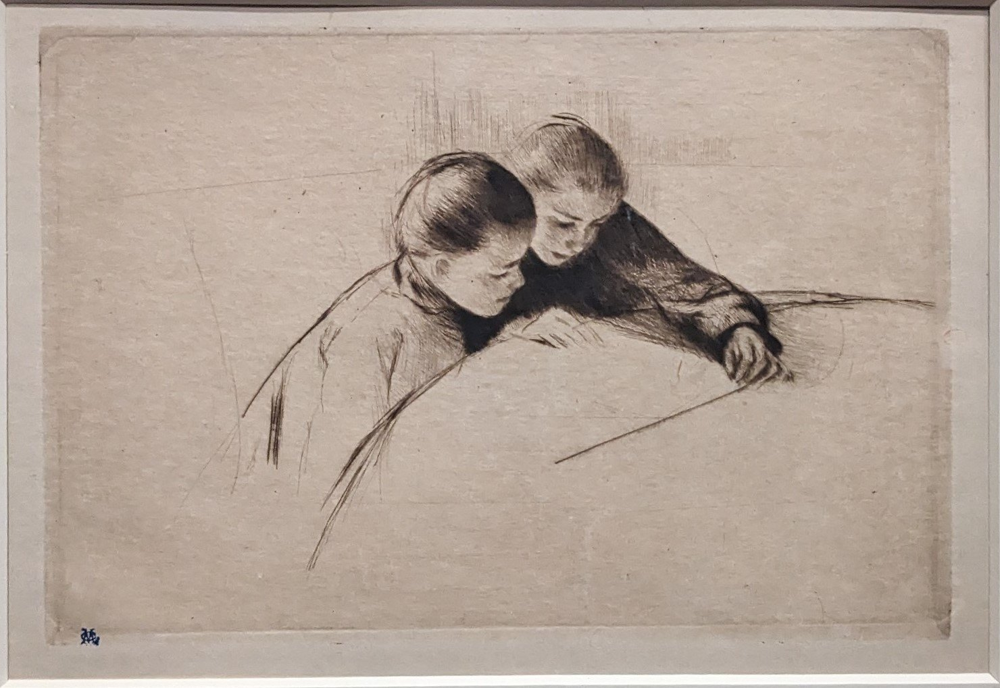{fig-alt="Two girls bent over a map, drypoint by Mary Cassatt"}

[Mary Cassatt, *La Leçon* (The Lesson), 1890, drypoint]{.legende}
:::
::: {.column width="48%"}
::: {.question}
Two girls drawn by Mary Cassatt study a map. They have not left the room, and yet they are travelling.

**What can we know about a place without having been there?**
:::

::: {.reponse}
A map is not the world. It is a representation we question, and a sketch of reality.
:::
:::
::::

::: {.notes}
In November 1890 this drypoint was on the front page of the first issue of L'Art dans les Deux Mondes,
Paul Durand-Ruel's review. An artist with a foot in each world, two girls examining a map.
:::

## Course map

::: {.fiche n="0.3" etat="a-revoir"}
Intention : The two movements, and the key to the three levels.
Experience : links to every slide
Request :
:::

::: {.carte-du-cours}
:::

::: {.notes}
Two movements. Three ways of looking: looking up, looking at the horizon, looking from above.
Then a round trip: climbing from the plane to the geoid to understand, coming back down to compute.
Examples are not listed here: they illustrate, they are not for revision.
:::

## To represent is to choose {.socle}

::: {.fiche n="0.4" etat="a-revoir"}
Intention : An environment, a subject who looks, an object that is shown: every map makes a choice.
Experience : none
Request :
:::

:::: {.columns}
::: {.column width="50%"}
::: {.schema fichier="images/schemas/en/milieu-sujet-objet.svg"}
:::
:::
::: {.column width="50%"}
Every map brings three things together:

- an **environment**, too rich to be shown in full;
- a **subject**, who looks with an intention;
- an **object**, what we decide to make visible.

[A map does not show everything: it chooses, highlighting the information its author wants the reader to know.]{.a-retenir}
:::
::::

::: {.notes}
The need to understand space and the phenomena tied to it.
These representations of space serve functions. Ask for examples.
:::

## What is a map for? {.socle}

::: {.fiche n="0.5" etat="a-revoir"}
Intention : Locating, orienting, moving, controlling, thinking.
Experience : multiple-answer quiz on the 1:25,000 map of Nancy
Request :
:::

:::: {.columns}
::: {.column width="46%"}
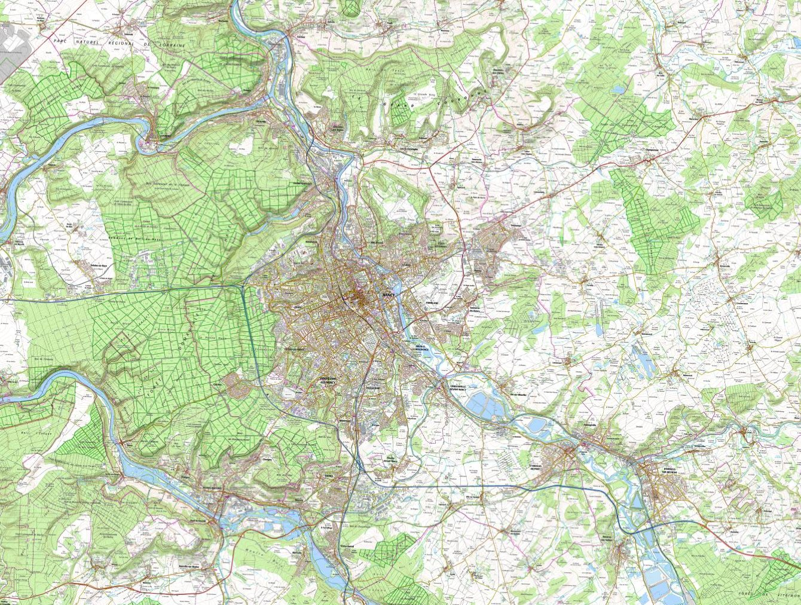{fig-alt="1:25,000 topographic map of the area around Nancy"}

[The area around Nancy at 1:25,000]{.legende}
:::
::: {.column width="54%"}
::: {.qcm .serre}
What does this map let you do? Several answers are right.

- [x] Find where you are
    - Know your position relative to your surroundings, using landmarks.
- [x] Get your bearings
    - Know which way to look, relative to a reference.
- [x] Grasp space
    - Build relationships, such as the one that lets you move around.
- [x] Control a territory
    - Yes, that too: it descends directly from the military staff map.
- [x] Think
    - Compare, measure, imagine what cannot be seen from the ground.
:::
:::
::::

## Before writing

::: {.fiche n="0.6" etat="a-revoir"}
Intention : At Bedolina, a territory is already being abstracted: fields, paths, houses.
Experience : clickable zones: a field, a path, a house
Request :
:::

:::: {.columns}
::: {.column width="62%"}
::: {.zones image="images/bedolina.jpg" alt="Bedolina rock engraving: dotted rectangles, winding lines and small buildings"}
- [x] 11,23,9,7 : A rectangle filled with regular dots: read as a field, or an enclosure.
- [x] 10,31,9,7 : A rectangle filled with regular dots: read as a field, or an enclosure.
- [x] 1,50,9,9 : A rectangle filled with regular dots: read as a field, or an enclosure.
- [x] 22,65,7,13 : A rectangle filled with regular dots: read as a field, or an enclosure.
- [x] 38,30,17,6 : A rectangle filled with regular dots: read as a field, or an enclosure.
- [x] 40,49,12,19 : A rectangle filled with regular dots: read as a field, or an enclosure.
- [x] 48,18,6,7 : A rectangle filled with regular dots: read as a field, or an enclosure.
- [x] 56,29,7,5 : A rectangle filled with regular dots: read as a field, or an enclosure.
- [x] 57,36,7,6 : A rectangle filled with regular dots: read as a field, or an enclosure.
- [x] 62,49,8,7 : A rectangle filled with regular dots: read as a field, or an enclosure.
- [x] 73,16,7,5 : A rectangle filled with regular dots: read as a field, or an enclosure.
- [x] 30,59,7,6 : A rectangle filled with regular dots: read as a field, or an enclosure.
- [x] 30,20,11,13 : A winding line linking the plots: a path, or a stream.
- [x] 29,66,49,27 : Buildings with pointed roofs: houses or granaries, added later.
:::
:::
::: {.column width="38%"}
At Bedolina, in Val Camonica, a rock engraved about three thousand years ago.

Find **a field**, **a path**, **a house**.

[Abstracting a territory came before writing.]{.a-retenir}
:::
::::

::: {.notes}
Northern Italy, Val Camonica. A capacity for abstraction older than writing.
Facing an environment that has to be grasped.
:::

## Looking up {.intercalaire}

::: {.fiche n="1.0" etat="a-revoir"}
Intention : First way of looking: at the sky.
Experience : none
Request :
:::

First way of looking: finding our place in the cosmos.

## The world seen from Babylon

::: {.fiche n="1.1" etat="a-revoir"}
Intention : The known world, surrounded by water, and beyond it the unknown.
Experience : none
Request :
:::

:::: {.columns}
::: {.column width="42%"}
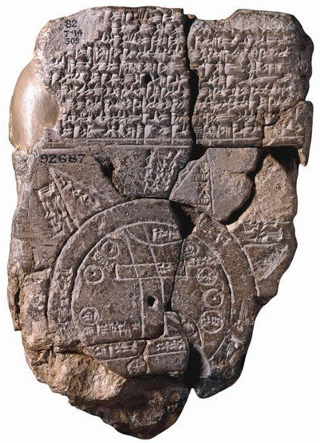{fig-alt="Babylonian clay tablet engraved with a circular map of the world" height="440"}
:::
::: {.column width="58%"}
Iraq, 7th century BC. The oldest map of a known world.

Look for these on the tablet:

- **Babylon**;
- **the Euphrates**;
- **the water** that surrounds the world;
- an **unknown region**.

[British Museum]{.legende}
:::
::::

::: {.plus titre="A map completed by a student"}
A fragment of this tablet was missing. It was found by Edith Horsley, a student of Irving Finkel, curator at the British Museum, and put back in its place: citizen science before its time.

Irving Finkel tells the story and explains the whole tablet in [this video](https://www.youtube.com/watch?v=LUxFzh8r384).
:::

::: {.notes}
The Persian Gulf is drawn as a river encircling the world.
The circles around Babylon mark cities. The lower rectangle shows
the marshlands of southern Mesopotamia.
Above all it is a tool for moving around: locating and orienting.
:::

## Worlds shaped like myths {.optionnel}

::: {.fiche n="1.2" etat="a-revoir"}
Intention : Each culture gives the world the shape of its own story.
Experience : none
Request :
:::

:::: {.columns}
::: {.column width="40%"}
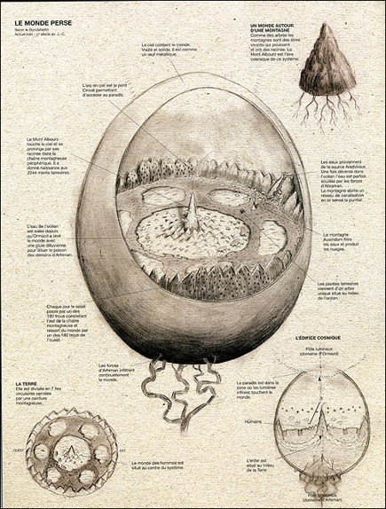{fig-alt="Illustrated plate of the world in Persian cosmogony: an egg containing the Earth"}
:::
::: {.column width="60%"}
Each culture gives the world the shape of its own story, its cosmogony. It may take the form of an egg, a disc, a mountain, a turtle.

The world is built as a boundary between the known and the unknown.

[After L. Haddad and G. Duprat, *Mondes, mythes et images de l'univers*]{.legende}
:::
::::

::: {.notes}
This knowledge will come through geometry. Cartography and geometry will be bound together for a time.
:::

## The known and the boundless {.veille}

::: {.fiche n="1.3" etat="a-revoir"}
Intention : Hecataeus draws the boundary between the oikoumene and the apeiron.
Experience : none
Request :
:::

:::: {.columns}
::: {.column width="46%"}
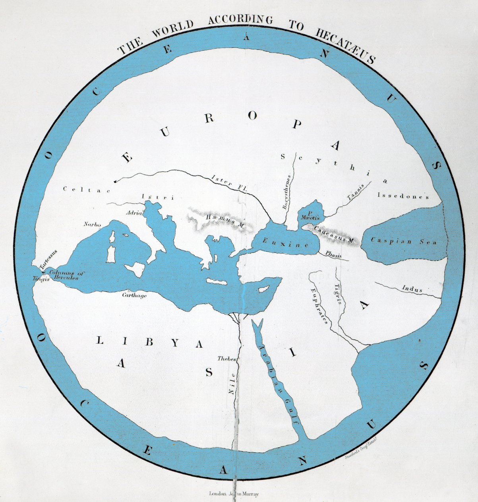{fig-alt="The world according to Hecataeus: a disc of land around the Mediterranean, encircled by the Ocean" height="430"}
:::
::: {.column width="54%"}
Around 500 BC, Hecataeus of Miletus draws a disc: Europe, Asia and Libya, around a sea.

- **The oikoumene**: the inhabited land, the known world.
- **The apeiron**: the boundless, the shoreless sea around it.

A map begins by drawing a boundary.

[Reconstruction published by John Murray]{.legende}
:::
::::

::: {.notes}
The scale changes compared with the cadastre. For Thales of Miletus, the Earth is like
a ship floating on a vast ocean. Anaximander and Hecataeus publish the first maps of the world.
:::

## How do we know the Earth is round? {.appui}

::: {.fiche n="1.4" etat="a-revoir"}
Intention : Three observations are enough, without leaving the ground.
Experience : question (prediction), then the diagram of the three observations
Request :
:::

::: {.question etiquette="Prediction"}
You have neither aircraft nor satellite. **Which observations are enough?**
:::

::: {.reponse}
::: {.schema fichier="images/schemas/en/rotondite.svg"}
:::
:::

::: {.notes}
Aristotle puts forward the Earth's shadow during eclipses and the change in visible stars.
Ask the students to suggest others.
:::

## Measuring the Earth with a shadow {.appui}

::: {.fiche n="1.5" etat="a-revoir"}
Intention : Eratosthenes: an angle and a distance give the Earth's circumference.
Experience : slider: vary the angle, read the Earth's circumference
Request :
:::

:::: {.columns}
::: {.column width="52%"}
::: {.curseur min="2" max="30" pas="0.1" valeur="7.2" unite="°" etiquette="Shadow angle at Alexandria" schema="images/schemas/en/eratosthene.svg" hauteur="270"}
- Earth's circumference: `{5000*360/x|0}` stadia
- That is `{5000*360/x*0.1575|0}` km, for a stadion of 157.5 m
:::
:::
::: {.column width="48%"}
On the same day at noon, the Sun lights the bottom of a well in Syene. In Alexandria, 5,000 stadia further north, a stick casts a shadow.

Eratosthenes measures that angle: **7.2°**, one fiftieth of a circle.

[An angle and a distance are enough to measure the Earth.]{.a-retenir}

Vary the angle. The distance between the two cities does not change: it is the Earth that grows or shrinks.
:::
::::

::: {.notes}
3rd century BC. Result: 250,000 stadia. The value accepted today is about 40,000 km.
The length of the stadion is still debated.
:::

## A map to think with {.veille .optionnel}

::: {.fiche n="1.6" etat="a-revoir"}
Intention : The globe of Crates invents lands nobody has seen.
Experience : none
Request :
:::

:::: {.columns}
::: {.column width="42%"}
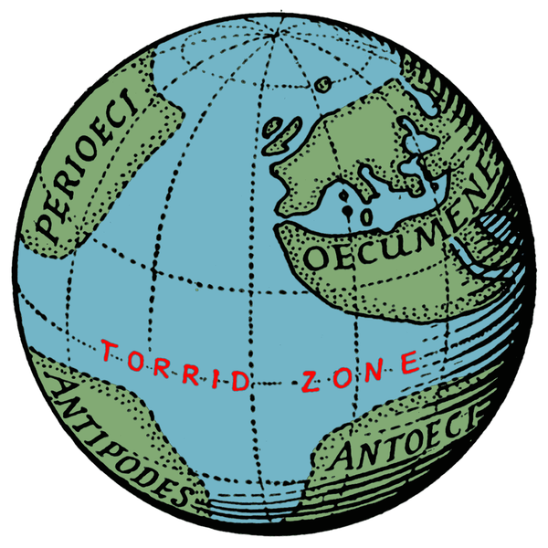{fig-alt="Globe of Crates: four landmasses separated by two crossing oceans"}
:::
::: {.column width="58%"}
Around 150 BC, Crates of Mallus builds a globe.

He does not place only the known world on it. By symmetry, he imagines three others: the Perioeci, the Antoeci and the Antipodes.

[The map becomes an object of thought: it brings into being lands nobody has seen.]{.a-retenir}
:::
::::

::: {.notes}
Once it is built, other spaces can be imagined. The balance of the lands
and the harmony of the sphere imply that other spaces exist.
:::

## A grid over the world {.socle}

::: {.fiche n="1.7" etat="a-revoir"}
Intention : With Ptolemy, latitudes and longitudes: the first projection.
Experience : ordering: four ancient maps, by date
Request :
:::

:::: {.columns}
::: {.column width="34%"}
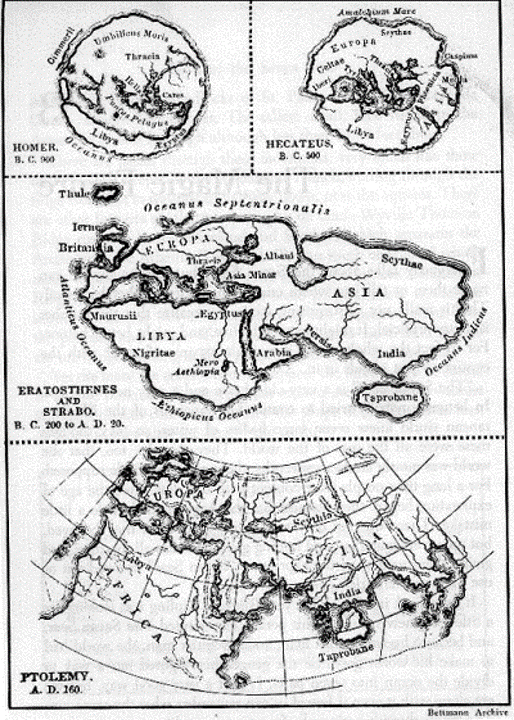{fig-alt="Four reconstructions of ancient maps, from Homer to Ptolemy" height="450"}
:::
::: {.column width="66%"}
::: {.ordre}
In seven centuries the known world grows and acquires a grid. Put these four maps in order.

1. A disc of land surrounded by the river Ocean
2. Three continents around the Mediterranean
3. The first reference lines, parallels and meridians
4. A complete grid of latitudes and longitudes
:::

With Ptolemy, in the 2nd century, every place receives two numbers. It is also the first projection.
:::
::::

::: {.notes}
Homer, Hecataeus, Eratosthenes, then Ptolemy. Eratosthenes and Ptolemy rely
on a spherical Earth, hence longitudes and latitudes.
:::

## Which way is up? {.appui}

::: {.fiche n="1.8" etat="a-revoir"}
Intention : On the T-O map, the Orient is at the top: to orient is to turn towards the east.
Experience : clickable zones: find the word "Oriens" on the map, which gives the answer; "Going further" bonus on the T-O map
Request :
:::

:::: {.columns}
::: {.column width="47%"}
::: {.zones image="images/carte-t-o.jpg" alt="T-O map: Asia at the top, Europe and Africa below, four Latin words around the circle" hauteur="500"}
- [x] 33,0,22,9 : Oriens: the Orient, where the Sun rises. To orient a map was to turn it towards the east. North at the top would come much later.
- [ ] 35,91,27,9 : Occidens: the setting Sun, the west. It is at the bottom of the map.
- [ ] 2,32,10,36 : Septentrio: the north. Here it is on the left.
- [ ] 89,32,10,28 : Meridies: midday, the south. Here it is on the right.
:::
:::
::: {.column width="53%"}
::: {.question}
This map is a half-symbolic representation of the world, linking a real view and a biblical one. It holds the origin of the verb "to orient". Can you find it?

**Click on the word it comes from.**
:::

::: {.retour-ici}
:::
:::
::::

::: {.plus titre="The T-O map"}
The T is surrounded by an O that stands for the ocean, hence the name T-O map: *Orbis Terrarum*.

This three-part division of the world matches the Trinity and the peopling of the Earth by the three sons of Noah: Shem for Asia, Ham for Africa, Japheth for Europe. The T is likened to the tau of the cross.

The T-O map takes up the circular model of Hecataeus of Miletus and Anaximander. Jerusalem replaces Delphi as the navel of the world.

This kind of representation, tied to religious belief, lasts in the West until the 12th century. At the same period, the area of Eurasia mapped by Chinese civilisation is far greater.

The T-O representation is gradually abandoned from the 12th century. In 1154, at the court of King Roger II of Sicily, the geographer Al-Idrisi draws a map of the known world that no longer uses it.
:::

::: {.notes}
A period of spatial withdrawal, with a stronger interest in the spiritual world. The Arab world is the exception.
:::

## Turn the map {.socle}

::: {.fiche n="1.9" etat="a-revoir"}
Intention : Al-Idrisi puts south at the top: north at the top is only a convention.
Experience : rotate the map until the Mediterranean is recognisable
Request :
:::

:::: {.columns}
::: {.column width="46%"}
::: {.pivoter image="images/al-idrisi.jpg" alt="Circular world map by Al-Idrisi, copy of 1456" cible="180" tolerance="20"}
South was at the top. You have just put north back in its usual place: the Mediterranean, Arabia and the Nile can be recognised.
:::
:::
::: {.column width="54%"}
Al-Idrisi's world map, 1154, in a copy of 1456.

Something escapes you? Rotate the map, with the mouse or the arrows, until you recognise the Mediterranean.

[North at the top is only a convention.]{.a-retenir}
:::
::::

## Looking at the horizon {.intercalaire}

::: {.fiche n="2.0" etat="a-revoir"}
Intention : Second way of looking: at the horizon.
Experience : none
Request :
:::

Second way of looking: travelling, measuring, controlling.

## A map without geometry {.appui}

::: {.fiche n="2.1" etat="a-revoir"}
Intention : The Peutinger Table keeps the stages and the links, not the shapes.
Experience : magnifier on the table; question: what is right, what is wrong; bonus link to itiner-e.org
Request :
:::

::: {.centre}
::: {.loupe zoom="3"}
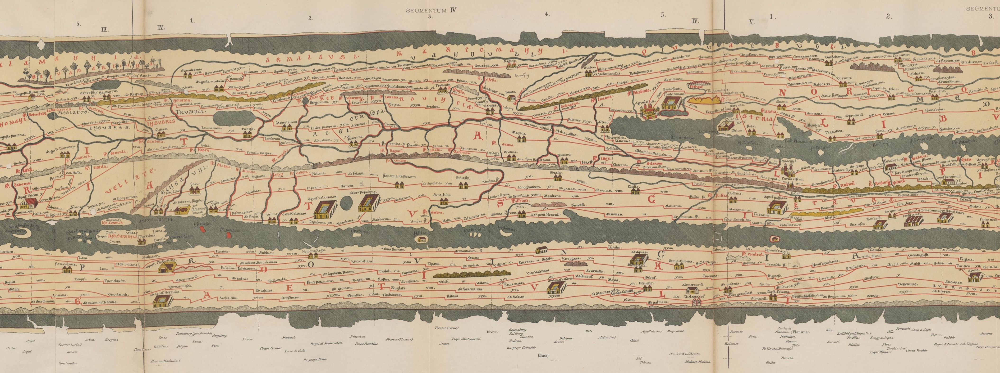{fig-alt="Extract of the Peutinger Table: roads, stages and towns stretched into a long ribbon" height="310"}
:::
:::

:::: {.columns .resserre}
::: {.column width="50%"}
::: {.question}
The Peutinger Table unrolls the Roman Empire over nearly 7 metres in length, and 34 centimetres in height.

**What is right on this map, and what is wrong?**
:::
:::
::: {.column width="50%"}
::: {.reponse}
**Right**: the order of the stages, the links, the written distances.
**Wrong**: the shapes, the directions, the proportions.

It is an underground map before its time.
:::
:::
::::

::: {.plus titre="The roads of the Roman Empire"}
[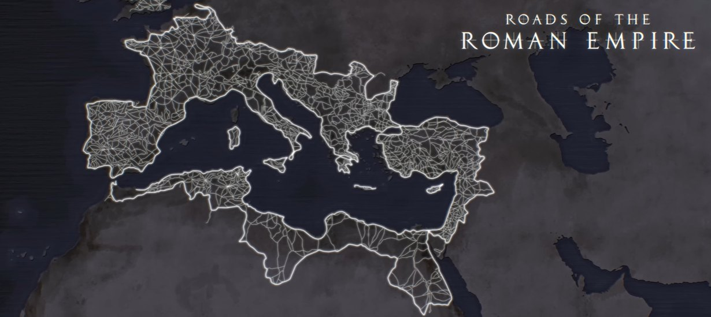{fig-alt="Map of the Roman road network around the Mediterranean"}](https://itiner-e.org/)

The Roman road network, to explore online: [itiner-e.org](https://itiner-e.org/). Click on the image.
:::

::: {.notes}
A medieval copy of a Roman map. Link it to the topology of a network in a GIS.
:::

## Holding a course

::: {.fiche n="2.2" etat="a-revoir"}
Intention : Portolan charts trace routes: the map becomes a tool for navigation.
Experience : heading: a compass turns the route on the portolan, point by point
Request :
:::

::: {.cap image="images/portulan-1540.jpg" alt="Portolan chart of 1540: Europe and the Mediterranean covered with rhumb lines" x="24.7" y="45.6" depart="90"}
On a portolan chart, lines radiate from the compass roses. The sailor picks the one that leads to port, reads the heading, and holds it with the compass.

Bring the ship to port or to starboard: one notch is one **point**, that is 11.25°.
:::

::: {.notes}
Portolans: navigation charts, 1540. The map becomes a tool for holding a route.
:::

## Instruments {.optionnel}

::: {.fiche n="2.3" etat="a-revoir"}
Intention : Sighting, measuring an angle: the alidade.
Experience : none
Request :
:::

:::: {.columns}
::: {.column width="58%"}
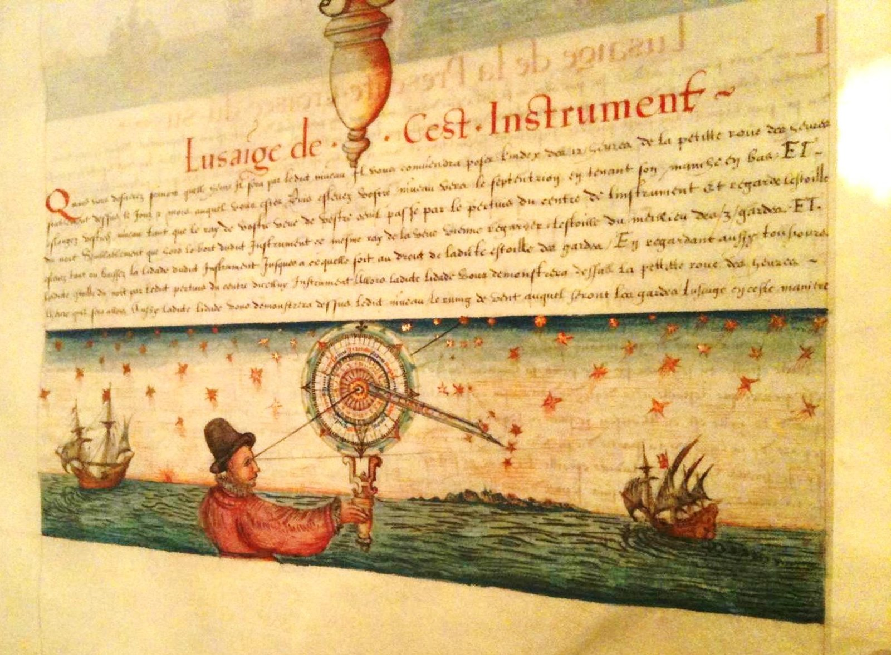{fig-alt="Illuminated manuscript: a sailor sights the sky with an instrument"}
:::
::: {.column width="42%"}
"The use of this instrument…"

Sight a star, read an angle: with the alidade, position is measured instead of estimated. It stays in use until the end of the 20th century in the form of the sextant, whose graduated arc is one sixth of a circle.
:::
::::

## Mercator, to hold the course {.appui}

::: {.fiche n="2.4" etat="a-revoir"}
Intention : A projection that preserves angles, at the cost of areas.
Experience : "Going further" bonus: a projection abandoned at the UN
Request :
:::

:::: {.columns}
::: {.column width="44%"}
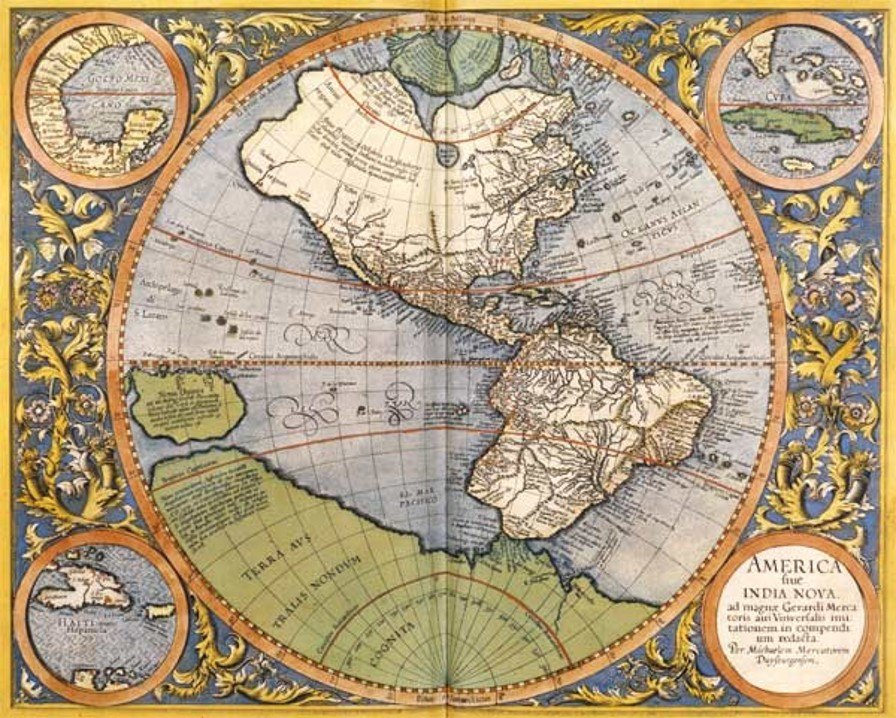{fig-alt="Map of America published in Mercator's atlas in 1595"}

[Mercator's atlas, 1595]{.legende}
:::
::: {.column width="56%"}
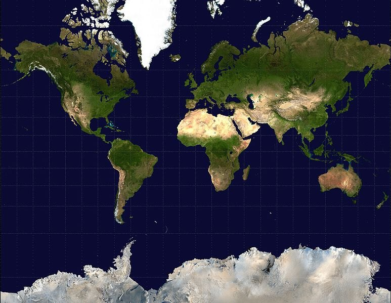{fig-alt="World map in the Mercator projection" height="230"}

In 1569, Mercator invents a projection on which a course of constant heading becomes a **straight line**.

It preserves angles. The price is paid in areas; we come back to this.
:::
::::

::: {.plus titre="A projection in retreat"}
A projection abandoned at the UN as well: [United Nations document](https://documents.un.org/doc/undoc/ltd/n26/201/85/pdf/n2620185.pdf).

It is a move that France, through its foreign ministry, has been making on its own side since 2021.
:::

::: {.notes}
The 1595 map shown here is not in the Mercator projection: it is a hemisphere from his atlas.
The world map on the right is.
:::

## Measuring a country {.socle}

::: {.fiche n="2.5" etat="a-revoir"}
Intention : Triangulation: covering a territory with triangles from a single baseline.
Experience : sight lines: link the stations across the Channel, on the plan of the Greenwich–Paris triangles
Request :
:::

::: {.visees image="images/triangulation-greenwich-paris.jpg" alt="Plan of the triangles linking the Greenwich and Paris observatories, 1784-1790" objectif="2" solution="1-2 1-3 1-4 2-3 2-4 3-4"}
Between 1784 and 1790, the English and the French link their observatories across the Channel.

Join the stations two by two to cross the sea.

- Fairlight Down : 40.0,74.6
- Dover : 59.5,52.1
- Cap Blanc-Nez : 70.7,70.3
- Montlambert : 69.4,90.0
- Calais : 75.2,67.1

**The sea is crossed.** A triangle has six measurements: three sides and three angles. Knowing three of them, including at least one side, is enough to compute the other three. So only one length is measured, the baseline; after that, only angles.
:::

::: {.notes}
Triangulation: covering a territory with triangles from one measured baseline.
The sight lines across the Channel exceed 40 km; observations were made at night, on lights.
:::

## The Cassini map {.appui}

::: {.fiche n="2.6" etat="a-revoir"}
Intention : The first map of a whole country surveyed by triangulation.
Experience : none
Request :
:::

:::: {.columns}
::: {.column width="58%"}
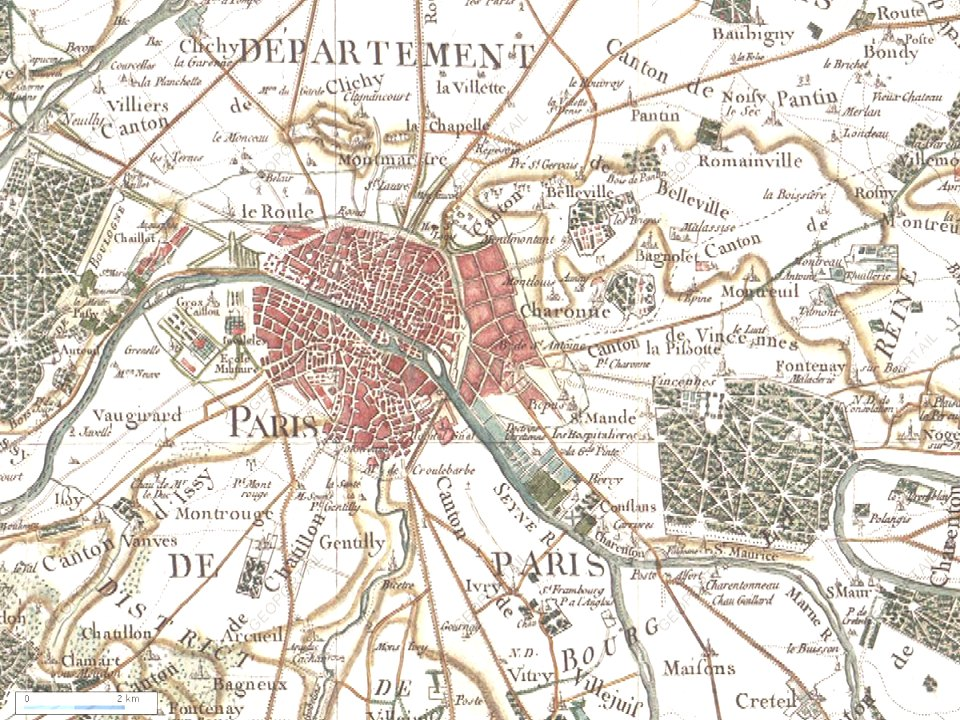{fig-alt="Paris and its surroundings on the Cassini map, around 1780"}
:::
::: {.column width="42%"}
In the 18th century, four generations of Cassinis cover the kingdom with triangles.

[The first map of a whole country surveyed by triangulation.]{.a-retenir}

It becomes the model for all of Europe.
:::
::::

## The map, an instrument of power {.veille}

::: {.fiche n="2.7" etat="a-revoir"}
Intention : From battle plan to colonial border: to map is to control.
Experience : browse three large maps; question: what does the caption of the islands say about the person drawing?
Request :
:::

:::: {.columns}
::: {.column width="56%"}
::: {.defiler}
- 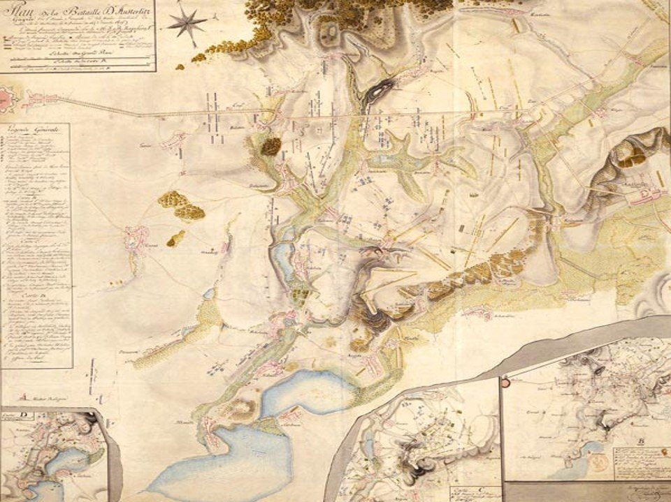
- 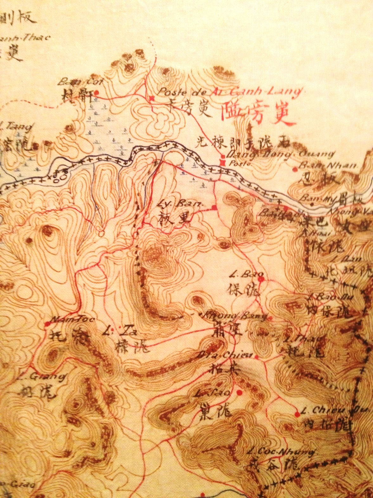
- 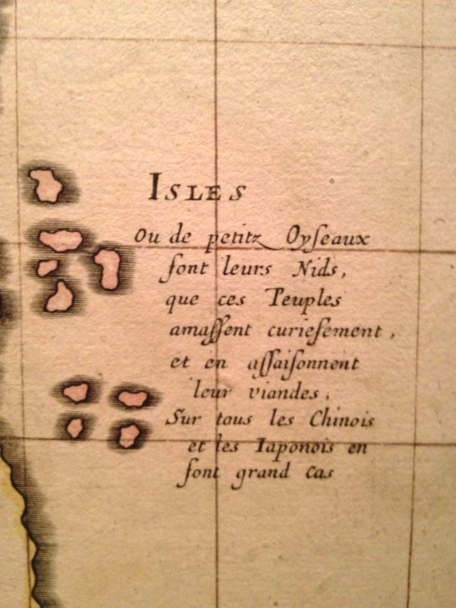
:::

[Maps held at the Musée de l'Armée, Hôtel des Invalides, Paris]{.legende}
:::
::: {.column width="44%"}
::: {.question}
Austerlitz, 1805. The border of Indochina. Islands and their caption.

**What does the caption of the islands say about the person drawing?**
:::

::: {.reponse}
It records what has value for him: here, nests that sell for a high price. To map is already to take stock, and so to control.
:::
:::
::::

::: {.notes}
The map becomes precise. Precise enough to plan not just strategy, but tactics.
It is a tool for conquering new territories and controlling old ones.
It also stands out for its view from above: the observer dominates and watches.
:::

## In the field {.optionnel}

::: {.fiche n="2.8" etat="a-revoir"}
Intention : Plane table, theodolite, geodetic tower: the surveyor's trade.
Experience : none
Request :
:::

::: {.mosaique}
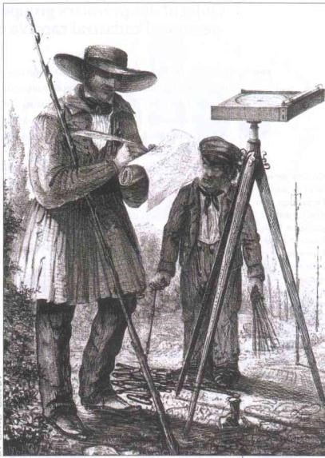{fig-alt="Engraving: two surveyors and their plane table"}

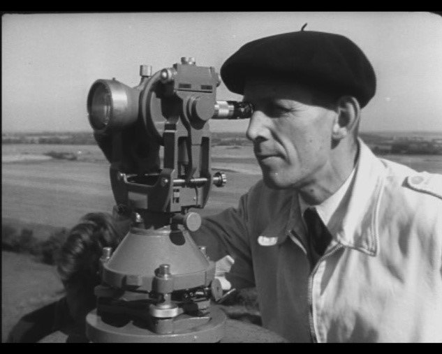{fig-alt="A geodesist sighting through a theodolite"}

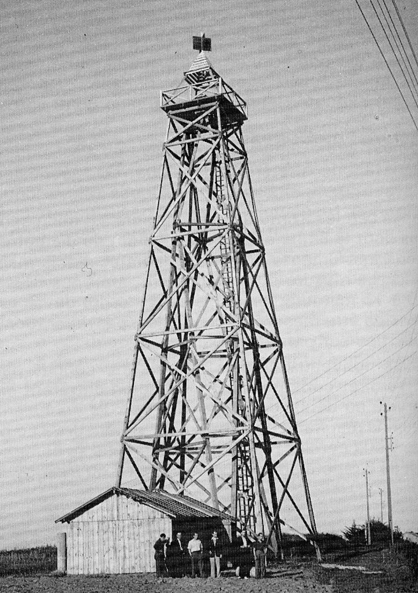{fig-alt="Geodetic tower with a metal frame"}

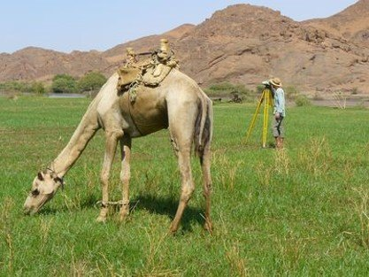{fig-alt="A surveyor at work on a plain, a dromedary in the foreground"}
:::

The plane table to draw on site, the theodolite to measure angles, the tower to see further: the trade changes only in its instruments.

## Nancy, three centuries {.appui}

::: {.fiche n="2.9" etat="a-revoir"}
Intention : The same place, from Cassini to the 1:25,000 map.
Experience : compare: slider between Cassini, the staff map and the 1:25,000 map
Request :
:::

:::: {.columns}
::: {.column width="62%"}
::: {.comparer}
- 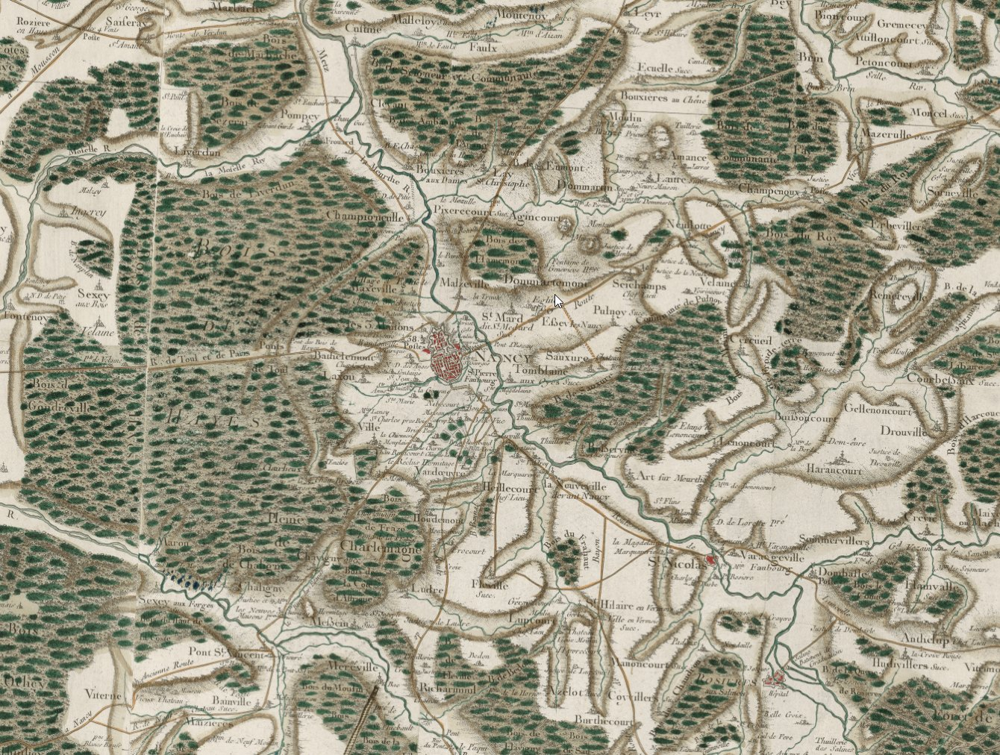
- 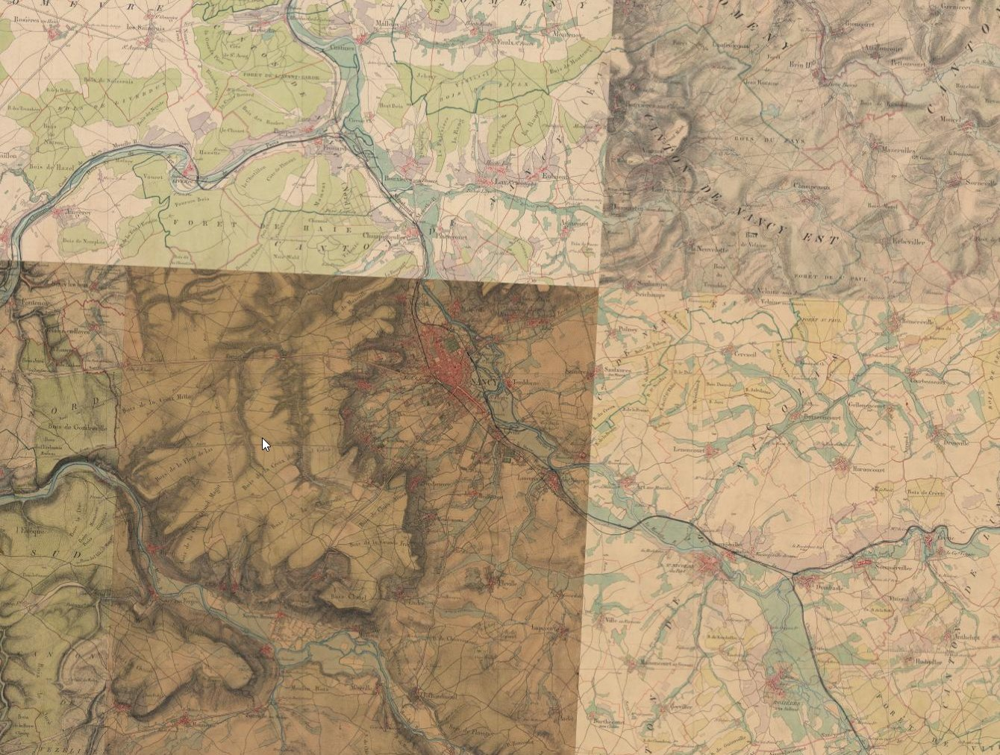
- 
:::
:::
::: {.column width="38%"}
The same place, three maps.

Move the slider. **What happens to the forest?** And to the town?

An old map is not a picture of the past: it is data that can be compared.
:::
::::

::: {.notes}
The three extracts cover the same extent: a forest edge or a meander can be followed from one map to the next.
:::

## Looking from above {.intercalaire}

::: {.fiche n="3.0" etat="a-revoir"}
Intention : Third way of looking: from the sky.
Experience : none
Request :
:::

Third way of looking: the gaze turns round, and centres on the Earth.

## Gaining height {.appui}

::: {.fiche n="3.1" etat="a-revoir"}
Intention : Aerial photography replaces surveying on the ground.
Experience : "Going further" bonus: photogrammetry and CO3D
Request :
:::

:::: {.columns}
::: {.column width="56%"}
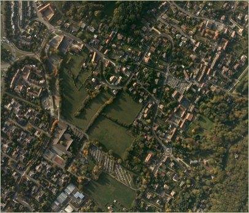{fig-alt="Aerial photograph of a small town and its wooded surroundings" height="480"}
:::
::: {.column width="44%"}
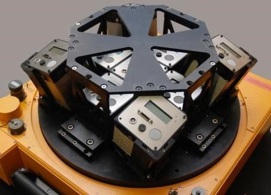{fig-alt="Digital aerial camera with several lenses" height="200"}

With the aircraft, the ground is no longer surveyed point by point: it is photographed, then measured on the image.

[From now on, the map is drawn from an image.]{.a-retenir}
:::
::::

::: {.plus titre="The third dimension"}
Aerial imagery also makes it possible to build 3D databases, using the principle of stereoscopic vision and photogrammetry. A starting point: [photogrammetry, on the IGN website](https://www.ign.fr/institut/kiosque/la-photogrammetrie) (in French).

These techniques are also used from space to build canopy models, for example with the [CO3D](https://cnes.fr/projets/co3d) programme.
:::

## The satellite {.appui}

::: {.fiche n="3.2" etat="a-revoir"}
Intention : A sensor, an orbit, an image: the principle of acquisition.
Experience : none
Request :
:::

:::: {.columns}
::: {.column width="56%"}
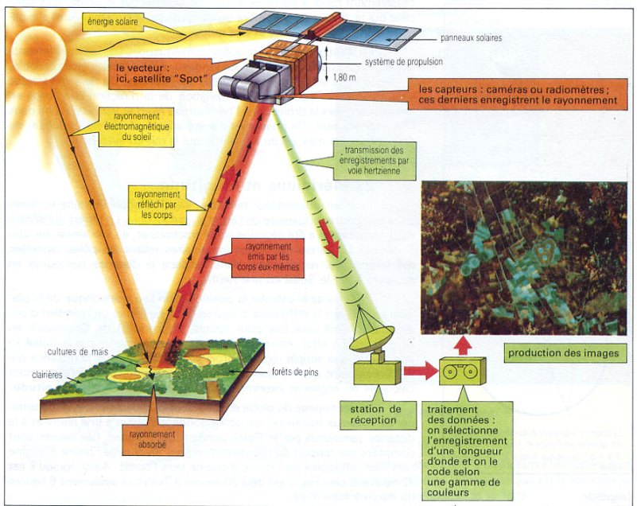{fig-alt="Diagram of image acquisition by the SPOT satellite, from the Sun to the receiving station"}
:::
::: {.column width="44%"}
The Sun illuminates, the surface reflects, the sensor records, the station receives.

Since SPOT 1, in 1986, the same area can be seen again every few days.

This diagram is the starting point of the remote sensing course.
:::
::::

## A forest seen from space

::: {.fiche n="3.3" etat="a-revoir"}
Intention : The boundary of Egmont National Park can be read from orbit.
Experience : clickable zones: where does the forest boundary run? then "What does this say about the world?"
Request :
:::

:::: {.columns}
::: {.column width="60%"}
::: {.zones image="images/egmont-depuis-orbite.jpg" alt="Mount Egmont and its forest, a dark disc seen from orbit"}
- [x] 43,35,20,21 : The park boundary is an almost perfect circle, about ten kilometres from the summit.
- [ ] 62,22,14,45 : Here it is the coastline: a natural boundary.
- [ ] 8,45,30,35 : Pasture. The forest was cleared up to the boundary, and no further.
:::
:::
::: {.column width="40%"}
Egmont National Park, New Zealand.

**Where does the forest boundary run?**

::: {.reponse etiquette="What does this say about the world?"}
This boundary was first drawn with a pair of compasses, on a map. The map does not only describe the territory: it makes it. Administrative divisions can sometimes be seen this way.
:::
:::
::::

## Nancy, today

::: {.fiche n="3.4" etat="a-revoir"}
Intention : Forest and hedgerows described as data, no longer only drawn.
Experience : compare: slider between the map, BD Forêt and the hedgerows
Request :
:::

:::: {.columns}
::: {.column width="62%"}
::: {.comparer}
- 
- 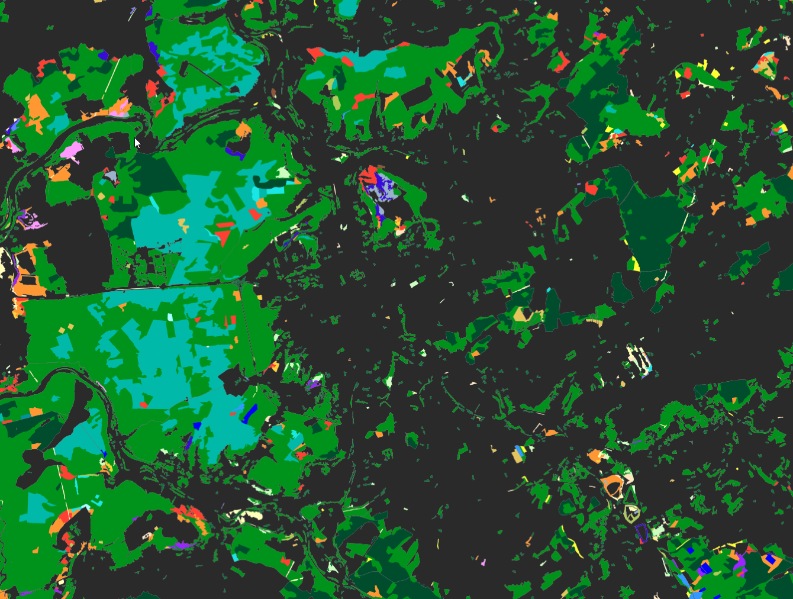
- 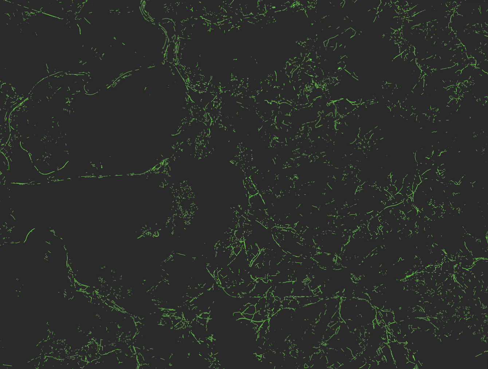
:::
:::
::: {.column width="38%"}
Forest and hedgerows are no longer only drawn: they are **described**, object by object.

Each patch of colour carries a stand type, an area, a date.

This is the raw material of a GIS.
:::
::::

## The three ways of looking {.socle}

::: {.fiche n="3.5" etat="a-revoir"}
Intention : Looking up, looking at the horizon, looking from above: the turning point.
Experience : sort nine documents by way of looking, three per box
Request :
:::

::: {.schema fichier="images/schemas/en/trois-regards.svg" hauteur="165"}
:::

::: {.classer}
### Looking up

- Babylonian tablet
- T-O map
- Map of Hecataeus

### Looking at the horizon

- Portolan chart
- Cassini map
- Battle of Austerlitz

### Looking from above

- Aerial photograph
- BD Forêt
- EFFIS service
:::

::: {.notes}
The gaze turned towards the stars came down, then centred on the world.
A centrifugal relationship, then a tangential one, then a centripetal one.
:::

## Which shape do we mean? {.intercalaire}

::: {.fiche n="4.0" etat="a-revoir"}
Intention : From the plane to the geoid: four shapes, each correcting the one before.
Experience : diagram of the staircase of shapes, going up
Request :
:::

The climb: each shape corrects the one before.

::: {.schema fichier="images/schemas/en/escalier-montee.svg"}
:::

## The plane is enough… up to where? {.appui}

::: {.fiche n="4.1" etat="a-revoir"}
Intention : Over 1 km the Earth departs from the plane by 8 cm; over 10 km, by 8 m.
Experience : question (prediction): at what distance does the error exceed one metre?
Request :
:::

::: {.schema fichier="images/schemas/en/plan-sphere.svg" hauteur="200"}
:::

:::: {.columns}
::: {.column width="50%"}
::: {.question etiquette="Prediction"}
You survey a plot as if the Earth were flat.

**At what distance does the error exceed one metre?**
:::
:::
::: {.column width="50%"}
::: {.reponse}
| Distance | Gap from the plane |
|---------:|-------------------:|
| 1 km     | 8 cm               |
| 10 km    | 8 m                |

Between 3 and 4 km: enough for a plot, not for a whole forest.
:::
:::
::::

## The sphere {.socle}

::: {.fiche n="4.2" etat="a-revoir"}
Intention : A centre, a radius: the first global model.
Experience : none
Request :
:::

:::: {.columns}
::: {.column width="40%"}
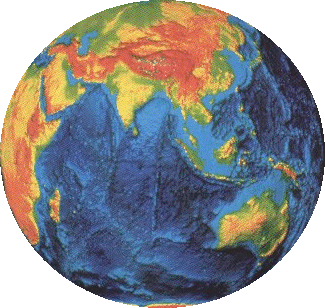{fig-alt="Relief globe of the Earth"}
:::
::: {.column width="60%"}
A centre, a radius: the first model of the whole Earth.

- Mean radius: **6,371 km**.
- Circumference: about **40,000 km**.

The sphere is enough for reasoning, for a world map, for a quick calculation. It is not enough for measuring.
:::
::::

## The ellipsoid {.socle}

::: {.fiche n="4.3" etat="a-revoir"}
Intention : Newton against Cassini: the Earth is flattened at the poles, by about twenty kilometres.
Experience : quiz: stretched or flattened? The globe changes shape with the chosen answer
Request :
:::

:::: {.columns}
::: {.column width="54%"}
::: {.qcm}
In the 18th century, two camps disagree about the shape of the Earth. Pick yours.

- [ ] Stretched towards the poles, like a lemon
    - This is what the Cassinis defend, from their measurements in France.
- [x] Flattened at the poles, like a tangerine
    - Newton is right: rotation makes the equator bulge.
:::

To settle it, one degree of meridian is measured in **Lapland** and in **Peru**.

The ellipsoid is a simple mathematical shape: two numbers define it.
:::
::: {.column width="46%"}
::: {.schema fichier="images/schemas/en/aplatissement.svg" hauteur="290"}
:::

::: {.apres-choix}
[The Earth is flattened at the poles: 21 km between the two radii.]{.a-retenir}
:::
:::
::::

::: {.notes}
Maupertuis in Lapland, La Condamine in Peru. Kepler studies the motion of the planets;
orbits are measured as ellipses, then the Earth itself is thought of as an ellipsoid.
:::

## The geoid {.socle}

::: {.fiche n="4.4" etat="a-revoir"}
Intention : Elevation follows gravity: the reference surface is that of an ocean at rest.
Experience : none
Request :
:::

:::: {.columns}
::: {.column width="45%"}
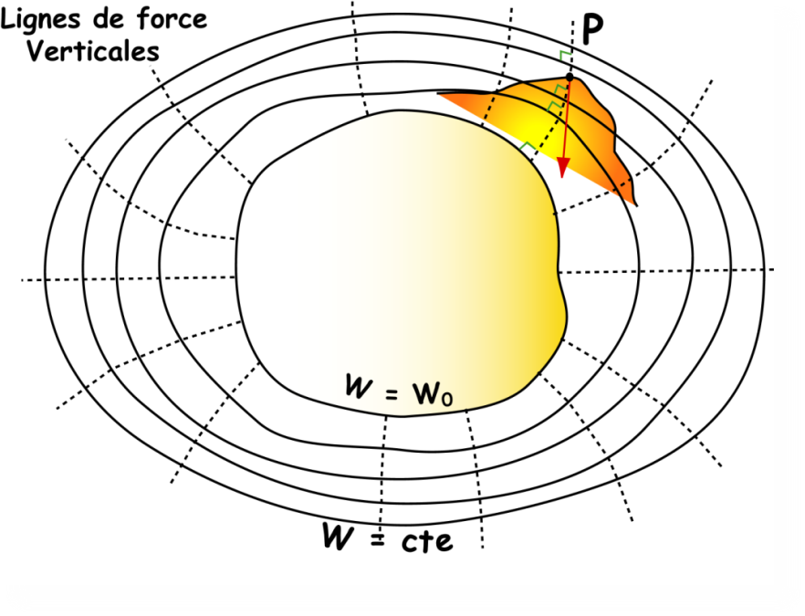{fig-alt="Cross-section of the Earth: nested surfaces of constant gravity potential W, crossed by vertical lines of force"}

[Surfaces of equal gravity potential, and vertical lines]{.legende}
:::
::: {.column width="55%"}
Water flows downhill, and downhill depends on **gravity**, which is not the same everywhere.

Among these surfaces, the one that extends mean sea level under the continents is the **geoid**.

[Elevation is measured from the geoid.]{.a-retenir}

In France, the origin is the Marseille tide gauge.

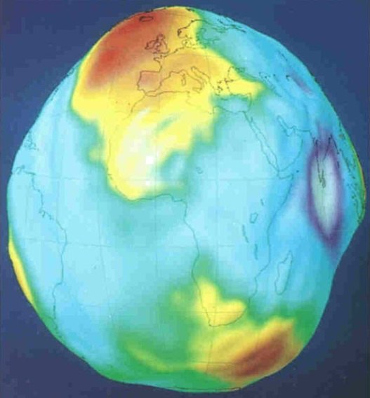{fig-alt="The geoid, with greatly exaggerated undulations, coloured by its distance from the ellipsoid" height="170"}
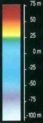{fig-alt="Colour scale from −100 m to +75 m" height="160"}
:::
::::

::: {.notes}
It would be the shape of the Earth if there were nothing but one vast ocean.
Causes of the undulations: internal masses, thickness of the crust, attraction of celestial bodies.
:::

## Height is not elevation {.socle}

::: {.fiche n="4.5" etat="a-revoir"}
Intention : Height is measured from the ellipsoid, elevation from the geoid.
Experience : quiz: what does the double arrow on the profile measure?
Request :
:::

:::: {.columns}
::: {.column width="52%"}
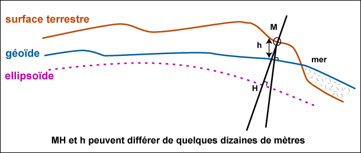{fig-alt="Profile showing the ground surface, the geoid and the ellipsoid at a point M"}
:::
::: {.column width="48%"}
::: {.qcm}
On this profile, what does the double arrow measure, between point M and the blue line?

- [x] The elevation of M
    - Yes: it is counted from the geoid.
- [ ] The height of M above the ellipsoid
    - No: that one goes down to the dotted line.
- [ ] The depth of the sea
    - No, the sea is further to the right.
:::
:::
::::

A GPS receiver gives a height above the ellipsoid. To get an elevation, the geoid undulation must be subtracted from it.

## Gaps on very different scales {.appui}

::: {.fiche n="4.6" etat="a-revoir"}
Intention : 21 km between sphere and ellipsoid, about a hundred metres between ellipsoid and geoid.
Experience : none (diagram of the three orders of magnitude)
Request :
:::

::: {.schema fichier="images/schemas/en/ordres-de-grandeur.svg" hauteur="250"}
:::

[Each step corrects two to three hundred times less than the one before.]{.a-retenir}

On a globe one metre across, the flattening would be less than 2 mm, and the geoid undulations less than a hundredth of a millimetre.

## Positioning a point M {.intercalaire}

::: {.fiche n="5.0" etat="a-revoir"}
Intention : We come back down: from the geoid to coordinates on the map.
Experience : diagram of the staircase, going down
Request :
:::

The descent: from the geoid to coordinates on the map.

::: {.schema fichier="images/schemas/en/escalier-descente.svg"}
:::

## From the Earth to the sphere: X, Y, Z {.appui}

::: {.fiche n="5.1" etat="a-revoir"}
Intention : Going from the real Earth to the sphere introduces geocentric Cartesian coordinates.
Experience : none
Request :
:::

:::: {.columns}
::: {.column width="42%"}
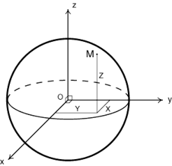{fig-alt="A sphere, an O x y z frame at its centre, and a point M located by X, Y and Z" height="400"}
:::
::: {.column width="58%"}
First model: a sphere, and a reference frame placed at its centre.

- **O**, the Earth's centre of mass;
- **Oz**, the axis of rotation;
- **Oxy**, the plane of the equator.

Any point M is located in it by three distances, **X, Y, Z**: these are **geocentric Cartesian coordinates**.

[The centre and the orientation are fixed. The surface remains to be described.]{.a-retenir}
:::
::::

::: {.notes}
In practice, these coordinates are mostly used to go from one geodetic system to another.
:::

## Locating M on the ellipsoid {.socle}

::: {.fiche n="5.2" etat="a-revoir"}
Intention : Longitude, latitude, height.
Experience : none
Request :
:::

:::: {.columns}
::: {.column width="46%"}
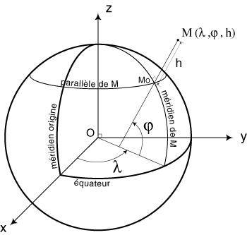{fig-alt="A point M located by its longitude, latitude and height on the ellipsoid"}
:::
::: {.column width="54%"}
On the ellipsoid, three numbers are enough:

- **longitude λ**, from a prime meridian;
- **latitude φ**, from the equator;
- **height** above the ellipsoid.

These are **geographic coordinates**. They are expressed in degrees, not in metres.
:::
::::

## The geodetic system {.socle}

::: {.fiche n="5.3" etat="a-revoir"}
Intention : An ellipsoid, positioned and oriented: local yesterday, global today.
Experience : none
Request :
:::

:::: {.columns}
::: {.column width="52%"}
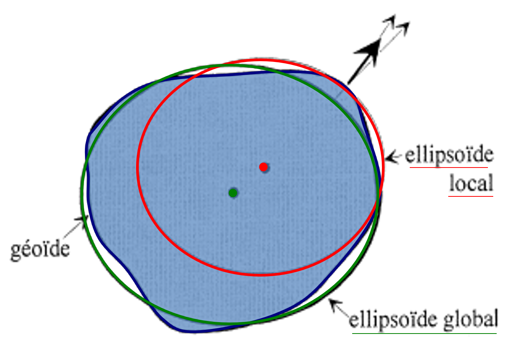{fig-alt="A local ellipsoid, fitted to one country, and a global ellipsoid, fitted to the whole Earth"}
:::
::: {.column width="48%"}
An ellipsoid is not enough: it has to be **positioned** and **oriented** relative to the Earth.

- In the past, each country fitted its own to its territory: **local** systems.
- Satellites made it possible to fit one to the whole Earth: **global** systems.

[Coordinates without their system do not designate any place.]{.a-retenir}
:::
::::

## Which system in France? {.socle}

::: {.fiche n="5.4" etat="a-revoir"}
Intention : RGF93, the legal system since 2000; WGS84 is the GPS one.
Experience : quiz: the legal system in France
Request :
:::

:::: {.columns}
::: {.column width="52%"}
::: {.qcm}
Which is the legal system in mainland France?

- [ ] NTF
    - It was until 2000. A local system, derived from a triangulation.
- [ ] ED50
    - A European system, also local.
- [x] RGF93
    - Yes. A space-based system, legal since the decree of 2000.
- [ ] WGS84
    - That is the GPS system. Very close to RGF93, but it is not the legal one.
:::
:::
::: {.column width="48%"}
::: {.reponse etiquette="To remember"}
| System | Local | Space-based |
|--------|:-----:|:-----------:|
| NTF    | ✓     |             |
| ED50   | ✓     |             |
| RGF93  |       | ✓           |
| WGS84  |       | ✓           |
:::
:::
::::

## To project is to choose {.socle}

::: {.fiche n="5.5" etat="a-revoir"}
Intention : Angles, areas or distances: not everything can be kept.
Experience : none
Request :
:::

:::: {.columns}
::: {.column width="54%"}
### Conformal
Preserves **angles** and shapes locally. Geodesy, topography, navigation.

### Equal-area
Preserves **areas**. Thematic mapping, area calculations.

### Compromise
Preserves neither: a trade-off. Also called aphylactic.
:::
::: {.column width="46%"}
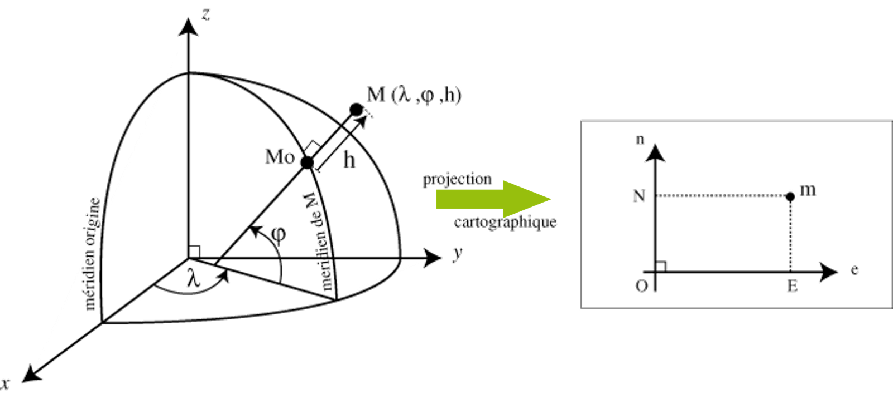{fig-alt="From geographic coordinates to plane coordinates"}

[No projection preserves angles, areas and distances all at once.]{.a-retenir}
:::
::::

## In which order? {.socle}

::: {.fiche n="5.5b" etat="a-revoir"}
Intention : Real Earth, geoid, ellipsoid, geodetic system, projection, plane coordinates.
Experience : ordering: from the real Earth to plane coordinates
Request :
:::

::: {.ordre}
From the real world to the coordinates you read in a GIS: put the chain back in order.

1. The real Earth
2. The geoid
3. The ellipsoid
4. The geodetic system
5. The projection
6. Plane coordinates
:::

## Where does Mercator exaggerate? {.appui}

::: {.fiche n="5.6" etat="a-revoir"}
Intention : The price of conformality can be read in the areas.
Experience : clickable zones: where are areas exaggerated? then Peters at the same width, on the next click
Request :
:::

The Mercator projection is **conformal**. The price shows in the areas: click where they are exaggerated.

:::: {.columns}
::: {.column width="50%"}
::: {.zones image="images/proj-mercator.jpg" alt="World map in the Mercator projection" hauteur="333"}
- [x] 30,0,16,22 : Greenland looks as large as Africa. It is in fact 14 times smaller.
- [x] 0,80,100,20 : Antarctica stretches across the whole width of the map. The closer to the poles, the more areas swell.
- [ ] 45,33,17,30 : Africa straddles the equator: that is where areas are most accurate.
- [ ] 27,44,14,34 : South America is hardly distorted, except at its tip.
:::

[Mercator, conformal]{.legende}
:::
::: {.column width="50%"}
::: {.fragment}
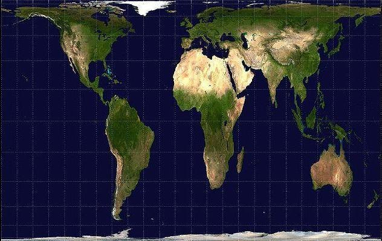{fig-alt="World map in the Peters projection, equal-area" width="430"}

[Peters, equal-area: same width, true areas]{.legende}
:::

::: {.retour-ici}
:::
:::
::::

## Three families of projection surface {.appui .optionnel}

::: {.fiche n="5.7" etat="a-revoir"}
Intention : Azimuthal, conic, cylindrical.
Experience : none
Request :
:::

:::: {.columns}
::: {.column width="33%"}
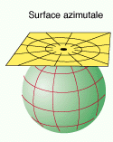{fig-alt="A plane tangent to the sphere" height="230"}

### Azimuthal
A plane tangent to the ellipsoid.
:::
::: {.column width="33%"}
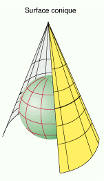{fig-alt="A cone resting on the sphere" height="230"}

### Conic
A tangent or secant cone. *E.g. Lambert.*
:::
::: {.column width="33%"}
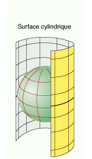{fig-alt="A cylinder around the sphere" height="230"}

### Cylindrical
A tangent or secant cylinder. *E.g. UTM.*
:::
::::

## France in zones {.veille .optionnel}

::: {.fiche n="5.8" etat="a-revoir"}
Intention : The old Lambert zones: why the country was divided.
Experience : "Going further" bonus: the nine conformal conic projections
Request :
:::

:::: {.columns}
::: {.column width="58%"}
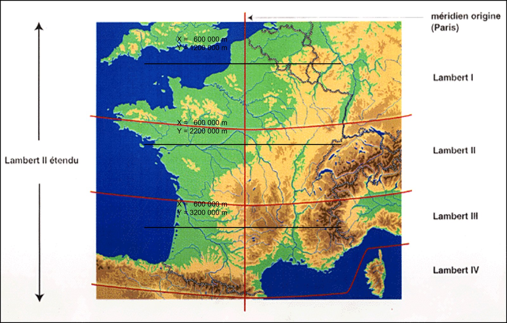{fig-alt="The four old Lambert zones on the map of France"}
:::
::: {.column width="42%"}
Until 2000, France is divided into four Lambert zones, from the north to Corsica.

Why divide? The further from the parallel of contact, the more lengths are distorted.

You will still come across these coordinates in older data.
:::
::::

::: {.plus titre="The nine conformal conic projections"}
Lambert 93 distorts lengths too much for some surveying work.

Nine projections, **CC42 to CC50**, complement it: one zone of 2° of latitude each, centred on a whole-degree parallel, with a distortion of less than 9 cm per kilometre.
:::

## Lambert 93 {.socle}

::: {.fiche n="5.10" etat="a-revoir"}
Intention : Today's reference: `EPSG:2154`.
Experience : none
Request :
:::

:::: {.columns}
::: {.column width="44%"}
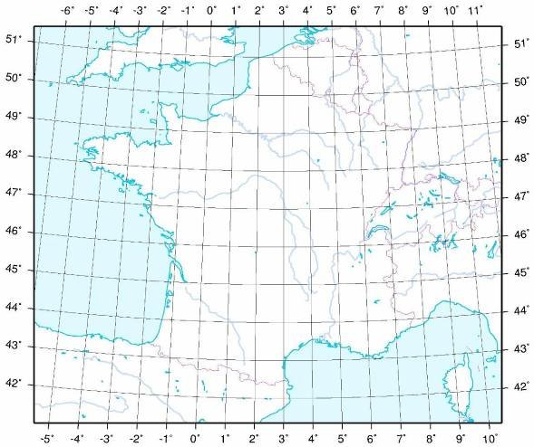{fig-alt="France in the Lambert 93 grid"}
:::
::: {.column width="56%"}
| Parameter | Value |
|-----------|-------|
| Geodetic system | RGF93 |
| Ellipsoid | IAG-GRS 1980 |
| Projection | conformal conic |
| Origin | 46°30′ N, 3° E |
| Standard parallels | 44° N and 49° N |

Today's reference, for the whole of mainland France. In a GIS, it is the code **`EPSG:2154`**.
:::
::::

## One point, three notations {.appui .optionnel}

::: {.fiche n="5.11" etat="a-revoir"}
Intention : The same point M in Nancy, in geographic coordinates, in Lambert 93, in UTM.
Experience : none (table of the three notations)
Request :
:::

The same point M, Place Stanislas in Nancy:

| Notation | Coordinates | System |
|---|---|---|
| Geographic | 48°41′37″ N, 6°11′00″ E | RGF93 |
| Lambert 93 | E = 934,230 m, N = 6,848,439 m | `EPSG:2154` |
| UTM, zone 32 | E = 292,722 m, N = 5,397,225 m | `EPSG:32632` |

[The place does not change. Only the way of writing it does.]{.a-retenir}

Overlaying layers that do not share the same notation, without telling the software, is the most common mistake in GIS.

## To remember

::: {.fiche n="6.1" etat="a-revoir"}
Intention : The core of the course, on one page.
Experience : generated list of the core slides, with links
Request :
:::

::: {.carte-du-cours niveaux="socle"}
:::

## Your turn {.fin}

::: {.fiche n="6.2" etat="a-revoir"}
Intention : Open QGIS, check the project's coordinate reference system.
Experience : bridge to the practical session
Request :
:::

Open QGIS and check the coordinate reference system of your project.

## Sources and credits {.petit}

::: {.fiche n="6.3" etat="a-revoir"}
Intention : Author, date, holding institution and licence of each image.
Experience : none
Request :
:::

:::: {.columns}
::: {.column width="50%"}
| Document | Source |
|---|---|
| Mary Cassatt, *La Leçon*, 1890 | photograph by M. Poupée |
| Bedolina rock engraving | to be completed |
| Babylonian tablet, 7th c. BC | British Museum |
| Persian cosmogony | L. Haddad, G. Duprat, *Mondes, mythes et images de l'univers* |
| The world according to Hecataeus | published by John Murray |
| Globe of Crates | to be completed |
| Ancient maps | to be completed |
| T-O map, 1472 | to be completed |
| Al-Idrisi's world map, copy of 1456 | to be completed |
| Peutinger Table | to be completed |
| Roman roads | itiner-e.org |
| Portolan chart, 1540 | to be completed |
:::
::: {.column width="50%"}
| Document | Source |
|---|---|
| Mercator's atlas, 1595 | to be completed |
| Greenwich–Paris triangulation, 1784-1790 | to be completed |
| Cassini map | to be completed |
| Austerlitz, Indochina | to be completed |
| Instruments and fieldwork | to be completed |
| Nancy: Cassini, staff map, 1:25,000 | to be completed |
| Nancy: BD Forêt, hedgerows | to be completed |
| Aerial photograph, camera | to be completed |
| SPOT acquisition diagram | to be completed |
| Mount Egmont from orbit | to be completed |
| Geoid, ellipsoids, projections | earlier course material |
| Drawn diagrams | made for this course |
:::
::::
