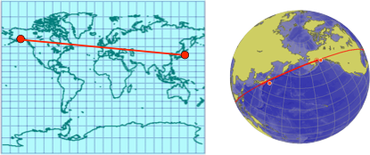
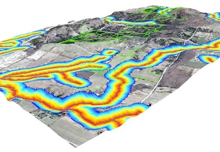
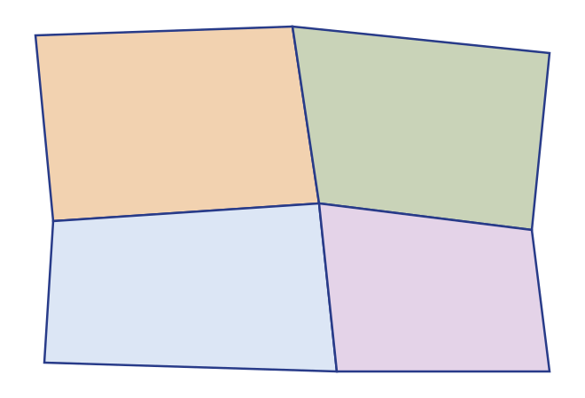
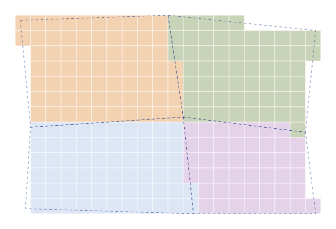

::: {.fiche n="0.1" etat="a-revoir"}
Intention : Couverture. Support présenté avant le TP, puis consulté seul. [PPT 1]
Expérience : aucune
Demande :
:::

## Comment lire ce support

::: {.fiche n="0.2" etat="a-revoir"}
Intention : Le même mode d'emploi que « GIS : Basics » (niveaux, exercices, bonus), sans le système de révision, pas encore prêt. Prérequis : raster, vecteur, attributs et couches, vus dans « GIS : Basics ». [nouvelle]
Expérience : aucune
Demande :
:::

Ce support accompagne la présentation du cours, puis se relit seul, avant et pendant le TP.

- Le **pictogramme** devant chaque titre donne le niveau : **socle**, à maîtriser ; **appui**, pour consolider ; **veille**, pour aller plus loin. Une diapo sans pictogramme est un exemple.
- Les **exercices** : répondez d'abord, puis cliquez.
- Le bouton **+** en haut à droite ouvre un bonus « Pour aller plus loin ».

[Prérequis : raster, vecteur, attributs et couches, vus dans « GIS : Basics ».]{.a-retenir}

## Ce que vous saurez faire

::: {.fiche n="0.3" etat="a-revoir"}
Intention : Trois verbes, trois parties : interroger une couche, enrichir ses attributs, créer de nouveaux objets ; puis les mêmes gestes en raster, et le passage de l'un à l'autre. [PPT 2]
Expérience : aucune
Demande :
:::

À la fin de ce support, vous saurez :

1. **interroger** une couche : sélectionner les objets qui répondent à des critères attributaires ou spatiaux ;
2. **enrichir** ses attributs, par la mesure ou par la position ;
3. **créer** de nouveaux objets : tampons, découpages, fusions ;
4. reconnaître les grandes **opérations raster** ;
5. **passer** du raster au vecteur, et inversement.

[Un géotraitement prend des couches en entrée et produit une nouvelle couche, ou de nouveaux attributs.]{.a-retenir}

## Carte du cours

::: {.fiche n="0.4" etat="a-revoir"}
Intention : Les cinq parties et la légende S / A / V.
Expérience : liens vers chaque diapo
Demande :
:::

::: {.carte-du-cours}
:::

## Interroger {.intercalaire}

::: {.fiche n="1.0" etat="a-revoir"}
Intention : Sélectionner les objets qui répondent à des critères. [PPT 3]
Expérience : aucune
Demande :
:::

Sélectionner les objets qui répondent à des critères.

## Une question posée à la base {.socle}

::: {.fiche n="1.1" etat="a-revoir"}
Intention : Une requête attributaire ou spatiale est une question adressée à la base pour visualiser, trier, modifier ou analyser. SQL, le langage standard des bases relationnelles, fondé sur l'algèbre relationnelle. [PPT 3]
Expérience : classer quatre questions forestières en « attributaire » ou « spatiale »
Demande :
:::

Une **requête** est une question adressée à la base, pour visualiser, trier, modifier ou analyser les données. **Attributaire**, elle porte sur les valeurs de la table ; **spatiale**, sur la position des objets.

On l'écrit souvent en **SQL** (*Structured Query Language*), le langage standard des bases relationnelles, fondé sur l'algèbre relationnelle.

::: {.classer}
### Attributaire

- Les peuplements de chêne
- Les parcelles de plus de 10 ha

### Spatiale

- Les placettes situées dans la forêt domaniale
- Les peuplements à moins de 50 m d'une piste
:::

## SELECT, FROM, WHERE {.socle}

::: {.fiche n="1.2" etat="a-revoir"}
Intention : La forme de base d'une requête : les champs voulus, la couche, les conditions. La capture ArcGIS est remplacée par la requête écrite, avec son équivalent dans QGIS (sélection par expression). [PPT 4]
Expérience : remise en ordre d'une requête sur les peuplements (SELECT, FROM, WHERE, condition)
Demande :
:::

:::: {.columns}
::: {.column width="48%"}
La forme de base d'une requête SQL :

- `SELECT` les champs voulus
- `FROM` la couche
- `WHERE` les conditions

Dans QGIS, *Sélectionner par expression* demande seulement la condition : la couche est celle que l'on a choisie, et l'on garde tous les champs.
:::
::: {.column width="52%"}
::: {.ordre}
Remettez la requête dans l'ordre : les noms et surfaces des chênaies de plus de 5 ha.

1. `SELECT nom, surface_ha`
2. `FROM peuplements`
3. `WHERE essence = 'Chêne'`
4. `AND surface_ha > 5`
:::
:::
::::

## Comparer {.socle}

::: {.fiche n="1.3" etat="a-revoir"}
Intention : Les opérateurs de comparaison : =, <>, <, >, <=, >= ; requêtes attributaires seulement. [PPT 5]
Expérience : QCM : quelle condition garde les peuplements qui ne sont pas des chênes ?
Demande :
:::

:::: {.columns}
::: {.column width="40%"}
| Opérateur | Sens |
|:---:|---|
| `=` | égal |
| `<>` | différent |
| `<` | plus petit que |
| `>` | plus grand que |
| `<=` | plus petit ou égal |
| `>=` | plus grand ou égal |

[Ces opérateurs portent sur les valeurs : requêtes attributaires.]{.legende}
:::
::: {.column width="60%"}
::: {.qcm}
Quelle condition garde les peuplements qui ne sont pas des chênes ?

- [ ] `essence = 'Chêne'`
    - C'est l'inverse : seulement les chênes.
- [x] `essence <> 'Chêne'`
    - Oui : différent de « Chêne ».
- [ ] `essence < 'Chêne'`
    - Sur du texte, `<` compare l'ordre alphabétique : il garderait « Aulne », « Bouleau », mais pas « Pin ».
:::
:::
::::

## Calculer {.appui}

::: {.fiche n="1.4" etat="a-revoir"}
Intention : Les opérations mathématiques (somme, produit, puissance, trigonométrie) et statistiques (somme, moyenne, extrêmes, écart-type) dans une requête. Exemple forestier : une densité de tiges par hectare. [PPT 6]
Expérience : question : comment calculer la densité de tiges d'un peuplement à partir de deux champs ?
Demande :
:::

:::: {.columns}
::: {.column width="50%"}
Une requête peut **calculer** :

- additionner, soustraire, multiplier, diviser ;
- élever à une puissance, extraire une racine ;
- appliquer des fonctions trigonométriques.

Elle peut aussi **résumer** :

- somme et moyenne ;
- valeurs minimale et maximale ;
- écart-type…
:::
::: {.column width="50%"}
::: {.question}
La table des peuplements contient `nb_tiges` et `surface_ha`. **Comment obtenir la densité de chaque peuplement ?**
:::

::: {.reponse}
En divisant l'un par l'autre, dans un nouveau champ :

`nb_tiges / surface_ha`

On obtient un nombre de tiges par hectare, que l'on peut ensuite comparer, trier ou cartographier.
:::
:::
::::

## Interroger l'espace {.socle}

::: {.fiche n="1.5" etat="a-revoir"}
Intention : Les opérateurs topologiques et de distance, qui font la requête spatiale : intersecte, contient, est à moins de… Les captures de svgopen.org sont redessinées en un schéma. [PPT 7]
Expérience : schéma des trois relations ; QCM : quel opérateur pour « les peuplements que traverse une piste » ?
Demande :
:::

Une **requête spatiale** compare la position des objets : relations topologiques et distances.

::: {.schema fichier="images/schemas/relations-spatiales.svg" hauteur="250"}
:::

::: {.qcm .serre}
Quel opérateur pour « les peuplements que traverse une piste » ?

- [x] intersecte
    - Oui : la piste et le peuplement ont une partie commune.
- [ ] contient
    - Il faudrait que la piste soit entièrement dans le peuplement.
- [ ] à moins de 100 m
    - Trop large : il garde aussi les peuplements voisins de la piste.
:::

## Combiner les critères {.socle}

::: {.fiche n="1.6" etat="a-revoir"}
Intention : Les opérateurs booléens AND, OR, NOT, entre deux critères ou plus, lus sur des diagrammes de Venn. [PPT 8]
Expérience : QCM avec diagramme : chêne AND plus de 5 ha, ou chêne OR plus de 5 ha ?
Demande :
:::

Les **opérateurs booléens** combinent deux critères ou plus.

::: {.schema fichier="images/schemas/venn.svg" hauteur="250"}
:::

::: {.qcm .serre}
Vous voulez les chênaies **et** de plus de 5 ha. Quel opérateur ?

- [x] `A AND B`
    - Oui : les deux conditions à la fois.
- [ ] `A OR B`
    - Il garderait toutes les chênaies, et tous les peuplements de plus de 5 ha.
- [ ] `A NOT B`
    - Il garderait les chênaies de 5 ha ou moins.
:::

## Enrichir les attributs {.intercalaire}

::: {.fiche n="2.0" etat="a-revoir"}
Intention : Ajouter à la table ce que la géométrie sait déjà. [PPT 9]
Expérience : aucune
Demande :
:::

Ajouter à la table ce que la géométrie sait déjà.

## Mesurer {.appui}

::: {.fiche n="2.1" etat="a-revoir"}
Intention : Les propriétés métriques des objets (centroïde, longueur, périmètre, surface) deviennent des champs. La distance entre objets : cartésienne sur le plan, orthodromique sur la sphère ; renvoi au cours « De la Terre à la carte ». [PPT 9]
Expérience : question : pourquoi la distance Paris – New York n'est-elle pas la même sur une carte en Mercator et sur le globe ?
Demande :
:::

:::: {.columns}
::: {.column width="50%"}
La géométrie de chaque objet donne des **mesures**, que l'on range dans de nouveaux champs : le centroïde, la longueur ou le périmètre, la surface.

La **distance** entre deux objets se mesure sur le plan (cartésienne) ou sur la sphère (orthodromique).

{fig-alt="Une même liaison tracée sur un planisphère et sur un globe" height="150"}
:::
::: {.column width="50%"}
::: {.question}
Pourquoi la distance Paris – New York n'est-elle pas la même mesurée sur une carte en Mercator et sur le globe ?
:::

::: {.reponse}
La projection déforme les distances, d'autant plus loin de l'équateur. Le plus court chemin sur le globe, l'orthodromie, n'est pas une droite sur la carte. Sur de courtes distances, dans une projection adaptée comme le Lambert 93, l'écart reste faible.
:::
:::
::::

## La jointure spatiale {.socle}

::: {.fiche n="2.2" etat="a-revoir"}
Intention : Joindre deux couches par leur position et non par une clef : chaque objet reçoit les attributs de l'objet qui le contient. Exemple forestier : chaque placette d'inventaire reçoit l'essence du peuplement où elle tombe. Schéma redessiné. [PPT 10]
Expérience : question (prédiction) : quelle table obtient-on après la jointure ? Avec la réponse, la nouvelle colonne apparaît à droite de la table, avec une flèche venue des peuplements.
Demande :
:::

Une **jointure spatiale** relie deux couches par leur position, et non par une clef : chaque objet reçoit les attributs de l'objet qui le contient, ou qu'il touche.

::: {.schema fichier="images/schemas/jointure.svg" hauteur="250"}
:::

:::: {.columns}
::: {.column width="50%"}
::: {.question etiquette="Prédiction"}
Chaque placette reçoit l'essence du peuplement où elle tombe. **Que contient la table des placettes après la jointure ?**
:::
:::
::: {.column width="50%"}
::: {.reponse}
Une colonne de plus, « essence » : chêne pour les placettes 1 et 3, dans P1 ; hêtre pour la placette 2, dans P2.
:::
:::
::::

## Créer des objets {.intercalaire}

::: {.fiche n="3.0" etat="a-revoir"}
Intention : Des géométries nouvelles, calculées à partir des anciennes. [PPT 12]
Expérience : aucune
Demande :
:::

Des géométries nouvelles, calculées à partir des anciennes.

## Changer d'implantation {.appui}

::: {.fiche n="3.1" etat="a-revoir"}
Intention : Des points à la ligne (un chemin), des points au polygone (l'enveloppe convexe), du polygone au point (le centroïde). [PPT 12]
Expérience : classer : quel outil pour passer des relevés GPS d'une piste à son tracé ? des arbres d'une placette à son emprise ? d'un peuplement à son étiquette ?
Demande :
:::

::: {.schema fichier="images/schemas/implantation.svg" hauteur="170"}
:::

Quel outil pour chaque besoin ?

::: {.classer}
### Chemin

- Des relevés GPS le long d'une piste, vers son tracé

### Enveloppe convexe

- Les arbres d'une placette, vers son emprise

### Centroïde

- Un peuplement, vers le point de son étiquette
:::

## Les zones tampon {.socle}

::: {.fiche n="3.2" etat="a-revoir"}
Intention : Une zone d'influence à distance fixe autour d'un objet ; tampons fusionnés ou séparés ; tampons multiples. Exemple forestier : la bande de 50 m le long des pistes, ou autour des cours d'eau. Schéma redessiné. [PPT 13]
Expérience : question (prédiction) : trois tampons qui se chevauchent, fusionnés ou non : combien d'objets en sortie ?
Demande :
:::

:::: {.columns}
::: {.column width="34%"}
::: {.schema fichier="images/schemas/tampons-question.svg" hauteur="300"}
:::
:::
::: {.column width="66%"}
Une **zone tampon** est la zone située à moins d'une distance donnée d'un objet : un point, une ligne ou un polygone. Exemples : la bande de 50 m le long d'une piste, la ripisylve autour d'un cours d'eau.

::: {.question etiquette="Prédiction"}
On trace un tampon de 50 m autour de trois placettes proches. **Combien d'objets obtient-on ?**
:::

::: {.reponse}
Cela dépend d'une option : trois objets si les tampons restent séparés, un seul s'ils sont fusionnés.
:::
:::
::::

::: {.plus titre="Séparés, fusionnés, multiples"}
::: {.schema fichier="images/schemas/tampons.svg" hauteur="300"}
:::

Les tampons multiples dessinent des anneaux à plusieurs distances : 50, 100, 150 m.
:::

## Superposer : découper, unir, intersecter {.socle}

::: {.fiche n="3.3" etat="a-revoir"}
Intention : Les géotraitements fondés sur la superposition : découper (clip), unir (union), intersecter (intersection). Ce qui change : la géométrie gardée, et les attributs hérités. Schéma redessiné. [PPT 14]
Expérience : classer trois besoins forestiers dans leur outil (ne garder que la commune ; toute la surface des deux couches ; seulement la partie commune avec les attributs des deux)
Demande :
:::

::: {.schema fichier="images/schemas/superposition.svg" hauteur="215"}
:::

::: {.classer}
### Découper

- Ne garder des peuplements que ce qui est dans la commune

### Unir

- Combiner peuplements et zones Natura 2000 sur toute leur surface

### Intersecter

- Savoir quelle partie de chaque peuplement est en Natura 2000
:::

## Fusionner selon un attribut {.socle}

::: {.fiche n="3.4" etat="a-revoir"}
Intention : La fusion (dissolve) regroupe les objets qui partagent une même valeur : six parcelles, trois zones. Exemple forestier : des parcelles aux séries d'aménagement. [PPT 15]
Expérience : question (prédiction) : combien d'objets reste-t-il après la fusion sur le champ « zone » ?
Demande :
:::

:::: {.columns}
::: {.column width="40%"}
::: {.schema fichier="images/schemas/dissolve-avant.svg" hauteur="300"}
:::
:::
::: {.column width="60%"}
La **fusion** (*dissolve*) regroupe les objets qui partagent une même valeur d'attribut, et efface les limites entre eux. En forêt : des parcelles aux séries d'aménagement.

::: {.question etiquette="Prédiction"}
On fusionne ces six parcelles sur le champ « zone ». **Combien d'objets reste-t-il ?**
:::

::: {.reponse}
:::: {.columns}
::: {.column width="45%"}
::: {.schema fichier="images/schemas/dissolve-apres.svg" hauteur="170"}
:::
:::
::: {.column width="55%"}
Trois : une zone X, une zone Y, une zone Z.
:::
::::
:::
:::
::::

## Pour aller plus loin : l'analyse spatiale {.veille}

::: {.fiche n="3.5" etat="a-revoir"}
Intention : Des outils plus spécialisés, empruntés à l'analyse spatiale : semis de points, autocorrélation spatiale, interpolation, localisation optimale, plus court chemin. [PPT 16]
Expérience : aucune
Demande :
:::

:::: {.columns}
::: {.column width="60%"}
D'autres outils, plus spécialisés, viennent de l'**analyse spatiale** :

- l'analyse de semis de points : les arbres sont-ils groupés, réguliers, au hasard ?
- l'autocorrélation spatiale : les valeurs proches se ressemblent-elles ?
- l'interpolation : estimer une valeur là où l'on n'a pas mesuré ;
- les localisations optimales : où placer une citerne contre l'incendie ?
- les plus courts chemins, sur un réseau.
:::
::: {.column width="40%"}
::: {.centre}
{fig-alt="Trois cartes d'analyse de réseau dans une ville" height="420"}
:::
:::
::::

## Les traitements raster {.intercalaire}

::: {.fiche n="4.0" etat="a-revoir"}
Intention : Les mêmes questions, posées à une grille : un résumé. [PPT 17]
Expérience : aucune
Demande :
:::

Les mêmes questions, posées à une grille.

## Trois familles d'opérations {.appui}

::: {.fiche n="4.1" etat="a-revoir"}
Intention : Locale (pixel à pixel), focale (selon les pixels voisins), zonale (selon des zones). Trois petits schémas de grille, à la place des figures de Jeremy Mennis. [PPT 18, 19, 30, 38]
Expérience : schéma ; classer cinq traitements forestiers dans leur famille
Demande :
:::

::: {.schema fichier="images/schemas/familles-raster.svg" hauteur="215"}
:::

::: {.classer}
### Locale

- Repérer les pentes de plus de 30 %
- Calculer le NDVI

### Focale

- Lisser un MNT
- Calculer la pente à partir du MNT

### Zonale

- La pente moyenne de chaque parcelle
:::

## Locales : reclasser, poser une condition {.appui}

::: {.fiche n="4.2" etat="a-revoir"}
Intention : Reclasser (une table de correspondance, ou n classes automatiques) ; poser une condition, souvent un seuil. Usages : un masque binaire, une classification simplifiée. Exemple forestier : les pentes de plus de 30 %, non mécanisables. Petit schéma de grille. [PPT 20, 21, 29]
Expérience : question : sur une grille de pentes, quels pixels valent 1 après la condition « pente > 30 » ?
Demande :
:::

:::: {.columns}
::: {.column width="30%"}
::: {.schema fichier="images/schemas/condition-entree.svg" hauteur="270"}
:::
:::
::: {.column width="70%"}
Une opération **locale** calcule chaque pixel à partir de sa seule valeur. **Reclasser** : donner de nouvelles valeurs, par une table de correspondance ou en n classes. **Poser une condition**, souvent un seuil : on obtient un masque binaire, 1 ou 0.

::: {.question}
Au-delà de 30 % de pente, on ne mécanise plus. **Quels pixels valent 1 avec la condition « pente > 30 » ?**
:::

::: {.reponse}
:::: {.columns}
::: {.column width="30%"}
::: {.schema fichier="images/schemas/condition-sortie.svg" hauteur="150"}
:::
:::
::: {.column width="70%"}
Les sept pixels au-delà de 30, regroupés à l'est : la zone à exploiter autrement.
:::
::::
:::
:::
::::

## Locales : calculer entre couches {.appui}

::: {.fiche n="4.3" etat="a-revoir"}
Intention : L'algèbre raster (la calculatrice raster) : une couche et une constante, ou plusieurs couches pixel à pixel (somme, moyenne). Exemple : le NDVI, indice de végétation. La superposition pondérée, pour un indice composite. Petits schémas. [PPT 22 à 27]
Expérience : aucune ; bonus : la superposition pondérée. Le seuil de 0,3 entre végétation et absence de végétation est donné.
Demande :
:::

:::: {.columns}
::: {.column width="50%"}
L'**algèbre raster** combine des couches pixel à pixel : avec une constante, ou entre elles. C'est la **calculatrice raster**.

::: {.schema fichier="images/schemas/algebre.svg" hauteur="150"}
:::

Un exemple très courant, le **NDVI**, indice de végétation : `(PIR − R) / (PIR + R)`. La végétation réfléchit fortement le proche infrarouge (PIR) et absorbe le rouge (R).
:::
::: {.column width="50%"}
Le NDVI varie de −1 à 1.

- En dessous de 0,3 environ : sol nu, bâti, eau.
- Vers **0,3** : la limite entre ce qui est végétalisé et ce qui ne l'est pas.
- Au-delà, plus la valeur monte, plus la végétation est dense et active.

{fig-alt="Vergers d'agrumes en image aérienne et leur indice de végétation" height="170"}
:::
::::

::: {.plus titre="La superposition pondérée"}
:::: {.columns}
::: {.column width="45%"}
Chaque couche est d'abord reclassée sur une même échelle, puis reçoit un poids ; la somme pondérée donne un indice composite. Exemple : choisir un site en croisant la distance à l'hôpital, à l'université, la population et le prix des logements.
:::
::: {.column width="55%"}
{fig-alt="Quatre cartes de critères combinées en une carte d'aptitude" height="380"}
:::
::::
:::

## Des couches qui ne se superposent pas {.appui}

::: {.fiche n="4.4" etat="a-revoir"}
Intention : La calculatrice raster est puissante, mais deux grilles de résolution ou de calage différents ne se superposent pas pixel à pixel : il faut d'abord les mettre en cohérence. [PPT 28]
Expérience : schéma de deux grilles décalées
Demande :
:::

La calculatrice raster est puissante, simple et rapide. Mais elle suppose que les pixels des deux couches se correspondent.

::: {.schema fichier="images/schemas/coherence.svg" hauteur="300"}
:::

[Avant de combiner deux rasters, vérifier qu'ils ont le même système de coordonnées, la même résolution et le même calage ; sinon, rééchantillonner l'un sur l'autre.]{.a-retenir}

## Focales : la fenêtre glissante {.appui}

::: {.fiche n="4.5" etat="a-revoir"}
Intention : Chaque pixel reçoit une valeur calculée sur ses voisins, dans une fenêtre de 3 × 3, 5 × 5… ; la forme du voisinage peut varier. Filtres et statistiques focales. Petit schéma. [PPT 31, 32, 33]
Expérience : question : quelle valeur reçoit le pixel central avec une moyenne 3 × 3 ?
Demande :
:::

:::: {.columns}
::: {.column width="45%"}
::: {.schema fichier="images/schemas/fenetre.svg" hauteur="300"}
:::
:::
::: {.column width="55%"}
Une opération **focale** calcule chaque pixel à partir de ses **voisins** : une fenêtre de 3 × 3, 5 × 5… glisse sur la grille. On y calcule une moyenne, un maximum, une diversité : ce sont les filtres et les statistiques focales.

::: {.question}
Avec une moyenne 3 × 3, **quelle valeur reçoit le pixel central ?**
:::

::: {.reponse}
La moyenne des neuf valeurs de la fenêtre : (3 + 6 + 9 + 4 + 8 + 5 + 7 + 2 + 1) / 9 = **5**. Le 8 est lissé par ses voisins.
:::
:::
::::

## Focales : dériver le relief {.appui}

::: {.fiche n="4.6" etat="a-revoir"}
Intention : Du MNT on tire la pente, l'orientation, l'ombrage. MNT (le sol) et MNS (le sol et le sursol, MNE dans l'ancien support) ; leur différence donne la hauteur de la végétation : le lien avec la forêt. [PPT 34, 35, 36]
Expérience : schéma MNS − MNT = hauteur de canopée ; question : où lire la hauteur des arbres ?
Demande :
:::

:::: {.columns}
::: {.column width="30%"}
{fig-alt="Un MNT et les trois couches qu'on en dérive : pente, orientation, ombrage" height="320"}
:::
::: {.column width="70%"}
Du **MNT**, on dérive la **pente**, l'**orientation** et l'**ombrage**, chacun calculé sur la fenêtre de voisins.

::: {.schema fichier="images/schemas/mns-mnt.svg" hauteur="180"}
:::

::: {.question}
**Où lire la hauteur des arbres ?**
:::

::: {.reponse}
Dans la différence MNS − MNT : le modèle numérique de hauteur, ou hauteur de canopée. Le LiDAR HD de l'IGN permet de la calculer partout en France.
:::
:::
::::

## Focales : la distance {.appui}

::: {.fiche n="4.7" etat="a-revoir"}
Intention : La distance euclidienne : chaque pixel reçoit sa distance à la source la plus proche ; avec un maximum, on obtient une zone tampon raster. [PPT 37]
Expérience : aucune
Demande :
:::

:::: {.columns}
::: {.column width="40%"}
Chaque pixel reçoit sa **distance** à la source la plus proche : une route, un cours d'eau, une piste.

Avec une distance maximale, on obtient une **zone tampon en raster**.

[En forêt : la distance de débardage jusqu'à la piste la plus proche.]{.a-retenir}
:::
::: {.column width="60%"}
:::: {.columns}
::: {.column width="45%"}
{fig-alt="Une carte de distance aux routes, du rouge au bleu" height="320"}
:::
::: {.column width="55%"}
{fig-alt="Une carte de distance drapée sur le relief" height="230"}
:::
::::
:::
::::

## Zonales {.appui}

::: {.fiche n="4.8" etat="a-revoir"}
Intention : Une statistique calculée sur les pixels d'une même zone (moyenne, somme, maximum…), la zone étant donnée par un raster ou un vecteur. Petit schéma. [PPT 38, 39]
Expérience : question : quelle est la moyenne de la zone B ?
Demande :
:::

:::: {.columns}
::: {.column width="50%"}
::: {.schema fichier="images/schemas/zonal.svg" hauteur="260"}
:::
:::
::: {.column width="50%"}
Une opération **zonale** calcule une statistique sur tous les pixels d'une même zone : moyenne, somme, maximum… La zone est donnée par un raster ou par des polygones.

::: {.question}
**Quelle est la moyenne des valeurs de la zone B ?**
:::

::: {.reponse}
La zone B couvre six pixels : (6 + 8 + 7 + 9 + 5 + 1) / 6 = **6**.
:::
:::
::::

## D'autres opérations courantes {.appui}

::: {.fiche n="4.9" etat="a-revoir"}
Intention : Rééchantillonner (changer la résolution), découper, extraire ; puis des traitements plus complexes : interpolation, bassins versants, rayonnement solaire, visibilité. [PPT 40, 42]
Expérience : aucune
Demande :
:::

:::: {.columns}
::: {.column width="50%"}
- **Rééchantillonner** : changer la résolution, ici par la moyenne de quatre pixels.
- **Découper** un raster, par un rectangle ou un polygone.
- **Extraire** les valeurs sous des points.

Et des traitements plus complexes : interpolation, délimitation des bassins versants, rayonnement solaire théorique, analyse de visibilité.
:::
::: {.column width="50%"}
::: {.schema fichier="images/schemas/reechantillonner.svg" hauteur="230"}
:::
:::
::::

## Entre raster et vecteur {.intercalaire}

::: {.fiche n="5.0" etat="a-revoir"}
Intention : Les traitements à cheval entre les deux modes, ceux que l'on utilise le plus en forêt. [nouvelle]
Expérience : aucune
Demande :
:::

Les traitements à cheval entre les deux modes.

## Rasteriser, vectoriser {.socle}

::: {.fiche n="5.1" etat="a-revoir"}
Intention : Du vecteur au raster : chaque pixel prend la valeur de l'objet qui le couvre. Du raster au vecteur : les pixels voisins de même valeur deviennent un polygone ; exemple : d'une image classée à une carte d'occupation du sol. Ce que l'on perd dans chaque sens. [PPT 11, 41]
Expérience : comparer : curseur entre les parcelles vecteur et leur version rasterisée
Demande :
:::

:::: {.columns}
::: {.column width="52%"}
::: {.comparer}
- 
- 
:::
:::
::: {.column width="48%"}
**Rasteriser** : chaque pixel prend la valeur de l'objet qui le couvre. Les limites deviennent des escaliers ; la précision dépend de la taille du pixel.

**Vectoriser** : les pixels voisins de même valeur deviennent un polygone. C'est ainsi qu'une image classée devient une carte d'occupation du sol.

{fig-alt="Une image satellite classée puis vectorisée en occupation du sol" height="130"}
:::
::::

## Le découpage change le résultat {.veille}

::: {.fiche n="5.2" etat="a-revoir"}
Intention : Le problème de l'unité spatiale modifiable (MAUP) : les mêmes données, agrégées selon deux découpages différents, donnent deux cartes différentes. Les deux cartes européennes de l'ancien support. [PPT 11]
Expérience : défiler les deux cartes ; question : pourquoi ne racontent-elles pas la même chose ?
Demande :
:::

:::: {.columns}
::: {.column width="55%"}
::: {.defiler commande="haut"}
- 
- 
:::
:::
::: {.column width="45%"}
::: {.question}
Les deux cartes montrent les mêmes données. **Pourquoi ne racontent-elles pas la même chose ?**
:::

::: {.reponse}
Parce que le découpage change le résultat : la taille et la forme des unités modifient les moyennes et les contrastes. C'est le problème de l'unité spatiale modifiable (MAUP), décrit par Stan Openshaw en 1984. Le résultat tiendrait-il avec un autre découpage ?
:::
:::
::::

## Résumer un raster par des polygones {.socle}

::: {.fiche n="5.3" etat="a-revoir"}
Intention : Les statistiques zonales avec des zones vecteur : la pente moyenne de chaque parcelle, la hauteur moyenne de chaque peuplement. Le résultat revient dans la table attributaire. [PPT 39]
Expérience : question (prédiction) : quel champ s'ajoute à la table des parcelles ?
Demande :
:::

:::: {.columns}
::: {.column width="45%"}
{fig-alt="Une couche de pente et des bassins versants donnent la pente moyenne par bassin" height="300"}

[La pente moyenne par bassin versant]{.legende}
:::
::: {.column width="55%"}
Les **statistiques zonales** prennent souvent leurs zones dans une couche **vecteur** : des parcelles, des peuplements, des bassins versants.

::: {.question etiquette="Prédiction"}
On calcule la pente moyenne sous chaque parcelle forestière. **Où arrive le résultat ?**
:::

::: {.reponse}
Dans la table attributaire des parcelles : un champ de plus par statistique demandée, par exemple « pente_moy ». Le raster est résumé par les polygones.
:::
:::
::::

## Découper un raster par un vecteur {.appui}

::: {.fiche n="5.4" etat="a-revoir"}
Intention : Le masque : ne garder du MNT que les pixels situés dans la forêt. [PPT 40]
Expérience : aucune
Demande :
:::

On ne garde d'un raster que les pixels situés dans un polygone : c'est le **masque**.

::: {.schema fichier="images/schemas/masque.svg" hauteur="280"}
:::

[Le contour vecteur est précis, les pixels gardés le sont moins : on garde, en général, ceux dont le centre est dans le polygone.]{.a-retenir}

## Lire un raster sous des points {.appui}

::: {.fiche n="5.5" etat="a-revoir"}
Intention : Échantillonner : chaque point reçoit la valeur du pixel sous lui ; exemple : l'altitude ou la pente de chaque placette d'inventaire. [PPT 40]
Expérience : question : quelle valeur reçoit la placette 3 ?
Demande :
:::

:::: {.columns}
::: {.column width="40%"}
::: {.schema fichier="images/schemas/echantillonner.svg" hauteur="320"}
:::
:::
::: {.column width="60%"}
**Échantillonner** un raster : chaque point reçoit, dans un nouveau champ, la valeur du pixel sur lequel il se trouve. En forêt : l'altitude, la pente ou la hauteur de canopée de chaque placette d'inventaire.

::: {.question}
**Quelle altitude reçoit la placette 3 ?**
:::

::: {.reponse}
**412 m** : la valeur du pixel où elle se trouve. Les placettes 1 et 2 reçoivent 410 et 431 m.
:::
:::
::::

## Draper et extruder {.veille}

::: {.fiche n="5.6" etat="a-revoir"}
Intention : Draper une image sur le MNT, extruder des objets vecteur selon un attribut : la vue en 3D, où raster et vecteur se rejoignent. [PPT 43, 44]
Expérience : défiler les deux images
Demande :
:::

:::: {.columns}
::: {.column width="35%"}
**Draper** : poser une image, une carte scannée ou une photo aérienne sur le relief du MNT.

**Extruder** : élever des objets vecteur selon un attribut, la hauteur des bâtiments par exemple.

Raster et vecteur se rejoignent dans la vue en 3D.
:::
::: {.column width="65%"}
::: {.defiler commande="haut"}
- 
- 
:::
:::
::::

## À retenir

::: {.fiche n="6.1" etat="a-revoir"}
Intention : Les diapos du socle, en une liste.
Expérience : liens vers chaque diapo
Demande :
:::

::: {.carte-du-cours niveaux="socle"}
:::

## À vous {.fin}

::: {.fiche n="6.2" etat="a-revoir"}
Intention : Renvoi au TP géotraitements : l'enquête sur les données forestières.
Expérience : aucune
Demande :
:::

Place au TP : une enquête sur des données forestières, de la première requête à la carte finale.

## Sources et crédits {.petit}

::: {.fiche n="6.3" etat="a-revoir"}
Intention : Les sources des figures reprises (ESRI, FAO, ESPON, etc.), à compléter. [nouvelle]
Expérience : aucune
Demande :
:::

:::: {.columns}
::: {.column width="50%"}
| Document | Origine |
|---|---|
| Distance sur le planisphère et le globe | ancien support, à compléter |
| Classification et occupation du sol | FAO |
| Cartes agrégées par régions et sur une grille | ESPON, UMS RIATE |
| Analyse de réseau | ancien support, à compléter |
| NDVI des vergers d'agrumes | J. Amorós López *et al.*, *ISPRS Journal*, 2011 |
:::
::: {.column width="50%"}
| Document | Origine |
|---|---|
| Superposition pondérée, comté d'Alachua | Lynn Palmer, données US Census Bureau |
| Pente, orientation, ombrage | ESRI |
| Cartes de distance | learn.environment.utoronto.ca |
| Pente moyenne par bassin versant | ESRI |
| MNT drapé, bâtiments extrudés | M. Neteler, données de la ville de Trente |
| Schémas dessinés | réalisés pour ce cours |
:::
::::
