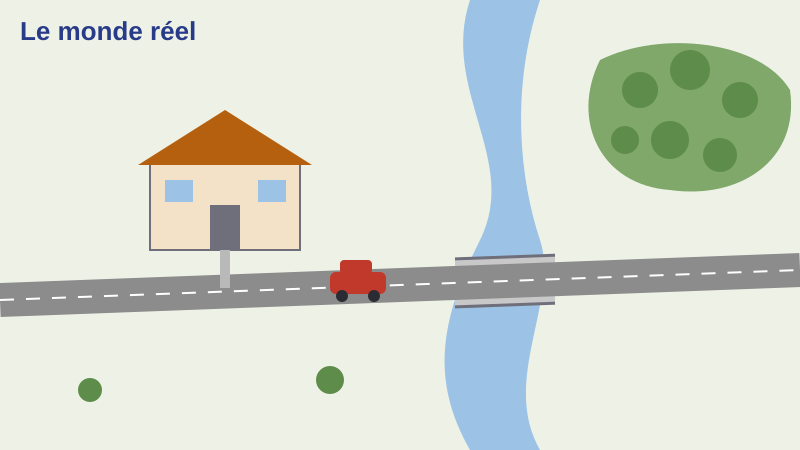
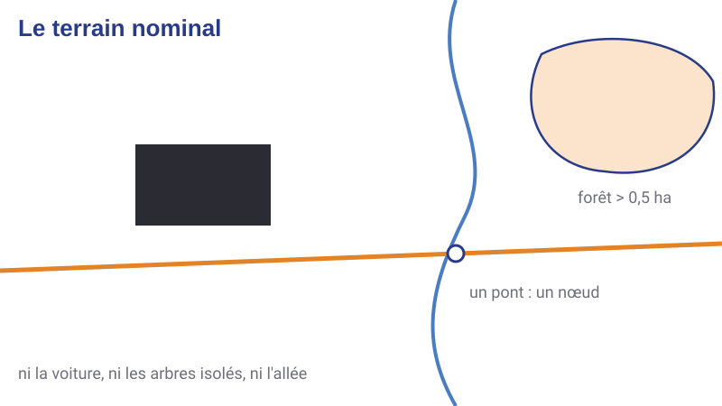

::: {.fiche n="0.1" etat="fige"}
Intention : Couverture. Support de référence, à consulter seul, pas à projeter. [PPT 1]
Expérience : aucune
Demande :
:::

## Comment lire ce support

::: {.fiche n="0.2" etat="fige"}
Intention : Mode d'emploi pour un étudiant seul : les trois niveaux S / A / V, les exercices à faire avant de lire la réponse, les bonus « Pour aller plus loin », l'adresse ?niveau=socle pour réviser. Renvoie au cours « De la Terre à la carte » pour les coordonnées et les projections. [nouvelle]
Expérience : aucune
Demande :
:::

Ce support se lit seul, à votre rythme. Avancez avec les flèches du clavier.

- Le **pictogramme** devant chaque titre donne le niveau : **socle**, à maîtriser ; **appui**, pour consolider ; **veille**, pour aller plus loin. Une diapo sans pictogramme est un exemple. Un clic sur le pictogramme ramène à la carte du cours.
- Les **exercices** : répondez d'abord, dans votre tête ou sur une feuille, puis cliquez. La réponse vient ensuite.
- Le bouton **+** en haut à droite, quand il est là, ouvre un bonus « Pour aller plus loin ».
- Pour **réviser**, ajoutez `?niveau=socle` à la fin de l'adresse de la page : il ne reste que le socle.

[Les coordonnées et les projections sont traitées dans le cours « De la Terre à la carte » : on ne les répète pas ici.]{.a-retenir}

::: {.transparence-ia profil="✒️ L'Auteur outillé" coordonnees="F2 · R0 · S0" outil="Claude 5"}
:::

## Ce que vous saurez faire

::: {.fiche n="0.3" etat="fige"}
Intention : Les trois objectifs de l'ancien support, reformulés : comprendre ce que l'information géographique apporte à la gestion d'un territoire ; savoir utiliser un SIG ; savoir définir un SIG et suivre sa mise en œuvre. L'objectif « maîtriser QGIS et/ou ArcGIS » devient : QGIS en TP, des principes valables pour tous les logiciels. [PPT 2, 15]
Expérience : aucune
Demande :
:::

À la fin de ce support, vous saurez :

1. **dire ce que l'information géographique apporte** à la gestion d'un territoire, d'une ville ou d'une forêt ;
2. **utiliser un SIG** : ouvrir des données, les interroger, les représenter, les croiser ;
3. **définir un SIG** pour un besoin donné et suivre sa mise en œuvre.

[En TP, vous travaillerez avec QGIS. Les principes vus ici valent pour tous les logiciels du même type.]{.a-retenir}

## Carte du cours

::: {.fiche n="0.4" etat="fige"}
Intention : Les six parties et la légende S / A / V.
Expérience : liens vers chaque diapo
Demande :
:::

::: {.carte-du-cours}
:::

## D'où vient le SIG ? {.intercalaire}

::: {.fiche n="1.0" etat="fige"}
Intention : Deux familles d'outils qui se rencontrent. [PPT 3]
Expérience : aucune
Demande :
:::

Deux familles d'outils qui se rencontrent.

## Dessiner ou stocker ? {.appui}

::: {.fiche n="1.1" etat="fige"}
Intention : Deux ancêtres : le dessin assisté par ordinateur (des formes, des coordonnées relatives, un usage visuel) et la base de données (des tables, des champs, des valeurs reliées par des clefs, un usage informationnel). Exemples de logiciels mis à jour. [PPT 4, 5]
Expérience : classer six propriétés dans « dessin » ou « base de données »
Demande :
:::

:::: {.columns .resserre}
::: {.column width="42%"}
{fig-alt="Carte de l'occupation du sol de La Réunion ouverte dans un logiciel de dessin"}

[L'occupation du sol de La Réunion, mise en page dans un logiciel de dessin : une belle carte, que l'on ne peut pas interroger.]{.legende}
:::
::: {.column width="58%"}
Le SIG a deux ancêtres. À quelle famille appartient chaque propriété ?

::: {.classer}
### Le dessin assisté par ordinateur

- Des coordonnées relatives à la feuille
- Un usage d'abord visuel
- AutoCAD, Illustrator, Inkscape

### La base de données

- Des tables reliées par des clefs
- Consulter, interroger, analyser
- Access, PostgreSQL
:::
:::
::::

## La fusion {.socle}

::: {.fiche n="1.2" etat="fige"}
Intention : Un SIG couple une base de données et un système de cartographie, dans un système de coordonnées absolu. Le schéma d'origine (SGBD, couche logicielle, couches cartographiques) est redessiné aux couleurs de la charte. [PPT 6]
Expérience : schéma dessiné
Demande :
:::

::: {.schema fichier="images/schemas/fusion.svg" hauteur="330"}
:::

[Un SIG couple une base de données et un système de cartographie, dans un système de coordonnées absolu : chaque objet a sa place sur la Terre, pas seulement sur la feuille.]{.a-retenir}

## Ce que la fusion permet {.appui}

::: {.fiche n="1.3" etat="fige"}
Intention : S'affranchir de l'échelle et de la projection ; stocker un objet et ses caractéristiques (une parcelle et son numéro) ; relier des objets et des données (une parcelle et son propriétaire) ; se servir de l'espace comme d'une variable d'analyse. Exemples forestiers. [PPT 7]
Expérience : QCM : laquelle de ces opérations est impossible avec une carte papier seule ?
Demande :
:::

:::: {.columns}
::: {.column width="52%"}
- **S'affranchir** de l'échelle et de la projection : la carte se fait à la demande.
- **Stocker** un objet et ses caractéristiques : une parcelle forestière et son numéro.
- **Relier** un objet et des données : la parcelle, son propriétaire, son plan de gestion.
- **Analyser** avec l'espace comme variable : les peuplements à moins de 200 m d'une piste.
- **Traduire** un phénomène en carte thématique.
:::
::: {.column width="48%"}
::: {.qcm}
Laquelle de ces opérations est impossible avec une carte papier seule ?

- [ ] Mesurer une distance
    - Possible : la règle et l'échelle suffisent.
- [x] Afficher d'un clic toutes les parcelles d'un même propriétaire
    - Oui : il faut relier les objets à une table. C'est ce que permet la fusion.
- [ ] Repérer une route
    - Possible : c'est l'usage premier d'une carte.
:::
:::
::::

## Une brève histoire {.veille}

::: {.fiche n="1.4" etat="fige"}
Intention : Des années 1960 à aujourd'hui : premier SIG au Canada (CGIS, Roger Tomlinson), premiers logiciels commerciaux, essor des fonctions métier, web et logiciel libre (QGIS), 3D, mobile, données ouvertes. Corrige l'ancien support, qui faisait d'Esri l'inventeur du SIG. [PPT 8, 9 masquée]
Expérience : remise en ordre de cinq étapes ; bonus « Pour aller plus loin » sur Esri et ArcGIS
Demande :
:::

::: {.ordre}
Remettez ces étapes dans l'ordre chronologique.

1. Au Canada, Roger Tomlinson conçoit le premier SIG, le CGIS, pour l'inventaire des terres : agriculture, forêt, faune.
2. Les premiers logiciels commerciaux apparaissent, comme ARC/INFO d'Esri.
3. Les SIG entrent dans les services des collectivités et des entreprises : la dimension métier.
4. Le web et le logiciel libre se développent : QGIS naît en 2002.
5. La 3D, le mobile et les données ouvertes se généralisent.
:::

::: {.plus titre="Esri et ArcGIS"}
Esri (*Environmental Systems Research Institute*) est fondée en 1969 en Californie par Jack et Laura Dangermond, comme cabinet de conseil en aménagement du territoire. Son logiciel ARC/INFO, au début des années 1980, puis ArcGIS en ont fait l'éditeur commercial le plus répandu.

Esri n'a pas inventé le SIG : le premier, le CGIS, est canadien et date des années 1960.
:::

## Qu'est-ce qu'un SIG ? {.intercalaire}

::: {.fiche n="2.0" etat="fige"}
Intention : Plus qu'un logiciel. [PPT 10]
Expérience : aucune
Demande :
:::

Plus qu'un logiciel.

## Avant tout un système {.socle}

::: {.fiche n="2.1" etat="fige"}
Intention : Cinq définitions qui s'emboîtent : une base de données à référence spatiale, un système d'information, un logiciel, une façon de gérer des données, une équipe. Le mot important est « système ». [PPT 11, 12]
Expérience : question avant la réponse : qu'est-ce qui fait partie d'un SIG ? (l'ancien brainstorm)
Demande :
:::

::: {.question}
**Qu'est-ce qui fait partie d'un SIG ?** Faites votre liste avant de cliquer.
:::

::: {.reponse}
:::: {.columns}
::: {.column width="55%"}
Un SIG, c'est à la fois :

- une **base de données à référence spatiale** ;
- un **système d'information** qui intègre des données localisées ;
- un **logiciel** ;
- une **façon de gérer** les données ;
- des **équipes** qui le font vivre.
:::
::: {.column width="45%"}
[Un SIG est avant tout un système : des données, des outils, des personnes et une organisation.]{.a-retenir}
:::
::::
:::

## Les composantes d'un SIG {.socle}

::: {.fiche n="2.2" etat="fige"}
Intention : Des données (de référence, métier), des équipements (matériel, logiciels), des personnes (administrateurs, gestionnaires, utilisateurs), une organisation, des applications. Schéma redessiné, sans les vignettes de 2010. [PPT 13]
Expérience : classer huit éléments (QGIS, BD TOPO, un plan d'aménagement forestier, un serveur, un géomaticien, une procédure de mise à jour…) dans Données / Outils / Personnes / Organisation
Demande :
:::

::: {.schema fichier="images/schemas/composantes.svg" hauteur="150"}
:::

::: {.classer}
### Données

- La BD TOPO, donnée de référence
- Le plan d'aménagement d'une forêt, donnée métier

### Outils

- QGIS
- Un serveur de données

### Personnes

- Un géomaticien
- Un technicien forestier qui consulte la carte

### Organisation

- La procédure de mise à jour annuelle
- Qui a le droit de modifier quoi
:::

## Le vocabulaire en un schéma {.appui}

::: {.fiche n="2.3" etat="fige"}
Intention : La vue d'ensemble de l'ancien support, à garder sous la main : tables, champs, valeurs, clefs, SGBD ; couches raster, vecteur, MNT ; objets point, ligne, surface ; système de projection ; interface. Chaque mot renvoie à la diapo qui l'explique. [PPT 16]
Expérience : schéma dessiné, mots cliquables vers les diapos
Demande :
:::

::: {.schema fichier="images/schemas/vocabulaire.svg" hauteur="450"}
:::

[Cliquez sur un mot du schéma pour aller à la diapo qui l'explique.]{.legende}

## Les données géographiques {.intercalaire}

::: {.fiche n="3.0" etat="fige"}
Intention : Le G de SIG : une information localisée ou localisable. [PPT 18, 26, 32]
Expérience : aucune
Demande :
:::

Le G de SIG : une information localisée, ou localisable.

## Où, et quoi {#ou-et-quoi .socle}

::: {.fiche n="3.1" etat="fige"}
Intention : Une donnée géographique a deux composantes : spatiale (où ?) et sémantique (quoi ?). La géométrie repose sur un système de coordonnées : renvoi au cours « De la Terre à la carte ». Elle se stocke de deux façons : raster ou vecteur. [PPT 19]
Expérience : question : dans « D400, route départementale, 2 voies », qu'est-ce qui dit où, qu'est-ce qui dit quoi ?
Demande :
:::

Une donnée géographique a deux composantes :

- **spatiale** : *où* est l'objet ? C'est sa géométrie, repérée dans un système de coordonnées ;
- **sémantique** : *qu'est-ce que* c'est ? Ce sont ses attributs.

La géométrie se stocke de deux façons : en **raster** ou en **vecteur**.

::: {.question}
Une route est tracée par quatre points (X1, Y1) … (X4, Y4) et décrite par « D400, route départementale, 2 voies ». **Qu'est-ce qui dit où, qu'est-ce qui dit quoi ?**
:::

::: {.reponse}
Les quatre couples de coordonnées disent *où* : c'est la composante spatiale. « D400, route départementale, 2 voies » dit *quoi* : c'est la composante sémantique.
:::

## Le raster : une grille {#raster .socle}

::: {.fiche n="3.2" etat="fige"}
Intention : Un quadrillage régulier du terrain ; chaque pixel porte une valeur (radiométrie d'une image, couleur d'un scan). Sur 8 bits, 256 valeurs par bande ; plusieurs bandes se superposent. Le texte des notes orales passe sur la diapo. [PPT 20]
Expérience : QCM : combien de valeurs différentes peut prendre un pixel codé sur 8 bits ? ; bonus : une image satellite et un scan
Demande :
:::

:::: {.columns}
::: {.column width="46%"}
::: {.schema fichier="images/schemas/raster-grille.svg" hauteur="340"}
:::
:::
::: {.column width="54%"}
Le mode **raster**, ou matriciel, découpe le terrain en un quadrillage régulier. Chaque case, le **pixel**, porte une valeur : l'intensité lumineuse pour une image satellite ou une photo aérienne, la couleur pour un document scanné. Une image a souvent plusieurs **bandes** superposées.

::: {.qcm .serre}
Sur 8 bits, combien de valeurs différentes un pixel peut-il prendre ?

- [ ] 8
    - Non : 8 est le nombre de bits, pas de valeurs.
- [x] 256
    - Oui : 2^8^ = 256, de 0 à 255.
- [ ] 65 536
    - C'est le cas sur 16 bits.
:::
:::
::::

::: {.plus titre="Deux rasters"}
:::: {.columns}
::: {.column width="50%"}
{fig-alt="Image satellite en fausses couleurs" height="300"}

[Une image satellite : chaque pixel porte une mesure de lumière.]{.legende}
:::
::: {.column width="50%"}
{fig-alt="Carte topographique scannée des environs de Mulhouse" height="300"}

[Une carte scannée : chaque pixel porte une couleur.]{.legende}
:::
::::
:::

## Un raster d'altitudes : le MNT {#mnt .appui}

::: {.fiche n="3.3" etat="fige"}
Intention : Dans un modèle numérique de terrain, chaque pixel porte une altitude ; le logiciel en tire un relief ombré ou une vue 3D. Exemple forestier : la pente. [PPT 21]
Expérience : bonus « Pour aller plus loin » : le RGE ALTI et le programme LiDAR HD de l'IGN
Demande :
:::

:::: {.columns}
::: {.column width="50%"}
{fig-alt="Relief en trois dimensions coloré selon l'altitude"}
:::
::: {.column width="50%"}
Dans un **modèle numérique de terrain** (MNT), chaque pixel porte une **altitude**.

Le logiciel en calcule la pente, l'orientation, un relief ombré ou une vue en 3D, en interpolant entre les pixels.

[En forêt, la pente décide de ce que l'on peut exploiter, et avec quels engins.]{.a-retenir}
:::
::::

::: {.plus titre="Les MNT de l'IGN"}
Le **RGE ALTI** couvre la France au pas de 1 m ou de 5 m.

Le programme **LiDAR HD** relève tout le territoire en nuages de points, à au moins 10 impulsions par mètre carré. On en tire un MNT au pas de 50 cm, et la hauteur de la végétation. Les données sont ouvertes, sur [cartes.gouv.fr](https://cartes.gouv.fr).
:::

## Le vecteur : point, ligne, surface {#vecteur .socle}

::: {.fiche n="3.4" etat="fige"}
Intention : Les primitives géométriques : le point (une borne), la ligne (un axe de route), la surface (une commune). Le texte (un toponyme) est un cas intermédiaire. Le choix de la primitive dépend de l'échelle. [PPT 22]
Expérience : classer six objets forestiers (arbre remarquable, puits, piste forestière, ligne électrique, parcelle forestière, commune) ; puis question : une rivière est-elle toujours une ligne ?
Demande :
:::

::: {.schema fichier="images/schemas/primitives.svg" hauteur="160"}
:::

:::: {.columns .resserre}
::: {.column width="58%"}
::: {.classer}
### Point

- Un arbre remarquable
- Un puits

### Ligne

- Une piste forestière
- Une ligne électrique

### Surface

- Une parcelle forestière
- Une commune
:::
:::
::: {.column width="42%"}
::: {.question}
Une rivière est-elle toujours une ligne ?
:::

::: {.reponse}
Non. À grande échelle, la Loire est une surface ; à petite échelle, une ligne. Le choix de la primitive dépend de l'échelle et de l'usage. Le texte, un nom de lieu, se place comme un point.
:::
:::
::::

## Des vecteurs particuliers : TIN et réseaux {.veille}

::: {.fiche n="3.5" etat="fige"}
Intention : Le TIN, réseau de triangles irréguliers, décrit le relief par facettes de pente (utile en hydrologie). Le réseau relie des tronçons par des nœuds : il sert au calcul d'itinéraire. La capture Google Maps de 2014 est remplacée par un schéma. [PPT 23, 24]
Expérience : aucune
Demande :
:::

:::: {.columns}
::: {.column width="48%"}
::: {.centre}
{fig-alt="Relief découpé en triangles irréguliers" height="300"}
:::

Le **TIN** (*Triangulated Irregular Network*) découpe le relief en triangles de taille variable. Chaque facette a une pente et une orientation : on suit par où l'eau s'écoule.
:::
::: {.column width="52%"}
::: {.schema fichier="images/schemas/reseau.svg" hauteur="320"}
:::

Le **réseau** relie des tronçons par des nœuds. Il sert à calculer un itinéraire, à organiser la desserte d'une forêt, à gérer des réseaux d'eau.
:::
::::

## Raster ou vecteur ? {.socle}

::: {.fiche n="3.6" etat="fige"}
Intention : Le raster est facile d'emploi, déjà symbolisé, lourd, et limite les analyses ; le vecteur est plus riche, plus léger, permet toutes les analyses, mais demande un habillage et plus de savoir-faire. [PPT 25]
Expérience : défiler du raster au vecteur, en grand ; classer huit propriétés dans « raster » ou « vecteur » (l'ancienne consigne orale « proposer des différences »)
Demande :
:::

:::: {.columns .resserre}
::: {.column width="42%"}
::: {.defiler commande="haut"}
- 
- 
:::
:::
::: {.column width="58%"}
::: {.classer}
### Raster

- Facile d'emploi, déjà symbolisé
- Une très grosse masse de données
- Des analyses limitées
- Une symbolisation figée

### Vecteur

- Une information plus riche
- Un volume de données moindre
- Toutes sortes d'analyses
- Un habillage nécessaire pour l'afficher
:::
:::
::::

## Les attributs {#attributs .socle}

::: {.fiche n="3.7" etat="fige"}
Intention : Chaque objet porte des informations sémantiques, rangées dans une table attributaire : pour un peuplement forestier, son essence, sa surface, son âge ; pour une route, son nom, son nombre de voies ; pour une commune, son nom, son code INSEE, sa population. Le lien entre l'objet et sa ligne de table passe par une clef. [PPT 27]
Expérience : aucune
Demande :
:::

:::: {.columns}
::: {.column width="50%"}
Chaque objet porte des informations sémantiques, rangées dans une **table attributaire** : une ligne par objet, une colonne par champ.

- Un **peuplement forestier** : essence dominante, surface, âge, propriétaire.
- Une **route** : nom, nombre de voies, nature, largeur.
- Une **commune** : nom, code INSEE, population.

[L'objet et sa ligne de table sont reliés par une clef, visible ou non selon le logiciel.]{.a-retenir}
:::
::: {.column width="50%"}
{fig-alt="Table attributaire ouverte à côté de la carte dans un logiciel SIG"}

[Une table attributaire, ouverte à côté de la carte]{.legende}
:::
::::

## Des types de valeurs {#types-valeurs .appui}

::: {.fiche n="3.8" etat="fige"}
Intention : Texte, réel, entier, booléen, liste de valeurs : le type dit ce que l'on peut calculer. [PPT 28]
Expérience : classer six valeurs (« La Seine », 12,4 ha, 2 154 habitants, 340 tiges par hectare, certifié PEFC : oui, « feuillus » dans une liste) dans leur type ; puis question : pourquoi ne pas tout stocker en texte ?
Demande :
:::

::: {.classer}
### Texte

- « La Seine »

### Réel

- 12,4 ha

### Entier

- 2 154 habitants
- 340 tiges par hectare

### Booléen

- Certifié PEFC : oui

### Liste

- « Feuillus », dans une liste fermée
:::

::: {.question}
Pourquoi ne pas tout stocker en texte ?
:::

::: {.reponse}
Le type dit ce que l'on peut faire de la valeur : additionner, trier, filtrer sur oui ou non. Un nombre écrit en texte ne se calcule pas.
:::

## Une couche par nature d'objet {#couches .socle}

::: {.fiche n="3.9" etat="fige"}
Intention : Les objets de même nature et de même géométrie forment une couche (une classe), avec ses attributs ; les couches se superposent : peuplements, cours d'eau, fond raster. [PPT 29, 30]
Expérience : aucune
Demande :
:::

:::: {.columns}
::: {.column width="58%"}
::: {.schema fichier="images/schemas/couches.svg" hauteur="400"}
:::
:::
::: {.column width="42%"}
On range dans une même **couche** les objets de même nature et de même géométrie. ArcGIS parle de **classe**.

Chaque couche a ses attributs. Les couches se superposent parce qu'elles partagent un système de coordonnées.

[Des relations peuvent relier deux couches : un peuplement appartient à une parcelle.]{.a-retenir}
:::
::::

## D'où viennent les données ? {.appui}

::: {.fiche n="3.10" etat="fige"}
Intention : Produire (levé GNSS, photogrammétrie, image satellite, lidar, numérisation d'un plan papier) ou récupérer (bases existantes : BD TOPO, BD Forêt, cadastre, OpenStreetMap ; flux WMS, WMTS, WFS de la Géoplateforme). Schéma d'acquisition redessiné ; la table à digitaliser disparaît. [PPT 31]
Expérience : question : pour cartographier les dessertes d'une forêt, produire ou récupérer ? (le schéma donne déjà le classement) ; bonus vers cartes.gouv.fr
Demande :
:::

::: {.schema fichier="images/schemas/acquisition.svg" hauteur="250"}
:::

::: {.question}
Vous devez cartographier les pistes d'une forêt communale. **Produire ou récupérer ?**
:::

::: {.reponse}
Les deux : récupérer la BD TOPO pour les routes et pistes connues, puis compléter au GNSS sur le terrain ou sur une orthophotographie, en notant la source et la précision de chaque tracé.
:::

::: {.plus titre="La Géoplateforme"}
Les données de l'IGN et de nombreux producteurs publics se consultent et se téléchargent sur [cartes.gouv.fr](https://cartes.gouv.fr), la vitrine de la Géoplateforme.

On peut aussi les charger dans QGIS sous forme de flux, sans les télécharger : WMS et WMTS pour des images, WFS pour des objets vecteur.
:::

## La topologie {.appui}

::: {.fiche n="3.11" etat="fige"}
Intention : Ce qui ne change pas quand on déforme : inclusion, adjacence, voisinage, intersection. Le plan du métro ne respecte ni les distances ni les formes, mais respecte la topologie. Lien avec la table de Peutinger du premier cours. [PPT 33, 34]
Expérience : question : le plan du métro est-il faux ? ; bonus « Pour aller plus loin » : la matrice des relations spatiales (l'image de la diapo 33)
Demande :
:::

:::: {.columns}
::: {.column width="42%"}
{fig-alt="Plan schématique du métro de Paris" height="430"}
:::
::: {.column width="58%"}
La **topologie** décrit ce qui ne change pas quand on déforme une figure : l'**inclusion**, l'**adjacence**, le **voisinage**, l'**intersection**.

::: {.question}
Le plan du métro ne respecte ni les distances ni les formes. **Est-il faux ?**
:::

::: {.reponse}
Il est faux en distances et en formes, mais juste en topologie : l'ordre des stations et les correspondances sont exacts. C'est tout ce qu'il faut au voyageur, comme sur la table de Peutinger du cours « De la Terre à la carte ».
:::
:::
::::

::: {.plus titre="La matrice des relations spatiales"}
:::: {.columns}
::: {.column width="40%"}
{fig-alt="Tableau des relations possibles entre points, lignes et surfaces" height="380"}
:::
::: {.column width="60%"}
Entre deux objets, point, ligne ou surface, les relations possibles se rangent dans un tableau : disjoints, se touchent, se croisent, l'un contient l'autre, se recouvrent.

Les logiciels s'appuient sur un modèle de ce type, le DE-9IM, pour les requêtes spatiales : « les peuplements qui touchent une piste ».
:::
::::
:::

## Et la troisième dimension ? {.veille}

::: {.fiche n="3.12" etat="fige"}
Intention : SIG 2D ; 2D½, où l'altitude est un attribut ; 3D, où elle est une coordonnée Z ; et les modules de MNT. Exemples : TIN, extrusion des bâtiments, drapé d'un scan, nuage lidar, lidar sous la forêt. [PPT 35, 36, 37]
Expérience : défiler les images 3D ; QCM : un bâtiment qui porte sa hauteur dans un attribut, c'est du 2D, du 2D½ ou du 3D ?
Demande :
:::

:::: {.columns .resserre}
::: {.column width="40%"}
- **2D** : la troisième dimension est ignorée.
- **2D½** : l'altitude est un attribut de l'objet.
- **3D** : l'altitude est une coordonnée, Z.
- Et des modules qui gèrent l'altitude à partir d'un MNT.

::: {.qcm .serre}
Un bâtiment porte sa hauteur dans un attribut. C'est…

- [ ] du 2D
    - Non : la hauteur est stockée.
- [x] du 2D½
    - Oui : la hauteur est un attribut, pas une coordonnée. C'est ce qui permet l'extrusion.
- [ ] du 3D
    - Il faudrait une coordonnée Z pour chaque sommet.
:::
:::
::: {.column width="60%"}
::: {.defiler commande="haut"}
- 
- 
- 
- 
- 
:::
:::
::::

## Décrire un objet géographique {.socle}

::: {.fiche n="3.13" etat="fige"}
Intention : La synthèse de la partie : obligatoire, une géométrie et une description sémantique ; facultatif, des informations topologiques ; toujours, un système de coordonnées (Lambert 93). Exemple de la D400. Schéma redessiné. [PPT 38]
Expérience : schéma dessiné ; QCM : qu'est-ce qui est obligatoire ?
Demande :
:::

::: {.schema fichier="images/schemas/objet-geographique.svg" hauteur="250"}
:::

::: {.qcm .serre}
Pour décrire un objet géographique, qu'est-ce qui est indispensable ? Plusieurs réponses sont justes.

- [x] La géométrie
    - Oui : sans elle, l'objet n'est pas localisé.
- [x] La description sémantique
    - Oui : sans elle, on ne sait pas ce qu'est l'objet.
- [ ] La topologie
    - Facultative : précieuse pour un réseau, elle n'est pas toujours stockée.
- [x] Le système de coordonnées
    - Oui : sans lui, les coordonnées ne veulent rien dire.
:::

## Les fonctions de base {.intercalaire}

::: {.fiche n="4.0" etat="fige"}
Intention : Ce que l'on fait avec un SIG, en cinq verbes. [PPT 39]
Expérience : aucune
Demande :
:::

Ce que l'on fait avec un SIG.

## Cinq verbes {.socle}

::: {.fiche n="4.1" etat="fige"}
Intention : Consulter, sélectionner, représenter, modifier, analyser. [PPT 14, 39, 40]
Expérience : classer neuf tâches forestières dans leur verbe : remplace l'ancien brainstorm « Quelles sont-elles ? »
Demande :
:::

**Consulter, sélectionner, représenter, modifier, analyser.** À quel verbe correspond chaque tâche ?

::: {.classer}
### Consulter

- Cliquer sur une parcelle pour lire son propriétaire

### Sélectionner

- Garder les peuplements de chêne de plus de 5 ha

### Représenter

- Colorer les peuplements selon leur essence
- Mettre en page la carte pour l'imprimer

### Modifier

- Corriger le tracé d'une piste
- Ajouter la coupe réalisée cette année

### Analyser

- Calculer la surface boisée de la commune
- Trouver les peuplements traversés par un cours d'eau
:::

## Consulter {.socle}

::: {.fiche n="4.2" etat="fige"}
Intention : Trouver les informations d'un objet en le désignant, ou trouver l'objet à partir d'une information. [PPT 41]
Expérience : question : donnez un exemple dans chaque sens (l'ancien « Ex : ? »)
Demande :
:::

**Consulter**, c'est trouver les informations d'un objet géographique, ou trouver l'objet à partir d'une information.

::: {.question}
Donnez un exemple dans chaque sens.
:::

::: {.reponse}
- De l'objet vers l'information : je clique sur une parcelle, je lis son propriétaire et sa surface.
- De l'information vers l'objet : je cherche la parcelle cadastrale B 412, ou une adresse, et le SIG me la montre sur la carte.
:::

## Sélectionner {.socle}

::: {.fiche n="4.3" etat="fige"}
Intention : Constituer un ensemble cohérent selon un critère sémantique, géométrique ou topologique, que l'on peut croiser ; on l'écrit souvent en SQL. Exemple : "ROUTE" = 'D100' ; les bâtiments de plus de 100 m² ; un exemple forestier. La capture Géoconcept est remplacée par l'expression écrite. [PPT 42]
Expérience : QCM : quelle requête garde les bâtiments de plus de 100 m² ?
Demande :
:::

:::: {.columns}
::: {.column width="52%"}
**Sélectionner**, c'est constituer un ensemble cohérent d'objets selon un critère :

- **sémantique** : l'essence est le chêne ;
- **géométrique** : la surface dépasse 5 ha ;
- **topologique** : le peuplement touche une piste.

On croise les critères, on affine. On les écrit souvent en SQL :

`"ROUTE" = 'D100'`

`"ESSENCE" = 'Chêne' AND "SURFACE_HA" > 5`
:::
::: {.column width="48%"}
::: {.qcm}
Quelle expression garde les bâtiments de plus de 100 m² ?

- [ ] `"SURFACE" = 100`
    - Seulement ceux qui font exactement 100 m².
- [x] `"SURFACE" > 100`
    - Oui.
- [ ] `"SURFACE" < 100`
    - C'est l'inverse : les plus petits.
:::
:::
::::

## Représenter {.socle}

::: {.fiche n="4.4" etat="fige"}
Intention : Définir des règles de symbolisation (couleur, taille, épaisseur, transparence), qui peuvent varier avec l'échelle ; en tirer des cartes thématiques (taux de chômage par département). Renvoi au cours de cartographie pour la sémiologie. Les captures Géoconcept et MapInfo disparaissent. [PPT 43, 44, 45]
Expérience : aucune
Demande :
:::

:::: {.columns}
::: {.column width="52%"}
**Représenter**, c'est définir des règles de symbolisation : couleur, taille, épaisseur, transparence. Elles peuvent changer avec l'échelle.

Quand le symbole varie selon un attribut, on obtient une **carte thématique** : colorer les peuplements selon leur essence, les départements selon leur taux de chômage.

[Les règles du choix des symboles, la sémiologie graphique, sont vues dans le cours de cartographie.]{.a-retenir}
:::
::: {.column width="48%"}
{fig-alt="Carte de France des départements colorés selon le taux de chômage" height="400"}

[Taux de chômage par département, données INSEE. Les chiffres sont anciens : l'exemple vaut pour la méthode.]{.legende}
:::
::::

## Mettre en page {.appui}

::: {.fiche n="4.5" etat="fige"}
Intention : Une carte publiée a un cadre, un titre, une légende, une échelle, des sources ; l'orientation, sauf quand elle est évidente pour tous (une carte de France pour des Français). Dans QGIS, la mise en page se fait dans une fenêtre à part. [PPT 46]
Expérience : QCM à réponses multiples : quels éléments une carte publiée doit-elle porter ?
Demande :
:::

:::: {.columns .resserre}
::: {.column width="50%"}
{fig-alt="Carte mise en page au 1:10 000 avec sa légende et son échelle"}

[Une mise en page au 1:10 000]{.legende}

Dans QGIS, la mise en page se prépare dans une fenêtre à part.
:::
::: {.column width="50%"}
::: {.qcm .serre}
Quels éléments une carte publiée doit-elle porter ? Plusieurs réponses sont justes.

- [x] Un titre
    - Oui : il dit ce que montre la carte.
- [x] Une légende
    - Oui : elle donne le sens des symboles.
- [x] Une échelle
    - Oui : pour mesurer.
- [ ] Une orientation
    - Pas toujours : on peut l'enlever quand elle est évidente pour tout le monde, par exemple une carte de France pour des Français.
- [x] La source et la date des données
    - Oui : le lecteur doit savoir d'où vient l'information.
- [ ] La liste des couches du projet
    - Non : elle sert à l'auteur, pas au lecteur.
:::
:::
::::

## Modifier {.socle}

::: {.fiche n="4.6" etat="fige"}
Intention : Changer des valeurs, la structure d'une table, ajouter ou supprimer des objets, changer leur forme ou leur type, fusionner, découper. Cela suppose souvent de créer de nouvelles couches : l'organisation compte. Exemple forestier : après une coupe. [PPT 47]
Expérience : aucune
Demande :
:::

**Modifier**, c'est :

- transformer des valeurs d'attributs ;
- changer la structure des données : ajouter un champ ;
- ajouter ou supprimer des objets ;
- changer la forme ou le type d'un objet ;
- fusionner, découper, regrouper.

Après une coupe, on découpe le peuplement, on crée la nouvelle surface et l'on met à jour son âge.

[Modifier, c'est souvent créer une nouvelle couche : on garde l'original, on travaille sur une copie. L'organisation des couches compte.]{.a-retenir}

## Analyser {.socle}

::: {.fiche n="4.7" etat="fige"}
Intention : Des calculs simples (surface, périmètre, centroïde), un changement de système de coordonnées, des lissages ; surtout, le croisement de couches : les peuplements traversés par un cours d'eau (au lieu des parcelles irriguées). Schéma du croisement redessiné. [PPT 48, 49]
Expérience : question (prédiction) : quels peuplements sortiront de ce croisement ?
Demande :
:::

**Analyser** : calculer des surfaces, changer de système de coordonnées, lisser… et surtout **croiser des couches**.

:::: {.columns}
::: {.column width="50%"}
::: {.schema fichier="images/schemas/croisement-entrees.svg" hauteur="190"}
:::

::: {.question etiquette="Prédiction"}
On cherche les peuplements traversés par le cours d'eau. **Lesquels la nouvelle couche gardera-t-elle ?**
:::
:::
::: {.column width="50%"}
::: {.reponse}
::: {.schema fichier="images/schemas/croisement-resultat.svg" hauteur="230"}
:::

P1, P3, P4 et P5 : tous ceux que le cours d'eau traverse, même sur quelques mètres. P2 et P6 restent dehors.
:::
:::
::::

## Quel SIG pour quel usage ? {.veille}

::: {.fiche n="4.8" etat="fige"}
Intention : SIG de gestion, d'étude, d'observation, de synthèse. Logiciels d'aujourd'hui : QGIS, ArcGIS Pro, PostGIS, FME, outils web. Ces deux diapos étaient masquées dans le PPT ; gardées à la demande de Marc. [PPT 50, 51 masquées]
Expérience : classer quatre situations forestières dans leur type de SIG
Demande :
:::

:::: {.columns .resserre}
::: {.column width="46%"}
- **Gestion** : gérer un patrimoine, dans des procédures établies.
- **Étude** : rassembler des informations variées sur un territoire, pour un projet.
- **Observation** : suivre une thématique sur un territoire, et la tenir à jour.
- **Synthèse** : produire une cartographie d'ensemble, à petite échelle.

Les logiciels : QGIS (libre), ArcGIS Pro (commercial), PostGIS (base de données), FME (traitements), et des outils web.
:::
::: {.column width="54%"}
::: {.classer}
### Gestion

- Suivre les coupes et les travaux d'une forêt domaniale

### Étude

- Préparer le tracé d'une nouvelle piste

### Observation

- Suivre chaque année les dégâts de scolytes dans un massif

### Synthèse

- Cartographier la forêt d'une région pour un schéma régional
:::
:::
::::

## À quoi sert un SIG ? {.intercalaire}

::: {.fiche n="5.0" etat="fige"}
Intention : Communiquer, analyser, simuler. [PPT 52]
Expérience : aucune
Demande :
:::

Communiquer, analyser, simuler.

## Communiquer, analyser, simuler

::: {.fiche n="5.1" etat="fige"}
Intention : Une galerie d'exemples réels, sans étiquette de niveau : départs de feux dans le Var, taxons en Guadeloupe, phosphore dans les sols, population de la Martinique, BD Forêt à Nancy, usages du Massif Central, trafic, isochrones de Bourges, implantation à Bordeaux, exposition aux ondes, impact odorant. Légendes et sources sous chaque image. [PPT 53 à 61]
Expérience : défiler les cartes en grand, flèches fixes sous le titre
Demande :
:::

::: {.defiler commande="haut"}
- 
- 
- 
- 
- 
- 
- 
- 
- 
- 
- 
:::

## Quel usage ? {.appui}

::: {.fiche n="5.2" etat="fige"}
Intention : Distinguer les trois grands usages par ce qui doit ressortir le plus : pour communiquer, la clarté du résultat ; pour analyser, la pertinence du processus ; pour simuler, la relation entre intrants et extrants. [PPT 53, 56, 59]
Expérience : question : une carte de simulation sans ses hypothèses, que manque-t-il au lecteur ?
Demande :
:::

Les trois usages ne demandent pas la même chose. Ce qui doit ressortir le plus :

:::: {.columns}
::: {.column width="33%"}
### Communiquer

**La clarté du résultat** : un message lisible au premier coup d'œil.
:::
::: {.column width="34%"}
### Analyser

**La pertinence du processus** : des données adaptées, une méthode explicite, que l'on peut refaire.
:::
::: {.column width="33%"}
### Simuler

**Le lien entre intrants et extrants** : des hypothèses affichées, des paramètres que l'on fait varier.
:::
::::

:::: {.columns}
::: {.column width="50%"}
::: {.question}
Une carte de simulation est publiée sans ses hypothèses. **Que manque-t-il au lecteur ?**
:::
:::
::: {.column width="50%"}
::: {.reponse}
Le moyen de juger le résultat : sans les intrants, il ne sait ni ce que la carte simule, ni ce qui changerait avec une autre hypothèse.
:::
:::
::::

[La frontière est poreuse : une carte d'analyse sert aussi à communiquer.]{.a-retenir}

## Des métiers, des secteurs {.veille}

::: {.fiche n="5.3" etat="fige"}
Intention : Production de données, développement, environnement et aménagement, risques, agriculture, forêt, santé, télécommunications, recherche. Un focus sur la forêt. [PPT 62]
Expérience : aucune
Demande :
:::

:::: {.columns}
::: {.column width="50%"}
Les SIG sont partout :

- production et diffusion de données ;
- développement informatique ;
- environnement et aménagement ;
- risques, agriculture, forêt ;
- santé, télécommunications ;
- formation et recherche ;
- etc.
:::
::: {.column width="50%"}
**En forêt**, le SIG sert à :

- inventorier la ressource ;
- rédiger et suivre les plans d'aménagement ;
- organiser la desserte ;
- défendre les forêts contre l'incendie ;
- suivre la santé des peuplements ;
- etc.
:::
::::

## Concevoir un SIG {.intercalaire}

::: {.fiche n="6.0" etat="fige"}
Intention : Avant de saisir, décider de ce que l'on saisira. [PPT 63]
Expérience : aucune
Demande :
:::

Avant de saisir, décider de ce que l'on saisira.

## D'abord les besoins {.socle}

::: {.fiche n="6.1" etat="fige"}
Intention : L'information en sortie : à qui s'adresse la base, à quoi elle sert, quels autres usages, qui sont les experts du phénomène. Cela définit le contenu, les partenaires, la précision utile. [PPT 64, 66]
Expérience : aucune
Demande :
:::

La conception d'un SIG commence par une analyse des besoins et de l'existant. On part de l'**information en sortie** :

- À qui s'adresse la base ? Pour quelles applications ?
- Quelles autres utilisations sont possibles ?
- Faut-il interroger les futurs utilisateurs ?
- Qui sont les experts du phénomène étudié ?
- Où ira-t-on chercher l'information ?

[Ces réponses définissent le contenu de la base, les partenaires, les informations utiles et leur précision.]{.a-retenir}

## Avec quels moyens ? {.appui}

::: {.fiche n="6.2" etat="fige"}
Intention : La zone à saisir, les sources disponibles ou à acheter, les personnes, le matériel, les logiciels, le budget. Ce que l'on peut faire, et en combien de temps ; ces choix rétroagissent sur les besoins. [PPT 67]
Expérience : aucune
Demande :
:::

On analyse ensuite la capacité de production :

- la zone à saisir ;
- les sources disponibles : images, cartes, bases existantes ;
- les sources à obtenir, et leur coût ;
- les personnes : leurs connaissances, leur formation ;
- le matériel et les logiciels ;
- le budget.

[Qu'est-il possible de faire, et en combien de temps ? Ces choix modifient les besoins : on fait des allers-retours.]{.a-retenir}

## Spécifier {.appui}

::: {.fiche n="6.3" etat="fige"}
Intention : L'information en entrée : identifier ce qui, du monde réel, est nécessaire et suffisant ; définir chaque information et sa règle de sélection ; écrire la spécification. Modéliser, c'est décider ce qui entre dans la base, ce qui n'y entre pas, et avec quelle précision. [PPT 65, 68, 69]
Expérience : aucune
Demande :
:::

La **spécification** décrit l'**information en entrée** :

- identifier ce qui, du monde réel, est nécessaire et suffisant ;
- définir chaque information de la base, et la règle qui décide de sa sélection ;
- écrire la spécification.

Elle sert ensuite à choisir un SIG selon ses capacités, puis à implémenter la base.

[Modéliser, c'est décider ce qui entre dans la base, ce qui n'y entre pas, et avec quelle précision, géométrique et sémantique.]{.a-retenir}

## Le terrain nominal {.socle}

::: {.fiche n="6.4" etat="fige"}
Intention : « La modélisation du monde réel à travers le filtre des spécifications. » Le monde réel d'un côté, ce que la base en garde de l'autre ; sans oublier le système de coordonnées et la précision (note orale). Schémas redessinés, avec une forêt. [PPT 70]
Expérience : comparer : curseur entre le monde réel et le terrain nominal
Demande :
:::

:::: {.columns}
::: {.column width="62%"}
::: {.comparer}
- 
- 
:::
:::
::: {.column width="38%"}
Le **terrain nominal**, c'est « la modélisation du monde réel à travers le filtre des spécifications ».

Faites glisser le curseur : le bâtiment devient un bloc, la route et la rivière des axes, la forêt une surface ; la voiture et les arbres isolés disparaissent.

[Sans oublier le système de coordonnées et la précision.]{.a-retenir}
:::
::::

## Un rond-point, trois modèles {.appui}

::: {.fiche n="6.5" etat="fige"}
Intention : La saisie dépend du besoin. Dans la BD TOPO, un rond-point ordinaire devient un cercle de tronçons, la place de l'Étoile se modélise avec des axes fictifs ; on aurait pu choisir deux lignes et un point portant l'attribut « rond-point ». Schéma redessiné. [PPT 71, 72]
Expérience : QCM : quel modèle de rond-point pour la base d'un outil de guidage routier ?
Demande :
:::

::: {.schema fichier="images/schemas/rond-point.svg" hauteur="270"}
:::

:::: {.columns .resserre}
::: {.column width="50%"}
La représentation se choisit selon le besoin. Dans la BD TOPO, un rond-point ordinaire est un anneau de tronçons ; un très grand rond-point, comme la place de l'Étoile, se modélise avec des axes fictifs. On aurait pu choisir deux lignes et un point qui porte l'attribut « rond-point ».
:::
::: {.column width="50%"}
::: {.qcm .serre}
Vous réalisez une base routière pour un outil de guidage routier. Quel modèle de rond-point choisir ?

- [x] L'anneau de tronçons
    - Oui : il donne le sens de circulation et la vraie longueur du trajet.
- [ ] Deux lignes et un point
    - Le calcul ignorerait le tour du rond-point. Ce modèle suffit pour un inventaire.
:::
:::
::::

## Nomenclature et règles de sélection {.appui}

::: {.fiche n="6.6" etat="fige"}
Intention : Distinguer les principes (la nomenclature : groupes, propriétés, définitions ; les règles de sélection : les conditions pour entrer dans la base) et les exemples (routes, autoroute ; cimetières, gares, BD Forêt). [PPT 73, 74, 75]
Expérience : QCM : avec la règle donnée, ce cimetière d'un hectare est-il dans la base ?
Demande :
:::

:::: {.columns .resserre}
::: {.column width="50%"}
### La nomenclature

*Le principe* : lister les groupes d'information, les propriétés de chaque groupe, et définir chaque objet.

*Des exemples* :

- routes, rivières, végétation, bâtiments ;
- pour les routes : numéro, revêtement, nombre de voies ;
- « Une autoroute est… ».
:::
::: {.column width="50%"}
### Les règles de sélection

*Le principe* : fixer les conditions qu'un objet du monde réel doit remplir pour entrer dans la base : une taille, une fonction, un statut.

*Des exemples* :

- toutes les nécropoles nationales ; les autres cimetières à partir de 2 ha ;
- pas les gares desservies uniquement par autocar ;
- BD Forêt : les formations boisées à partir de 0,5 ha.
:::
::::

::: {.qcm .serre}
Avec ces règles, un cimetière communal d'un hectare est-il dans la base ?

- [ ] Oui
    - Seules les nécropoles nationales sont retenues quelle que soit leur surface.
- [x] Non
    - Il fait moins de 2 ha : il n'entre pas dans le terrain nominal.
:::

## Le dictionnaire des données {.socle}

::: {.fiche n="6.7" etat="fige"}
Intention : La synthèse de la démarche : besoins et moyens, définition des couches, propriétés et relations, règles de sélection, terrain nominal ; tout est rassemblé dans un dictionnaire des données. [PPT 76]
Expérience : remise en ordre des cinq étapes ; bonus vers la documentation de la BD TOPO
Demande :
:::

::: {.ordre}
Remettez la démarche dans l'ordre.

1. Analyser les besoins et les possibilités
2. Définir chaque couche, chaque propriété, chaque relation
3. Fixer les règles de sélection de chaque couche
4. Construire le terrain nominal
5. Tout rassembler dans un dictionnaire des données
:::

[Le dictionnaire des données est le document de référence de la base : c'est lui que l'on consulte pour savoir ce que contient une couche.]{.a-retenir}

::: {.plus titre="Un dictionnaire réel"}
Chaque base de l'IGN a le sien. Celui de la BD TOPO, son « descriptif de contenu », se trouve sur [geoservices.ign.fr](https://geoservices.ign.fr/bdtopo). Ouvrez-le et cherchez comment est défini un tronçon de route.
:::

## Exemple : un réseau autoroutier

::: {.fiche n="6.8" etat="fige"}
Intention : La démarche appliquée, en une diapo : pourquoi (gérer le réseau, les accidents, les travaux, informer), pour qui (conducteurs de travaux, information des usagers, gestion de crise), comment, et le classement par thèmes (infrastructures, équipements, assainissement, signalisation…). [PPT 77 à 80]
Expérience : schéma d'un tronçon d'autoroute et des objets que gère son SIG, chacun avec son thème
Demande :
:::

::: {.schema fichier="images/schemas/autoroute.svg" hauteur="250"}
:::

:::: {.columns .resserre}
::: {.column width="50%"}
**Pourquoi ?** Gérer le réseau, les accidents, planifier les travaux, informer les usagers.

**Pour qui ?** Les conducteurs de travaux, les gestionnaires de l'information aux usagers, les gestionnaires de crise.

**Comment ?** Connaître la géométrie des tronçons, les accès de service, l'évacuation des eaux de ruissellement, la technologie des panneaux à message variable…
:::
::: {.column width="50%"}
**De quelle manière ?** Le tronçon modélisé à l'axe, avec son sens, sa largeur, son numéro ; le réseau secondaire proche ; les sens d'écoulement des impluviums.

**Par thèmes** : infrastructures, équipements statiques et dynamiques, assainissement, signalisation, réseaux divers, ouvrages d'art, bâtiments, zonages techniques et administratifs.
:::
::::

## Qu'est-ce qu'un modèle de données ? {.appui}

::: {.fiche n="6.8b" etat="fige"}
Intention : Introduire les modèles avant d'en parler : un modèle décrit l'organisation des données, en trois niveaux (conceptuel, logique, physique). Sans entrer dans le détail : un cours y est consacré. [nouvelle, demandée par Marc]
Expérience : schéma des trois niveaux
Demande :
:::

Un **modèle de données** décrit comment les informations d'une base sont organisées. On le construit en trois niveaux, du plus abstrait au plus concret :

::: {.schema fichier="images/schemas/modele-niveaux.svg" hauteur="220"}
:::

On le dessine avec des formalismes normalisés, comme UML ou le modèle entité-association.

[La modélisation des données a son propre cours. Ici, retenez les trois niveaux, et le vocabulaire du niveau conceptuel : classe, attribut, relation.]{.a-retenir}

## De la spécification au modèle {.appui}

::: {.fiche n="6.9" etat="fige"}
Intention : Une fois la spécification écrite, on organise la base dans un modèle conceptuel : groupe → classe, propriété → attribut, relation → relation, élément → objet. Exemple : l'étude des parasites en milieu urbain. [PPT 81, 82]
Expérience : classer quatre exemples dans Classe / Attribut / Relation / Objet (plutôt qu'une remise en ordre, qui ne convient pas à des paires) ; bonus : le modèle de l'étude sur les parasites
Demande :
:::

Une fois la spécification écrite, on la traduit dans le **modèle conceptuel** : chaque groupe devient une **classe**, chaque propriété un **attribut**, chaque relation un **lien**, chaque élément un **objet**.

::: {.classer}
### Classe

- Le groupe « Routes »

### Attribut

- La propriété « nombre de voies »

### Relation

- « Une route traverse une commune »

### Objet

- L'autoroute A6, de Paris à Lyon
:::

::: {.plus titre="Un modèle réel"}
:::: {.columns}
::: {.column width="60%"}
{fig-alt="Modèle conceptuel reliant espace, système social et état de santé" height="400"}
:::
::: {.column width="40%"}
Le modèle d'une étude sur les parasites en milieu urbain : espace, système social, état de santé, et leurs relations.

[Revue *Espace populations sociétés* : [eps.revues.org/1830](https://journals.openedition.org/eps/1830)]{.legende}
:::
::::
:::

## À retenir

::: {.fiche n="7.1" etat="fige"}
Intention : Les diapos du socle, en une liste : la fiche de révision.
Expérience : liens vers chaque diapo
Demande :
:::

::: {.carte-du-cours niveaux="socle"}
:::

## Glossaire {.petit}

::: {.fiche n="7.2" etat="fige"}
Intention : Une vingtaine de termes définis en une ligne (SIG, SGBD, couche, raster, vecteur, MNT, TIN, attribut, clef, topologie, requête, terrain nominal, spécification…). Remplace l'ancien « Présenter le glossaire ». [PPT 17]
Expérience : aucune
Demande :
:::

:::: {.columns}
::: {.column width="50%"}
| Terme | Définition |
|------------------------|------------------------------------------------------------|
| Attribut | une information sémantique portée par un objet |
| Clef | le champ qui relie un objet à sa ligne de table |
| Couche | un ensemble d'objets de même nature et de même géométrie |
| Dictionnaire des données | le document qui décrit tout le contenu d'une base |
| Flux (WMS, WFS) | des données servies en ligne, sans téléchargement |
| Géométrie | la forme et la position d'un objet |
| Lidar | un relevé par laser, en nuage de points |
| MNT | un raster dont chaque pixel porte une altitude |
| Nomenclature | la liste des groupes d'information et de leurs propriétés |
| Pixel | la case d'un raster, qui porte une valeur |
| Primitive | point, ligne ou surface |
:::
::: {.column width="50%"}
| Terme | Définition |
|------------------------|------------------------------------------------------------|
| Raster | une donnée en grille de pixels |
| Règle de sélection | la condition pour qu'un objet entre dans la base |
| Requête | une question posée à la base, souvent en SQL |
| Réseau | des tronçons reliés par des nœuds |
| SGBD | le logiciel qui gère une base de données |
| SIG | un système qui gère des données localisées |
| Spécification | la description de l'information en entrée |
| Table attributaire | une ligne par objet, une colonne par champ |
| Terrain nominal | le monde réel vu à travers les spécifications |
| TIN | un relief décrit par des triangles irréguliers |
| Topologie | les relations qui résistent à la déformation |
| Vecteur | une donnée faite d'objets géométriques |
:::
::::

## À vous {.fin}

::: {.fiche n="7.3" etat="fige"}
Intention : Passer à la pratique : ouvrir QGIS, charger une couche, ouvrir sa table attributaire, faire une sélection. Renvoi vers les TP. [PPT 83]
Expérience : aucune
Demande :
:::

Ouvrez QGIS, chargez une couche, ouvrez sa table attributaire, puis sélectionnez les objets qui répondent à un critère.

## Sources et crédits {.petit}

::: {.fiche n="7.4" etat="fige"}
Intention : Les sources des images et des exemples, à compléter. [nouvelle]
Expérience : aucune
Demande :
:::

:::: {.columns}
::: {.column width="50%"}
| Document | Origine |
|---|---|
| Ancien support | *Initiation aux SIG*, IGN, DDMEG, 2016 |
| Occupation du sol, La Réunion | CORINE Land Cover, CGDD, 2006 |
| Image satellite, carte scannée, MNT, TIN | ancien support, à compléter |
| Table attributaire, captures | ancien support, à compléter |
| Plan du métro | RATP |
| Matrice des relations spatiales | à compléter |
| Images 3D, nuage lidar | ancien support, à compléter |
| Principe du lidar en forêt | © 2007 Marc Bartels |
| Taux de chômage | INSEE, fond GéoFla |
| Mise en page au 1:10 000 | IGN |
:::
::: {.column width="50%"}
| Document | Origine |
|---|---|
| Départs de feux, Var | Prométhée, INSEE RP 1999, IGN BD Carto |
| BD Forêt, Nancy | IGN |
| Massif Central | schéma régional de cohérence écologique |
| Taxons, Guadeloupe | MNHN, IGN BD Carto |
| Phosphore des sols | Gis Sol (BDAT), 2009 ; IGN BD Carto, 2006 ; Gis Sol – SOeS |
| Population, Martinique | INSEE, 2009 |
| Trafic en 3D | démonstration SIG 2013, GeoDesign et Smart City |
| Isochrones, Bourges ; Bordeaux | Articque, à vérifier |
| Ondes électromagnétiques | MITHRA-REM, CSTB – Geomod |
| Impact odorant | Aroma Consult |
| Modèle des parasites | *Espace populations sociétés* |
| Schémas dessinés | réalisés pour ce cours |
:::
::::
