::: {.fiche n="0.1" etat="a-revoir"}
Intention : Cover. A reference to read on one's own, not to project. [PPT 1]
Experience : none
Request :
:::

## How to use this handout

::: {.fiche n="0.2" etat="a-revoir"}
Intention : User guide for a student working alone: the three levels, exercises to do before reading the answer, "Going further" bonuses, the ?niveau=socle address for revision. Points to "From the Earth to the Map" for coordinates and projections. [new]
Experience : none
Request :
:::

This handout is meant to be read on your own, at your own pace. Use the arrow keys to move on.

- The **icon** in front of each title gives the level: **core**, to master; **support**, to consolidate; **further**, to go beyond. A slide without an icon is an example. Clicking the icon takes you back to the course map.
- **Exercises**: answer first, in your head or on paper, then click. The answer comes next.
- The **+** button at the top right, when there is one, opens a "Going further" bonus.
- To **revise**, add `?niveau=socle` to the end of the page address: only the core remains.

[Coordinates and projections are covered in the course "From the Earth to the Map": they are not repeated here.]{.a-retenir}

## What you will be able to do

::: {.fiche n="0.3" etat="a-revoir"}
Intention : The three objectives of the old handout, rephrased: understand what geographic information brings to managing a territory; use a GIS; define a GIS and oversee its implementation. QGIS in practicals, principles valid for all software. [PPT 2, 15]
Experience : none
Request :
:::

By the end of this handout, you will be able to:

1. **explain what geographic information brings** to managing a territory, a city or a forest;
2. **use a GIS**: open data, query it, display it, overlay it;
3. **define a GIS** for a given need and oversee its implementation.

[In the practicals you will work with QGIS. The principles seen here apply to all software of the same kind.]{.a-retenir}

## Course map

::: {.fiche n="0.4" etat="a-revoir"}
Intention : The six parts and the key to the three levels.
Experience : links to each slide
Request :
:::

::: {.carte-du-cours}
:::

## Where does GIS come from? {.intercalaire}

::: {.fiche n="1.0" etat="a-revoir"}
Intention : Two families of tools that meet. [PPT 3]
Experience : none
Request :
:::

Two families of tools that meet.

## Drawing or storing? {.appui}

::: {.fiche n="1.1" etat="a-revoir"}
Intention : Two ancestors: computer-aided drawing (shapes, relative coordinates, a visual use) and the database (tables, fields, values linked by keys, an informational use). Software examples updated. [PPT 4, 5]
Experience : sort six properties into "drawing" or "database"
Request :
:::

:::: {.columns .resserre}
::: {.column width="42%"}
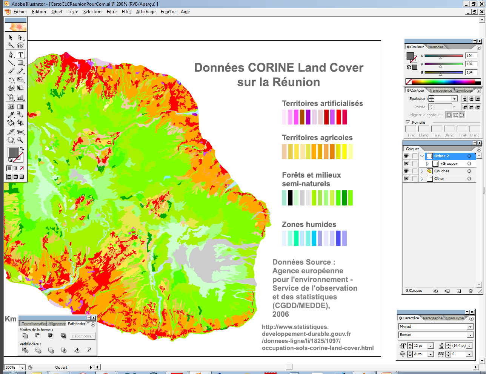{fig-alt="Land cover map of Réunion open in a drawing program"}

[Land cover of Réunion, laid out in a drawing program: a fine map that cannot be queried.]{.legende}
:::
::: {.column width="58%"}
GIS has two ancestors. Which family does each property belong to?

::: {.classer}
### Computer-aided drawing

- Coordinates relative to the sheet
- A use that is first of all visual
- AutoCAD, Illustrator, Inkscape

### The database

- Tables linked by keys
- Look up, query, analyse
- Access, PostgreSQL
:::
:::
::::

## The merger {.socle}

::: {.fiche n="1.2" etat="a-revoir"}
Intention : A GIS couples a database and a mapping system, in an absolute coordinate system. The original diagram (DBMS, software layer, map layers) redrawn in the school's colours. [PPT 6]
Experience : diagram
Request :
:::

::: {.schema fichier="images/schemas/en/fusion.svg" hauteur="330"}
:::

[A GIS couples a database and a mapping system, in an absolute coordinate system: each feature has its place on the Earth, not just on the sheet.]{.a-retenir}

## What the merger makes possible {.appui}

::: {.fiche n="1.3" etat="a-revoir"}
Intention : Freedom from scale and projection; storing a feature and its characteristics (a parcel and its number); linking features and data (a parcel and its owner); using space as a variable of analysis. Forest examples. [PPT 7]
Experience : multiple choice: which of these operations is impossible with a paper map alone?
Request :
:::

:::: {.columns}
::: {.column width="52%"}
- **Free yourself** from scale and projection: maps are made on demand.
- **Store** a feature and its characteristics: a forest parcel and its number.
- **Link** a feature and data: the parcel, its owner, its management plan.
- **Analyse** with space as a variable: the stands less than 200 m from a forest road.
- **Turn** a phenomenon into a thematic map.
:::
::: {.column width="48%"}
::: {.qcm}
Which of these operations is impossible with a paper map alone?

- [ ] Measuring a distance
    - Possible: a ruler and the scale are enough.
- [x] Showing, in one click, all the parcels of the same owner
    - Yes: features must be linked to a table. That is what the merger allows.
- [ ] Finding a road
    - Possible: it is what maps are first used for.
:::
:::
::::

## A short history {.veille}

::: {.fiche n="1.4" etat="a-revoir"}
Intention : From the 1960s to today: the first GIS in Canada (CGIS, Roger Tomlinson), the first commercial software, business functions, the web and free software (QGIS), 3D, mobile, open data. Corrects the old handout, which made Esri the inventor of GIS. [PPT 8, 9 hidden]
Experience : put five steps in order; "Going further" bonus on Esri and ArcGIS
Request :
:::

::: {.ordre}
Put these steps in chronological order.

1. In Canada, Roger Tomlinson designs the first GIS, CGIS, for the land inventory: agriculture, forestry, wildlife.
2. The first commercial software appears, such as Esri's ARC/INFO.
3. GIS enters local authorities and companies: the business dimension.
4. The web and free software develop: QGIS is born in 2002.
5. 3D, mobile and open data become widespread.
:::

::: {.plus titre="Esri and ArcGIS"}
Esri (*Environmental Systems Research Institute*) was founded in 1969 in California by Jack and Laura Dangermond, as a land-use planning consultancy. Its ARC/INFO software, in the early 1980s, then ArcGIS, made it the most widespread commercial vendor.

Esri did not invent GIS: the first one, CGIS, is Canadian and dates from the 1960s.
:::

## What is a GIS? {.intercalaire}

::: {.fiche n="2.0" etat="a-revoir"}
Intention : More than software. [PPT 10]
Experience : none
Request :
:::

More than software.

## First of all, a system {.socle}

::: {.fiche n="2.1" etat="a-revoir"}
Intention : Five nested definitions: a spatially referenced database, an information system, software, a way of managing data, a team. The key word is "system". [PPT 11, 12]
Experience : question before the answer: what is part of a GIS? (the old brainstorm)
Request :
:::

::: {.question}
**What is part of a GIS?** Make your list before clicking.
:::

::: {.reponse}
:::: {.columns}
::: {.column width="55%"}
A GIS is, all at once:

- a **spatially referenced database**;
- an **information system** that integrates located data;
- **software**;
- a **way of managing** data;
- **teams** who keep it alive.
:::
::: {.column width="45%"}
[A GIS is first of all a system: data, tools, people and an organisation.]{.a-retenir}
:::
::::
:::

## The components of a GIS {.socle}

::: {.fiche n="2.2" etat="a-revoir"}
Intention : Data (reference, business), equipment (hardware, software), people (administrators, managers, users), an organisation, applications. Diagram redrawn without the 2010 thumbnails. [PPT 13]
Experience : sort eight items (QGIS, BD TOPO, a forest management plan, a server, a geomatics specialist, an update procedure…) into Data / Tools / People / Organisation
Request :
:::

::: {.schema fichier="images/schemas/en/composantes.svg" hauteur="150"}
:::

::: {.classer}
### Data

- BD TOPO, reference data
- A forest management plan, business data

### Tools

- QGIS
- A data server

### People

- A geomatics specialist
- A forester who looks at the map

### Organisation

- The yearly update procedure
- Who is allowed to change what
:::

## The vocabulary in one diagram {.appui}

::: {.fiche n="2.3" etat="a-revoir"}
Intention : The overview from the old handout, to keep at hand: tables, fields, values, keys, DBMS; raster, vector and DTM layers; point, line and polygon features; coordinate system; interface. Each word links to the slide that explains it. [PPT 16]
Experience : diagram, words clickable to the slides
Request :
:::

::: {.schema fichier="images/schemas/en/vocabulaire.svg" hauteur="450"}
:::

[Click a word in the diagram to go to the slide that explains it.]{.legende}

## Geographic data {.intercalaire}

::: {.fiche n="3.0" etat="a-revoir"}
Intention : The G in GIS: information that is located, or can be located. [PPT 18, 26, 32]
Experience : none
Request :
:::

The G in GIS: information that is located, or can be located.

## Where, and what {#ou-et-quoi .socle}

::: {.fiche n="3.1" etat="a-revoir"}
Intention : Geographic data have two components: spatial (where?) and semantic (what?). The geometry relies on a coordinate system: see "From the Earth to the Map". It is stored in two ways: raster or vector. [PPT 19]
Experience : question: in "D400, departmental road, 2 lanes", what says where, what says what?
Request :
:::

Geographic data have two components:

- **spatial**: *where* is the feature? Its geometry, located in a coordinate system;
- **semantic**: *what* is it? Its attributes.

Geometry is stored in two ways: as **raster** or as **vector**.

::: {.question}
A road is drawn through four points (X1, Y1) … (X4, Y4) and described as "D400, departmental road, 2 lanes". **What says where, and what says what?**
:::

::: {.reponse}
The four coordinate pairs say *where*: that is the spatial component. "D400, departmental road, 2 lanes" says *what*: that is the semantic component.
:::

## Raster: a grid {#raster .socle}

::: {.fiche n="3.2" etat="a-revoir"}
Intention : A regular grid over the ground; each pixel carries a value (radiometry of an image, colour of a scan). On 8 bits, 256 values per band; several bands are stacked. The speaker notes move onto the slide. [PPT 20]
Experience : multiple choice: how many different values can an 8-bit pixel take?; bonus: a satellite image and a scan
Request :
:::

:::: {.columns}
::: {.column width="46%"}
::: {.schema fichier="images/schemas/en/raster-grille.svg" hauteur="340"}
:::
:::
::: {.column width="54%"}
**Raster** mode, or grid mode, cuts the ground into a regular grid. Each cell, the **pixel**, carries a value: light intensity for a satellite image or an aerial photo, colour for a scanned document. An image often has several stacked **bands**.

::: {.qcm .serre}
On 8 bits, how many different values can a pixel take?

- [ ] 8
    - No: 8 is the number of bits, not of values.
- [x] 256
    - Yes: 2^8^ = 256, from 0 to 255.
- [ ] 65,536
    - That is the case on 16 bits.
:::
:::
::::

::: {.plus titre="Two rasters"}
:::: {.columns}
::: {.column width="50%"}
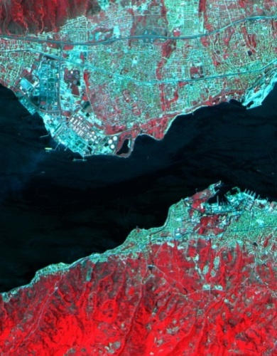{fig-alt="False-colour satellite image" height="300"}

[A satellite image: each pixel carries a measurement of light.]{.legende}
:::
::: {.column width="50%"}
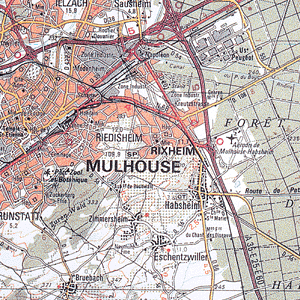{fig-alt="Scanned topographic map of the Mulhouse area" height="300"}

[A scanned map: each pixel carries a colour.]{.legende}
:::
::::
:::

## An elevation raster: the DTM {#mnt .appui}

::: {.fiche n="3.3" etat="a-revoir"}
Intention : In a digital terrain model, each pixel carries an elevation; the software derives shaded relief or a 3D view from it. Forest example: slope. [PPT 21]
Experience : "Going further" bonus: IGN's RGE ALTI and the LiDAR HD programme
Request :
:::

:::: {.columns}
::: {.column width="50%"}
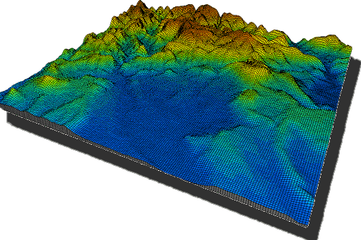{fig-alt="Relief in three dimensions coloured by elevation"}
:::
::: {.column width="50%"}
In a **digital terrain model** (DTM), each pixel carries an **elevation**.

The software computes slope, aspect, shaded relief or a 3D view from it, by interpolating between pixels.

[In a forest, slope decides what can be harvested, and with which machines.]{.a-retenir}
:::
::::

::: {.plus titre="IGN's terrain models"}
**RGE ALTI** covers France at a 1 m or 5 m resolution.

The **LiDAR HD** programme surveys the whole country as point clouds, with at least 10 pulses per square metre. It yields a 50 cm DTM, and the height of the vegetation. The data are open, on [cartes.gouv.fr](https://cartes.gouv.fr).
:::

## Vector: point, line, polygon {#vecteur .socle}

::: {.fiche n="3.4" etat="a-revoir"}
Intention : The geometric primitives: the point (a boundary marker), the line (a road centreline), the polygon (a municipality). Text (a place name) is an in-between case. The choice of primitive depends on scale. [PPT 22]
Experience : sort six forest features (veteran tree, well, forest road, power line, forest parcel, municipality); then question: is a river always a line?
Request :
:::

::: {.schema fichier="images/schemas/en/primitives.svg" hauteur="160"}
:::

:::: {.columns .resserre}
::: {.column width="58%"}
::: {.classer}
### Point

- A veteran tree
- A well

### Line

- A forest road
- A power line

### Polygon

- A forest parcel
- A municipality
:::
:::
::: {.column width="42%"}
::: {.question}
Is a river always a line?
:::

::: {.reponse}
No. At a large scale, the Loire is a polygon; at a small scale, a line. The choice of primitive depends on scale and use. Text, a place name, is placed like a point.
:::
:::
::::

## Special vectors: TINs and networks {.veille}

::: {.fiche n="3.5" etat="a-revoir"}
Intention : The TIN, a network of irregular triangles, describes relief as slope facets (useful in hydrology). The network links segments through nodes: it is used for routing. The 2014 Google Maps screenshot is replaced by a diagram. [PPT 23, 24]
Experience : none
Request :
:::

:::: {.columns}
::: {.column width="44%"}
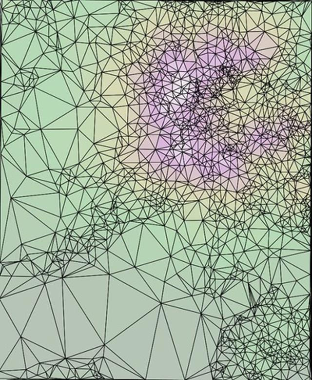{fig-alt="Relief cut into irregular triangles" height="230"}

The **TIN** (*Triangulated Irregular Network*) cuts relief into triangles of varying size. Each facet has a slope and an aspect: you can follow where water flows.
:::
::: {.column width="56%"}
::: {.schema fichier="images/schemas/en/reseau.svg" hauteur="300"}
:::

The **network** links segments through nodes. It is used to compute a route, to plan access in a forest, to manage water networks.
:::
::::

## Raster or vector? {.socle}

::: {.fiche n="3.6" etat="a-revoir"}
Intention : Raster is easy to use, already symbolised, heavy, and limits analysis; vector is richer, lighter, allows any analysis, but needs styling and more skill. [PPT 25]
Experience : sort eight properties into "raster" or "vector" (the old spoken prompt "suggest differences")
Request :
:::

:::: {.columns .resserre}
::: {.column width="30%"}
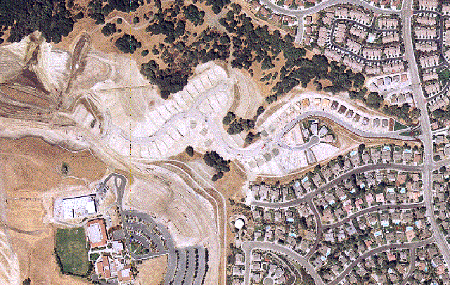{fig-alt="Aerial photograph of an urban area" height="150"}

[Raster: an aerial photo]{.legende}

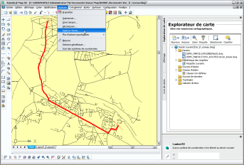{fig-alt="Vector layers displayed in a program" height="150"}

[Vector: features in a program]{.legende}
:::
::: {.column width="70%"}
::: {.classer}
### Raster

- Easy to use, already symbolised
- A very large volume of data
- Limited analysis
- Fixed symbology

### Vector

- Richer information
- A smaller volume of data
- All kinds of analysis
- Needs styling to be displayed
:::
:::
::::

## Attributes {#attributs .socle}

::: {.fiche n="3.7" etat="a-revoir"}
Intention : Each feature carries semantic information, stored in an attribute table: for a forest stand, its species, area, age; for a road, its name, number of lanes; for a municipality, its name, INSEE code, population. Feature and table row are linked by a key. [PPT 27]
Experience : none
Request :
:::

:::: {.columns}
::: {.column width="50%"}
Each feature carries semantic information, stored in an **attribute table**: one row per feature, one column per field.

- A **forest stand**: main species, area, age, owner.
- A **road**: name, number of lanes, type, width.
- A **municipality**: name, INSEE code, population.

[A feature and its table row are linked by a key, visible or not depending on the software.]{.a-retenir}
:::
::: {.column width="50%"}
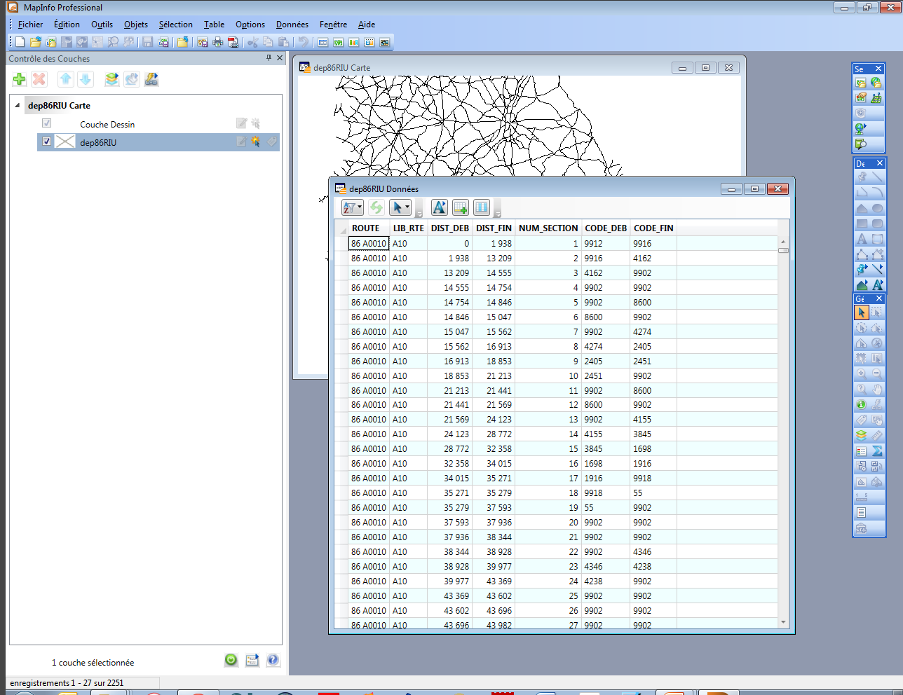{fig-alt="Attribute table open next to the map in a GIS program"}

[An attribute table, open next to the map]{.legende}
:::
::::

## Value types {#types-valeurs .appui}

::: {.fiche n="3.8" etat="a-revoir"}
Intention : Text, real, integer, boolean, list of values: the type says what can be computed. [PPT 28]
Experience : sort six values ("Seine", 12.4 ha, 2,154 inhabitants, 340 stems per hectare, PEFC certified: yes, "broadleaved" from a list) into their type; then question: why not store everything as text?
Request :
:::

::: {.classer}
### Text

- "Seine"

### Real

- 12.4 ha

### Integer

- 2,154 inhabitants
- 340 stems per hectare

### Boolean

- PEFC certified: yes

### List

- "Broadleaved", from a closed list
:::

::: {.question}
Why not store everything as text?
:::

::: {.reponse}
The type says what you can do with the value: add, sort, filter on yes or no. A number written as text cannot be computed.
:::

## One layer per kind of feature {#couches .socle}

::: {.fiche n="3.9" etat="a-revoir"}
Intention : Features of the same kind and geometry form a layer (a class), with its attributes; layers are stacked: stands, rivers, raster background. [PPT 29, 30]
Experience : none
Request :
:::

:::: {.columns}
::: {.column width="58%"}
::: {.schema fichier="images/schemas/en/couches.svg" hauteur="400"}
:::
:::
::: {.column width="42%"}
Features of the same kind and the same geometry go into one **layer**. ArcGIS calls it a **feature class**.

Each layer has its attributes. Layers can be stacked because they share a coordinate system.

[Relationships can link two layers: a stand belongs to a parcel.]{.a-retenir}
:::
::::

## Where do data come from? {.appui}

::: {.fiche n="3.10" etat="a-revoir"}
Intention : Produce (GNSS survey, photogrammetry, satellite image, lidar, digitising a paper map) or reuse (existing databases: BD TOPO, BD Forêt, cadastre, OpenStreetMap; WMS, WMTS, WFS services from the Géoplateforme). Acquisition diagram redrawn; the digitising table is gone. [PPT 31]
Experience : question: to map the roads of a forest, produce or reuse?; bonus on cartes.gouv.fr
Request :
:::

::: {.schema fichier="images/schemas/en/acquisition.svg" hauteur="250"}
:::

::: {.question}
You need to map the roads of a municipal forest. **Produce or reuse?**
:::

::: {.reponse}
Both: reuse BD TOPO for the known roads, then complete with GNSS in the field or on an orthophoto, recording the source and accuracy of each line.
:::

::: {.plus titre="The Géoplateforme"}
Data from IGN and many public producers can be browsed and downloaded on [cartes.gouv.fr](https://cartes.gouv.fr), the showcase of the Géoplateforme.

They can also be loaded into QGIS as services, without downloading them: WMS and WMTS for images, WFS for vector features.
:::

## Topology {.appui}

::: {.fiche n="3.11" etat="a-revoir"}
Intention : What does not change under deformation: inclusion, adjacency, neighbourhood, intersection. The metro map respects neither distances nor shapes, but respects topology. Link with the Peutinger Table in the first course. [PPT 33, 34]
Experience : question: is the metro map wrong?; "Going further" bonus: the spatial relationship matrix (the image on slide 33)
Request :
:::

:::: {.columns}
::: {.column width="42%"}
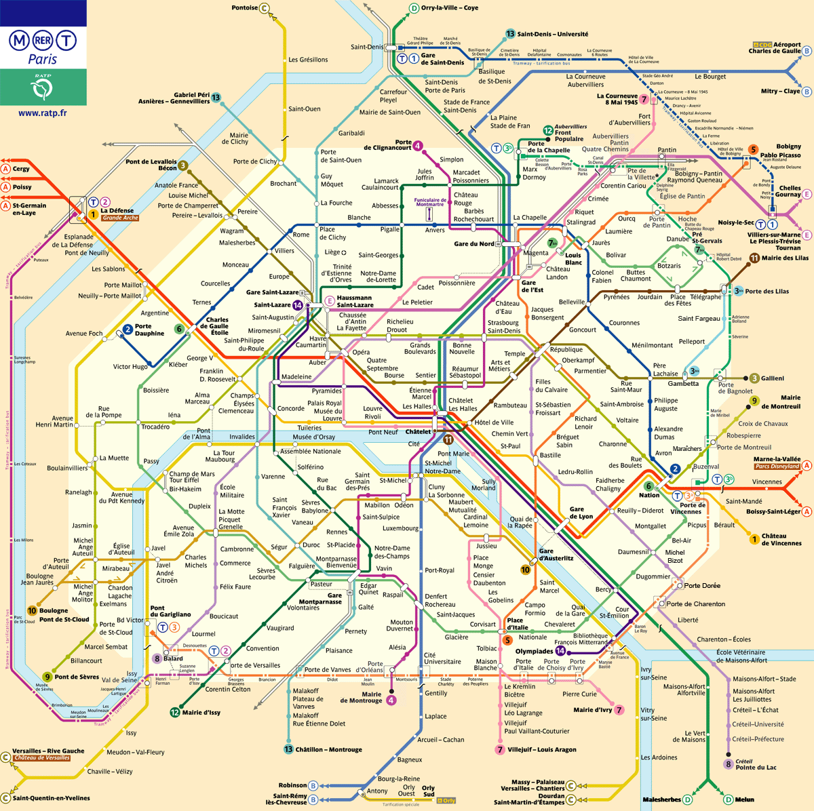{fig-alt="Schematic map of the Paris metro" height="430"}
:::
::: {.column width="58%"}
**Topology** describes what does not change when a figure is deformed: **inclusion**, **adjacency**, **neighbourhood**, **intersection**.

::: {.question}
The metro map respects neither distances nor shapes. **Is it wrong?**
:::

::: {.reponse}
It is wrong about distances and shapes, but right about topology: the order of stations and the interchanges are exact. That is all a traveller needs, as on the Peutinger Table in "From the Earth to the Map".
:::
:::
::::

::: {.plus titre="The spatial relationship matrix"}
:::: {.columns}
::: {.column width="40%"}
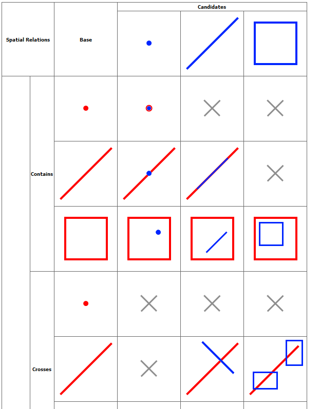{fig-alt="Table of possible relationships between points, lines and polygons" height="380"}
:::
::: {.column width="60%"}
Between two features, point, line or polygon, the possible relationships fit into a table: disjoint, touching, crossing, one containing the other, overlapping.

Software relies on a model of this kind, DE-9IM, for spatial queries: "the stands that touch a forest road".
:::
::::
:::

## And the third dimension? {.veille}

::: {.fiche n="3.12" etat="a-revoir"}
Intention : 2D GIS; 2.5D, where elevation is an attribute; 3D, where it is a Z coordinate; and DTM modules. Examples: TIN, building extrusion, a draped scan, a lidar point cloud, lidar under the forest. [PPT 35, 36, 37]
Experience : scroll through the 3D images; multiple choice: a building that carries its height in an attribute is 2D, 2.5D or 3D?
Request :
:::

:::: {.columns .resserre}
::: {.column width="46%"}
- **2D**: the third dimension is ignored.
- **2.5D**: elevation is an attribute of the feature.
- **3D**: elevation is a coordinate, Z.
- And modules that handle elevation from a DTM.

::: {.qcm .serre}
A building carries its height in an attribute. This is…

- [ ] 2D
    - No: the height is stored.
- [x] 2.5D
    - Yes: height is an attribute, not a coordinate. That is what makes extrusion possible.
- [ ] 3D
    - Each vertex would need a Z coordinate.
:::
:::
::: {.column width="54%"}
::: {.defiler}
- 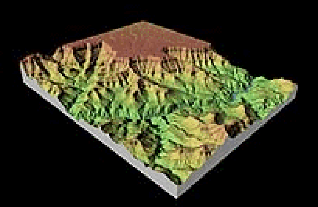
- 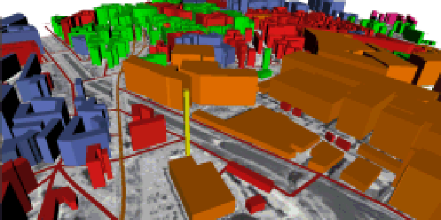
- 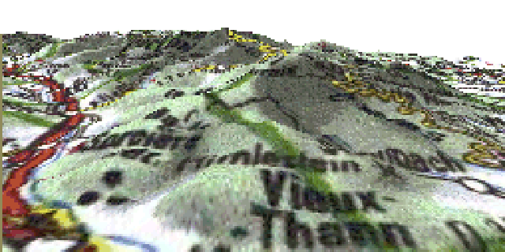
- 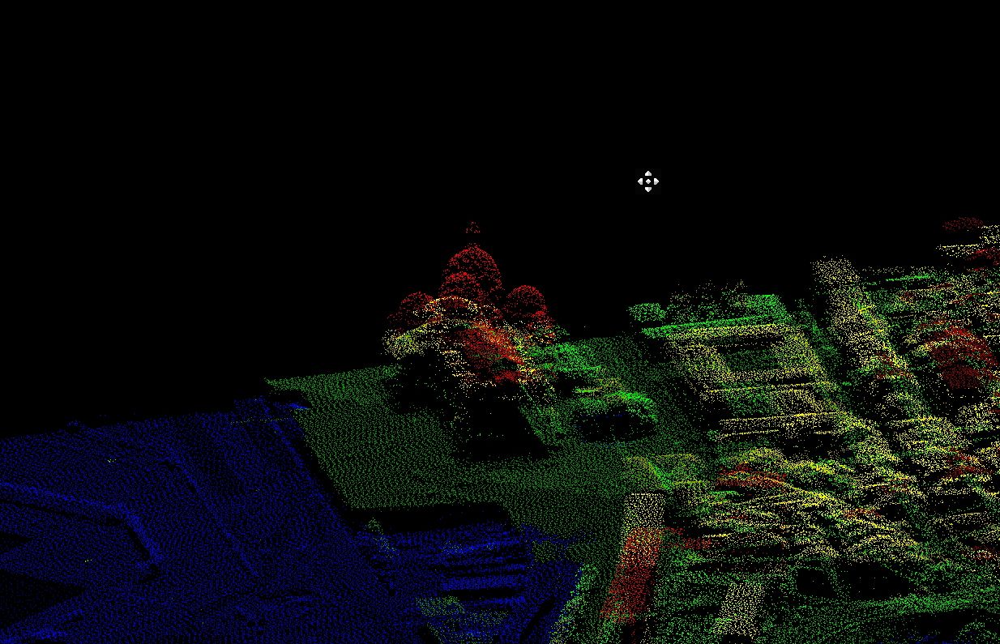
- 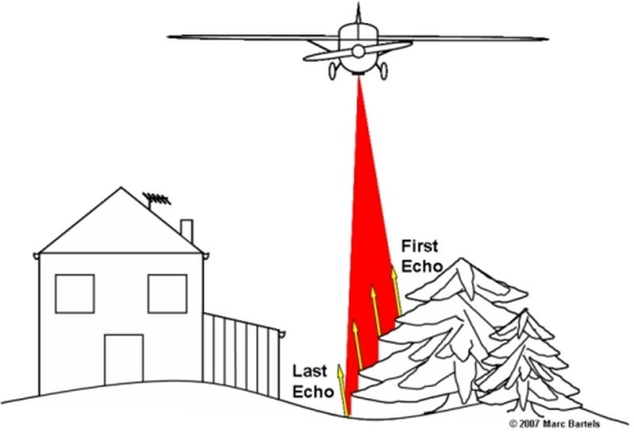
:::
:::
::::

## Describing a geographic feature {.socle}

::: {.fiche n="3.13" etat="a-revoir"}
Intention : The summary of the part: required, a geometry and a semantic description; optional, topological information; always, a coordinate system (Lambert 93). The D400 example. Diagram redrawn. [PPT 38]
Experience : diagram; multiple choice: what is required?
Request :
:::

::: {.schema fichier="images/schemas/en/objet-geographique.svg" hauteur="250"}
:::

::: {.qcm .serre}
To describe a geographic feature, what is essential? More than one answer is correct.

- [x] The geometry
    - Yes: without it, the feature is not located.
- [x] The semantic description
    - Yes: without it, we do not know what the feature is.
- [ ] The topology
    - Optional: valuable for a network, it is not always stored.
- [x] The coordinate system
    - Yes: without it, coordinates mean nothing.
:::

## Basic functions {.intercalaire}

::: {.fiche n="4.0" etat="a-revoir"}
Intention : What we do with a GIS, in five verbs. [PPT 39]
Experience : none
Request :
:::

What we do with a GIS.

## Five verbs {.socle}

::: {.fiche n="4.1" etat="a-revoir"}
Intention : Look up, select, display, edit, analyse. [PPT 14, 39, 40]
Experience : sort nine forest tasks by verb: replaces the old brainstorm "What are they?"
Request :
:::

**Look up, select, display, edit, analyse.** Which verb does each task belong to?

::: {.classer}
### Look up

- Click a parcel to read its owner

### Select

- Keep the oak stands larger than 5 ha

### Display

- Colour the stands by species
- Lay out the map for printing

### Edit

- Correct the line of a forest road
- Add this year's felling

### Analyse

- Compute the wooded area of the municipality
- Find the stands crossed by a river
:::

## Look up {.appui}

::: {.fiche n="4.2" etat="a-revoir"}
Intention : Find the information of a feature by pointing at it, or find the feature from a piece of information. [PPT 41]
Experience : question: give one example in each direction (the old "e.g.: ?")
Request :
:::

To **look up** is to find the information about a geographic feature, or to find the feature from a piece of information.

::: {.question}
Give one example in each direction.
:::

::: {.reponse}
- From feature to information: I click on a parcel and read its owner and area.
- From information to feature: I search for cadastral parcel B 412, or an address, and the GIS shows it to me on the map.
:::

## Select {.socle}

::: {.fiche n="4.3" etat="a-revoir"}
Intention : Build a coherent set from a semantic, geometric or topological criterion, which can be combined; it is often written in SQL. Example: "ROUTE" = 'D100'; buildings over 100 m²; a forest example. The Géoconcept screenshot is replaced by the written expression. [PPT 42]
Experience : multiple choice: which query keeps buildings over 100 m²?
Request :
:::

:::: {.columns}
::: {.column width="52%"}
To **select** is to build a coherent set of features from a criterion:

- **semantic**: the species is oak;
- **geometric**: the area exceeds 5 ha;
- **topological**: the stand touches a forest road.

Criteria are combined and refined. They are often written in SQL:

`"ROUTE" = 'D100'`

`"ESSENCE" = 'Chêne' AND "SURFACE_HA" > 5`
:::
::: {.column width="48%"}
::: {.qcm}
Which expression keeps buildings over 100 m²?

- [ ] `"SURFACE" = 100`
    - Only those of exactly 100 m².
- [x] `"SURFACE" > 100`
    - Yes.
- [ ] `"SURFACE" < 100`
    - The opposite: the smaller ones.
:::
:::
::::

## Display {.socle}

::: {.fiche n="4.4" etat="a-revoir"}
Intention : Define symbology rules (colour, size, width, transparency), which can change with scale; produce thematic maps from them (unemployment rate by département). See the cartography course for semiology. The Géoconcept and MapInfo screenshots are gone. [PPT 43, 44, 45]
Experience : none
Request :
:::

:::: {.columns}
::: {.column width="52%"}
To **display** is to define symbology rules: colour, size, width, transparency. They can change with scale.

When the symbol varies with an attribute, you get a **thematic map**: colouring stands by species, départements by unemployment rate.

[The rules for choosing symbols, graphic semiology, are covered in the cartography course.]{.a-retenir}
:::
::: {.column width="48%"}
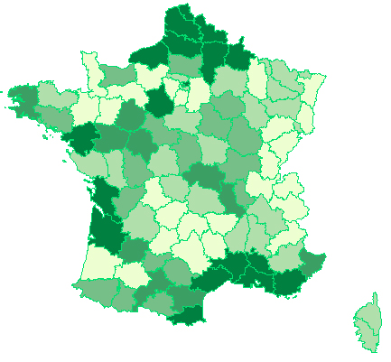{fig-alt="Map of France with départements coloured by unemployment rate" height="400"}

[Unemployment rate by département, INSEE data. The figures are old: the example is about the method.]{.legende}
:::
::::

## Map layout {.appui}

::: {.fiche n="4.5" etat="a-revoir"}
Intention : A published map has a frame, a title, a legend, a scale, an orientation, sources. In QGIS, the layout is prepared in a separate window. [PPT 46]
Experience : multiple choice, several answers: which elements must a published map carry?
Request :
:::

:::: {.columns .resserre}
::: {.column width="50%"}
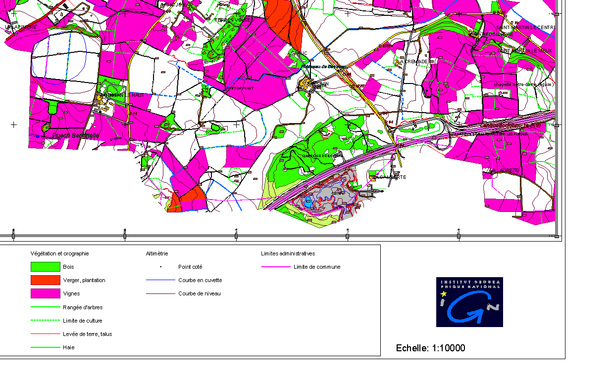{fig-alt="Map laid out at 1:10,000 with its legend and scale"}

[A layout at 1:10,000]{.legende}

In QGIS, the layout is prepared in a separate window.
:::
::: {.column width="50%"}
::: {.qcm .serre}
Which elements must a published map carry? More than one answer is correct.

- [x] A title
    - Yes: it says what the map shows.
- [x] A legend
    - Yes: it gives the meaning of the symbols.
- [x] A scale
    - Yes: to measure.
- [x] An orientation
    - Yes, at least when north is not at the top.
- [x] The source and date of the data
    - Yes: readers must know where the information comes from.
- [ ] The list of the project's layers
    - No: it is for the author, not the reader.
:::
:::
::::

## Edit {.appui}

::: {.fiche n="4.6" etat="a-revoir"}
Intention : Change values, the structure of a table, add or delete features, change their shape or type, merge, split. This often means creating new layers: organisation matters. Forest example: after a felling. [PPT 47]
Experience : none
Request :
:::

To **edit** is to:

- change attribute values;
- change the structure of the data: add a field;
- add or delete features;
- change the shape or type of a feature;
- merge, split, group.

After a felling, you split the stand, create the new polygon and update its age.

[Editing often means creating a new layer: keep the original, work on a copy. How layers are organised matters.]{.a-retenir}

## Analyse {.socle}

::: {.fiche n="4.7" etat="a-revoir"}
Intention : Simple calculations (area, perimeter, centroid), a change of coordinate system, smoothing; above all, overlaying layers: the stands crossed by a river (instead of the irrigated parcels). Overlay diagram redrawn. [PPT 48, 49]
Experience : question (prediction): which stands will come out of this overlay?
Request :
:::

**Analyse**: compute areas, change coordinate system, smooth… and above all **overlay layers**.

:::: {.columns}
::: {.column width="50%"}
::: {.schema fichier="images/schemas/en/croisement-entrees.svg" hauteur="190"}
:::

::: {.question etiquette="Prediction"}
We are looking for the stands crossed by the river. **Which ones will the new layer keep?**
:::
:::
::: {.column width="50%"}
::: {.reponse}
::: {.schema fichier="images/schemas/en/croisement-resultat.svg" hauteur="230"}
:::

P1, P3, P4 and P5: all those the river crosses, even for a few metres. P2 and P6 stay out.
:::
:::
::::

## Which GIS for which use? {.veille}

::: {.fiche n="4.8" etat="a-revoir"}
Intention : Management, study, monitoring and synthesis GIS. Today's software: QGIS, ArcGIS Pro, PostGIS, FME, web tools. These two slides were hidden in the PPT; kept at Marc's request. [PPT 50, 51 hidden]
Experience : sort four forest situations by type of GIS
Request :
:::

:::: {.columns .resserre}
::: {.column width="46%"}
- **Management**: managing assets, within established procedures.
- **Study**: gathering varied information on a territory, for a project.
- **Monitoring**: following one theme on a territory, and keeping it up to date.
- **Synthesis**: producing overall maps, at a small scale.

Software: QGIS (free), ArcGIS Pro (commercial), PostGIS (database), FME (processing), and web tools.
:::
::: {.column width="54%"}
::: {.classer}
### Management

- Tracking fellings and works in a state forest

### Study

- Preparing the route of a new forest road

### Monitoring

- Tracking bark beetle damage in a forest every year

### Synthesis

- Mapping a region's forests for a regional plan
:::
:::
::::

## What is a GIS for? {.intercalaire}

::: {.fiche n="5.0" etat="a-revoir"}
Intention : Communicate, analyse, simulate. [PPT 52]
Experience : none
Request :
:::

Communicate, analyse, simulate.

## Communicate, analyse, simulate

::: {.fiche n="5.1" etat="a-revoir"}
Intention : A gallery of real examples, without a level tag: wildfire starts in the Var, taxa in Guadeloupe, phosphorus in soils, population of Martinique, BD Forêt around Nancy, land uses in the Massif Central, traffic, isochrones in Bourges, siting in Bordeaux, exposure to radio waves, odour impact. Captions and sources under each image. [PPT 53 to 61]
Experience : scroll through the maps in large format
Request :
:::

::: {.defiler}
- 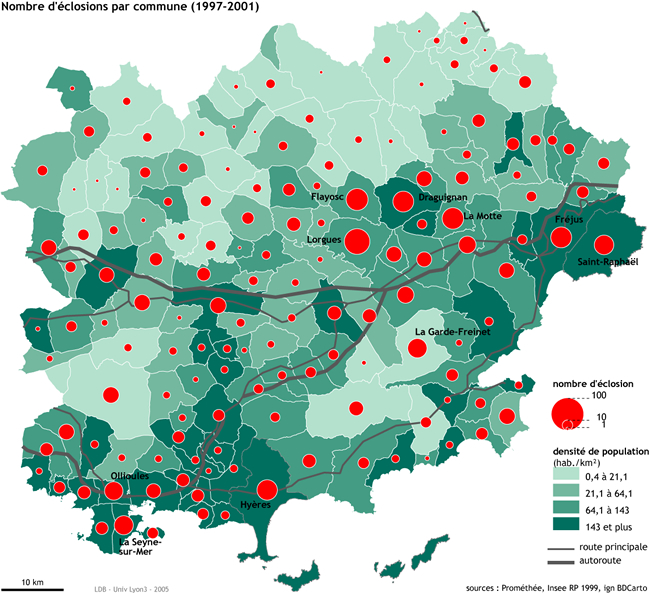
- 
- 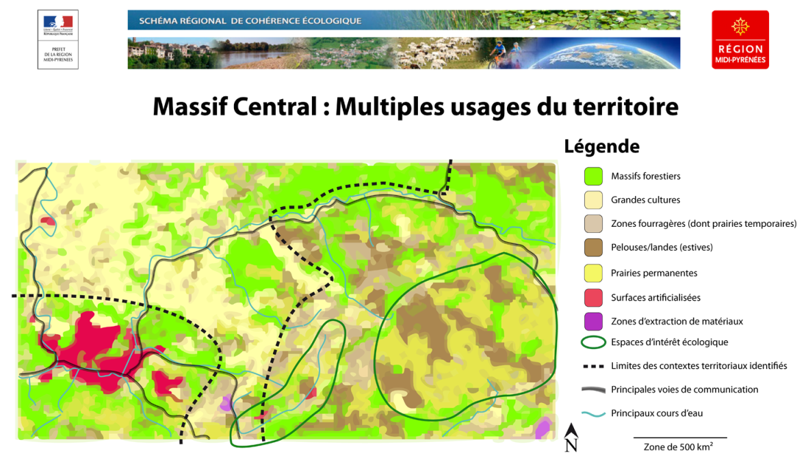
- 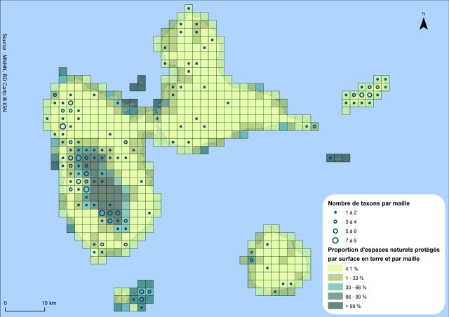
- 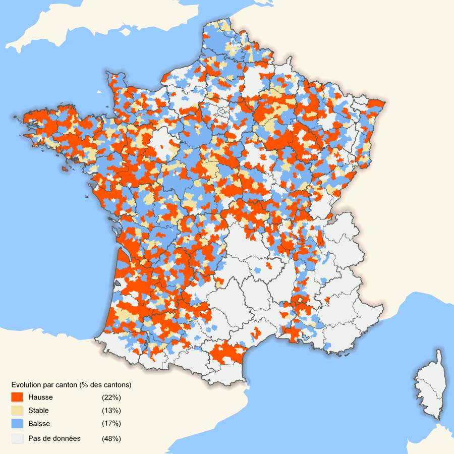
- 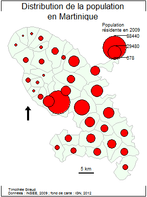
- 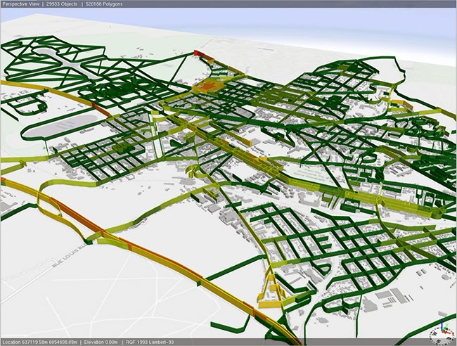
- 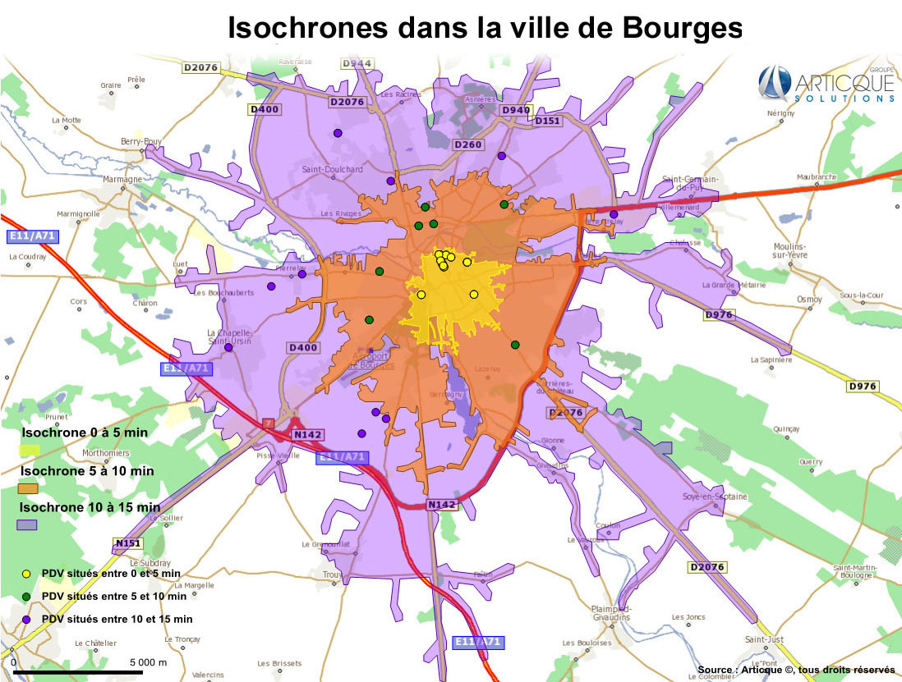
- 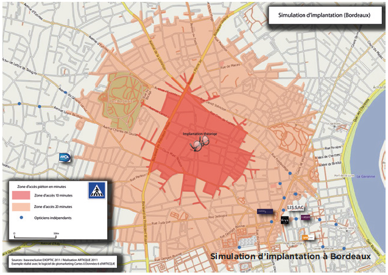
- 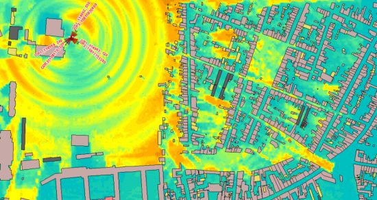
- 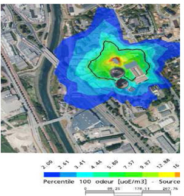
:::

## Which use? {.appui}

::: {.fiche n="5.2" etat="a-revoir"}
Intention : Tell the three main uses apart, from the examples in the gallery. [PPT 53, 56, 59]
Experience : sort six examples into "communicate", "analyse" or "simulate"
Request :
:::

:::: {.columns .resserre}
::: {.column width="40%"}
- **Communicate**: thematic and statistical maps, locating, publishing the cadastre.
- **Analyse**: managing traffic, flows, networks; spatial correlations and distributions.
- **Simulate**: preparing a project, optimising a location, studying an impact, foresight.
:::
::: {.column width="60%"}
::: {.classer}
### Communicate

- The population of Martinique
- Soil phosphorus content

### Analyse

- The isochrones of Bourges
- Road, cycle and pedestrian traffic

### Simulate

- Exposure to radio waves
- The odour impact of a plant
:::
:::
::::

[The boundary is porous: an analysis map also serves to communicate.]{.a-retenir}

## Jobs and sectors {.veille}

::: {.fiche n="5.3" etat="a-revoir"}
Intention : Data production, development, environment and planning, risks, agriculture, forestry, health, telecommunications, research. A focus on forestry. [PPT 62]
Experience : none
Request :
:::

:::: {.columns}
::: {.column width="50%"}
GIS is everywhere:

- producing and publishing data;
- software development;
- environment and planning;
- risks, agriculture, forestry;
- health, telecommunications;
- teaching and research.
:::
::: {.column width="50%"}
**In forestry**, GIS is used to:

- inventory the resource;
- write and follow management plans;
- plan forest access;
- protect forests against fire;
- monitor forest health.
:::
::::

## Designing a GIS {.intercalaire}

::: {.fiche n="6.0" etat="a-revoir"}
Intention : Before capturing data, decide what to capture. [PPT 63]
Experience : none
Request :
:::

Before capturing data, decide what to capture.

## Needs first {.socle}

::: {.fiche n="6.1" etat="a-revoir"}
Intention : Output information: who the database is for, what it is for, what other uses, who the experts are. This defines the content, the partners, the useful accuracy. [PPT 64, 66]
Experience : none
Request :
:::

Designing a GIS starts with an analysis of needs and of what already exists. We start from the **output information**:

- Who is the database for? For which applications?
- What other uses are possible?
- Should the future users be surveyed?
- Who are the experts on the phenomenon studied?
- Where will the information come from?

[These answers define the content of the database, the partners, the useful information and its accuracy.]{.a-retenir}

## With what means? {.appui}

::: {.fiche n="6.2" etat="a-revoir"}
Intention : The area to capture, sources available or to buy, people, hardware, software, budget. What can be done, and how fast; these choices feed back into the needs. [PPT 67]
Experience : none
Request :
:::

Then the production capacity is analysed:

- the area to capture;
- the available sources: images, maps, existing databases;
- the sources to obtain, and their cost;
- the people: their knowledge, their training;
- hardware and software;
- the budget.

[What can be done, and how fast? These choices change the needs: you go back and forth.]{.a-retenir}

## Specifying {.appui}

::: {.fiche n="6.3" etat="a-revoir"}
Intention : Input information: identify what, in the real world, is necessary and sufficient; define each piece of information and its selection rule; write the specification. Modelling means deciding what goes into the database, what does not, and how accurately. [PPT 65, 68, 69]
Experience : none
Request :
:::

The **specification** describes the **input information**:

- identify what, in the real world, is necessary and sufficient;
- define each piece of information in the database, and the rule that decides whether it is selected;
- write the specification.

It is then used to choose a GIS according to its capabilities, and to implement the database.

[Modelling means deciding what goes into the database, what does not, and how accurately, both geometrically and semantically.]{.a-retenir}

## The nominal ground {.socle}

::: {.fiche n="6.4" etat="a-revoir"}
Intention : "The modelling of the real world through the filter of the specifications." The real world on one side, what the database keeps of it on the other; not forgetting the coordinate system and accuracy (speaker note). Diagrams redrawn, with a forest. [PPT 70]
Experience : compare: slider between the real world and the nominal ground
Request :
:::

:::: {.columns}
::: {.column width="62%"}
::: {.comparer}
- 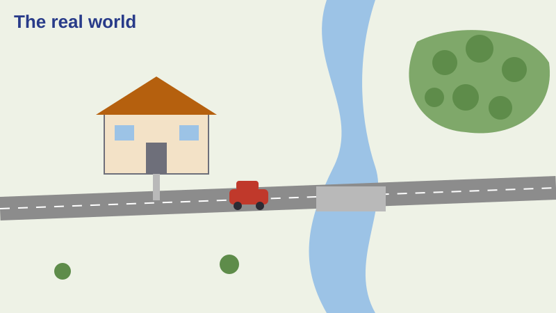
- 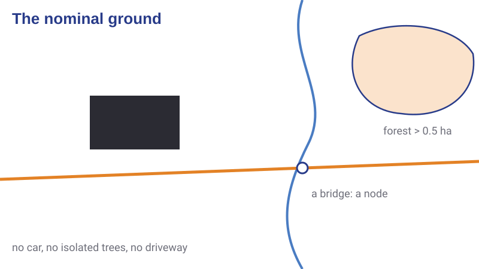
:::
:::
::: {.column width="38%"}
The **nominal ground** is "the modelling of the real world through the filter of the specifications".

Move the slider: the building becomes a block, the road and the river become centrelines, the forest a polygon; the car and the isolated trees disappear.

[Not forgetting the coordinate system and accuracy.]{.a-retenir}
:::
::::

## One roundabout, three models {.appui}

::: {.fiche n="6.5" etat="a-revoir"}
Intention : Capture depends on the need. In BD TOPO, an ordinary roundabout becomes a ring of segments, the Place de l'Étoile is modelled with dummy centrelines; one could have chosen two lines and a point carrying the attribute "roundabout". Diagram redrawn. [PPT 71, 72]
Experience : multiple choice: which model for routing?
Request :
:::

::: {.schema fichier="images/schemas/en/rond-point.svg" hauteur="270"}
:::

:::: {.columns .resserre}
::: {.column width="50%"}
The representation is chosen according to the need. In BD TOPO, an ordinary roundabout is a ring of segments; a very large one, like the Place de l'Étoile, is modelled with dummy centrelines. One could have chosen two lines and a point carrying the attribute "roundabout".
:::
::: {.column width="50%"}
::: {.qcm .serre}
You compute routes. Which model should you choose?

- [x] The ring of segments
    - Yes: it gives the direction of traffic and the true length of the trip.
- [ ] Two lines and a point
    - Routing would ignore going round the roundabout. This model is enough for an inventory.
:::
:::
::::

## Feature catalogue and selection rules {.appui}

::: {.fiche n="6.6" etat="a-revoir"}
Intention : List the groups of information, define each one and its properties, then the conditions a real-world object must meet to enter the database (waymarked paths, stations served by train, cemeteries over 2 ha, forests over 0.5 ha in BD Forêt). [PPT 73, 74, 75]
Experience : multiple choice: with the given rule, is this one-hectare cemetery in the database?
Request :
:::

:::: {.columns .resserre}
::: {.column width="50%"}
**The feature catalogue**

- the list of groups of information: roads, rivers, vegetation, buildings…;
- for each group, its properties: for roads, the number, the surface, the number of lanes;
- the definition of each feature: "A motorway is…".

**Selection rules**: the conditions a real-world object must meet to enter the database.

- Stations served only by coach are not included.
- National war cemeteries are all included; other cemeteries from 2 ha.
- In BD Forêt, a wooded area is described from 0.5 ha.
:::
::: {.column width="50%"}
::: {.qcm}
With these rules, is a one-hectare municipal cemetery in the database?

- [ ] Yes
    - Only national war cemeteries are included whatever their area.
- [x] No
    - It is smaller than 2 ha: it is not part of the nominal ground.
:::
:::
::::

## The data dictionary {.socle}

::: {.fiche n="6.7" etat="a-revoir"}
Intention : The summary of the approach: needs and means, definition of layers, properties and relationships, selection rules, nominal ground; everything is gathered in a data dictionary. [PPT 76]
Experience : put the five steps in order; bonus pointing to the BD TOPO documentation
Request :
:::

::: {.ordre}
Put the approach in order.

1. Analyse the needs and the possibilities
2. Define each layer, each property, each relationship
3. Set the selection rules for each layer
4. Build the nominal ground
5. Gather everything in a data dictionary
:::

[The data dictionary is the reference document of the database: it is where you look to know what a layer contains.]{.a-retenir}

::: {.plus titre="A real dictionary"}
Each IGN database has its own. The one for BD TOPO, its "descriptif de contenu", is on [geoservices.ign.fr](https://geoservices.ign.fr/bdtopo). Open it and look up how a road segment is defined.
:::

## Example: a motorway network

::: {.fiche n="6.8" etat="a-revoir"}
Intention : The approach applied, in one slide: why (manage the network, accidents, works, inform), for whom (works managers, traveller information, crisis management), how, and the classification by theme (infrastructure, equipment, drainage, signage…). [PPT 77 to 80]
Experience : "Going further" bonus: the themes in detail
Request :
:::

:::: {.columns .resserre}
::: {.column width="50%"}
**Why?** Manage the network and accidents, plan works, inform travellers.

**For whom?** Works managers, traveller information managers, crisis managers.

**How?** Know the geometry of the segments, the service accesses, how runoff is drained, the technology of the variable message signs…
:::
::: {.column width="50%"}
**In what way?** The segment modelled as a centreline, with its direction, width and number; the nearby secondary network; the flow directions of the catchments.

**By theme**: infrastructure, static and dynamic equipment, drainage, signage, other networks, engineering structures, buildings, technical and administrative zones.
:::
::::

::: {.plus titre="Two themes in detail"}
:::: {.columns}
::: {.column width="50%"}
**Infrastructure**: segment, lighting, service access, emergency access, interchange, routes, refuge…
:::
::: {.column width="50%"}
**Dynamic equipment**: variable message sign, antenna, weather sensor, counting point, camera, lane control signals…
:::
::::
:::

## From specification to model {.appui}

::: {.fiche n="6.9" etat="a-revoir"}
Intention : Once the specification is written, the database is organised in a conceptual model: group → class, property → attribute, relationship → relationship, element → feature. Example: the study of parasites in urban areas. [PPT 81, 82]
Experience : sort four examples into Class / Attribute / Relationship / Feature (rather than ordering, which does not suit pairs); bonus: the model of the parasite study
Request :
:::

Once the specification is written, the database is organised in a **conceptual model**: each group becomes a **class**, each property an **attribute**, each relationship a **link**, each element a **feature**.

::: {.classer}
### Class

- The group "Roads"

### Attribute

- The property "number of lanes"

### Relationship

- "A road crosses a municipality"

### Feature

- The A6 motorway, from Paris to Lyon
:::

::: {.plus titre="A real model"}
:::: {.columns}
::: {.column width="60%"}
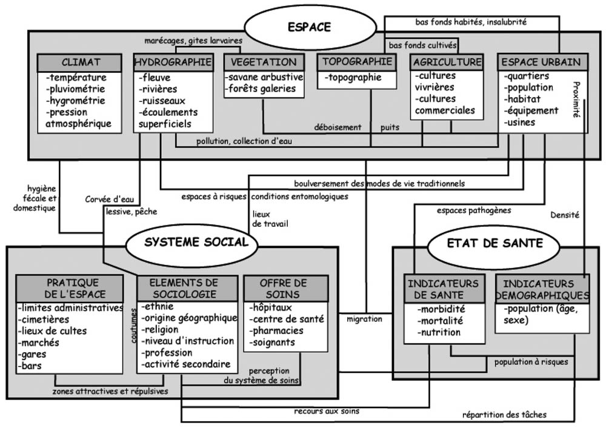{fig-alt="Conceptual model linking space, social system and health" height="400"}
:::
::: {.column width="40%"}
The model of a study on parasites in urban areas: space, social system, health, and their relationships.

[Journal *Espace populations sociétés*: [eps.revues.org/1830](https://journals.openedition.org/eps/1830)]{.legende}
:::
::::
:::

## Key points

::: {.fiche n="7.1" etat="a-revoir"}
Intention : The core slides, in one list: the revision sheet.
Experience : links to each slide
Request :
:::

::: {.carte-du-cours niveaux="socle"}
:::

## Glossary {.petit}

::: {.fiche n="7.2" etat="a-revoir"}
Intention : About twenty terms defined in one line (GIS, DBMS, layer, raster, vector, DTM, TIN, attribute, key, topology, query, nominal ground, specification…). Replaces the old "Present the glossary". [PPT 17]
Experience : none
Request :
:::

:::: {.columns}
::: {.column width="50%"}
| Term | Definition |
|------------------------|------------------------------------------------------------|
| Attribute | a piece of semantic information carried by a feature |
| Attribute table | one row per feature, one column per field |
| Data dictionary | the document describing the whole content of a database |
| DBMS | the software that manages a database |
| DTM | a raster whose pixels each carry an elevation |
| Feature catalogue | the list of groups of information and their properties |
| Geometry | the shape and position of a feature |
| GIS | a system that manages located data |
| Key | the field that links a feature to its table row |
| Layer | a set of features of the same kind and geometry |
| Lidar | a laser survey, as a point cloud |
:::
::: {.column width="50%"}
| Term | Definition |
|------------------------|------------------------------------------------------------|
| Network | segments linked by nodes |
| Nominal ground | the real world seen through the specifications |
| Pixel | a raster cell, which carries a value |
| Primitive | point, line or polygon |
| Query | a question put to the database, often in SQL |
| Raster | data as a grid of pixels |
| Selection rule | the condition for a feature to enter the database |
| Specification | the description of the input information |
| TIN | relief described by irregular triangles |
| Topology | the relationships that survive deformation |
| Vector | data made of geometric features |
| Web service (WMS, WFS) | data served online, without download |
:::
::::

## Your turn {.fin}

::: {.fiche n="7.3" etat="a-revoir"}
Intention : Move to practice: open QGIS, load a layer, open its attribute table, make a selection. Points to the practicals. [PPT 83]
Experience : none
Request :
:::

Open QGIS, load a layer, open its attribute table, then select the features that meet a criterion.

## Sources and credits {.petit}

::: {.fiche n="7.4" etat="a-revoir"}
Intention : Sources of the images and examples, to be completed. [new]
Experience : none
Request :
:::

:::: {.columns}
::: {.column width="50%"}
| Document | Origin |
|---|---|
| Original handout | *Initiation aux SIG*, IGN, DDMEG, 2016 |
| Land cover, Réunion | CORINE Land Cover, CGDD, 2006 |
| Satellite image, scanned map, DTM, TIN | original handout, to be completed |
| Attribute table, screenshots | original handout, to be completed |
| Metro map | RATP |
| Spatial relationship matrix | to be completed |
| 3D images, lidar point cloud | original handout, to be completed |
| Lidar principle in a forest | © 2007 Marc Bartels |
| Unemployment rate | INSEE, GéoFla background |
| Layout at 1:10,000 | IGN |
:::
::: {.column width="50%"}
| Document | Origin |
|---|---|
| Wildfire starts, Var | Prométhée, INSEE RP 1999, IGN BD Carto |
| BD Forêt, Nancy | IGN |
| Massif Central | regional ecological coherence scheme |
| Taxa, Guadeloupe | MNHN, IGN BD Carto |
| Soil phosphorus | Gis Sol (BDAT), 2009; IGN BD Carto, 2006; Gis Sol – SOeS |
| Population, Martinique | INSEE, 2009 |
| Traffic in 3D | GIS 2013 demonstration, GeoDesign and Smart City |
| Isochrones, Bourges; Bordeaux | Articque, to be checked |
| Electromagnetic waves | MITHRA-REM, CSTB – Geomod |
| Odour impact | Aroma Consult |
| Parasite model | *Espace populations sociétés* |
| Drawn diagrams | made for this course |
:::
::::
