::: {.fiche n="0.1" etat="a-revoir"}
Intention : Cover. Presented before the practical, then read on one's own. [PPT 1]
Experience : none
Request :
:::

## How to use this handout

::: {.fiche n="0.2" etat="a-revoir"}
Intention : The same user guide as "GIS: Basics" (levels, exercises, bonuses), without the revision system, not ready yet. Prerequisites: raster, vector, attributes and layers, from "GIS: Basics". [new]
Experience : none
Request :
:::

This handout goes with the presentation of the course, then is read again on your own, before and during the practical.

- The **icon** in front of each title gives the level: **core**, to master; **support**, to consolidate; **further**, to go beyond. A slide without an icon is an example.
- **Exercises**: answer first, then click.
- The **+** button at the top right opens a "Going further" bonus.

[Prerequisites: raster, vector, attributes and layers, covered in "GIS: Basics".]{.a-retenir}

::: {.transparence-ia profil="✒️ The equipped Author" coordonnees="F2 · R0 · S0" outil="Claude 5"}
:::

## What you will be able to do

::: {.fiche n="0.3" etat="a-revoir"}
Intention : Three verbs, three parts: query a layer, enrich its attributes, create new features; then the same moves in raster, and going from one to the other. [PPT 2]
Experience : none
Request :
:::

By the end of this handout, you will be able to:

1. **query** a layer: select the features that meet attribute or spatial criteria;
2. **enrich** its attributes, by measurement or by position;
3. **create** new features: buffers, clips, dissolves;
4. recognise the main **raster operations**;
5. **move** from raster to vector, and back.

[A geoprocessing tool takes layers as input and produces a new layer, or new attributes.]{.a-retenir}

## Course map

::: {.fiche n="0.4" etat="a-revoir"}
Intention : The five parts and the key to the three levels.
Experience : links to each slide
Request :
:::

::: {.carte-du-cours}
:::

## Querying {.intercalaire}

::: {.fiche n="1.0" etat="a-revoir"}
Intention : Selecting the features that meet criteria. [PPT 3]
Experience : none
Request :
:::

Selecting the features that meet criteria.

## A question put to the database {.socle}

::: {.fiche n="1.1" etat="a-revoir"}
Intention : An attribute or spatial query is a question put to the database to display, sort, edit or analyse. SQL, the standard language of relational databases, based on relational algebra. [PPT 3]
Experience : sort four forest questions into "attribute" or "spatial"
Request :
:::

A **query** is a question put to the database, to display, sort, edit or analyse the data. An **attribute** query is about the values in the table; a **spatial** query is about the position of the features.

It is often written in **SQL** (*Structured Query Language*), the standard language of relational databases, based on relational algebra.

::: {.classer}
### Attribute

- The oak stands
- The parcels larger than 10 ha

### Spatial

- The plots located in the state forest
- The stands less than 50 m from a forest road
:::

## SELECT, FROM, WHERE {.socle}

::: {.fiche n="1.2" etat="a-revoir"}
Intention : The basic form of a query: the fields wanted, the layer, the conditions. The ArcGIS screenshot is replaced by the written query, with its QGIS equivalent (select by expression). [PPT 4]
Experience : put a query on the stands in order (SELECT, FROM, WHERE, condition)
Request :
:::

:::: {.columns}
::: {.column width="48%"}
The basic form of an SQL query:

- `SELECT` the fields wanted
- `FROM` the layer
- `WHERE` the conditions

In QGIS, *Select by expression* only asks for the condition: the layer is the one you chose, and all fields are kept.
:::
::: {.column width="52%"}
::: {.ordre}
Put the query in order: the names and areas of the oak stands larger than 5 ha.

1. `SELECT nom, surface_ha`
2. `FROM peuplements`
3. `WHERE essence = 'Chêne'`
4. `AND surface_ha > 5`
:::
:::
::::

## Comparing {.socle}

::: {.fiche n="1.3" etat="a-revoir"}
Intention : Comparison operators: =, <>, <, >, <=, >=; attribute queries only. [PPT 5]
Experience : multiple choice: which condition keeps the stands that are not oak?
Request :
:::

:::: {.columns}
::: {.column width="40%"}
| Operator | Meaning |
|:---:|---|
| `=` | equal |
| `<>` | not equal |
| `<` | less than |
| `>` | greater than |
| `<=` | less than or equal |
| `>=` | greater than or equal |

[These operators work on values: attribute queries.]{.legende}
:::
::: {.column width="60%"}
::: {.qcm}
Which condition keeps the stands that are not oak?

- [ ] `essence = 'Chêne'`
    - The opposite: oak only.
- [x] `essence <> 'Chêne'`
    - Yes: not equal to "Chêne" (oak).
- [ ] `essence < 'Chêne'`
    - On text, `<` compares alphabetical order: it would keep "Aulne" (alder) or "Bouleau" (birch), but not "Pin" (pine).
:::
:::
::::

## Calculating {.appui}

::: {.fiche n="1.4" etat="a-revoir"}
Intention : Mathematical operations (sum, product, power, trigonometry) and statistics (sum, mean, extremes, standard deviation) in a query. Forest example: a stem density per hectare. [PPT 6]
Experience : question: how do you compute the stem density of a stand from two fields?
Request :
:::

:::: {.columns}
::: {.column width="50%"}
A query can **calculate**:

- add, subtract, multiply, divide;
- raise to a power, take a root;
- apply trigonometric functions.

It can also **summarise**:

- sum and mean;
- minimum and maximum values;
- standard deviation…
:::
::: {.column width="50%"}
::: {.question}
The stand table contains `nb_tiges` (stems) and `surface_ha` (area). **How do you get the density of each stand?**
:::

::: {.reponse}
By dividing one by the other, in a new field:

`nb_tiges / surface_ha`

You get a number of stems per hectare, which you can then compare, sort or map.
:::
:::
::::

## Querying space {.socle}

::: {.fiche n="1.5" etat="a-revoir"}
Intention : Topological and distance operators, which make a spatial query: intersects, contains, within a distance of… The svgopen.org screenshots are redrawn as one diagram. [PPT 7]
Experience : diagram of the three relationships; multiple choice: which operator for "the stands crossed by a forest road"?
Request :
:::

A **spatial query** compares the position of features: topological relationships and distances.

::: {.schema fichier="images/schemas/en/relations-spatiales.svg" hauteur="250"}
:::

::: {.qcm .serre}
Which operator for "the stands crossed by a forest road"?

- [x] intersects
    - Yes: the road and the stand share a part.
- [ ] contains
    - The road would have to lie entirely inside the stand.
- [ ] within 100 m
    - Too broad: it also keeps the stands next to the road.
:::

## Combining criteria {.socle}

::: {.fiche n="1.6" etat="a-revoir"}
Intention : Boolean operators AND, OR, NOT, between two or more criteria, read on Venn diagrams. [PPT 8]
Experience : multiple choice with diagram: oak AND over 5 ha, or oak OR over 5 ha?
Request :
:::

**Boolean operators** combine two or more criteria.

::: {.schema fichier="images/schemas/en/venn.svg" hauteur="250"}
:::

::: {.qcm .serre}
You want the stands that are oak **and** larger than 5 ha. Which operator?

- [x] `A AND B`
    - Yes: both conditions at once.
- [ ] `A OR B`
    - It would keep all oak stands, and all stands larger than 5 ha.
- [ ] `A NOT B`
    - It would keep the oak stands of 5 ha or less.
:::

## Enriching attributes {.intercalaire}

::: {.fiche n="2.0" etat="a-revoir"}
Intention : Adding to the table what the geometry already knows. [PPT 9]
Experience : none
Request :
:::

Adding to the table what the geometry already knows.

## Measuring {.appui}

::: {.fiche n="2.1" etat="a-revoir"}
Intention : The metric properties of features (centroid, length, perimeter, area) become fields. Distance between features: Cartesian on the plane, great-circle on the sphere; see "From the Earth to the Map". [PPT 9]
Experience : question: why is the Paris – New York distance not the same on a Mercator map and on the globe?
Request :
:::

:::: {.columns}
::: {.column width="50%"}
The geometry of each feature yields **measurements**, stored in new fields: the centroid, the length or perimeter, the area.

The **distance** between two features is measured on the plane (Cartesian) or on the sphere (great-circle).

{fig-alt="The same route drawn on a world map and on a globe" height="150"}
:::
::: {.column width="50%"}
::: {.question}
Why is the Paris – New York distance not the same when measured on a Mercator map and on the globe?
:::

::: {.reponse}
The projection distorts distances, all the more far from the equator. The shortest path on the globe, the great circle, is not a straight line on the map. Over short distances, in a suitable projection such as Lambert 93, the difference stays small.
:::
:::
::::

## The spatial join {.socle}

::: {.fiche n="2.2" etat="a-revoir"}
Intention : Joining two layers by position rather than by a key: each feature receives the attributes of the feature that contains it. Forest example: each inventory plot receives the species of the stand it falls in. Diagram redrawn. [PPT 10]
Experience : question (prediction): which table do you get after the join? With the answer, the new column appears to the right of the table, with an arrow from the stands.
Request :
:::

A **spatial join** links two layers by position, not by a key: each feature receives the attributes of the feature that contains it, or that it touches.

::: {.schema fichier="images/schemas/en/jointure.svg" hauteur="250"}
:::

:::: {.columns}
::: {.column width="50%"}
::: {.question etiquette="Prediction"}
Each plot receives the species of the stand it falls in. **What does the plot table contain after the join?**
:::
:::
::: {.column width="50%"}
::: {.reponse}
One more column, "species": oak for plots 1 and 3, in P1; beech for plot 2, in P2.
:::
:::
::::

## Creating features {.intercalaire}

::: {.fiche n="3.0" etat="a-revoir"}
Intention : New geometries, computed from the old ones. [PPT 12]
Experience : none
Request :
:::

New geometries, computed from the old ones.

## Changing the geometry type {.appui}

::: {.fiche n="3.1" etat="a-revoir"}
Intention : From points to a line (a path), from points to a polygon (the convex hull), from a polygon to a point (the centroid). [PPT 12]
Experience : sort: which tool to go from the GPS readings of a road to its line? from the trees of a plot to its footprint? from a stand to its label?
Request :
:::

::: {.schema fichier="images/schemas/en/implantation.svg" hauteur="170"}
:::

Which tool for each need?

::: {.classer}
### Path

- GPS readings along a forest road, to its line

### Convex hull

- The trees of a plot, to its footprint

### Centroid

- A stand, to the point of its label
:::

## Buffers {.socle}

::: {.fiche n="3.2" etat="a-revoir"}
Intention : An area of influence at a fixed distance around a feature; dissolved or separate buffers; multiple buffers. Forest example: the 50 m strip along forest roads, or around rivers. Diagram redrawn. [PPT 13]
Experience : question (prediction): three overlapping buffers, dissolved or not: how many features come out?
Request :
:::

:::: {.columns}
::: {.column width="34%"}
::: {.schema fichier="images/schemas/en/tampons-question.svg" hauteur="300"}
:::
:::
::: {.column width="66%"}
A **buffer** is the area within a given distance of a feature: a point, a line or a polygon. Examples: the 50 m strip along a forest road, the riparian zone around a river.

::: {.question etiquette="Prediction"}
You draw a 50 m buffer around three nearby plots. **How many features do you get?**
:::

::: {.reponse}
It depends on an option: three features if the buffers stay separate, one if they are dissolved.
:::
:::
::::

::: {.plus titre="Separate, dissolved, multiple"}
::: {.schema fichier="images/schemas/en/tampons.svg" hauteur="300"}
:::

Multiple buffers draw rings at several distances: 50, 100, 150 m.
:::

## Overlaying: clip, union, intersect {.socle}

::: {.fiche n="3.3" etat="a-revoir"}
Intention : Geoprocessing based on overlay: clip, union, intersection. What changes: the geometry kept, and the attributes inherited. Diagram redrawn. [PPT 14]
Experience : sort three forest needs into their tool (keep only the municipality; the whole area of both layers; only the common part with the attributes of both)
Request :
:::

::: {.schema fichier="images/schemas/en/superposition.svg" hauteur="215"}
:::

::: {.classer}
### Clip

- Keep only the parts of the stands inside the municipality

### Union

- Combine stands and Natura 2000 zones over their whole area

### Intersect

- Find which part of each stand lies in Natura 2000
:::

## Dissolving on an attribute {.socle}

::: {.fiche n="3.4" etat="a-revoir"}
Intention : Dissolve groups the features that share the same value: six parcels, three zones. Forest example: from parcels to management series. [PPT 15]
Experience : question (prediction): how many features remain after dissolving on the "zone" field?
Request :
:::

:::: {.columns}
::: {.column width="40%"}
::: {.schema fichier="images/schemas/en/dissolve-avant.svg" hauteur="300"}
:::
:::
::: {.column width="60%"}
**Dissolve** groups the features that share the same attribute value, and removes the boundaries between them. In a forest: from parcels to management series.

::: {.question etiquette="Prediction"}
These six parcels are dissolved on the "zone" field. **How many features remain?**
:::

::: {.reponse}
:::: {.columns}
::: {.column width="45%"}
::: {.schema fichier="images/schemas/en/dissolve-apres.svg" hauteur="170"}
:::
:::
::: {.column width="55%"}
Three: one zone X, one zone Y, one zone Z.
:::
::::
:::
:::
::::

## Going further: spatial analysis {.veille}

::: {.fiche n="3.5" etat="a-revoir"}
Intention : More specialised tools, borrowed from spatial analysis: point pattern analysis, spatial autocorrelation, interpolation, optimal location, shortest path. [PPT 16]
Experience : none
Request :
:::

:::: {.columns}
::: {.column width="60%"}
Other, more specialised tools come from **spatial analysis**:

- point pattern analysis: are the trees clustered, regular, random?
- spatial autocorrelation: do nearby values resemble each other?
- interpolation: estimating a value where nothing was measured;
- optimal location: where to put a fire-fighting water tank?
- shortest paths, on a network.
:::
::: {.column width="40%"}
::: {.centre}
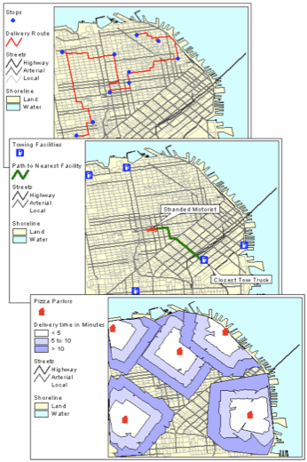{fig-alt="Three network analysis maps of a city" height="420"}
:::
:::
::::

## Raster processing {.intercalaire}

::: {.fiche n="4.0" etat="a-revoir"}
Intention : The same questions, asked of a grid: a summary. [PPT 17]
Experience : none
Request :
:::

The same questions, asked of a grid.

## Three families of operations {.appui}

::: {.fiche n="4.1" etat="a-revoir"}
Intention : Local (cell by cell), focal (from neighbouring cells), zonal (by zone). Three small grid diagrams, instead of Jeremy Mennis's figures. [PPT 18, 19, 30, 38]
Experience : diagram; sort five forest tasks into their family
Request :
:::

::: {.schema fichier="images/schemas/en/familles-raster.svg" hauteur="215"}
:::

::: {.classer}
### Local

- Find slopes steeper than 30%
- Compute the NDVI

### Focal

- Smooth a DTM
- Compute slope from the DTM

### Zonal

- The mean slope of each parcel
:::

## Local: reclassify, apply a condition {.appui}

::: {.fiche n="4.2" etat="a-revoir"}
Intention : Reclassify (a lookup table, or n automatic classes); apply a condition, often a threshold. Uses: a binary mask, a simplified classification. Forest example: slopes over 30%, too steep for machines. Small grid diagram. [PPT 20, 21, 29]
Experience : question: on a slope grid, which cells equal 1 after the condition "slope > 30"?
Request :
:::

:::: {.columns}
::: {.column width="30%"}
::: {.schema fichier="images/schemas/en/condition-entree.svg" hauteur="270"}
:::
:::
::: {.column width="70%"}
A **local** operation computes each cell from its own value only. **Reclassify**: give new values, through a lookup table or in n classes. **Apply a condition**, often a threshold: you get a binary mask, 1 or 0.

::: {.question}
Beyond a 30% slope, machines can no longer work. **Which cells equal 1 with the condition "slope > 30"?**
:::

::: {.reponse}
:::: {.columns}
::: {.column width="30%"}
::: {.schema fichier="images/schemas/en/condition-sortie.svg" hauteur="150"}
:::
:::
::: {.column width="70%"}
The seven cells above 30, grouped to the east: the area to be worked differently.
:::
::::
:::
:::
::::

## Local: calculating across layers {.appui}

::: {.fiche n="4.3" etat="a-revoir"}
Intention : Raster algebra (the raster calculator): a layer and a constant, or several layers cell by cell (sum, mean). Example: the NDVI, a vegetation index. Weighted overlay, for a composite index. Small diagrams. [PPT 22 to 27]
Experience : none; bonus: weighted overlay. The 0.3 threshold between vegetation and no vegetation is given.
Request :
:::

:::: {.columns}
::: {.column width="50%"}
**Raster algebra** combines layers cell by cell: with a constant, or with each other. This is the **raster calculator**.

::: {.schema fichier="images/schemas/en/algebre.svg" hauteur="150"}
:::

A very common example, the **NDVI**, a vegetation index: `(NIR − R) / (NIR + R)`. Vegetation strongly reflects near-infrared (NIR) and absorbs red (R).
:::
::: {.column width="50%"}
The NDVI ranges from −1 to 1.

- Below about 0.3: bare soil, built-up areas, water.
- Around **0.3**: the boundary between vegetated and non-vegetated.
- Above it, the higher the value, the denser and more active the vegetation.

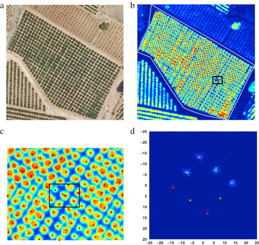{fig-alt="Citrus orchards in an aerial image and their vegetation index" height="170"}
:::
::::

::: {.plus titre="Weighted overlay"}
:::: {.columns}
::: {.column width="45%"}
Each layer is first reclassified on a common scale, then given a weight; the weighted sum gives a composite index. Example: choosing a site by combining distance to a hospital, to a university, population and house prices.
:::
::: {.column width="55%"}
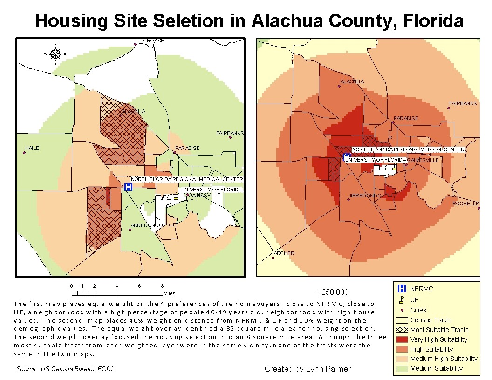{fig-alt="Four criterion maps combined into a suitability map" height="380"}
:::
::::
:::

## Layers that do not line up {.appui}

::: {.fiche n="4.4" etat="a-revoir"}
Intention : The raster calculator is powerful, but two grids with different resolution or alignment do not overlay cell by cell: they must first be made consistent. [PPT 28]
Experience : diagram of two offset grids
Request :
:::

The raster calculator is powerful, simple and fast. But it assumes that the cells of the two layers match.

::: {.schema fichier="images/schemas/en/coherence.svg" hauteur="300"}
:::

[Before combining two rasters, check that they share the same coordinate system, resolution and alignment; otherwise, resample one onto the other.]{.a-retenir}

## Focal: the moving window {.appui}

::: {.fiche n="4.5" etat="a-revoir"}
Intention : Each cell receives a value computed from its neighbours, in a 3 × 3, 5 × 5… window; the shape of the neighbourhood can vary. Filters and focal statistics. Small diagram. [PPT 31, 32, 33]
Experience : question: what value does the centre cell receive with a 3 × 3 mean?
Request :
:::

:::: {.columns}
::: {.column width="45%"}
::: {.schema fichier="images/schemas/en/fenetre.svg" hauteur="300"}
:::
:::
::: {.column width="55%"}
A **focal** operation computes each cell from its **neighbours**: a 3 × 3, 5 × 5… window moves across the grid. It computes a mean, a maximum, a diversity: these are filters and focal statistics.

::: {.question}
With a 3 × 3 mean, **what value does the centre cell receive?**
:::

::: {.reponse}
The mean of the nine values in the window: (3 + 6 + 9 + 4 + 8 + 5 + 7 + 2 + 1) / 9 = **5**. The 8 is smoothed by its neighbours.
:::
:::
::::

## Focal: deriving the terrain {.appui}

::: {.fiche n="4.6" etat="a-revoir"}
Intention : From the DTM come slope, aspect, hillshade. DTM (the ground) and DSM (ground and above-ground); their difference gives vegetation height: the link with the forest. [PPT 34, 35, 36]
Experience : diagram DSM − DTM = canopy height; question: where can you read tree height?
Request :
:::

:::: {.columns}
::: {.column width="30%"}
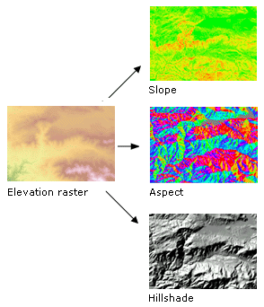{fig-alt="A DTM and the three layers derived from it: slope, aspect, hillshade" height="320"}
:::
::: {.column width="70%"}
From the **DTM** you derive **slope**, **aspect** and **hillshade**, each computed over the neighbourhood window.

::: {.schema fichier="images/schemas/en/mns-mnt.svg" hauteur="180"}
:::

::: {.question}
**Where can you read tree height?**
:::

::: {.reponse}
In the difference DSM − DTM: the canopy height model. IGN's LiDAR HD makes it possible to compute it everywhere in France.
:::
:::
::::

## Focal: distance {.appui}

::: {.fiche n="4.7" etat="a-revoir"}
Intention : Euclidean distance: each cell receives its distance to the nearest source; with a maximum, you get a raster buffer. [PPT 37]
Experience : none
Request :
:::

:::: {.columns}
::: {.column width="40%"}
Each cell receives its **distance** to the nearest source: a road, a river, a forest road.

With a maximum distance, you get a **raster buffer**.

[In a forest: the skidding distance to the nearest forest road.]{.a-retenir}
:::
::: {.column width="60%"}
:::: {.columns}
::: {.column width="45%"}
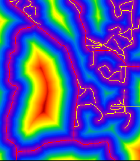{fig-alt="A distance-to-roads map, from red to blue" height="320"}
:::
::: {.column width="55%"}
{fig-alt="A distance map draped over the terrain" height="230"}
:::
::::
:::
::::

## Zonal {.appui}

::: {.fiche n="4.8" etat="a-revoir"}
Intention : A statistic computed over the cells of the same zone (mean, sum, maximum…), the zones being given by a raster or a vector. Small diagram. [PPT 38, 39]
Experience : question: what is the mean of zone B?
Request :
:::

:::: {.columns}
::: {.column width="50%"}
::: {.schema fichier="images/schemas/en/zonal.svg" hauteur="260"}
:::
:::
::: {.column width="50%"}
A **zonal** operation computes a statistic over all the cells of the same zone: mean, sum, maximum… The zones come from a raster or from polygons.

::: {.question}
**What is the mean of the values in zone B?**
:::

::: {.reponse}
Zone B covers six cells: (6 + 8 + 7 + 9 + 5 + 1) / 6 = **6**.
:::
:::
::::

## Other common operations {.appui}

::: {.fiche n="4.9" etat="a-revoir"}
Intention : Resample (change the resolution), clip, extract; then more complex processing: interpolation, watersheds, solar radiation, visibility. [PPT 40, 42]
Experience : none
Request :
:::

:::: {.columns}
::: {.column width="50%"}
- **Resample**: change the resolution, here by the mean of four cells.
- **Clip** a raster, by a rectangle or a polygon.
- **Extract** the values under points.

And more complex processing: interpolation, watershed delineation, theoretical solar radiation, visibility analysis.
:::
::: {.column width="50%"}
::: {.schema fichier="images/schemas/en/reechantillonner.svg" hauteur="230"}
:::
:::
::::

## Between raster and vector {.intercalaire}

::: {.fiche n="5.0" etat="a-revoir"}
Intention : Processing that straddles the two modes, the kind most used in forestry. [new]
Experience : none
Request :
:::

Processing that straddles the two modes.

## Rasterise, vectorise {.socle}

::: {.fiche n="5.1" etat="a-revoir"}
Intention : From vector to raster: each cell takes the value of the feature that covers it. From raster to vector: neighbouring cells with the same value become a polygon; example: from a classified image to a land cover map. What is lost each way. [PPT 11, 41]
Experience : compare: slider between the vector parcels and their rasterised version
Request :
:::

:::: {.columns}
::: {.column width="52%"}
::: {.comparer}
- 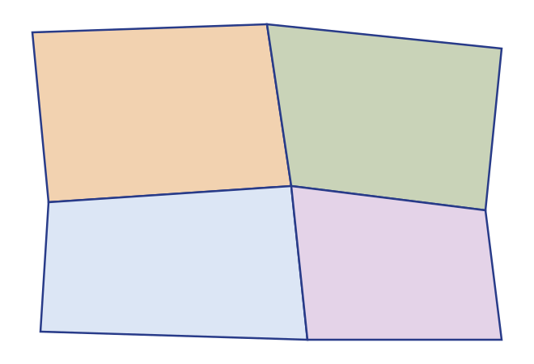
- 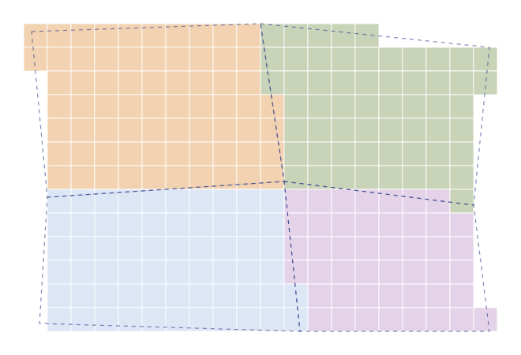
:::
:::
::: {.column width="48%"}
**Rasterise**: each cell takes the value of the feature that covers it. Boundaries become staircases; accuracy depends on the cell size.

**Vectorise**: neighbouring cells with the same value become a polygon. This is how a classified image becomes a land cover map.

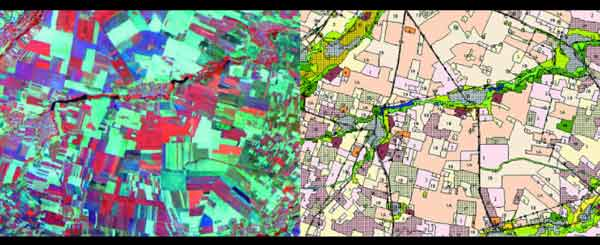{fig-alt="A satellite image classified then vectorised into land cover" height="130"}
:::
::::

## The zoning changes the result {.veille}

::: {.fiche n="5.2" etat="a-revoir"}
Intention : The modifiable areal unit problem (MAUP): the same data, aggregated with two different zonings, give two different maps. The two European maps from the old handout. [PPT 11]
Experience : scroll through the two maps; question: why do they not tell the same story?
Request :
:::

:::: {.columns}
::: {.column width="55%"}
::: {.defiler commande="haut"}
- 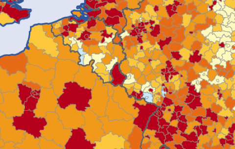
- 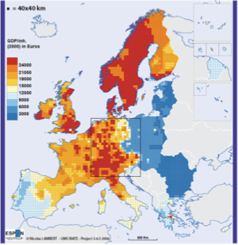
:::
:::
::: {.column width="45%"}
::: {.question}
The two maps show the same data. **Why do they not tell the same story?**
:::

::: {.reponse}
Because the zoning changes the result: the size and shape of the units change means and contrasts. This is the modifiable areal unit problem (MAUP), described by Stan Openshaw in 1984. Would the result hold with another zoning?
:::
:::
::::

## Summarising a raster by polygons {.socle}

::: {.fiche n="5.3" etat="a-revoir"}
Intention : Zonal statistics with vector zones: the mean slope of each parcel, the mean height of each stand. The result goes back into the attribute table. [PPT 39]
Experience : question (prediction): which field is added to the parcel table?
Request :
:::

:::: {.columns}
::: {.column width="45%"}
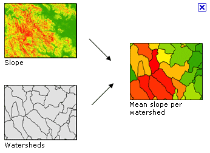{fig-alt="A slope layer and watersheds give the mean slope per watershed" height="300"}

[Mean slope per watershed]{.legende}
:::
::: {.column width="55%"}
**Zonal statistics** often take their zones from a **vector** layer: parcels, stands, watersheds.

::: {.question etiquette="Prediction"}
You compute the mean slope under each forest parcel. **Where does the result go?**
:::

::: {.reponse}
Into the attribute table of the parcels: one more field per statistic requested, for example "mean_slope". The raster is summarised by the polygons.
:::
:::
::::

## Clipping a raster by a vector {.appui}

::: {.fiche n="5.4" etat="a-revoir"}
Intention : The mask: keep only the DTM cells inside the forest. [PPT 40]
Experience : none
Request :
:::

You keep only the cells of a raster that lie inside a polygon: this is the **mask**.

::: {.schema fichier="images/schemas/en/masque.svg" hauteur="280"}
:::

[The vector boundary is precise, the cells kept are less so: in general, those whose centre lies in the polygon are kept.]{.a-retenir}

## Reading a raster under points {.appui}

::: {.fiche n="5.5" etat="a-revoir"}
Intention : Sampling: each point receives the value of the cell under it; example: the elevation or slope of each inventory plot. [PPT 40]
Experience : question: what value does plot 3 receive?
Request :
:::

:::: {.columns}
::: {.column width="40%"}
::: {.schema fichier="images/schemas/en/echantillonner.svg" hauteur="320"}
:::
:::
::: {.column width="60%"}
**Sampling** a raster: each point receives, in a new field, the value of the cell it sits on. In a forest: the elevation, slope or canopy height of each inventory plot.

::: {.question}
**What elevation does plot 3 receive?**
:::

::: {.reponse}
**412 m**: the value of the cell it sits on. Plots 1 and 2 receive 410 and 431 m.
:::
:::
::::

## Draping and extruding {.veille}

::: {.fiche n="5.6" etat="a-revoir"}
Intention : Draping an image over the DTM, extruding vector features by an attribute: the 3D view, where raster and vector meet. [PPT 43, 44]
Experience : scroll through the two images
Request :
:::

:::: {.columns}
::: {.column width="35%"}
**Draping**: laying an image, a scanned map or an aerial photo over the relief of the DTM.

**Extruding**: raising vector features by an attribute, the height of buildings for example.

Raster and vector meet in the 3D view.
:::
::: {.column width="65%"}
::: {.defiler commande="haut"}
- 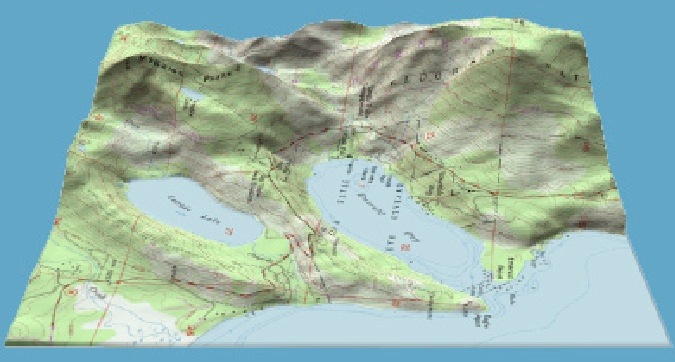
- 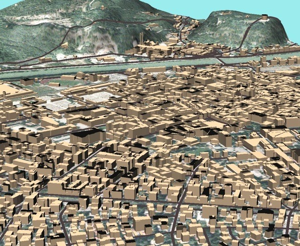
:::
:::
::::

## Key points

::: {.fiche n="6.1" etat="a-revoir"}
Intention : The core slides, in one list.
Experience : links to each slide
Request :
:::

::: {.carte-du-cours niveaux="socle"}
:::

## Your turn {.fin}

::: {.fiche n="6.2" etat="a-revoir"}
Intention : Points to the geoprocessing practical: the investigation on forest data.
Experience : none
Request :
:::

Over to the practical: an investigation on forest data, from the first query to the final map.

## Sources and credits {.petit}

::: {.fiche n="6.3" etat="a-revoir"}
Intention : Sources of the figures reused (ESRI, FAO, ESPON, etc.), to be completed. [new]
Experience : none
Request :
:::

:::: {.columns}
::: {.column width="50%"}
| Document | Origin |
|---|---|
| Distance on the world map and the globe | original handout, to be completed |
| Classification and land cover | FAO |
| Maps aggregated by region and on a grid | ESPON, UMS RIATE |
| Network analysis | original handout, to be completed |
| NDVI of citrus orchards | J. Amorós López *et al.*, *ISPRS Journal*, 2011 |
:::
::: {.column width="50%"}
| Document | Origin |
|---|---|
| Weighted overlay, Alachua County | Lynn Palmer, US Census Bureau data |
| Slope, aspect, hillshade | ESRI |
| Distance maps | learn.environment.utoronto.ca |
| Mean slope per watershed | ESRI |
| Draped DTM, extruded buildings | M. Neteler, data from the City of Trento |
| Drawn diagrams | made for this course |
:::
::::
