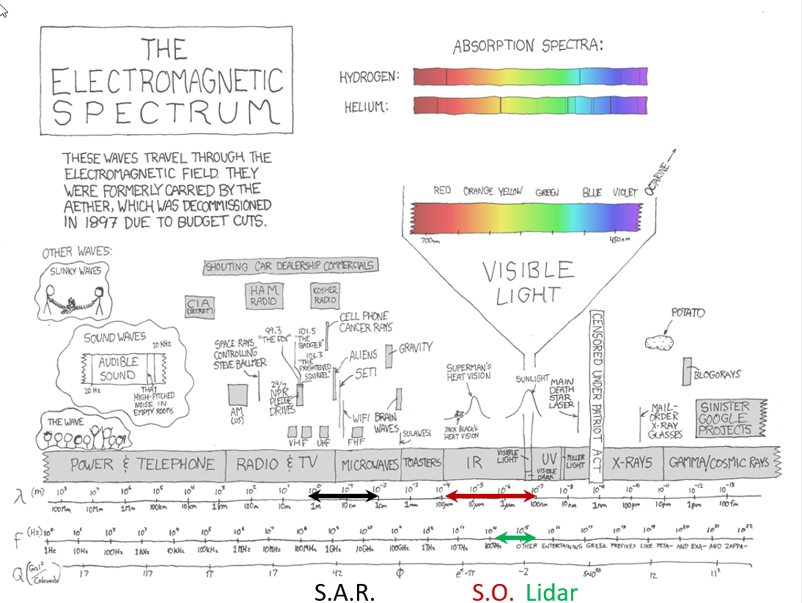
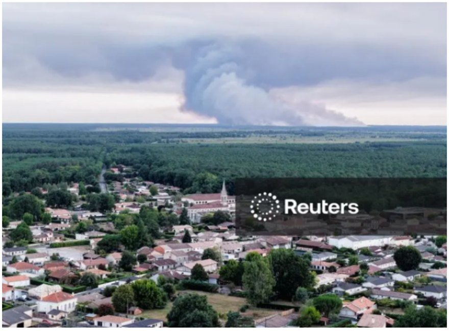

::: {.fiche n="0.1" etat="a-revoir"}
Intention : Couverture, sur une mosaïque d'hexagones aux couleurs des familles de l'atelier : le jeu se devine dès le titre. Image de Marc possible à la place.
Expérience : aucune
Demande :
:::

## Comment lire ce support

::: {.fiche n="0.2" etat="a-revoir"}
Intention : Le mode d'emploi : un atelier de deux heures, par groupes de trois (60 étudiants, 20 groupes) ; ce que l'on fait sur son écran ; ce qui est gardé, ce qui est envoyé. Déclaration de transparence IA.
Expérience : aucune
Demande :
:::

Ce cours est un **atelier**. Vous travaillez par **petits groupes**, sur un seul écran par groupe.

- Vous **votez**, vous **réglez**, vous **construisez** avant de lire la réponse.
- Au cœur du cours, je tente un exercice expériemental rendu possible grâce à l'IA : une **commande** à honorer : vous assemblez la chaîne de traitement qui y répond, en interrogeant quatre spécialistes.
- Ce que vous faites reste dans votre navigateur. À la fin de l'atelier, vous **envoyez** votre travail à la feuille du cours : c'est la trace commune de la séance.
- Le **pictogramme** devant chaque titre donne le niveau : **socle**, **appui**, **veille**. Une diapo sans pictogramme est un exemple ou une activité.

::: {.transparence-ia profil="✒️ L'Auteur outillé" coordonnees="F2 · R0 · S0" outil="Claude 5"}
:::

## Carte du cours

::: {.fiche n="0.3" etat="a-revoir"}
Intention : Les quatre parties et la légende S / A / V. Durées indicatives : vote 10 min ; voir 15 min ; faire 15 min ; atelier Saumos environ 70 min (cadrage, 30 min d'enquête, 5 min de rapport, débrief, verdict). [Fusion du 25 novembre : quatre parties au lieu de sept.]
Expérience : liens vers chaque diapo
Demande :
:::

::: {.carte-du-cours}
:::

## Que peut-on voir d'en haut ? {.intercalaire}

::: {.fiche n="1.0" etat="a-revoir"}
Intention : L'accroche, environ 10 minutes. Le vote remplace la liste des étudiants de la première version (décision de Marc).
Expérience : aucune
Demande :
:::

Vous savez photo-interprêter le visible. Aujourd'hui, on découvre d'autres applications.

## Possible, ou pas ?

::: {.fiche n="1.1" etat="a-revoir"}
Intention : Le vote d'accroche : des usages vrais, dont certains déjà vus en photo-interprétation (les bases russes, Angkor : l'expérience commence à se constituer) et d'autres inattendus (le vent sur Mars, la gravité des nappes, les rivières sous le Sahara), et des faux. Aucun des huit cas de l'atelier n'y figure, pour ne pas le déflorer. Chaque étudiant vote sur son écran ; Marc peut faire voter à main levée sur la projection. Avec la réponse apparaissent une image, son descriptif et sa source. [Retour V0 : une image ou une figure et un descriptif pour chaque réponse, fournis par Marc et recopiés tels quels ; un curseur de fondu pour le Sahara et pour la Bolivie ; la vidéo de Skybox. Le texte des énoncés et des explications est celui de Marc.] [Retour du 19 novembre : l'image radar de la Manche se zoome (un clic agrandit ×4, la souris la parcourt ; version web gardée à 4 000 px) ; les illustrations prennent les deux tiers de la largeur et toute la hauteur, le bouton « Suivant » passant dans la colonne de texte ; les images de Bolivie recadrées par Marc sont reprises comme originaux.] [Retour du 20 novembre : la vidéo de Skybox s'intègre comme dans le lien de Marc (youtube.com/embed, même politique de référent) ; ouvert comme simple fichier, le support montre sa vignette, qui ouvre la vidéo sur YouTube, car YouTube refuse de jouer une vidéo intégrée sans adresse de page. Deux flèches passent d'un énoncé à l'autre sans voter, et « Recommencer » est accessible à tout moment, en tête du vote.]
Expérience : voter oui / non / pas sûr, puis lire l'explication et voir l'image (brique « vote ») ; bilan final
Demande :
:::

::: {.vote question="Peut-on le faire depuis le ciel ou l'espace ?"}
- [vrai] Estimer la vitesse du vent à la surface de Mars : En mesurant et suivant, d'une image à l'autre, le déplacement des crêtes des dunes, il est possible d'en déduire un modèle physique.
    - image : images/mars-dunes.jpg
    - legende : An (almost) automated process to track the Martians dunes. Arthur Coque 2017
- [faux] Lire la plaque d'immatriculation d'une voiture sur une image satellite du commerce : Les meilleurs satellites commerciaux ont des pixels d'environ 30 cm, améliorés à 15 cm par réseaux de neurones ; une plaque demande moins du centimètre, sans parler de l'angle d'observation.
    - image : images/pleiades-neo-arcachon.jpg
    - legende : © Airbus DS, Pleiades Neo Octobre 2021, Canal panchromatique : Parking d'Arcachon.
- [vrai] Voir et mesurer l'étendue d'une marée noire à travers les nuages : Le radar envoie sa propre onde et traverse les nuages ; l'eau libre renvoie le signal, pas l'eau rendue visqueuse par les hydrocarbures, qui se comporte comme un mirroir et paraît sombre.
    - image : images/maree-noire-radar.jpg
    - legende : Detection de nappe de pétrole dans le golfe persique, projet DDEMG.
- [vrai] Peser l'eau des nappes souterraines : Les satellites GRACE mesurent d'infimes variations de la gravité, qui suivent la masse d'eau stockée dans le sol.
    - image : images/grace.jpg
    - legende : Couple des satellites Grace.
    - lien : https://www.space4water.org/fr/news/penuries-deau-en-milieu-urbain-comment-les-donnees-de-la-mission-grace-fo-de-la-nasa-peuvent
- [vrai] Repérer les bateaux de pêche qui coupent leur balise AIS : Le radar voit les navires, balise ou pas ; on croise ensuite avec les positions qu'ils déclarent.
    - image : images/manche-sentinel-1.jpg
    - zoom : 4
    - legende : traffic martime dans le rail de la Manche,  S1-IW septembre 2026, RGB Ratio
- [faux] Voir à travers le toit d'un hangar : Ni l'optique ni le radar ne traversent un toit ; seule l'activité autour (véhicules, chaleur, ombres) trahit ce qu'il abrite.
    - image : images/forcalquier-ortho.jpg
    - legende : © IGN, Orthophotographie juillet 2024, RVB
- [vrai] Suivre l'activité d'un pays la nuit : Les lumières nocturnes suivent l'éclairage, l'électrification, et même les coupures de courant.
    - image : images/denver-nuit.jpg
    - legende : Denver, Colorado, USA, exhibiting the street grid typical of large cities in the southwestern USA.
- [vrai] Voir l'arrêt des usines chinoises au début du Covid : Le dioxyde d'azote, gaz des moteurs et des usines, a fortement baissé au-dessus de la Chine en février 2020, mesuré par satellite.
    - image : images/chine-no2-covid.jpg
    - legende : Average OMI tropospheric NO2 vertical column densities (TVCDs) over China in 2020. (A) −20 to −1, (B) 0 to 19, and (C) 20 to 39 days relative to the 2020 LNY. Fei Liu et al. ,Abrupt decline in tropospheric nitrogen dioxide over China after the outbreak of COVID-19.Sci. Adv.6,eabc2992(2020).DOI:10.1126/sciadv.abc2992
    - lien : https://doi.org/10.1126/sciadv.abc2992
- [vrai] Repérer des canaux anciens dissimulés sous plusieurs mètres de sable : Le satellite de la Mission BIOMASS peut pénétrer ces espaces secs sur une profondeur de 5 mètres grâce à sa bande P.
    - image : images/sahara-rvb.jpg
    - fondu : images/sahara-biomass.jpg
    - lien : https://www.futura-sciences.com/planete/actualites/desert-ils-ont-reussi-voir-sous-sable-sahara-premieres-images-revelent-monde-disparu-rivieres-lacs-138417/
- [faux] Filmer la même rue toute la journée depuis un satellite en orbite basse : Un satellite en orbite basse survole un lieu en quelques minutes ; on n'en tire que de courts films. Un satellite géostationnaire voit toute la journée, mais en pixels kilométriques.
    - video : https://www.youtube.com/watch?v=fCrB1t8MncY
    - legende : Skybox Imaging Captures World's First High-Resolution, HD Video of Earth from Space-1080p HD
    - lien : https://www.youtube.com/watch?v=fCrB1t8MncY
- [vrai] Repérer la montée en puissance de bases militaires : Une série d'images montre les véhicules et les camps qui s'ajoutent.
    - image : images/soloti.gif
    - legende : Base russe de Soloti, Sentinel2-MSI animation de 2017 à 2021
- [vrai] Révéler des villes cachées sous la forêt : Le LiDAR atteint le sol entre les feuilles : les villes khmères autour d'Angkor.
    - image : images/cite-maya-lidar.jpg
    - legende : Advanced laser techniques have revealed more than 60,000 ancient Mayan structures beneath the jungles of northern Guatemala. PACUNAM/Canuto & Auld-Thomas
    - lien : https://edition.cnn.com/style/article/ancient-mayan-structures-discovered
- [vrai] Suivre les bancs de sargasses qui arrivent sur les Antilles : Les algues flottantes ont une signature nette dans le proche infrarouge ; on les suit presque chaque jour.
    - image : images/sargasses.jpg
    - legende : Vue d’ensemble de la situation des sargasses dans l’océan Atlantique, basé sur une moyenne de 7 jours de détection par le satellite européen Sentinel-3 (OLCI) et le satellite américain NOAA Aqua (MODIS). L’image ci-dessus contient des données modifiées du satellite Sentinel-2 de Copernicus (2019).
    - lien : https://www.cls.fr/service-operationnel-de-surveillance-des-sargasses-cls-ouvert-aux-utilisateurs/
- [faux] Mesurer directement la température de l'eau à 100 m de profondeur : Le thermique ne voit que la pellicule de surface ; en profondeur, il faut des bouées et des modèles.
    - image : images/flotteur-argo.jpg
    - legende : Argo floats measure temperature and salinity. Bio-Argo floats with other sensors are also being tested by CSIRO. CSIRO
    - lien : https://theconversation.com/ocean-depths-heating-steadily-despite-global-warming-pause-37047
- [vrai] Mesurer la biomasse des forêts de toute la planète : C'est l'objectif de la mission BIOMASS de l'ESA, un radar à grande longueur d'onde lancé en 2025.
    - image : images/bolivie-sentinel-2.jpg
    - fondu : images/bolivie-biomass.jpg
    - legende : Image de la même zone de la Bolivie par le satellite Sentinel-2 du programme Copernicus et par Biomass (crédit ESA)
    - lien : https://reves-d-espace.com/le-satellite-biomass-devoile-ses-premieres-images-des-forets-de-la-planete/
:::

## Sortir du visible {.socle}

::: {.fiche n="1.2" etat="a-revoir"}
Intention : Le pont avec la photo-interprétation : l'œil ne voit qu'une étroite bande du spectre ; la télédétection exploite trois origines du signal (ce que la surface renvoie du soleil, ce qu'elle émet, ce qu'un instrument envoie et reçoit). Ce sont les hexagones « Signal » de l'atelier. [Retour V0 : le spectre de xkcd annoté par Marc (radar, optique, LiDAR) remplace le schéma, à gauche ; le texte de Marc, tel quel, et la question à droite.]
Expérience : spectre annoté ; QCM
Demande :
:::

:::: {.columns}
::: {.column width="52%"}
{height="400px"}
:::
::: {.column width="48%"}
::: {style="font-size: 21px; line-height: 1.35"}
Chaque signal est sensible à des phénomènes différents : le visible, et le proche infrarouge sont dit les canaux de la vie car en lien direct avec la Source solaire. L'infrarouge thermique mesurent lui les canaux d'émission des corps autour de 300K, soit la température ambiante. La rugosité elle se mesure avant tout avec les ondes radio actives des capteurs Radar. Les élévations, du sol ou de la végétation se mesure elles avec le Lidar, un autre capteur actif. Choisir un signal, c'est choisir ce que l'on pourra voir.
:::

::: {.qcm .serre}
Voir une inondation sous un ciel couvert : quel signal ?

- [ ] Le visible
    - Les nuages l'arrêtent.
- [ ] L'infrarouge thermique
    - Les nuages l'arrêtent aussi.
- [x] Le radar
    - Oui : l'instrument envoie sa propre onde, qui traverse les nuages.
:::

:::
::::

## Qu'est-ce que voir ? {.intercalaire}

::: {.fiche n="2.0" etat="a-revoir"}
Intention : Environ 15 minutes. Les facteurs qui limitent la donnée source, puis le traitement.
Expérience : aucune
Demande :
:::

Voir à la verticale, en particulier depuis l'espace, a ouvert des champs nouveaux d'observation. Il reste cependant de nombreuses limites.

## Les quatre résolutions {.socle}

::: {.fiche n="2.1" etat="a-revoir"}
Intention : Les quatre résolutions, définies par l'étudiant lui-même en rangeant huit énoncés : une définition et un exemple pour chacune.
Expérience : classer huit énoncés en quatre cases, au glisser-déposer
Demande :
:::

Rangez chaque énoncé sous la résolution qu'il décrit.

::: {.classer}
### Spatiale

- La taille du plus petit détail visible
- Des pixels de 10 m

### Temporelle

- Le temps entre deux images du même lieu
- Une image tous les cinq jours

### Spectrale

- Le nombre et la largeur des bandes
- Treize bandes, du visible à l'infrarouge moyen

### Radiométrique

- La finesse des nuances d'intensité
- Des valeurs codées sur 12 bits, soit 4 096 niveaux
:::

## Les quatre résolutions, en images {.socle}

::: {.fiche n="2.2" etat="a-revoir"}
Intention : [Retour du 19 novembre, nouvelle diapo demandée par Marc : un schéma pour chacune des quatre résolutions, et l'avertissement que la résolution spatiale ne se confond avec la résolution terrain qu'en première approximation.] Après le classement de la diapo 2.1, la correction en images : chaque résolution en deux réglages, grossier puis fin. Schéma fait pour le cours (outils/schemas.py) ; la signature de végétation n'est qu'une allure. Texte de l'avertissement écrit par Claude, à valider par Marc.
Expérience : schéma
Demande :
:::

::: {.schema fichier="images/schemas/resolutions.svg" hauteur="330"}
:::

[**Attention.** Dans ce cours, la résolution spatiale se confond avec la résolution terrain, la taille du pixel au sol. Ce n'est qu'une première approximation : le plus petit détail que l'on distingue dépend aussi de l'optique, de l'angle de visée, de l'atmosphère et des traitements. La suite de vos études complexifiera ce point.]{.a-retenir style="font-size: 20px"}

## Le jeu des compromis {.socle}

::: {.fiche n="2.3" etat="a-revoir"}
Intention : Proposition de Marc : quatre curseurs centrés sur 0 et un objectif. Monter un curseur en fait baisser un autre, et le cours dit pourquoi (fauchée, lumière reçue, volume de données). Le profil obtenu est rapproché d'un capteur réel. Le dernier objectif est impossible : un seul capteur ne peut pas tout avoir. Profils des capteurs indicatifs, relatifs à Sentinel-2 (0 partout), à valider par Marc. [Retour du 19 novembre : changer d'objectif remet les curseurs à zéro.]
Expérience : choisir un objectif, régler les quatre curseurs (brique « compromis »)
Demande :
:::

::: {.compromis}
### Suivre chaque jour l'évolution d'un phénomène | temporelle >= 2
### Compter les voitures sur un parking | spatiale >= 3
### Reconnaître des minéraux à leur signature | spectrale >= 2
### Distinguer d'infimes nuances dans la couleur de l'eau | radiometrique >= 1
### Tout voir, tout le temps, dans toutes les couleurs | spatiale >= 2, temporelle >= 2, spectrale >= 2

- Météosat (géostationnaire) | -3, 3, 0, 0 | une image toutes les 10 à 15 minutes, des pixels de l'ordre du kilomètre
- Sentinel-3 | -2, 1, 0, 1 | presque chaque jour, des pixels de 300 m, une grande sensibilité pour la couleur de l'eau
- Sentinel-2 | 0, 0, 0, 0 | 10 à 60 m, tous les cinq jours environ, 13 bandes
- Landsat 8 et 9 | 0, -1, 0, 1 | 30 m, tous les huit jours à deux satellites, une sensibilité fine
- PlanetScope (constellation) | 1, 3, -2, -2 | 3 m, chaque jour, 4 à 8 bandes, une sensibilité moindre
- Pléiades Neo | 3, -1, -1, -1 | 30 cm, sur commande, 6 bandes
- PRISMA, EnMAP (hyperspectral) | -1, -2, 3, 0 | 30 m, sur commande, plus de 200 bandes
:::

## Pourquoi on ne peut pas tout avoir {.socle}

::: {.fiche n="2.4" etat="a-revoir"}
Intention : Les trois raisons physiques derrière les compromis : la lumière reçue par pixel et par bande, la géométrie de l'orbite (fauchée et revisite), le volume de données à descendre au sol. Puis la parade : combiner les capteurs. [Retour du 19 novembre : un schéma animé montre les trois mécanismes et leur effet sur l'image (bruit, fauchée, volume de données) ; les trois se succèdent dans le même cadre, 4 secondes chacun ; dans le PDF, ils sont côte à côte, en petit.]
Expérience : schéma animé ; question, puis réponse
Demande :
:::

:::: {.columns style="font-size: 18px; line-height: 1.3"}
::: {.column width="40%"}
::: {.schema fichier="images/schemas/limites.svg" hauteur="400"}
:::
:::
::: {.column width="60%"}
Trois limites, et elles se tiennent entre elles :

- **La lumière ou le REM** Un pixel plus petit ou une bande plus étroite reçoivent moins de lumière : le signal se perd dans le bruit, le rapport des deux devient insuffisant pour une mesure signifiante.
- **L'orbite.** Voir fin, c'est voir proche, c'est donc voir étroit : le satellite met plus longtemps à revenir au même endroit.
- **Les données.** Chaque pixel, chaque bande, chaque passage s'enregistre puis descend au sol : le débit a une limite.

::: {.question etiquette="À vous"}
Alors, quand un client veut voir fin, souvent, et dans beaucoup de bandes, que fait-on ?
:::

::: {.reponse}
On **combine** : une constellation pour revenir plus souvent ; une image fine en noir et blanc fusionnée avec une image en couleurs plus grossière ; un capteur grossier pour chercher, un fin pour regarder. Et l'on choisit d'après la **commande** : quelle résolution compte vraiment ?
:::
:::
::::

## Ce qui limite, après le capteur {.appui}

::: {.fiche n="2.5" etat="a-revoir"}
Intention : La question de Marc : « Quels sont les facteurs limitant la donnée source ? Et le traitement ? » Trois familles de limites : la scène, le capteur, le traitement.
Expérience : classer neuf limites en trois cases, au glisser-déposer
Demande :
:::

D'où vient chaque limite ?

::: {.classer}
### La scène

- Les nuages
- Le relief et ses ombres
- La saison

### Le couple vecteur/capteur

- La taille du pixel
- L'heure de passage, imposée par l'orbite
- Le bruit de l'instrument

### Le traitement

- Deux dates mal superposées
- Trop peu d'exemples pour l'apprentissage
- Un seuil de filtrage mal choisi
:::

[Une erreur de traitement ressemble souvent à un vrai phénomène : c'est la plus dangereuse.]{.a-retenir style="font-size: 24px"}

## Qu'en faire ? {.intercalaire}

::: {.fiche n="3.0" etat="a-revoir"}
Intention : Environ 15 minutes. Relier les verbes de la commande aux étapes du traitement : la grammaire de l'atelier.
Expérience : aucune
Demande :
:::

Un client ne demande jamais une image. Il demande une réponse.

## Six verbes {.socle}

::: {.fiche n="3.1" etat="a-revoir"}
Intention : Les verbes de la commande, rangés par niveau d'inférence (contradiction validée par Marc) : mesurer, détecter, classer, suivre, estimer, modéliser. Cartographier n'est pas un verbe de plus, c'est la forme de presque tous les résultats.
Expérience : remettre les six verbes en ordre, du plus direct au plus déduit ; réponse
Demande :
:::

:::: {.columns}
::: {.column width="45%"}
Remettez les verbes en ordre, de la mesure la plus **directe** à la réponse la plus **déduite**.

::: {.ordre}
1. Mesurer
2. Détecter
3. Classer
4. Suivre
5. Estimer
6. Modéliser
:::

[Il faut quantifier une information, pour transformer un signal en donnée signifiante individualisable : un phénomène. Ils sont alors différenciable les uns des autres, ce qui permet de les distinguer dans l'espace et/ou le temps. Leurs variations sont alors mesurables, voir simulables ]{.legende}
:::
::: {.column width="55%"}
::: {.question}
Et « cartographier » ? Pourquoi n'est-il pas dans la liste ?
:::

::: {.reponse}
Parce que presque tous les résultats finissent en carte. Cartographier n'est pas un verbe de plus : c'est la **forme** du résultat. Dans l'atelier, la carte est un hexagone « Résultat ».

Plus on monte dans la liste, plus la chaîne s'allonge, et plus il faut de **données extérieures** à l'image : un terrain, un modèle, un registre.
:::
:::
::::

## Une chaîne, des étapes {.socle}

::: {.fiche n="3.2" etat="a-revoir"}
Intention : La grammaire des hexagones : la chaîne type, de la commande au résultat ; Acquérir et Dériver peuvent manquer, Valider jamais. Puis ranger des opérations dans leur étape : la granularité de base que les étudiants retrouveront dans l'atelier.
Expérience : schéma ; classer huit opérations en quatre étapes
Demande :
:::

::: {.schema fichier="images/schemas/chaine.svg" hauteur="140"}
:::

::: {.classer}
### Préparer

- Corriger l'atmosphère
- Masquer les nuages

### Dériver

- Calculer un indice de végétation
- Soustraire deux dates

### Analyser

- Classer les pixels d'après des exemples
- Croiser avec le cadastre

### Valider

- Comparer à des relevés de terrain
- Faire contrôler les détections par un expert
:::

## Atelier : le feu de Saumos {.intercalaire .jdr-titre}

::: {.fiche n="4.0" etat="a-revoir"}
Intention : L'atelier, environ 70 minutes, sous forme de jeu de rôle : il clôt le cours. Le titre passe, lettre à lettre, en police 8 bits et revient. [Fusion du 25 novembre : l'atelier, construit à part dans IMAGE-AtelierSaumos.qmd, devient la partie 4 et remplace l'atelier des commandes ; les parties 5 et 6, la projective et la diapo 3.3 sont mises de côté, en commentaire en fin de fichier.]
Expérience : aucune
Demande :
:::

Un incendie, un préfet, trois enquêtes : à vous de jouer.

## Comment jouer {.jdr}

::: {.fiche n="4.1" etat="a-revoir"}
Intention : Le déroulé en une diapo : dépêche, commande, paris, équipe, cadrage de Rose, experts, 30 minutes d'enquête et de labo, 5 minutes de rapport, débrief, phrase de la classe, verdict. Le mode solo. [V3 : déroulé du script V3.] [Fusion du 25 novembre : la déclaration de transparence IA est celle de la diapo 0.2.]
Expérience : aucune
Demande :
:::

Un **jeu de rôle** par groupes de trois, chacun sur son écran. Le **préfet** passe une commande ; vous **pariez** ; vous choisissez votre **posture**.

1. **Rose** cadre le travail, puis présente les **experts**. « C'est parti » : **30 minutes**.
2. Chaque posture mène **son enquête** : on interroge les experts, ils ne donnent jamais la réponse, mais vous passent les **clefs** de votre **labo**.
3. Vous n'avez pas accès aux mêmes infos : **parlez-vous**. Un indice de trop coûte un peu de la **confiance du préfet**.
4. Le **rapport au propre** : 5 minutes pour un mini dossier. Puis le **débrief**, la **phrase de la classe**, le **verdict**.

Seul, chez vous ? Cochez « solo » : vous jouez les trois profils. Ce que vous faites reste dans votre navigateur.

## La dépêche {.jdr}

::: {.fiche n="4.2" etat="a-revoir"}
Intention : La question de départ, telle que dans la séance prépa : la photo Reuters, la dépêche du 23 juillet, puis la question « presque en direct ». [V3 : on vouvoie, et la question finit sur le mini dossier.]
Expérience : aucune
Demande :
:::

:::: {.columns}
::: {.column width="52%"}

:::
::: {.column width="48%"}
::: {.jdr-depeche}
dépêche · 23.07.2026 · 06:04

Un incendie déclaré hier à Saumos, en Gironde, a parcouru plusieurs milliers d'hectares de pin maritime durant la nuit. Les évacuations se poursuivent sur la façade océane.
:::

**Comment fait-on pour cartographier presque en direct un feu de forêt ?**

Cela dépend des données disponibles et donc des vecteurs en faisant l'acquisition : souvent des satellites. Vous allez pouvoir en choisir un, comprendre ce qu'il sait faire en fonction d'un paramètre important, leur orbite. À la fin, vous compilez vos réponses et fournissez un mini dossier.
:::
::::

## La commande du préfet {.jdr}

::: {.fiche n="4.3" etat="a-revoir"}
Intention : Le préfet passe la commande : la date précise du départ, la surface brûlée connue précisément à la fin du feu. Sa tête parle quand on arrive sur la diapo, avec un petit son de lecture sans langue, comme dans les JRPG ; le bouton « son » le coupe. [V3 : le son.] [Retour du 22 novembre : le préfet demande la date et l'heure précises du départ ; à côté, une carte 8 bits de la région (Sentinel-2 du 21 juillet en gros pixels d'environ 1 km, outils/carte-saumos.py) avec Saumos, Bordeaux, Arcachon, Lacanau et le départ du feu, au lieu-dit de l'Esquirot, au sud du bourg (position approchée).]
Expérience : écouter la commande (brique jdr-commande)
Demande :
:::

::: {.jdr-commande}
:::

[Copernicus EMS a été activé : c'est la mission **EMSR899**. Pour le préfet, une seule question compte : qu'aura-t-il entre les mains, et quand ?]{.legende}

## Vos paris {.jdr}

::: {.fiche n="4.4" etat="a-revoir"}
Intention : Les deux paris, avant toute enquête. La réponse attendue au verdict : cela dépend de la précision voulue et des moyens engagés. [Retour du 22 novembre : « jours ETP » est un terme technique ; un clic l'explique et le range dans le carnet.]
Expérience : parier (brique jdr-paris), un pari par groupe
Demande :
:::

::: {.jdr-paris}
:::

## Votre équipe {#equipe .jdr .jdr-plein data-state="plein"}

::: {.fiche n="4.5" etat="fige"}
Intention : Chaque étudiant choisit sa posture (rapporteur, analyste, orbitographe) et sa tête de héros. Un groupe de trois : une posture chacun. En groupe, chacun n'a accès qu'à son enquête et à son labo ; la case « solo » ouvre les trois profils (pour rejouer chez soi). [V3 : mode solo.]
Expérience : choisir sa posture, sa tête, son nom, son numéro de groupe, le mode solo (brique jdr-equipe)
Demande :
:::

::: {.jdr-equipe}
:::

## Rose cadre le travail {#cadrage .jdr .jdr-plein data-state="plein"}

::: {.fiche n="4.6" etat="a-revoir"}
Intention : Rose se présente, demande ce qui est important (réponse : la maîtrise de la chaîne d'information du phénomène aux conclusions, et des incertitudes de chaque maillon), donne les grandes lignes de l'enquête selon la posture de celui qui lit, invite à prendre une page et un crayon, rappelle qu'il peut y avoir plusieurs solutions et que c'est un travail d'équipe, annonce le compte à rebours. Texte de Marc (script V3). [V3 : nouvelle diapo.] [Retour du 22 novembre : chacun écrit sa réponse à « qu'est-ce qui est important ? » avant de lire celle de Rose (gardée avec le rapport) ; « Continuer ▶ » en bas à droite.]
Expérience : écouter Rose, réplique par réplique, répondre à sa question (brique jdr-cadrage)
Demande :
:::

::: {.jdr-cadrage}
:::

## Les experts {#experts .jdr .jdr-plein data-state="plein"}

::: {.fiche n="4.7" etat="a-revoir"}
Intention : Rose présente les trois experts (nom, rôle, travail) et se tient un peu à part : elle cadre, pas le fond. Bastien reprend les traitements de Youri. Les traits de caractère ne sont pas affichés : ils donnent le ton des répliques. « C'est parti » lance le chrono de 30 minutes et ouvre l'enquête de sa posture. [V3 : quatre experts, chrono.]
Expérience : lancer le chrono (brique jdr-experts)
Demande :
:::

::: {.jdr-experts}
:::

## Enquête A — le départ du feu {#enquete-a .jdr-plein data-state="plein"}

::: {.fiche n="4.8" etat="a-revoir"}
Intention : L'enquête du rapporteur. « Avec qui veux-tu commencer ? », puis « Avec qui désires-tu continuer de travailler ? ». Elikia : quel phénomène (la fumée), quel signal (le visible) ; Bastien : quelle résolution (temporelle). Le second des deux qui a ce qu'il faut répond « Meteosat ou Terra » et passe les clefs du labo Eumetsat. Inès vérifie ce qu'est un couple capteur / vecteur. Rose : la marge. Apartés et quatrième mur. [V3 : dialogues réécrits d'après le script V3.]
Expérience : dialoguer avec les experts, carnet et journal (brique jdr-enquete)
Demande :
:::

::: {.jdr-enquete enquete="A"}
:::

## Labo Eumetsat {#labo-a .jdr-plein data-state="plein"}

::: {.fiche n="4.9" etat="a-revoir"}
Intention : La version JRPG d'EUMETView : les images Meteosat (MSG 0°) du 21 juillet midi au 22 juillet 23 h, à faire défiler une à une, l'heure inscrite sur l'image. « Premier signe » note la date et l'heure pour le rapport. Terra en second œil, quand Elikia l'a ouvert. [V3 : images de Marc.] [Retour du 22 novembre : « ◀ enquête A » en bas à droite, à la place des flèches.]
Expérience : feuilleter les images, noter le premier signe (brique jdr-labo)
Demande :
:::

::: {.jdr-labo labo="a"}
:::

## Enquête B — la surface brûlée {#enquete-b .jdr-plein data-state="plein"}

::: {.fiche n="4.10" etat="a-revoir"}
Intention : L'enquête de l'analyste. Elikia montre la courbe de réflectance en 8 bits (proche infrarouge et SWIR, B8 et B12) et demande quel satellite : la réponse, Sentinel-2, vient de l'orbitographe (Inès la lui a soufflée). Bastien demande satellite et bandes, puis le NBR, après les compositions colorées. Les clefs du labo Copernicus. [V3 : dialogues réécrits d'après le script V3.] [Retour du 22 novembre : Elikia montre deux « signatures spectrales » ; ce terme, « bandes », « proche infrarouge » et « SWIR » sont en couleur : un clic, elle fait un aparté pour l'expliquer, le terme entre au carnet, puis « Reprendre la discussion ». Le labo renvoie à l'enquête B par « ◀ enquête B » en bas à droite.]
Expérience : dialoguer avec les experts, réponses tapées, termes techniques (brique jdr-enquete)
Demande :
:::

::: {.jdr-enquete enquete="B"}
:::

## Labo Copernicus {#labo-b .jdr-plein data-state="plein"}

::: {.fiche n="4.11" etat="a-revoir"}
Intention : La version JRPG du Copernicus Browser : trois dates (21 juillet, 26 juillet, 4 septembre), quatre compositions et leurs bandes, le dNBR quand Bastien l'a ouvert ; l'outil de mesure sur toutes les vues. « Noter » remplit le rapport. [V3 : compositions du 4 septembre de Marc.]
Expérience : comparer, mesurer, noter (brique jdr-labo)
Demande :
:::

::: {.jdr-labo labo="b"}
:::

## Enquête C — les satellites et leurs orbites {#enquete-c .jdr-plein data-state="plein"}

::: {.fiche n="4.12" etat="a-revoir"}
Intention : L'enquête de l'orbitographe. Elikia le renvoie vers Inès avec une blague ; Inès parie sur Sentinel-2 (à transmettre à l'analyste) et demande la famille du satellite du rapporteur : « Meteosat », sous toutes ses graphies, ouvre le labo Deimos. Puis géostationnaire, revisite, nuages, commande, radar. [V3 : dialogues réécrits d'après le script V3.] [Retour du 22 novembre : la question d'Inès sur le couple capteur / vecteur (enquêtes A et B, là où elle la pose) attend d'abord oui ou non ; « non » amène les trois exemples. Inès précise (C-I3 et fiche du labo) que Sentinel-2, ce sont deux satellites à 180° : 10 jours chacun, 5 à deux, à l'équateur ; en 2026, Sentinel-2B et Sentinel-2C, qui a remplacé Sentinel-2A en janvier 2025.]
Expérience : dialoguer avec les experts, réponse tapée (brique jdr-enquete)
Demande :
:::

::: {.jdr-enquete enquete="C"}
:::

## Labo Deimos {#labo-c .jdr-plein data-state="plein"}

::: {.fiche n="4.13" etat="a-revoir"}
Intention : La version JRPG de Deimos : la Terre vue du pôle Nord, les satellites connus du joueur sur leur orbite, les passages de Sentinel-2 au-dessus de Saumos, et une fiche par satellite (orbite, altitude, revisite, pixel, nuit) qui s'ouvre à mesure de l'enquête. « Noter » remplit le rapport. [V3.] [Retour du 22 novembre : Meteosat-12 et son capteur FCI (500 m sous le satellite, à l'équateur, pour les canaux les plus fins ; une image toutes les 10 minutes), partout dans le jeu. La Terre, en gros pixels, pivote à la souris ou d'une heure à la fois, et la vitesse se règle de la pause à × 21 600, facteur affiché ; l'heure solaire de Saumos s'affiche.]
Expérience : regarder, faire pivoter, régler la vitesse, ouvrir les fiches, noter (brique jdr-labo)
Demande :
:::

::: {.jdr-labo labo="c"}
:::

## Le rapport au propre {#rapport .jdr-plein data-state="plein"}

::: {.fiche n="4.14" etat="a-revoir"}
Intention : Le rapporteur compile : pour chaque enquête, la réponse, la preuve, et ce que l'on ne peut pas dire ; puis les trois solutions au préfet, chacune datée. Cinq minutes (chrono), à la fin des 30 minutes ou plus tôt. Le préfet relit le dossier : chaque point juste lui redonne confiance, chaque manque reçoit une aide, jamais la réponse. Téléchargement, envoi à la feuille du cours. [V3 : plus de note sur 8.] [Retour du 22 novembre : « Les trois solutions au préfet : pour chacune, un capteur, une date ou un délai » ; seconde case : « Pour une précision relative mais régulièrement mesurée, car insensible aux nuages : » ; plus de preuve ni de « ce que nous ne pouvons pas dire » pour l'orbitographe.]
Expérience : remplir, faire relire, envoyer (brique jdr-rapport)
Demande :
:::

::: {.jdr-rapport envoi=""}
:::

## Pause : le débrief, on arrête le jeu et on fait le point {.jdr}

::: {.fiche n="4.15" etat="a-revoir"}
Intention : Rose anime le débrief, question par question : qui a encore la confiance du préfet ; quelles réponses au préfet ; plusieurs solutions pour la surface ; coup de chance ou pas, la détection du départ (questions de Marc). Ajouts de Claude, à valider : les paris du début, et le maillon le plus incertain de la chaîne. Éléments de réponse : fin du script V3. [V3 : remplace l'échange.] [Retour du 22 novembre : nouveau titre ; dernière question de Rose, plus méta, sur l'approche ludique ; chacun répond dans une case libre, envoyée à la feuille du cours (quand envoi="…" est renseigné) ou téléchargée.]
Expérience : répondre à voix haute, puis écrire son avis sur le jeu (briques jdr-bulle et jdr-retour)
Demande :
:::

::: {.jdr-bulle qui="rose" source="debrief" liste="oui"}
:::

::: {.jdr-retour envoi=""}
:::

## La phrase de la classe {.jdr}

::: {.fiche n="4.16" etat="a-revoir"}
Intention : La phrase à trous de la séance prépa, sur la projection : chaque rapporteur lit, l'enseignant remplit les blancs, puis révèle les trois dernières cases.
Expérience : lire son rapport à voix haute (brique jdr-phrase)
Demande :
:::

::: {.jdr-phrase}
:::

## Le verdict {.jdr .jdr-verdict}

::: {.fiche n="4.17" etat="a-revoir"}
Intention : Rose relit la question « presque en direct ». Retour sur les paris : la réponse dépend de la précision désirée et des moyens engagés. Les trois solutions datées, la référence ETP de Marc, la chaîne du feu, le lien UN-SPIDER, le clin d'œil au DM biosphère.
Expérience : aucune
Demande :
:::

::: {.jdr-bulle qui="rose"}
"Presque en direct", c'est ce que dira le communiqué. Vous, vous signeriez quoi ?
:::

:::: {.columns}
::: {.column width="50%"}
**Combien de jours ?** cela dépend de la précision désirée et des moyens engagés.

- **Avec des moyens** : on commande une image à un satellite pointable. Le périmètre officiel, 31 386 ha, est tracé le 29 juillet.
- **Pour une précision relative** : le radar, qui voit à travers la fumée et les nuages.
- **Sans moyens** : on attend une Sentinel-2 sans nuages. La sévérité arrive six semaines plus tard.
:::
::: {.column width="50%"}
**Combien d'ETP ?**

- Pour un non Géodata Paris, quelques jours.
- Pour un Géodata Paris, quelques heures.
- Un processus automatique maîtrisé, pour un non Géodata Paris, impossible.
- Un processus automatique maîtrisé, pour un Géodata Paris, quelques jours à quelques mois suivant l'emprise spatio-temporelle.
:::
::::

::: {.chaine commande="feux"}
:::

[La méthode : [UN-SPIDER, Normalized Burn Ratio](https://un-spider.org/advisory-support/recommended-practices/recommended-practice-burn-severity/in-detail/normalized-burn-ratio). L'an prochain, le DM biosphère vous attend.]{.legende}

## Sources et crédits {.petit}

::: {.fiche n="4.18" etat="a-revoir"}
Intention : Les sources des images et des données de l'atelier, puis celles des parties 1 à 3. [Fusion du 25 novembre : l'atelier clôt le cours ; les sources des parties abandonnées sont gardées en commentaire, en fin de fichier.]
Expérience : aucune
Demande :
:::

:::: {.columns}
::: {.column width="50%"}
| Donnée | Origine |
|---|---|
| Photo de Saumos, 22 juillet 2026 | Reuters, via le rapport de situation Copernicus EMS EMSR899 |
| Périmètre officiel (31 386 ha, 29 juillet) | Copernicus EMS, EMSR899, délimitation sur WorldView Legion |
| Images Meteosat, 21 et 22 juillet | EUMETSAT, EUMETView ; Meteosat-12 (troisième génération, capteur FCI) assure le service principal européen depuis 2025 |
| Carte 8 bits de la commande | Copernicus, Sentinel-2 L2A du 21 juillet 2026, réduite en gros pixels ; départ du feu : lieu-dit de l'Esquirot, au sud du bourg de Saumos (presse, position approchée) |
| Sentinel-2B et Sentinel-2C | ESA et Copernicus : Sentinel-2C a remplacé Sentinel-2A le 21 janvier 2025 |
| Anomalies thermiques | NASA, Terra (MODIS), via Worldview |
| Compositions Sentinel-2 L2A (21 et 26 juillet, 4 septembre) | Copernicus, Copernicus Browser |
:::
::: {.column width="50%"}
| Donnée | Origine |
|---|---|
| dNBR | méthode UN-SPIDER, calcul de la séance prépa |
| Courbe de réflectance | allure indicative, dessinée pour l'atelier |
| « Près de 500 satellites d'observation de la Terre » | USGS, 2024 (472 satellites), cité par l'OCDE |
| Orbites | IGN, Deimos ; animation dessinée pour l'atelier |
| Têtes des personnages | dessins originaux pour l'atelier |
| Vote (partie 1) | crédit et source sous chaque image |
| Spectre (1.2) | d'après xkcd n° 273, « Electromagnetic Spectrum », Randall Munroe (CC BY-NC 2.5), annoté par Marc |
| Schémas (couverture, parties 2 et 3) | dessinés pour le cours |
:::
::::

<!--
MIS DE CÔTÉ le 25 novembre 2026 (décision de Marc) : la diapo 3.3 (sa logique ne fonctionne pas en l'état),
l'ancienne partie 4 (atelier des commandes), les parties 5 (solutions) et 6 (expérience), la projective (7.1)
et les sources qui leur étaient propres. Pour réactiver une diapo : la remonter au-dessus de ce commentaire
et retirer les deux espaces devant son titre (ils empêchent outils/figer.py de la compter).

  ## Lire une chaîne : des manchots vus de l'espace {.appui}

::: {.fiche n="3.3" etat="a-revoir"}
Intention : Un cas résolu, hors de l'atelier, pour s'exercer à lire une chaîne avant d'en construire une : en 2020, le British Antarctic Survey annonce onze nouvelles colonies de manchots empereurs, repérées sur des images Sentinel-2 grâce aux taches de guano sur la glace. Le détail de la validation (images très haute résolution) est à vérifier.
Expérience : remettre la chaîne en ordre
Demande :
:::

:::: {.columns}
::: {.column width="40%"}
En 2020, une équipe britannique annonce **onze nouvelles colonies** de manchots empereurs en Antarctique. Personne n'y est allé : les colonies ont été trouvées sur des images satellite.

[Indice : le guano tache la glace en brun.]{.legende}
:::
::: {.column width="60%"}
Remettez la chaîne en ordre.

::: {.ordre}
1. Détecter des colonies
2. Le visible et le proche infrarouge
3. Sentinel-2, toute la côte
4. Écarter les nuages
5. Repérer les taches brunes
6. Vérifier sur une image très fine
7. La carte des colonies
:::
:::
::::

  ## L'atelier des commandes {.intercalaire}

::: {.fiche n="4.0" etat="a-revoir"}
Intention : Environ 45 minutes : 20 min de construction, 5 min de correction, 15 min de cas réel, 5 min d'envoi.
Expérience : aucune
Demande :
:::

À vous d'honorer une commande.

  ## Les règles du jeu

::: {.fiche n="4.1" etat="a-revoir"}
Intention : Les règles : un groupe, une commande (numéro de groupe → commande, huit commandes pour vingt groupes, donc deux ou trois groupes par commande, comparables entre eux) ; la grammaire (chaque hexagone touche une étape antérieure ; le verbe ouvre la chaîne ; Valider obligatoire) ; les quatre temps et leur durée.
Expérience : aucune
Demande :
:::

:::: {.columns}
::: {.column width="52%"}
1. **Votre commande.** Votre numéro de groupe vous attribue une commande ; d'autres groupes ont la même.
2. **La chaîne, 20 min.** Posez les hexagones, du verbe au résultat. Interrogez les spécialistes.
3. **La correction, 5 min.** Validez : bons et mauvais choix s'allument. Corrigez.
4. **Le cas réel, 15 min.** Trouvez un cas réel proche, remplissez sa fiche.
5. **L'envoi, 5 min.** Vers la feuille du cours.
:::
::: {.column width="48%"}
**La grammaire**

- Chaque hexagone doit **toucher** un hexagone d'une étape antérieure.
- Le **verbe** ouvre la chaîne.
- Plusieurs branches peuvent se rejoindre : deux données, par exemple.
- *Acquérir* et *Dériver* peuvent manquer. *Valider*, jamais.

::: {.schema fichier="images/schemas/chaine.svg" hauteur="70"}
:::
:::
::::

  ## Quatre spécialistes à interroger

::: {.fiche n="4.2" etat="a-revoir"}
Intention : Les quatre personnages, précâblés pour chaque commande (dialogues scénarisés, sans IA) : le signal, les données, les traitements, et la contradictrice qui remplace le débat de la première version (décision de Marc). Leurs réponses débloquent des hexagones fins (la granularité à deux niveaux) et contiennent des pépites, reprises en partie 6. Prénoms à valider par Marc.
Expérience : aucune
Demande :
:::

:::: {.columns}
::: {.column width="25%"}
### Héloïse
**Le signal.** Ce que chaque capteur reçoit vraiment, et ce qu'il ne verra jamais.
:::
::: {.column width="25%"}
### Bastien
**Les données.** Les catalogues, les résolutions, les coûts, les délais. Ce qui existe déjà.
:::
::: {.column width="25%"}
### Inès
**Les traitements.** Comment une image devient un résultat, et comment ce résultat se trompe.
:::
::: {.column width="25%"}
### Rose
**La contradictrice.** Juriste, ancienne journaliste. Votre résultat tiendrait-il face à quelqu'un qui le conteste ?
:::
::::

[Leurs réponses débloquent des hexagones plus fins. Certaines sont des **pépites** : notez-les, on y revient à la fin.]{.a-retenir style="font-size: 24px"}

  ## L'atelier {.atelier-plein}

::: {.fiche n="4.3" etat="a-revoir"}
Intention : Le jeu sérieux : la commande toujours visible ; la réserve d'hexagones par famille (51 de base, 24 fins débloqués par les personnages) ; le plateau ; les quatre personnages ; la correction dynamique (indispensables en vert, acceptables en bleu, pièges en rouge, hors sujet en gris, hexagones isolés signalés, ce qui manque listé) ; la chaîne de référence et le lien vers la solution ; la fiche du cas réel ; l'envoi vers la feuille Google. Contenu dans donnees/atelier.json. L'adresse d'envoi est à régler (voir outils/feuille-google.gs).
Expérience : atelier complet (brique « atelier-commandes »)
Demande :
:::

::: {.atelier-commandes donnees="donnees/atelier.json" envoi=""}
:::

  ## Huit commandes, huit solutions {.intercalaire}

::: {.fiche n="5.0" etat="a-revoir"}
Intention : Les solutions des huit cas, avec un visuel réel : elles servent de support de cours. Montrées en fin d'atelier, ou laissées à la lecture.
Expérience : aucune
Demande :
:::

Chaque chaîne de référence, et le cas réel qui l'a inspirée.

  ## Le volume de bois d'un massif {#sol-lidar .appui}

::: {.fiche n="5.1" etat="a-revoir"}
Intention : Solution de la commande LiDAR. Cas réel : la chaîne LiDAR de l'ONF, calée sur des placettes mesurées sur le terrain (journée CRIG Occitanie, 16 novembre 2023) ; le modèle numérique de hauteur du LiDAR HD de l'IGN. Visuel réel à fournir par Marc (un MNH du LiDAR HD, ou une carte de volume de l'ONF).
Expérience : chaîne de référence (brique « chaine »)
Demande :
:::

**Gestionnaire forestier.** Quel volume de bois sur pied, parcelle par parcelle ?

::: {.chaine commande="lidar"}
:::

:::: {.columns}
::: {.column width="56%"}
- Le LiDAR mesure une **hauteur** ; le volume, on l'**estime**.
- Sans **placettes de terrain**, aucun modèle ne passe de l'une à l'autre.
- Piège : Sentinel-2 voit le dessus de la canopée, pas sa hauteur.

[Cas réel : la chaîne LiDAR de l'ONF, calée sur des placettes de terrain ; le LiDAR HD de l'IGN.]{.legende}
:::
::: {.column width="44%"}
::: {.visuel-a-fournir}
Visuel à fournir : un modèle numérique de hauteur du LiDAR HD sur un massif, ou une carte de volume.
:::
:::
::::

  ## Les piscines non déclarées {#sol-piscines .appui}

::: {.fiche n="5.2" etat="a-revoir"}
Intention : Solution de la commande optique très haute résolution. Cas réel : le « Foncier innovant » de la DGFiP (avec Capgemini et Google) : expérimenté dans neuf départements, 20 000 piscines détectées en 2022, généralisé en 2023, 140 000 piscines au total ; étendu aux autres constructions. Visuel réel à fournir (une orthophoto avec des piscines, Géoportail).
Expérience : chaîne de référence
Demande :
:::

**Administration fiscale.** Quelles piscines n'ont pas été déclarées ?

::: {.chaine commande="piscines"}
:::

:::: {.columns}
::: {.column width="56%"}
- L'image ne dit pas ce qui est **déclaré** : c'est le **croisement** avec le cadastre qui crée l'information.
- Le réseau de neurones apprend sur des piscines **étiquetées à la main**.
- La détection est une présomption ; un **agent** contrôle.

[Cas réel : le « Foncier innovant » de la DGFiP, généralisé en 2023 ; 140 000 piscines détectées.]{.legende}
:::
::: {.column width="44%"}
::: {.visuel-a-fournir}
Visuel à fournir : une orthophoto de lotissement avec des piscines (Géoportail, IGN).
:::
:::
::::

  ## Après le grand feu {#sol-feux .appui}

::: {.fiche n="5.3" etat="a-revoir"}
Intention : Solution de la commande SWIR. Cas réel à choisir et à vérifier : une cartographie rapide Copernicus EMS ou EFFIS d'un grand feu. Visuel réel à fournir (avant / après en infrarouge, ou une carte de sévérité).
Expérience : chaîne de référence
Demande :
:::

**Préfecture et assureurs.** Quelle surface a brûlé, et avec quelle sévérité ?

::: {.chaine commande="feux"}
:::

:::: {.columns}
::: {.column width="56%"}
- Le **proche infrarouge** baisse, l'**infrarouge moyen** monte : l'indice de brûlis joue sur cet écart.
- C'est la **différence entre deux dates** qui donne la sévérité.
- Les **seuils** se calent sur le terrain.

[Cas réel à préciser : une cartographie rapide de Copernicus EMS ou d'EFFIS.]{.legende}
:::
::: {.column width="44%"}
::: {.visuel-a-fournir}
Visuel à fournir : une image Sentinel-2 avant et après un grand feu, ou une carte de sévérité.
:::
:::
::::

  ## Les îlots de chaleur {#sol-chaleur .appui}

::: {.fiche n="5.4" etat="a-revoir"}
Intention : Solution de la commande thermique, la commande piège : la température de surface n'est pas celle de l'air ; le satellite passe de jour ; à 100 m, on voit des quartiers, pas des rues. Cas réels : la carte de l'Atelier parisien d'urbanisme (températures de l'air, nuit du 25 au 26 juillet 2019) ; l'étude de la canicule de 2003 à Paris (images NOAA-AVHRR, Santé publique France) ; le LNE juge la thermographie satellite insuffisante pour les îlots de chaleur. Visuel réel à fournir.
Expérience : chaîne de référence
Demande :
:::

**Le maire.** Où sont les îlots de chaleur, rue par rue ?

::: {.chaine commande="chaleur"}
:::

:::: {.columns}
::: {.column width="56%"}
- Le satellite mesure la **surface**, pas l'air que l'on respire.
- Il passe **de jour** ; l'îlot qui pèse sur la santé est **nocturne**.
- À 100 m, on voit des **quartiers**, pas des rues : il faut des mesures au sol, ou un modèle.

[Cas réels : la carte nocturne de l'Atelier parisien d'urbanisme, juillet 2019 ; Santé publique France, canicule de 2003.]{.legende}
:::
::: {.column width="44%"}
::: {.visuel-a-fournir}
Visuel à fournir : une température de surface Landsat sur Paris en été, à côté d'une carte des températures de l'air la nuit.
:::
:::
::::

  ## Les icebergs sur la route {#sol-icebergs .appui}

::: {.fiche n="5.5" etat="a-revoir"}
Intention : Solution de la commande radar. Cas réel : CLS, filiale du CNES, fournisseur officiel des données de glace du Vendée Globe depuis 2008 ; radar Sentinel-1 en large fauchée (400 km, 50 m) et altimétrie ; zone d'exclusion Antarctique ; en 2020, une vingtaine d'icebergs douteux près de Crozet et Kerguelen font remonter la zone de 5° ; en janvier 2025, des icebergs confirmés hors de la zone. Visuel réel à fournir (CNES, ESA).
Expérience : chaîne de référence
Demande :
:::

**Direction de course.** Où sont les icebergs, et où seront-ils ?

::: {.chaine commande="icebergs"}
:::

:::: {.columns}
::: {.column width="56%"}
- Le radar voit **à travers les nuages**, de jour comme de nuit.
- On préfère **couvrir grand** (400 km) plutôt que voir fin (50 m).
- Les **altimètres**, faits pour la hauteur de la mer, repèrent aussi les gros icebergs.

[Cas réel : CLS (filiale du CNES) et la zone d'exclusion Antarctique du Vendée Globe.]{.legende}
:::
::: {.column width="44%"}
::: {.visuel-a-fournir}
Visuel à fournir : une image Sentinel-1 avec des icebergs détectés, ou la zone d'exclusion Antarctique.
:::
:::
::::

  ## Les maisons qui se fissurent {#sol-argiles .appui}

::: {.fiche n="5.6" etat="a-revoir"}
Intention : Solution de la commande interférométrie. Cas réel : le service européen EGMS (Copernicus), mouvements du sol au millimètre d'après Sentinel-1, avec une série temporelle par point, relative à un point de référence. Un projet assurantiel sur les argiles reste à choisir et à vérifier. Visuel réel à fournir (une vue de l'explorateur EGMS).
Expérience : chaîne de référence
Demande :
:::

**Assureur.** Les maisons fissurées bougent-elles à cause des argiles ?

::: {.chaine commande="argiles"}
:::

:::: {.columns}
::: {.column width="56%"}
- La **phase** radar mesure des déplacements de quelques millimètres.
- Le service **EGMS** a déjà fait la mesure : cherchez le produit avant de le fabriquer.
- Les argiles ont un **calendrier** : gonflement l'hiver, retrait l'été.

[Cas réel : le service européen EGMS (Copernicus), d'après Sentinel-1.]{.legende}
:::
::: {.column width="44%"}
::: {.visuel-a-fournir}
Visuel à fournir : une vue de l'explorateur EGMS sur un secteur argileux, avec une série de déplacement.
:::
:::
::::

  ## Les panaches de méthane {#sol-methane .appui}

::: {.fiche n="5.7" etat="a-revoir"}
Intention : Solution de la commande atmosphère. Cas réel : MARS, le système d'alerte du PNUE (IMEO) : Sentinel-5P pour détecter les très gros panaches, des satellites plus fins (PRISMA, Sentinel-2) pour attribuer la source ; notification aux gouvernements et aux entreprises ; données publiques 45 à 75 jours après la détection. Visuel réel à fournir.
Expérience : chaîne de référence
Demande :
:::

**ONG et journaliste.** Quelles installations relâchent d'énormes panaches de méthane ?

::: {.chaine commande="methane"}
:::

:::: {.columns}
::: {.column width="56%"}
- On voit un gaz invisible à **ce qu'il absorbe**.
- Un capteur **grossier** pour chercher, un capteur **fin** pour désigner.
- Sans **le vent**, pas de débit.

[Cas réel : MARS, le système d'alerte méthane du PNUE.]{.legende}
:::
::: {.column width="44%"}
::: {.visuel-a-fournir}
Visuel à fournir : un panache de méthane détecté par satellite au-dessus d'un site pétrolier ou gazier.
:::
:::
::::

  ## Les cultures déclarées {#sol-pac .appui}

::: {.fiche n="5.8" etat="a-revoir"}
Intention : Solution de la huitième commande, la fusion de données : le contrôle des aides de la politique agricole commune par suivi satellite (séries Sentinel-2 et Sentinel-1 confrontées aux parcelles déclarées). Cas réel à vérifier : le système de suivi des surfaces de la PAC et sa mise en œuvre en France. Visuel réel à fournir.
Expérience : chaîne de référence
Demande :
:::

**Organisme payeur.** Les cultures déclarées sont-elles celles qui poussent ?

::: {.chaine commande="pac"}
:::

:::: {.columns}
::: {.column width="56%"}
- Une culture se reconnaît à son **calendrier** : la série temporelle est sa signature.
- Le **radar** prend le relais quand les nuages bouchent le printemps.
- L'algorithme **signale**, l'humain **décide**.

[Cas réel à préciser : le suivi des surfaces de la PAC.]{.legende}
:::
::: {.column width="44%"}
::: {.visuel-a-fournir}
Visuel à fournir : les courbes d'indice de végétation de quelques cultures sur une saison, ou une carte des parcelles en désaccord.
:::
:::
::::

  ## Le plus dur : l'expérience {.intercalaire}

::: {.fiche n="6.0" etat="a-revoir"}
Intention : Environ 10 minutes. Montrer que construire ces chaînes demande de l'expérience, et ce qui permet de monter vite en compétence : la véritable correction des deux heures.
Expérience : aucune
Demande :
:::

Ce que les spécialistes vous ont dit, sans en avoir l'air.

  ## Les pépites {.socle}

::: {.fiche n="6.1" etat="a-revoir"}
Intention : Les pépites des personnages, rassemblées : celles que le groupe a entendues pendant l'atelier s'allument. Ce sont les réflexes d'un professionnel ; la vraie correction de la séance.
Expérience : liste des pépites, entendues ou non (brique « pepites »)
Demande :
:::

::: {.pepites}
:::

  ## Monter vite en compétence {.appui}

::: {.fiche n="6.2" etat="a-revoir"}
Intention : Les gestes qui font gagner des années, tirés des pépites : partir de la grandeur physique ; chercher le produit existant ; lire la validation avant le résultat ; refaire une chaîne publiée ; garder un carnet de chaînes. Proposition à compléter par Marc, avec ses propres réflexes.
Expérience : question, puis réponse
Demande :
:::

:::: {.columns}
::: {.column width="50%"}
- **Partir de la grandeur physique.** Que mesure vraiment le capteur ? Puis seulement : que veut le client ?
- **Chercher avant de fabriquer.** Un produit, un service, une chaîne publiée existent souvent déjà.
- **Lire la validation avant le résultat.** Une jolie carte non validée ne prouve rien.
- **Refaire une chaîne publiée.** Rien n'apprend plus vite que reproduire un cas réel.
- **Garder un carnet de chaînes.** Chaque cas lu enrichit votre réserve.
:::
::: {.column width="50%"}
::: {.question etiquette="À vous"}
Laquelle de ces habitudes vous a manqué pendant l'atelier ?
:::

::: {.reponse}
Le plus souvent : partir de la donnée que l'on connaît au lieu de la question posée, et oublier la validation. Les spécialistes l'ont dit à demi-mot ; les professionnels le font sans y penser.
:::
:::
::::

  ## Ouvrir sa veille {.veille}

::: {.fiche n="6.3" etat="a-revoir"}
Intention : Des canaux de veille sur l'observation de la Terre, pour continuer après le cours. Liste proposée, à compléter par Marc ; adresses à vérifier avant diffusion.
Expérience : aucune
Demande :
:::

:::: {.columns}
::: {.column width="50%"}
**Pour voir des cas, chaque semaine**

- [NASA Earth Observatory](https://earthobservatory.nasa.gov) : une image, une histoire.
- [ESA, Observing the Earth](https://www.esa.int/Applications/Observing_the_Earth) : les missions Sentinel et leurs usages.
- [Copernicus EMS](https://emergency.copernicus.eu) : les cartes des crises, en direct.
- [Bellingcat](https://www.bellingcat.com) : l'enquête en sources ouvertes.
:::
::: {.column width="50%"}
**Pour regarder soi-même**

- [Copernicus Browser](https://browser.dataspace.copernicus.eu) : toutes les images Sentinel, gratuites.
- [Global Fishing Watch](https://globalfishingwatch.org) : la pêche vue du ciel.
- [EGMS](https://egms.land.copernicus.eu) : les mouvements du sol en Europe.
- [Géoportail](https://www.geoportail.gouv.fr) : les orthophotos et le LiDAR HD de l'IGN.
:::
::::

  ## Un projet un peu fou

::: {.fiche n="7.1" etat="a-revoir"}
Intention : La projective, environ 5 minutes : un projet un peu fou que la télédétection rendrait possible, et « savez-vous comment y arriver ? » (oui / non / pas sûr). Puis l'envoi final, qui ajoute la projection à la trace du groupe.
Expérience : zone d'écriture (brique « observer ») ; sondage (brique « vote ») ; envoi (brique « envoi »)
Demande :
:::

:::: {.columns}
::: {.column width="50%"}
**Si vous deviez proposer un projet un peu fou, quel serait-il ?**

::: {.observer cle="projective" invite="Avec la télédétection, je voudrais…"}
:::

::: {.vote question="Et maintenant"}
- [?] Savez-vous comment y arriver ?
:::
:::
::: {.column width="50%"}
::: {.envoi}
:::
:::
::::

  ## Sources et crédits {.petit}

::: {.fiche n="7.2" etat="a-revoir"}
Intention : Les références des cas de l'atelier et des solutions, vérifiées en ligne le 17 novembre 2026 ; les cas marqués « à préciser » restent à sourcer. Les visuels réels, à fournir, porteront leurs crédits.
Expérience : aucune
Demande :
:::

:::: {.columns}
::: {.column width="50%"}
| Cas | Origine |
|---|---|
| LiDAR et forêt | ONF, journée CRIG Occitanie, 2023 ; IGN, MNH LiDAR HD |
| Piscines | DGFiP, « Foncier innovant », 2022-2023 |
| Feux | Copernicus EMS, EFFIS (à préciser) |
| Îlots de chaleur | APUR, 2019 ; Santé publique France ; LNE |
| Icebergs | CNES, janvier 2025 ; ESA, 2020 |
:::
::: {.column width="50%"}
| Cas | Origine |
|---|---|
| Argiles | Copernicus, EGMS |
| Méthane | PNUE, IMEO, MARS |
| PAC | suivi des surfaces de la PAC (à préciser) |
| Manchots | British Antarctic Survey, 2020 |
| Vote | crédit et source sous chaque image |
:::
::::

(commentaire :
V0 du 17 novembre 2026, d'après source/StrucutreEnseignementApplicationsdeTélédétection.txt
et la discussion du même jour (décisions de Marc) :
  - granularité à deux niveaux : hexagones de base, et hexagones fins débloqués par les personnages ;
  - le vote vrai / faux remplace la liste de l'accroche ;
  - correction dynamique sur la proposition des étudiants, puis les solutions des huit cas avec un visuel réel ;
  - 60 étudiants par groupes de 3 : 20 groupes, plusieurs groupes par commande ;
  - les cas déjà vus en photo-interprétation sont exclus des commandes, mais présents dans le vote.
Le contenu de l'atelier (familles, hexagones, personnages, commandes, corrections) est dans donnees/atelier.json.
L'envoi vers la feuille Google : voir outils/feuille-google.gs, puis renseigner envoi="…" sur la diapo 4.3.
)
-->
