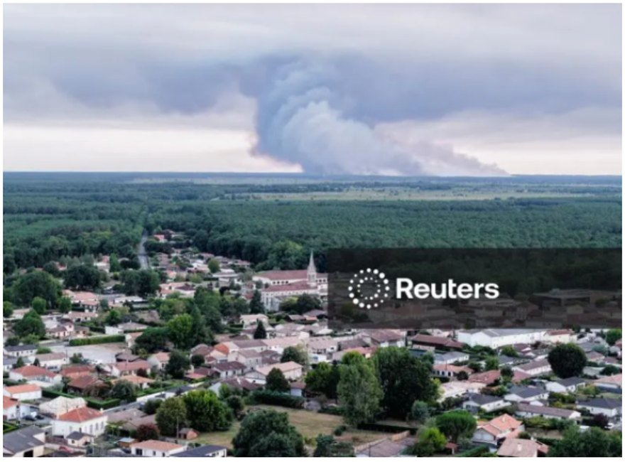

::: {.fiche n="0.1" etat="a-revoir"}
Intention : Couverture de l'atelier, comme le titre d'une partie de cours, sur la photo de Saumos le 22 juillet ; le titre passe, lettre à lettre, en police 8 bits et revient. Diapo provisoire : l'atelier sera fusionné dans IMAGE-Application (partie 4). [V3 : titre « Atelier : le feu de Saumos ».]
Expérience : aucune
Demande :
:::

## Comment jouer {.jdr}

::: {.fiche n="0.2" etat="a-revoir"}
Intention : Le déroulé en une diapo : dépêche, commande, paris, équipe, cadrage de Rose, experts, 30 minutes d'enquête et de labo, 5 minutes de rapport, débrief, phrase de la classe, verdict. Le mode solo. Déclaration de transparence IA. [V3 : déroulé du script V3.]
Expérience : aucune
Demande :
:::

Un **jeu de rôle** par groupes de trois, chacun sur son écran. Le **préfet** passe une commande ; vous **pariez** ; vous choisissez votre **posture**.

1. **Rose** cadre le travail, puis présente les **experts**. « C'est parti » : **30 minutes**.
2. Chaque posture mène **son enquête** : on interroge les experts, ils ne donnent jamais la réponse, mais vous passent les **clefs** de votre **labo**.
3. Vous n'avez pas accès aux mêmes infos : **parlez-vous**. Un indice de trop coûte un peu de la **confiance du préfet**.
4. Le **rapport au propre** : 5 minutes pour un mini dossier. Puis le **débrief**, la **phrase de la classe**, le **verdict**.

Seul, chez vous ? Cochez « solo » : vous jouez les trois profils. Ce que vous faites reste dans votre navigateur.

::: {.transparence-ia profil="✒️ L'Auteur outillé" coordonnees="F2 · R0 · S0" outil="Claude 5"}
:::

## La dépêche {.jdr}

::: {.fiche n="1.1" etat="a-revoir"}
Intention : La question de départ, telle que dans la séance prépa : la photo Reuters, la dépêche du 23 juillet, puis la question « presque en direct ». [V3 : on vouvoie, et la question finit sur le mini dossier.]
Expérience : aucune
Demande :
:::

:::: {.columns}
::: {.column width="52%"}

:::
::: {.column width="48%"}
::: {.jdr-depeche}
dépêche · 23.07.2026 · 06:04

Un incendie déclaré hier à Saumos, en Gironde, a parcouru plusieurs milliers d'hectares de pin maritime durant la nuit. Les évacuations se poursuivent sur la façade océane.
:::

**Comment fait-on pour cartographier presque en direct un feu de forêt ?**

Cela dépend des données disponibles et donc des vecteurs en faisant l'acquisition : souvent des satellites. Vous allez pouvoir en choisir un, comprendre ce qu'il sait faire en fonction d'un paramètre important, leur orbite. À la fin, vous compilez vos réponses et fournissez un mini dossier.
:::
::::

## La commande du préfet {.jdr}

::: {.fiche n="1.2" etat="a-revoir"}
Intention : Le préfet passe la commande : la date précise du départ, la surface brûlée connue précisément à la fin du feu. Sa tête parle quand on arrive sur la diapo, avec un petit son de lecture sans langue, comme dans les JRPG ; le bouton « son » le coupe. [V3 : le son.] [Retour du 22 novembre : le préfet demande la date et l'heure précises du départ ; à côté, une carte 8 bits de la région (Sentinel-2 du 21 juillet en gros pixels d'environ 1 km, outils/carte-saumos.py) avec Saumos, Bordeaux, Arcachon, Lacanau et le départ du feu, au lieu-dit de l'Esquirot, au sud du bourg (position approchée).]
Expérience : écouter la commande (brique jdr-commande)
Demande :
:::

::: {.jdr-commande}
:::

[Copernicus EMS a été activé : c'est la mission **EMSR899**. Pour le préfet, une seule question compte : qu'aura-t-il entre les mains, et quand ?]{.legende}

## Vos paris {.jdr}

::: {.fiche n="1.3" etat="a-revoir"}
Intention : Les deux paris, avant toute enquête. La réponse attendue au verdict : cela dépend de la précision voulue et des moyens engagés. [Retour du 22 novembre : « jours ETP » est un terme technique ; un clic l'explique et le range dans le carnet.]
Expérience : parier (brique jdr-paris), un pari par groupe
Demande :
:::

::: {.jdr-paris}
:::

## Votre équipe {#equipe .jdr .jdr-plein data-state="plein"}

::: {.fiche n="2.1" etat="fige"}
Intention : Chaque étudiant choisit sa posture (rapporteur, analyste, orbitographe) et sa tête de héros. Un groupe de trois : une posture chacun. En groupe, chacun n'a accès qu'à son enquête et à son labo ; la case « solo » ouvre les trois profils (pour rejouer chez soi). [V3 : mode solo.]
Expérience : choisir sa posture, sa tête, son nom, son numéro de groupe, le mode solo (brique jdr-equipe)
Demande :
:::

::: {.jdr-equipe}
:::

## Rose cadre le travail {#cadrage .jdr .jdr-plein data-state="plein"}

::: {.fiche n="2.2" etat="a-revoir"}
Intention : Rose se présente, demande ce qui est important (réponse : la maîtrise de la chaîne d'information du phénomène aux conclusions, et des incertitudes de chaque maillon), donne les grandes lignes de l'enquête selon la posture de celui qui lit, invite à prendre une page et un crayon, rappelle qu'il peut y avoir plusieurs solutions et que c'est un travail d'équipe, annonce le compte à rebours. Texte de Marc (script V3). [V3 : nouvelle diapo.] [Retour du 22 novembre : chacun écrit sa réponse à « qu'est-ce qui est important ? » avant de lire celle de Rose (gardée avec le rapport) ; « Continuer ▶ » en bas à droite.]
Expérience : écouter Rose, réplique par réplique, répondre à sa question (brique jdr-cadrage)
Demande :
:::

::: {.jdr-cadrage}
:::

## Les experts {#experts .jdr .jdr-plein data-state="plein"}

::: {.fiche n="2.3" etat="a-revoir"}
Intention : Rose présente les trois experts (nom, rôle, travail) et se tient un peu à part : elle cadre, pas le fond. Bastien reprend les traitements de Youri. Les traits de caractère ne sont pas affichés : ils donnent le ton des répliques. « C'est parti » lance le chrono de 30 minutes et ouvre l'enquête de sa posture. [V3 : quatre experts, chrono.]
Expérience : lancer le chrono (brique jdr-experts)
Demande :
:::

::: {.jdr-experts}
:::

## Enquête A — le départ du feu {#enquete-a .jdr-plein data-state="plein"}

::: {.fiche n="3.1" etat="a-revoir"}
Intention : L'enquête du rapporteur. « Avec qui veux-tu commencer ? », puis « Avec qui désires-tu continuer de travailler ? ». Elikia : quel phénomène (la fumée), quel signal (le visible) ; Bastien : quelle résolution (temporelle). Le second des deux qui a ce qu'il faut répond « Meteosat ou Terra » et passe les clefs du labo Eumetsat. Inès vérifie ce qu'est un couple capteur / vecteur. Rose : la marge. Apartés et quatrième mur. [V3 : dialogues réécrits d'après le script V3.]
Expérience : dialoguer avec les experts, carnet et journal (brique jdr-enquete)
Demande :
:::

::: {.jdr-enquete enquete="A"}
:::

## Labo Eumetsat {#labo-a .jdr-plein data-state="plein"}

::: {.fiche n="3.2" etat="a-revoir"}
Intention : La version JRPG d'EUMETView : les images Meteosat (MSG 0°) du 21 juillet midi au 22 juillet 23 h, à faire défiler une à une, l'heure inscrite sur l'image. « Premier signe » note la date et l'heure pour le rapport. Terra en second œil, quand Elikia l'a ouvert. [V3 : images de Marc.] [Retour du 22 novembre : « ◀ enquête A » en bas à droite, à la place des flèches.]
Expérience : feuilleter les images, noter le premier signe (brique jdr-labo)
Demande :
:::

::: {.jdr-labo labo="a"}
:::

## Enquête B — la surface brûlée {#enquete-b .jdr-plein data-state="plein"}

::: {.fiche n="3.3" etat="a-revoir"}
Intention : L'enquête de l'analyste. Elikia montre la courbe de réflectance en 8 bits (proche infrarouge et SWIR, B8 et B12) et demande quel satellite : la réponse, Sentinel-2, vient de l'orbitographe (Inès la lui a soufflée). Bastien demande satellite et bandes, puis le NBR, après les compositions colorées. Les clefs du labo Copernicus. [V3 : dialogues réécrits d'après le script V3.] [Retour du 22 novembre : Elikia montre deux « signatures spectrales » ; ce terme, « bandes », « proche infrarouge » et « SWIR » sont en couleur : un clic, elle fait un aparté pour l'expliquer, le terme entre au carnet, puis « Reprendre la discussion ». Le labo renvoie à l'enquête B par « ◀ enquête B » en bas à droite.]
Expérience : dialoguer avec les experts, réponses tapées, termes techniques (brique jdr-enquete)
Demande :
:::

::: {.jdr-enquete enquete="B"}
:::

## Labo Copernicus {#labo-b .jdr-plein data-state="plein"}

::: {.fiche n="3.4" etat="a-revoir"}
Intention : La version JRPG du Copernicus Browser : trois dates (21 juillet, 26 juillet, 4 septembre), quatre compositions et leurs bandes, le dNBR quand Bastien l'a ouvert ; l'outil de mesure sur toutes les vues. « Noter » remplit le rapport. [V3 : compositions du 4 septembre de Marc.]
Expérience : comparer, mesurer, noter (brique jdr-labo)
Demande :
:::

::: {.jdr-labo labo="b"}
:::

## Enquête C — les satellites et leurs orbites {#enquete-c .jdr-plein data-state="plein"}

::: {.fiche n="3.5" etat="a-revoir"}
Intention : L'enquête de l'orbitographe. Elikia le renvoie vers Inès avec une blague ; Inès parie sur Sentinel-2 (à transmettre à l'analyste) et demande la famille du satellite du rapporteur : « Meteosat », sous toutes ses graphies, ouvre le labo Deimos. Puis géostationnaire, revisite, nuages, commande, radar. [V3 : dialogues réécrits d'après le script V3.] [Retour du 22 novembre : la question d'Inès sur le couple capteur / vecteur (enquêtes A et B, là où elle la pose) attend d'abord oui ou non ; « non » amène les trois exemples. Inès précise (C-I3 et fiche du labo) que Sentinel-2, ce sont deux satellites à 180° : 10 jours chacun, 5 à deux, à l'équateur ; en 2026, Sentinel-2B et Sentinel-2C, qui a remplacé Sentinel-2A en janvier 2025.]
Expérience : dialoguer avec les experts, réponse tapée (brique jdr-enquete)
Demande :
:::

::: {.jdr-enquete enquete="C"}
:::

## Labo Deimos {#labo-c .jdr-plein data-state="plein"}

::: {.fiche n="3.6" etat="a-revoir"}
Intention : La version JRPG de Deimos : la Terre vue du pôle Nord, les satellites connus du joueur sur leur orbite, les passages de Sentinel-2 au-dessus de Saumos, et une fiche par satellite (orbite, altitude, revisite, pixel, nuit) qui s'ouvre à mesure de l'enquête. « Noter » remplit le rapport. [V3.] [Retour du 22 novembre : Meteosat-12 et son capteur FCI (500 m sous le satellite, à l'équateur, pour les canaux les plus fins ; une image toutes les 10 minutes), partout dans le jeu. La Terre, en gros pixels, pivote à la souris ou d'une heure à la fois, et la vitesse se règle de la pause à × 21 600, facteur affiché ; l'heure solaire de Saumos s'affiche.]
Expérience : regarder, faire pivoter, régler la vitesse, ouvrir les fiches, noter (brique jdr-labo)
Demande :
:::

::: {.jdr-labo labo="c"}
:::

## Le rapport au propre {#rapport .jdr-plein data-state="plein"}

::: {.fiche n="4.1" etat="a-revoir"}
Intention : Le rapporteur compile : pour chaque enquête, la réponse, la preuve, et ce que l'on ne peut pas dire ; puis les trois solutions au préfet, chacune datée. Cinq minutes (chrono), à la fin des 30 minutes ou plus tôt. Le préfet relit le dossier : chaque point juste lui redonne confiance, chaque manque reçoit une aide, jamais la réponse. Téléchargement, envoi à la feuille du cours. [V3 : plus de note sur 8.] [Retour du 22 novembre : « Les trois solutions au préfet : pour chacune, un capteur, une date ou un délai » ; seconde case : « Pour une précision relative mais régulièrement mesurée, car insensible aux nuages : » ; plus de preuve ni de « ce que nous ne pouvons pas dire » pour l'orbitographe.]
Expérience : remplir, faire relire, envoyer (brique jdr-rapport)
Demande :
:::

::: {.jdr-rapport envoi=""}
:::

## Pause : le débrief, on arrête le jeu et on fait le point {.jdr}

::: {.fiche n="5.1" etat="a-revoir"}
Intention : Rose anime le débrief, question par question : qui a encore la confiance du préfet ; quelles réponses au préfet ; plusieurs solutions pour la surface ; coup de chance ou pas, la détection du départ (questions de Marc). Ajouts de Claude, à valider : les paris du début, et le maillon le plus incertain de la chaîne. Éléments de réponse : fin du script V3. [V3 : remplace l'échange.] [Retour du 22 novembre : nouveau titre ; dernière question de Rose, plus méta, sur l'approche ludique ; chacun répond dans une case libre, envoyée à la feuille du cours (quand envoi="…" est renseigné) ou téléchargée.]
Expérience : répondre à voix haute, puis écrire son avis sur le jeu (briques jdr-bulle et jdr-retour)
Demande :
:::

::: {.jdr-bulle qui="rose" source="debrief" liste="oui"}
:::

::: {.jdr-retour envoi=""}
:::

## La phrase de la classe {.jdr}

::: {.fiche n="5.2" etat="a-revoir"}
Intention : La phrase à trous de la séance prépa, sur la projection : chaque rapporteur lit, l'enseignant remplit les blancs, puis révèle les trois dernières cases.
Expérience : lire son rapport à voix haute (brique jdr-phrase)
Demande :
:::

::: {.jdr-phrase}
:::

## Le verdict {.jdr .jdr-verdict}

::: {.fiche n="5.3" etat="a-revoir"}
Intention : Rose relit la question « presque en direct ». Retour sur les paris : la réponse dépend de la précision désirée et des moyens engagés. Les trois solutions datées, la référence ETP de Marc, la chaîne du feu, le lien UN-SPIDER, le clin d'œil au DM biosphère.
Expérience : aucune
Demande :
:::

::: {.jdr-bulle qui="rose"}
"Presque en direct", c'est ce que dira le communiqué. Vous, vous signeriez quoi ?
:::

:::: {.columns}
::: {.column width="50%"}
**Combien de jours ?** cela dépend de la précision désirée et des moyens engagés.

- **Avec des moyens** : on commande une image à un satellite pointable. Le périmètre officiel, 31 386 ha, est tracé le 29 juillet.
- **Pour une précision relative** : le radar, qui voit à travers la fumée et les nuages.
- **Sans moyens** : on attend une Sentinel-2 sans nuages. La sévérité arrive six semaines plus tard.
:::
::: {.column width="50%"}
**Combien d'ETP ?**

- Pour un non Géodata Paris, quelques jours.
- Pour un Géodata Paris, quelques heures.
- Un processus automatique maîtrisé, pour un non Géodata Paris, impossible.
- Un processus automatique maîtrisé, pour un Géodata Paris, quelques jours à quelques mois suivant l'emprise spatio-temporelle.
:::
::::

::: {.chaine commande="feux"}
:::

[La méthode : [UN-SPIDER, Normalized Burn Ratio](https://un-spider.org/advisory-support/recommended-practices/recommended-practice-burn-severity/in-detail/normalized-burn-ratio). L'an prochain, le DM biosphère vous attend.]{.legende}

## Sources et crédits {.petit}

::: {.fiche n="5.4" etat="a-revoir"}
Intention : Les sources des images et des données de l'atelier.
Expérience : aucune
Demande :
:::

| Donnée | Origine |
|---|---|
| Photo de Saumos, 22 juillet 2026 | Reuters, via le rapport de situation Copernicus EMS EMSR899 |
| Périmètre officiel (31 386 ha, 29 juillet) | Copernicus EMS, EMSR899, délimitation sur WorldView Legion |
| Images Meteosat, 21 et 22 juillet | EUMETSAT, EUMETView ; Meteosat-12 (troisième génération, capteur FCI) assure le service principal européen depuis 2025 |
| Carte 8 bits de la commande | Copernicus, Sentinel-2 L2A du 21 juillet 2026, réduite en gros pixels ; départ du feu : lieu-dit de l'Esquirot, au sud du bourg de Saumos (presse, position approchée) |
| Sentinel-2B et Sentinel-2C | ESA et Copernicus : Sentinel-2C a remplacé Sentinel-2A le 21 janvier 2025 |
| Anomalies thermiques | NASA, Terra (MODIS), via Worldview |
| Compositions Sentinel-2 L2A (21 et 26 juillet, 4 septembre) | Copernicus, Copernicus Browser |
| dNBR | méthode UN-SPIDER, calcul de la séance prépa |
| Courbe de réflectance | allure indicative, dessinée pour l'atelier |
| « Près de 500 satellites d'observation de la Terre » | USGS, 2024 (472 satellites), cité par l'OCDE |
| Orbites | IGN, Deimos ; animation dessinée pour l'atelier |
| Têtes des personnages | dessins originaux pour l'atelier |

<!--
V0 du 20 novembre 2026, d'après source/Cas1-Saumos/ : la conception v3bis, la séance prépa
(saumos-seance.html), les scripts v1 (annoté par Marc) et v2 (graphe, réponses de Marc).
Tout le contenu du jeu est dans donnees/saumos.json ; les têtes dans donnees/pixels.json (outils/pixels.py).
Atelier provisoirement séparé ; il remplacera la partie 4 de IMAGE-Application.
L'envoi vers la feuille Google : voir outils/feuille-google.gs, puis renseigner envoi="…" sur la diapo 4.1.
-->
