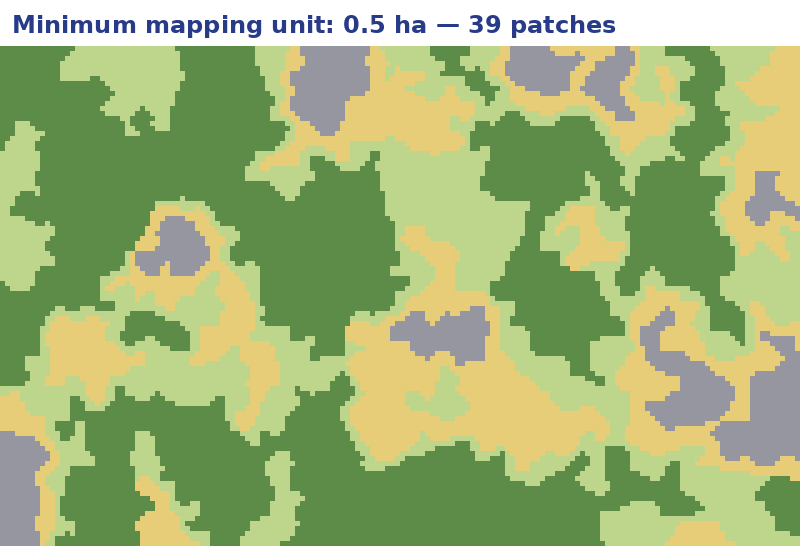
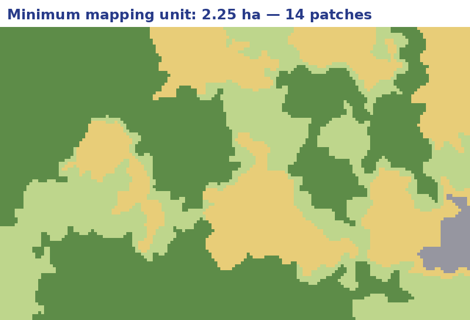
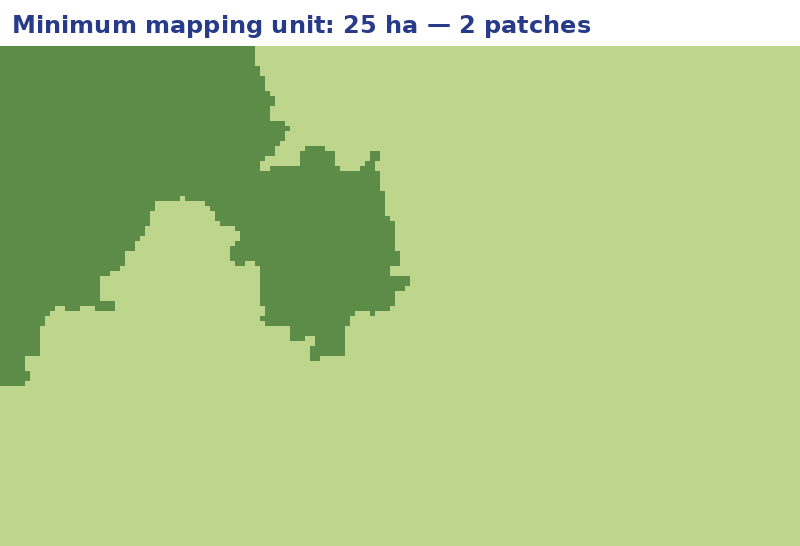

::: {.fiche n="0.1" etat="a-revoir"}
Intention : Cover. Planned background: the Peenemünde photograph (1943), at the heart of Marc's serious game; waiting for the file. [new]
Experience : none
Request :
:::

## How to use this handout

::: {.fiche n="0.2" etat="a-revoir"}
Intention : The shared user guide, plus what is specific to this course: the investigation, writing before the answer, the certainty bar, the revision mode. AI transparency statement. [new]
Experience : none
Request :
:::

This course is an **investigation**. Almost every slide asks you to look, write or choose **before** reading the answer.

- The **icon** in front of each title gives the level: **core**, to master; **support**, to consolidate; **further**, to go beyond. A slide without an icon is an example.
- The **writing boxes** keep what you write, in your browser only: you will find it again later on.
- The **certainty bar** asks you, before answering, how sure you are. At the end, the course compares your certainty with your results.
- The last part holds a **revision mode**, to reopen in a day, a week, a month.

::: {.transparence-ia profil="✒️ The equipped Author" coordonnees="F2 · R0 · S0" outil="Claude 5"}
:::

## What you will be able to do

::: {.fiche n="0.3" etat="a-revoir"}
Intention : The six skills, each with an action verb; a starting self-assessment, taken up again at the end. [new]
Experience : starting self-assessment: I don't know / I think I know / I know ("bilan" brick)
Request :
:::

Place yourself before you start. The same grid comes back at the end.

::: {.bilan moment="debut"}
- C1 | Describe before interpreting: separate what I see from what I infer
- C2 | Identify an object with the identification keys: tone, size, shape, texture, pattern, shadow, date
- C3 | Reconstruct a mechanism by cross-checking clues, and state my degree of certainty
- C4 | Choose the image that answers a question, and know its limits
- C5 | Turn an interpretation into data: nomenclature, minimum mapping unit, checks
- C6 | Tell a real image from a generated one, and place the interpreter alongside AI
:::

## Course map

::: {.fiche n="0.4" etat="a-revoir"}
Intention : The seven parts and the key to the three levels.
Experience : links to each slide
Request :
:::

::: {.carte-du-cours}
:::

## Seeing, then knowing {.intercalaire}

::: {.fiche n="1.0" etat="a-revoir"}
Intention : The intelligence of an image: one word, two meanings, gathering information and understanding. [new]
Experience : none
Request :
:::

*Intelligence*: gathering information, and understanding. This course is about both.

## The scene {competences="C1"}

::: {.fiche n="1.1" etat="a-revoir"}
Intention : The opening with the scene from the series "Cœurs noirs" (Prime Video, 2023), shown in class: a secret base is detected on an image. The handout holds no excerpt or still; only the reference and the debriefing. Episode and timecode to be given by Marc. Example, no level. [new]
Experience : two writing boxes: what did we see? what did we infer, and how sure? ("observer" brick), then Marc's reading
Request :
:::

The scene is shown in class: the series *Cœurs noirs*, season 1 (Prime Video, 2023), episode and timecode to be added. A team spots a secret base on an image.

:::: {.columns}
::: {.column width="50%"}
**What did we see on the image?**

::: {.observer cle="scene-vu" invite="Shapes, colours, objects…"}
Marc's reading to be written: what the image really shows.
:::
:::
::: {.column width="50%"}
**What did we infer, and how sure were we?**

::: {.observer cle="scene-deduit" invite="A hypothesis, and what supports it…"}
Marc's reading to be written: the characters' reasoning, and what it lacks.
:::
:::
::::

## What we see, what we infer {.socle competences="C1"}

::: {.fiche n="1.2" etat="a-revoir"}
Intention : The founding distinction: observation (what is on the image) and inference (what we conclude from it). On the Flamanville image, which returns as the course image. Link with graphic and mental understanding in "Cartography: Basics". [new]
Experience : sort six statements into "I see" or "I infer"
Request :
:::

:::: {.columns}
::: {.column width="42%"}
{height="360" fig-alt="Orthophoto of an industrial site by the sea, with two domes and a construction site"}
:::
::: {.column width="58%"}
Sort each statement: is it **on** the image, or **drawn from** the image?

::: {.classer}
### I see

- Two grey domes
- White boils offshore
- Cranes around a dome

### I infer

- A nuclear power plant
- Sea water cools it
- A reactor under construction
:::

[Seeing is describing. Inferring is already interpreting: it needs evidence.]{.a-retenir}
:::
::::

## Induction, deduction, abduction {.socle competences="C3"}

::: {.fiche n="1.3" etat="a-revoir"}
Intention : The cognitive process of the investigation (Marc's request): induction (cases → a rule), deduction (a rule + a case → a consequence), abduction (a surprising clue → the best explanation). Sherlock Holmes's "deduction" is mostly abduction. Clues converge in a bundle. [new]
Experience : diagram; multiple choice: which reasoning does the interpreter use on seeing boils offshore?
Request :
:::

::: {.schema fichier="images/schemas/en/raisonnements.svg" hauteur="300"}
:::

::: {.qcm .serre}
The interpreter sees boils offshore from a power plant and concludes: "probably the cooling water outfall". Which reasoning?

- [ ] Induction
    - No: no rule is drawn from many cases.
- [ ] Deduction
    - Not quite: a deduction is certain if its rule is. Here nothing proves the boils come from the outfall.
- [x] Abduction
    - Yes: the best explanation of a surprising clue. It remains a hypothesis, which other clues confirm or not.
:::

## A trade born of war {.appui competences="C1"}

::: {.fiche n="1.4" etat="a-revoir"}
Intention : The beginnings: First World War aerial photography (Marc's image to come); the Central Interpretation Unit at Medmenham, where Constance Babington Smith spots the V-1 on a Peenemünde photograph (1943); the Cuban missile crisis (Richard Heyser's U-2, 14 October 1962; the sites identified by NPIC on the 15th). Bonus: a tour of the aerial photography museum. [new]
Experience : put five steps in order; bonus: virtual tour (scroll)
Request :
:::

At Medmenham, in 1943, Constance Babington Smith spots on a Peenemünde photograph a cross-shaped object less than a millimetre long: the V-1. She works with a **stereoscope** and a **magnifying glass**.

::: {.ordre}
Put these steps in chronological order.

1. Kites and pigeons carry cameras
2. The trenches of 1914-18, seen from aircraft
3. Peenemünde: the V-1 spotted under the magnifier
4. Cuba: missile ramps seen from the U-2
5. Interpreters label data for AI
:::

[First World War image to come (Marc's file).]{.legende}

::: {.plus titre="A tour of the aerial photography museum"}
::: {.defiler commande="haut"}
- 
- 
- 
- 
- 
- 
- 
- 
:::

[Aerial photography museum, L'Europe vue du Ciel. Photos: Marc Poupée. Panels in French.]{.legende}
:::

## Your turn: what is it? {.appui competences="C1 C2 C3"}

::: {.fiche n="1.5" etat="a-revoir"}
Intention : Replaying the scene on a real image: the Pléiades image of 2 March 2016 of a site in China, revealed clue by clue. The object is named only at the end. [new]
Experience : riddle with progressive clues, with certainty at each clue ("indices" brick)
Request :
:::

::: {.indices image="images/fast-2016.jpg" alt="Satellite image of a silver disc at the bottom of a wooded hollow" confiance="oui" style="--hauteur-indices: 400px"}
- 30,28,29,42 : At the bottom of a hollow ringed by wooded hills, a perfect disc about 500 m across (the image is 1.85 km wide).
- 40,44,10,12 : In the centre, a hexagonal structure; the disc is made of panels that reflect the sun.
- 40,8,11,18 : Pale embankments and new tracks cut into the slopes.
- 50,71,10,16 : Blue-roofed buildings lined up along a road: a construction workers' camp.
- The image dates from 2 March 2016, in Guizhou, China.

The **FAST radio telescope**, the largest single-dish antenna in the world, set in a natural karst depression. Its last panel was fitted in July 2016: the image catches it at the end of construction.
:::

## Stating your certainty {.socle competences="C3"}

::: {.fiche n="1.6" etat="a-revoir"}
Intention : An interpretation without a degree of confidence is an opinion. Sherman Kent's "words of estimative probability" (CIA, 1964). Copernicus EMS also says "possibly damaged". [new]
Experience : multiple choice with a certainty bar ("confiance" brick)
Request :
:::

:::: {.columns}
::: {.column width="45%"}
In 1964, Sherman Kent, a CIA analyst, proposed matching words and odds:

| Word | Odds |
|---|---|
| Almost certain | about 9 in 10 |
| Probable | about 3 in 4 |
| Possible | about 1 in 2 |
| Unlikely | about 1 in 3 |

[A word of certainty commits you: it tells the reader what risk they take in believing you.]{.a-retenir}
:::
::: {.column width="55%"}
::: {.confiance}
::: {.qcm .serre}
On the FAST image, you see a camp with blue roofs. Which sentence should you write?

- [ ] "There are workers on the site."
    - Too strong: no one can be seen. At best, it is probable.
- [x] "Construction is probably under way."
    - Yes: several clues converge (camp, embankments, new tracks), and the word states the uncertainty.
- [ ] "Nothing can be said."
    - Too cautious: the clues exist, they must be weighed.
:::
:::
:::
::::

## When the image deceives {.veille competences="C3"}

::: {.fiche n="1.7" etat="a-revoir"}
Intention : The counter-example: on 5 February 2003, at the UN Security Council, satellite images support the existence of chemical weapons in Iraq; they will never be found. Confirmation bias: we see what we are looking for. Sources to be added. [new]
Experience : question: which step of the method was missing?
Request :
:::

On 5 February 2003, at the UN Security Council, satellite images are presented as proof of chemical weapons in Iraq. The weapons will never be found.

::: {.question}
**Which step of the method was missing?**
:::

::: {.reponse}
Looking for the clue that **contradicts**, and stating the real **certainty**. A truck near a bunker has many possible explanations; the one expected is chosen. This is **confirmation bias**.
:::

## From image to data {.intercalaire}

::: {.fiche n="2.0" etat="a-revoir"}
Intention : Interpretation is not only for intelligence: it produces most geographic data. [new]
Experience : none
Request :
:::

Interpretation is not only for intelligence: it makes most maps.

## Interpreting to build a database {.socle competences="C5"}

::: {.fiche n="2.1" etat="a-revoir"}
Intention : National databases born of image interpretation: BD TOPO (photogrammetric plotting), BD Forêt V2 (colour-infrared orthophotos, 0.5 ha, 32 classes, 2007-2018, automatic segmentation then checks by photo interpreters), CORINE Land Cover in Europe (25 ha). [new]
Experience : question: why do three databases not say the same thing about the same place?
Request :
:::

:::: {.columns}
::: {.column width="55%"}
- **BD TOPO**: buildings, roads, rivers, plotted from aerial photographs in relief.
- **BD Forêt V2** (IGN, 2007-2018): forests interpreted on colour-infrared photographs, 32 types, no patch under **0.5 ha**.
- **CORINE Land Cover**: Europe's land cover, no patch under **25 ha**.
:::
::: {.column width="45%"}
::: {.question}
**Why do three databases not say the same thing about one place?**
:::

::: {.reponse}
They do not share the same question, the same nomenclature, or the same **minimum mapping unit**. A database is an interpretation, made according to rules.
:::
:::
::::

## The minimum mapping unit {.socle competences="C5"}

::: {.fiche n="2.2" etat="a-revoir"}
Intention : Every database sets an area below which nothing is mapped. On a 160 ha area: 145 patches at the start, 39 at 0.5 ha, 14 at 2.25 ha, 2 at 25 ha; at 25 ha, 61% of the area changes class (computed). Like classification in "Cartography: Basics", the choice changes the map. [new]
Experience : compare three minimum mapping units on the same area
Request :
:::

:::: {.columns}
::: {.column width="62%"}
::: {.comparer}
- 
- 
- 
:::
:::
::: {.column width="38%"}
The same 160 ha area, with three minimum mapping units: patches that are too small merge into their neighbour.

::: {.question}
**At 25 ha, what is left?**
:::

::: {.reponse}
Two patches. 61% of the area has changed class: copses, hamlets and small fields have vanished.
:::
:::
::::

## A nomenclature, some rules {.appui competences="C5"}

::: {.fiche n="2.3" etat="a-revoir"}
Intention : A nested nomenclature and capture rules (what to do with a recent felling? a construction site?). Without written rules, two interpreters produce two maps. General examples. [new]
Experience : sort eight objects from the course image into a simple nomenclature, including ambiguous cases
Request :
:::

Sort these objects from the course image. Some need a **rule**: which would you write?

::: {.classer}
### Buildings

- A reactor dome
- A turbine hall

### Construction

- The third dome, surrounded by cranes
- Bare earthworks

### Water

- The intake basin
- The two green ponds

### Farmland

- Fields bordered by hedges
- A mown meadow
:::

[Does a construction site become a building? An artificial pond, water? Without a written rule, each interpreter decides alone.]{.a-retenir}

## Two interpreters, two maps {.appui competences="C5"}

::: {.fiche n="2.4" etat="a-revoir"}
Intention : Agreement between interpreters measures the quality of a capture: the same area is interpreted twice and compared. [new]
Experience : question
Request :
:::

Two interpreters map the same area. They agree on 9 points out of 10.

::: {.question}
**Where are the disagreements, most of the time?**
:::

::: {.reponse}
At **boundaries** (where does the forest end?), on **small objects** (near the minimum mapping unit) and on **cases the rules did not foresee**. Measuring agreement measures how clear the rules are as much as how skilled the interpreters are.
:::

## Data to teach machines {.appui competences="C6"}

::: {.fiche n="2.5" etat="a-revoir"}
Intention : AI learns from images labelled by people. FLAIR (Garioud, Gonthier, Landrieu, De Wit, Valette, Poupée, Giordano, Wattrelos, NeurIPS 2023): over 20 billion labelled pixels, 817 km² of 20 cm aerial imagery, with satellite time series. The interpreter becomes an annotator. [new]
Experience : question; bonus: the paper
Request :
:::

:::: {.columns}
::: {.column width="55%"}
A neural network learns to recognise land cover from **labelled examples** made by hand.

The **FLAIR** dataset (IGN, 2023): over **20 billion labelled pixels**, across 817 km² of 20 cm aerial imagery, with satellite image series.
:::
::: {.column width="45%"}
::: {.question}
**Who makes these labels, and why is it hard?**
:::

::: {.reponse}
Interpreters. Each pixel calls for a decision, following a nomenclature and rules. The machine will learn their errors and hesitations too.
:::
:::
::::

::: {.plus titre="The FLAIR paper"}
A. Garioud, N. Gonthier, L. Landrieu, A. De Wit, M. Valette, M. Poupée, S. Giordano, B. Wattrelos, "FLAIR: a Country-Scale Land Cover Semantic Segmentation Dataset From Multi-Source Optical Imagery", *NeurIPS 2023, Datasets and Benchmarks*. [The paper](https://arxiv.org/abs/2310.13336) · [the data](https://ignf.github.io/FLAIR/)
:::

## The interpreter checks the machine {.appui competences="C6"}

::: {.fiche n="2.6" etat="a-revoir"}
Intention : Validating an automatic result relies on a sample interpreted by hand: right and wrong classifications are counted (the confusion matrix, in plain words). [new]
Experience : multiple choice with a certainty bar
Request :
:::

An AI maps buildings. Out of 100 random points, an interpreter checks: **90 are right**.

::: {.confiance}
::: {.qcm .serre}
What can be concluded?

- [ ] The map is 90% right, everywhere
    - No: errors may cluster somewhere (dark roofs, dense areas).
- [x] On this territory, about 9 points in 10 are right; we must look at where the errors are
    - Yes: the overall figure is not enough, the distribution of errors class by class is needed.
- [ ] The interpreter is no longer needed
    - No: the interpreter produced the check.
:::
:::

## Tracking change {.appui competences="C4"}

::: {.fiche n="2.7" etat="a-revoir"}
Intention : Tracking change, here with radar (Baltimore): a colour composite of several dates. Radar sees at night and through clouds, but does not read like a photograph. Source and dates of the image to be given by Marc. [new]
Experience : question
Request :
:::

:::: {.columns}
::: {.column width="52%"}
{height="430" fig-alt="Radar image of the port of Baltimore, grey with colour patches"}

[Port of Baltimore, radar image, several dates. Source to be added.]{.legende}
:::
::: {.column width="48%"}
This image stacks several radar dates, each in one colour.

::: {.question}
**What do grey and the colours mean?**
:::

::: {.reponse}
**Grey** is what did not change between the dates. **Colours** are what moved: ships, containers, vehicles. Radar sees at night and through clouds, but it must be learnt.
:::
:::
::::

## Archaeology under the forest {.appui competences="C4"}

::: {.fiche n="2.8" etat="a-revoir"}
Intention : Airborne LiDAR reveals the Khmer cities around Angkor under the forest (2012 and 2015 campaigns; Evans et al., PNAS, 2013). The link with IGN to be specified by Marc; image to be supplied. [new]
Experience : question
Request :
:::

In 2012, an airborne **LiDAR** flies over Angkor. Its laser pulses pass between the leaves and reach the ground: under the forest, streets, ponds and whole districts appear.

[Image of the Angkor LiDAR to come.]{.legende}

::: {.question}
**Why was an aerial photograph not enough?**
:::

::: {.reponse}
It only shows the forest canopy. LiDAR also measures what lies beneath: the ground relief, and the traces of ancient works.
:::

## Many other uses {.appui competences="C4"}

::: {.fiche n="2.9" etat="a-revoir"}
Intention : The gallery of uses, for a wide audience: crisis, tracking change, control, image verification, archaeology, ecology, geopolitics. [new]
Experience : sort eight questions by use
Request :
:::

Sort each question by the use of interpretation.

::: {.classer}
### Crisis

- Which buildings did the flood destroy?
- How far did the fire go?

### Monitoring and control

- How many fields were built over in ten years?
- Was this felling authorised?

### Verification

- Was this photo really taken here, on that day?
- Was this image generated by AI?

### Geopolitics

- Is a refugee camp growing?
- Is a military base expanding?
:::

## The identification keys {.intercalaire}

::: {.fiche n="3.0" etat="a-revoir"}
Intention : What the object is. The course image: the Flamanville power plant (Manche, France), during construction of the EPR, an image that brings all the keys together. [new]
Experience : none
Request :
:::

What the object is.

## The course image

::: {.fiche n="3.1" etat="a-revoir"}
Intention : The whole image, explored freely before any key; a description without interpretation, taken up in the final note. Example, no level. [new]
Experience : magnifier; writing box ("observer" brick)
Request :
:::

:::: {.columns}
::: {.column width="50%"}
::: {.loupe zoom="3"}
{height="440" fig-alt="Orthophoto of the Flamanville power plant, on the English Channel"}
:::
:::
::: {.column width="50%"}
Explore the image with the magnifier. Then **describe what you see, without interpreting**: shapes, colours, sizes, positions. You will find this text again at the end.

::: {.observer cle="description-image" invite="I see…"}
A rocky coast; a breakwater of large blocks enclosing a basin of turquoise water; two grey domes about fifty metres across and a third, copper-coloured, surrounded by cranes; long rectangular buildings; white boils at sea; two green ponds; fields bordered by hedges.
:::
:::
::::

## Tone and colour {.socle competences="C2 C4"}

::: {.fiche n="3.2" etat="a-revoir"}
Intention : The first and simplest key: tone (light, dark) and colour. The turquoise water of the basin, the white boils, the copper dome of the construction site. In colour infrared, living vegetation turns red. [new]
Experience : multiple choice: what does the whiteness of the boils reveal?
Request :
:::

:::: {.columns}
::: {.column width="45%"}
{height="380" fig-alt="The Flamanville power plant"}
:::
::: {.column width="55%"}
**Tone** (light or dark) and **colour** are the first keys the eye reads. In **colour infrared**, living vegetation turns red: diseased plants show up.

::: {.qcm .serre}
At sea, on the left, two large white patches. What does their whiteness say?

- [x] Rough water full of bubbles: turbulence
    - Yes: foam reflects light. It remains to find what stirs the water.
- [ ] Sand under the water
    - No: sand would give a pale, even colour, without these filaments.
- [ ] Clouds
    - No: they would cast their shadow on the water.
:::
:::
::::

## Size and shape {.socle competences="C2"}

::: {.fiche n="3.3" etat="a-revoir"}
Intention : Size is read with the scale (200 m ≈ 130 pixels on the image: about 1.5 m per pixel, measured); shape separates the natural from the human-made. A dome is about 50 m across (measured). [new]
Experience : measuring question
Request :
:::

:::: {.columns}
::: {.column width="45%"}
::: {.loupe zoom="3"}
{height="400" fig-alt="The Flamanville power plant, with its scale bar"}
:::
:::
::: {.column width="55%"}
**Size** is read with the scale; **shape** separates the natural (irregular outlines) from the human-made (geometry). A perfect dome of this size has few explanations.

::: {.question}
The scale bar at the bottom left is 200 m long. **How wide are the domes?**
:::

::: {.reponse}
About **50 m**: a quarter of the scale bar. A concrete dome of this size, by the sea: a reactor building.
:::
:::
::::

## Texture and pattern {.socle competences="C2"}

::: {.fiche n="3.4" etat="a-revoir"}
Intention : Texture (the grain) and pattern (the repeated arrangement). The rough breakwater of large blocks; the hedged fields in a mesh; car parks in rows. [new]
Experience : sort six details by the key that reveals them
Request :
:::

**Texture** is the grain of a surface; **pattern** is the arrangement of repeated elements.

::: {.classer}
### Texture

- The breakwater, rough like gravel
- The sea, smooth offshore and stringy near the boils
- The construction site, grainy

### Pattern

- Fields in a mesh, bordered by hedges
- Cars in rows in the car parks
- Buildings aligned at right angles
:::

## Shadow and relief {.socle competences="C2 C4"}

::: {.fiche n="3.5" etat="a-revoir"}
Intention : Shadow and light give relief. Mini-game (Marc's request): on the FAST image, a walker goes from A to B through the centre of the radio telescope; the student makes him climb or descend with the keyboard arrows, then compares with the real profile. The reference profile is indicative, to be validated (or taken from a DEM). [new]
Experience : topographic profile mini-game ("coupe" brick)
Request :
:::

Draw the profile from **A** to **B**: at each step, make the walker climb or descend according to the image. Shadows and glints tell you where the slopes are.

::: {.coupe image="images/fast-2016.jpg" alt="The FAST radio telescope in its hollow" depart="2,49" arrivee="98,49" pas="24" profil="donnees/fast-profil.json" style="--hauteur-coupe: 320px"}
::: {.apres-jeu}
The dish is **hollow**: its centre is the lowest point. It sits in a natural **karst depression**, between hills higher than its rim. [Indicative profile, read from the image.]{.legende}
:::
:::

## The date matters {.appui competences="C2 C4"}

::: {.fiche n="3.6" etat="a-revoir"}
Intention : The date of an image sets what can be seen on it: construction under way (the EPR at Flamanville, FAST in March 2016), the season, the tide, the time of day (length and direction of shadows). [new]
Experience : multiple choice with a certainty bar
Request :
:::

The date tells the **state** of a place: a construction site, a season, a tide, a time of day.

::: {.confiance}
::: {.qcm .serre}
On the Flamanville image, the shadows of the buildings fall to the right (east). What do you make of it?

- [ ] The photo was taken in the morning
    - No: in the morning the sun is in the east and shadows fall to the west.
- [x] The photo was taken in the afternoon
    - Yes: the sun is in the west or south-west, shadows point east.
- [ ] Nothing can be said about the time
    - Yes it can: the direction of shadows gives the position of the sun.
:::
:::

## Which key for which question? {.socle competences="C2"}

::: {.fiche n="3.7" etat="a-revoir"}
Intention : A recap of the identification keys, mixed (interleaved practice). [new]
Experience : multiple choice with a certainty bar
Request :
:::

::: {.confiance}
::: {.qcm .serre}
To tell whether a tall chimney is higher than a nearby block of flats, on a single vertical photograph, which key?

- [ ] Tone
    - No: it tells the material or the lighting, not the height.
- [ ] Shape
    - No: seen from above, a chimney is just a disc.
- [x] Shadow
    - Yes: at the same time of day, the longest shadow belongs to the tallest object.
- [ ] Pattern
    - No: it concerns repeated elements.
:::
:::

[Tone and colour, size, shape, texture, pattern, shadow, date: seven keys to say **what** an object is.]{.a-retenir}

## The interpretation keys {.intercalaire}

::: {.fiche n="4.0" etat="a-revoir"}
Intention : What is going on. From recognised objects to the mechanisms that link them. [new]
Experience : none
Request :
:::

What is going on.

## Site {.socle competences="C3"}

::: {.fiche n="4.1" etat="a-revoir"}
Intention : The position of an object in its surroundings narrows what it can be and explains what happens to it. Why a power plant at the foot of a cliff, by the sea? [new]
Experience : question
Request :
:::

**Site** is the place of an object in its surroundings: seashore, valley floor, ridge, roadside.

::: {.question}
**Why build a power plant here, at the foot of a cliff, on the English Channel?**
:::

::: {.reponse}
For **sea water**, plentiful and cold, which cools the plant; for **rocky** ground; for distance from towns. The site already explains part of the mechanism.
:::

## Association {.socle competences="C3"}

::: {.fiche n="4.2" etat="a-revoir"}
Intention : Objects that go together: reactors, turbine halls, water intake, outfall at sea, high-voltage lines, construction site. One object alone is ambiguous; an association hardly is. Zone coordinates to be checked. [new]
Experience : clickable zones: find the elements of the water and electricity circuit
Request :
:::

:::: {.columns}
::: {.column width="50%"}
An **association** is a set of objects that go together. Find on the image what makes a power plant work: the water coming in, the heat, the water going out, the electricity leaving.

::: {.question}
**Which object, alone, would be ambiguous?**
:::

::: {.reponse}
A dome: a planetarium, a silo, a radome… With the water intake, the outfall and the high-voltage lines, there is hardly any doubt left.
:::
:::
::: {.column width="50%"}
::: {.zones image="images/flamanville.jpg" alt="The Flamanville power plant" hauteur="440"}
- [x] 53,46,7,17 : The two reactor buildings, under their domes.
- [x] 47,43,6,18 : The turbine halls: turbines and condensers.
- [x] 42,23,7,46 : The intake basin, closed by the breakwater.
- [x] 1,22,22,52 : The boils of the cooling water outfall, offshore.
- [x] 56,31,8,10 : The third reactor, the EPR, under construction.
- [ ] 84,26,14,22 : The hedged farmland: it was there before the plant.
:::
:::
::::

## Time {.socle competences="C3 C4"}

::: {.fiche n="4.3" etat="a-revoir"}
Intention : Time: an image freezes one moment of a process. The clues of a construction site (cranes, earthworks, open dome) tell a before and an after; comparing two dates of the same place reveals a dynamic. [new]
Experience : multiple choice with a certainty bar
Request :
:::

An image freezes a **moment**. To understand a mechanism, look for what tells the before and the after: a construction site, a flood, a felling, regrowth. Two dates of the same place reveal a **dynamic**.

::: {.confiance}
::: {.qcm .serre}
On the image, which clue best shows that a reactor is **under construction**?

- [ ] Its size
    - No: a finished reactor is the same size.
- [x] The cranes, the bare earthworks and the dome still copper-coloured, not yet grey concrete
    - Yes: several clues of a temporary state converge.
- [ ] Its place near the sea
    - No: that is true of every reactor on the site.
:::
:::

## Reconstructing a mechanism {.socle competences="C3"}

::: {.fiche n="4.4" etat="a-revoir"}
Intention : Converging clues tell a complete mechanism: the cooling water circuit, from intake to outfall, and the electricity leaving. Each step is linked to a clue in the image. How the Flamanville outfall works to be validated by Marc. [new]
Experience : put the steps in order
Request :
:::

::: {.ordre}
Put the mechanism of the power plant in order. Each step has its clue in the course image.

1. Sea water enters the basin closed by the breakwater
2. Pumps send it to the turbine halls
3. It cools the steam that drove the turbines
4. Warmed, it goes back to sea through tunnels
5. It rises offshore: the white boils
6. The electricity leaves through the high-voltage lines
:::

## Reasoning step by step {.socle competences="C1 C3"}

::: {.fiche n="4.5" etat="a-revoir"}
Intention : A deduction tree on the Brest roadstead: what is happening inside the red dashes? Each choice is a clue; the path taken stays on screen, like a bundle. First version: the tree will be rebuilt from the answers of Marc's students, and its conclusions validated by him. [new]
Experience : deduction tree ("arbre" brick)
Request :
:::

What is happening inside the **red dashes**? Answer step by step: each answer is a clue.

::: {.arbre image="images/rade-de-brest.jpg" alt="Orthophoto of the Brest roadstead, a red dashed area on the water" style="--hauteur-arbre: 390px"}
### depart | How big are the small white dots? (scale: 200 m)
- A few metres → petits
- Several tens of metres → grands

### grands ! Measure again
With the scale, 200 m is about 126 pixels: a dot of 3 or 4 pixels measures a few metres. Go back one step.

### petits | How are they spread?
- Scattered, fairly evenly spaced → espaces
- Lined up in straight rows → rangees
- Packed in a group, all heading the same way → groupe

### espaces | Do they all point the same way?
- Yes, all the same way → mouillage
- No, at random → flottants

### mouillage ! Hypothesis: a mooring area
Boats on their moorings, all turned by the same current or wind, near the shore. To confirm: a slipway, a club, a harbour nearby? Conclusion to be validated.

### rangees ! Hypothesis: shellfish or seaweed farming
Buoys lined up on longlines. To confirm: sheds on shore, access tracks? Conclusion to be validated.

### groupe ! Hypothesis: a regatta
Sailing boats moving as a fleet. To confirm: wakes, a course mark? Conclusion to be validated.

### flottants ! Hypothesis: floating objects
Buoys, debris or birds. To confirm with a second date. Conclusion to be validated.
:::

## Traps {.appui competences="C3"}

::: {.fiche n="4.6" etat="a-revoir"}
Intention : False friends (a shadow taken for water, a meadow for a construction site) and confirmation bias. The counter: look for the clue that contradicts. [new]
Experience : multiple choice with a certainty bar; the calibration at the end shows whether you are over-confident
Request :
:::

::: {.confiance}
::: {.qcm .serre}
A large dark patch at the foot of a tall building, on an image taken late in the afternoon. What is it?

- [ ] A pond, no doubt
    - Too quick: a cast shadow is just as dark, and it has the shape of the building.
- [x] Probably its shadow: check its shape and direction
    - Yes: at that time shadows are long; if the patch extends the building in the direction of the other shadows, it is a shadow.
- [ ] A car park
    - Nothing suggests it: no cars, no markings.
:::
:::

[The counter to confirmation bias: look for the clue that **contradicts** your hypothesis.]{.a-retenir}

## Real or generated? {.intercalaire}

::: {.fiche n="5.0" etat="a-revoir"}
Intention : Detecting AI-generated images: the interpreter's keys apply. The third major strand of the course (Marc's request); placed after the keys, which are used to detect. [new]
Experience : none
Request :
:::

The interpreter's keys also unmask generated images.

## Four years ago {competences="C6"}

::: {.fiche n="5.1" etat="a-revoir"}
Intention : In January 2022, an "aerial view" generated by Wombo Dream: Marc's students saw an Asian landscape in it, because it was unthinkable that an image could be made up. We do not detect what we do not imagine. Example, no level. [new]
Experience : question before the answer
Request :
:::

:::: {.columns}
::: {.column width="38%"}
{height="440" fig-alt="An aerial view of a village with red roofs"}
:::
::: {.column width="62%"}
::: {.question}
**Where was this aerial view taken?**
:::

::: {.reponse}
Nowhere: it was generated in January 2022 by an app, from the words *aerial view* alone. At the time, students saw an Asian landscape in it: it was unthinkable that an image could be made up.
:::

[We do not detect what we do not imagine possible.]{.a-retenir}
:::
::::

## Physical errors {.socle competences="C6 C3"}

::: {.fiche n="5.2" etat="a-revoir"}
Intention : Physical and topographic inconsistencies, revealed by the interpretation keys: rivers crossing ridges, contradictory lighting, relief crumpled like paper (DALL·E, 2024). [new]
Experience : scroll; question
Request :
:::

:::: {.columns}
::: {.column width="50%"}
::: {.defiler commande="haut"}
- 
- 
- 
:::
:::
::: {.column width="50%"}
::: {.question}
These views from above were generated. **What gives them away?**
:::

::: {.reponse}
- **Rivers** that do not follow valleys, or cross ridges.
- **Lighting** coming from several sides at once.
- **Relief** with no erosion logic, crumpled like paper.
- A **town** with no network: roads lead nowhere.
:::
:::
::::

## The implausible {.appui competences="C6"}

::: {.fiche n="5.3" etat="a-revoir"}
Intention : A fabricated "historical" image: Tiananmen Square seen from a drone. Anachronism (no consumer drones in 1989), tanks with inconsistent shapes. The keys of time and shape. Generation date to be specified. [new]
Experience : question
Request :
:::

:::: {.columns}
::: {.column width="45%"}
{height="400" fig-alt="Tanks on a large square, seen from above"}
:::
::: {.column width="55%"}
::: {.question}
An image captioned "Tiananmen, 1989, seen from a drone". **How many clues contradict it?**
:::

::: {.reponse}
- The **date**: in 1989, no drone films a protest like this.
- The **shapes**: tanks with inconsistent turrets and tracks.
- The **people**: figures with no proper shadow.

Three converging inconsistencies: the image is fake.
:::
:::
::::

## The missing emotion {.appui competences="C6"}

::: {.fiche n="5.4" etat="a-revoir"}
Intention : The lack of emotion in generated faces and scenes (PXL_20250930_173652676~2, Marc's image to come). [new]
Experience : question
Request :
:::

[Image to come: PXL_20250930_173652676~2.]{.legende}

::: {.question}
**What does this scene lack to look real?**
:::

::: {.reponse}
Answer to be written with the image: the emotion in the faces, the interaction between people.
:::

## What still gives AI away {.socle competences="C6 C2"}

::: {.fiche n="5.5" etat="a-revoir"}
Intention : What remains today: difficult textures (fur, wrinkles), inconsistent blurred backgrounds, simplified high-spatial-frequency structures typical of convolutional networks (PXL_20261006_182859009 and PXL_20261006_182903643, Marc's images to come). [new]
Experience : question; images to come
Request :
:::

[Images to come: PXL_20261006_182859009 and PXL_20261006_182903643.]{.legende}

By 2026, generated images have made huge progress. Weak points remain:

- fine, disordered **textures**: fur, hair, wrinkles;
- **blurred backgrounds** whose blur does not follow distance;
- **fine details** (high frequencies), simplified into over-regular motifs: the signature of the networks that generate images.

[The identification keys, texture and pattern first, remain the best weapons.]{.a-retenir}

## The real that looks fake {competences="C6"}

::: {.fiche n="5.6" etat="a-revoir"}
Intention : The wink: an unusual real image that now looks generated (IMG-20261029-WA0000, Marc's image to come). Doubt spreads to real images. Example, no level. [new]
Experience : question
Request :
:::

[Image to come: IMG-20261029-WA0000.]{.legende}

::: {.question}
**Generated, or real?**
:::

::: {.reponse}
Real. Now an unusual image looks fake: doubt spreads to real images. The only answer is the method: the source, the date, the converging clues.
:::

## Your turn: real or generated? {.appui competences="C6"}

::: {.fiche n="5.7" etat="a-revoir"}
Intention : The test: real images (Pléiades, orthophotos, radar) and generated ones (2022 to 2024), one at a time, with certainty each time. To be enriched with Marc's 2025 and 2026 images. [new]
Experience : "vrai-ia" brick, with certainty bar and score
Request :
:::

For each image: real, or generated? State your certainty first.

::: {.vrai-ia style="--hauteur-vraiia: 420px"}
-  [ai] : Lace-like shores with no logic, buildings melted into the vegetation, no road.
-  [real] : A Pléiades image: roads lead somewhere, shadows are consistent, the construction site makes sense.
-  [ai] : A flat white lagoon, with no depth or pass, ball-shaped vegetation: physically unlikely.
-  [real] : An orthophoto: a continuous road network, aligned shadows, irregular details.
-  [ai] : Rivers crossing ridges and relief with no erosion.
-  [real] : A multi-date radar image: its flaws are those of the sensor, not of a generator.
:::

## The method {.socle competences="C6 C3"}

::: {.fiche n="5.8" etat="a-revoir"}
Intention : The verification method: source and provenance (metadata, content credentials), reverse image search, consistency with other images of the same place and day, converging clues. Never a single clue. [new]
Experience : put the steps in order
Request :
:::

::: {.ordre}
Put the verification of an image in order.

1. Where does it come from? Who published it, when, with what metadata?
2. Has it circulated before? (reverse image search)
3. Are the place and date consistent? (other images, the sun, the season)
4. Do the identification and interpretation keys hold? (shapes, textures, shadows, physics)
5. Conclude with a degree of certainty
:::

[No clue proves anything alone: a bundle, and a stated certainty.]{.a-retenir}

## The interpretation note {.intercalaire}

::: {.fiche n="6.0" etat="a-revoir"}
Intention : Writing up the investigation. [new]
Experience : none
Request :
:::

Writing up the investigation.

## Writing a note {.socle competences="C1 C3"}

::: {.fiche n="6.1" etat="a-revoir"}
Intention : The note in four headings (observations, interpretations, certainty, sources and limits), on the course image. The description written in 3.1 comes back. Link with "Cartography: Basics": clearly, honestly. [new]
Experience : the description comes back; the student writes the note, then compares it with the expert's ("observer" brick)
Request :
:::

An interpretation note has **four headings**: what I see; what I infer; how sure I am; on what sources, with what limits.

::: {.observer cle="note-image" rappel="description-image" invite="Observations… Interpretations… Certainty… Sources and limits…"}
**Observations.** A rocky coast, a breakwater enclosing a basin, two domes about 50 m across and a third under construction, long buildings, boils offshore, power lines.

**Interpretations.** A nuclear power plant by the sea, cooled by sea water (intake in the basin, outfall offshore), with a third reactor under construction.

**Certainty.** Almost certain for the power plant (a bundle of clues); probable for the water circuit (the tunnels cannot be seen).

**Sources and limits.** One orthophoto, one date; the outfall is inferred, not seen.
:::

## Your turn: a new image {.appui competences="C1 C2 C3 C4"}

::: {.fiche n="6.2" etat="a-revoir"}
Intention : Transfer to an image from another sensor: the port of Baltimore in radar. An interpretation note without guidance, then the expert reading. Reading to be completed by Marc. [new]
Experience : writing box, then expert reading ("observer" brick)
Request :
:::

:::: {.columns}
::: {.column width="45%"}
{height="430" fig-alt="Multi-date radar image of the port of Baltimore"}
:::
::: {.column width="55%"}
Write your note on this radar image, with its four headings.

::: {.observer cle="note-baltimore" invite="Observations… Interpretations… Certainty… Sources and limits…"}
**Observations.** Quays, basins, a grid-pattern town; grey almost everywhere; colour patches on the water and on the quaysides.

**Interpretations.** The colours mark what changed between the dates: ships arriving or leaving, containers moved. Grey, what stayed put.

**Certainty.** Probable: we would need to know which colour matches which date.

**Sources and limits.** A radar image, whose source and dates are to be added.
:::
:::
::::

## Revising {.intercalaire}

::: {.fiche n="7.0" etat="a-revoir"}
Intention : What remains, and how to make it last. [new]
Experience : none
Request :
:::

What remains, and how to make it last.

## Key points

::: {.fiche n="7.1" etat="a-revoir"}
Intention : The core slides, in one list.
Experience : links to each slide
Request :
:::

::: {.carte-du-cours niveaux="socle"}
:::

[See, then infer; cross-check the clues; state your certainty.]{.a-retenir}

## Your self-assessment

::: {.fiche n="7.2" etat="a-revoir"}
Intention : The starting grid comes back: the student places themselves again, sees the gap, and the slides to work on again; their calibration (certainty and success). [new]
Experience : final self-assessment ("bilan" brick); calibration table ("calibration" brick)
Request :
:::

:::: {.columns}
::: {.column width="62%"}
::: {.bilan moment="fin"}
- C1 | Describe before interpreting
- C2 | Identify with the identification keys
- C3 | Reconstruct a mechanism and state its certainty
- C4 | Choose the image that answers the question
- C5 | Turn an interpretation into data
- C6 | Tell a real image from a generated one
:::
:::
::: {.column width="38%"}
**Your calibration**

::: {.calibration}
:::
:::
::::

## The revision programme

::: {.fiche n="7.3" etat="a-revoir"}
Intention : The revision mode: all the questions in the course, mixed; a known card is spaced out (a day, a week, a month), a missed card comes back. Principle: retrieve from memory, space out, interleave, judge yourself. [new]
Experience : "revision" brick; the ?revision address opens this slide directly
Request :
:::

:::: {.columns}
::: {.column width="40%"}
All the questions in the course become **cards**, mixed.

- You knew it: it comes back in **a day**, then **a week**, then **a month**.
- You had forgotten it: it comes back straight away.

Reopen this handout tomorrow, then in a week. Add `?revision` to its address to land here directly.
:::
::: {.column width="60%"}
::: {.revision}
:::
:::
::::

## Your turn {.fin}

::: {.fiche n="7.4" etat="a-revoir"}
Intention : The bridge to the photo interpretation practical.
Experience : none
Request :
:::

An image does not speak for itself: you **look** at it, **question** it, **cross-check** its clues, and **say** what you know, with your certainty.

## Sources and credits {.petit}

::: {.fiche n="7.5" etat="a-revoir"}
Intention : References: FLAIR (Marc's paper), Natural Resources Canada, the GIS&T Body of Knowledge, textbooks, Kent, history (Babington Smith, Cuba), Angkor, the images and their rights. Marc's course PDF to be added. [new]
Experience : none
Request :
:::

:::: {.columns}
::: {.column width="50%"}
| Document | Origin |
|---|---|
| Interpretation elements | Natural Resources Canada, *Elements of visual interpretation*; S. Myint, GIS&T Body of Knowledge, DC-04-012, 2024 |
| Textbooks | Lillesand, Kiefer and Chipman, *Remote Sensing and Image Interpretation*, 2015; Jensen, 2013; Estes, Hajic and Tinney, 1983 |
| FLAIR | Garioud *et al.*, NeurIPS 2023 |
| Certainty | S. Kent, "Words of Estimative Probability", 1964 |
| Medmenham, Cuba | C. Babington Smith; Smithsonian, NSArchive |
| Angkor | D. Evans *et al.*, PNAS, 2013 |
| BD Forêt V2 | IGN, online conference, 19 January 2021 |
:::
::: {.column width="50%"}
| Document | Origin |
|---|---|
| Flamanville, Brest roadstead | Géoportail, IGN |
| FAST | Pléiades image, 2 March 2016 (rights to be specified) |
| Baltimore | radar image, source to be specified |
| Generated images | Wombo Dream (2022), DALL·E (2024), others to be specified |
| Museum | Aerial photography museum, L'Europe vue du Ciel; photos by Marc Poupée |
| Minimum mapping unit, diagrams, profile | made for this course |
| Marc Poupée's course | PDF to be added |
:::
::::
