::: {.fiche n="0.1" etat="a-revoir"}
Intention : Couverture, sur le plan de Peenemünde, au cœur du jeu sérieux de Marc. [Retour V0 : le plan de Peenemünde en image de titre.]
Expérience : aucune
Demande :
:::

## Comment lire ce support

::: {.fiche n="0.2" etat="a-revoir"}
Intention : Le mode d'emploi commun, plus ce qui est propre à ce cours : l'enquête, l'écriture avant la réponse, la barre de certitude, le mode révision. Déclaration de transparence IA. [nouvelle]
Expérience : aucune
Demande :
:::

Ce cours est une **enquête**. Presque chaque diapo vous demande de regarder, d'écrire ou de choisir **avant** de lire la réponse.

- Le **pictogramme** devant chaque titre donne le niveau : **socle**, à maîtriser ; **appui**, pour consolider ; **veille**, pour aller plus loin. Une diapo sans pictogramme est un exemple.
- Les **zones d'écriture** gardent ce que vous écrivez, dans votre navigateur seulement : vous le retrouverez plus loin.
- La **barre de certitude** vous demande, avant de répondre, si vous êtes sûr de vous. À la fin, le cours compare votre certitude et vos réussites.
- La dernière partie contient un **mode révision**, à rouvrir dans un jour, une semaine, un mois.

::: {.transparence-ia profil="✒️ L'Auteur outillé" coordonnees="F2 · R0 · S0" outil="Claude 5"}
:::

## Ce que vous saurez faire

::: {.fiche n="0.3" etat="a-revoir"}
Intention : Les six compétences, chacune avec un verbe d'action ; un bilan d'entrée, repris à la fin. [nouvelle]
Expérience : bilan d'entrée : je ne sais pas / je crois savoir / je sais (brique « bilan »)
Demande :
:::

Situez-vous avant de commencer. La même grille revient à la fin.

::: {.bilan moment="debut"}
- C1 | Décrire avant d'interpréter : séparer ce que je vois de ce que j'en déduis
- C2 | Identifier un objet avec les clés d'identification : ton, taille, forme, texture, structure, ombre, date
- C3 | Reconstituer un mécanisme en croisant les indices, et dire mon degré de certitude
- C4 | Choisir l'image qui répond à une question, et connaître ses limites
- C5 | Transformer une interprétation en donnée : nomenclature, unité minimale, contrôle
- C6 | Distinguer une image réelle d'une image générée, et situer l'interprète face à l'IA
:::

## Carte du cours

::: {.fiche n="0.4" etat="a-revoir"}
Intention : Les sept parties et la légende S / A / V. [Retour V0 : le socle dépassait de la diapo ; un niveau de plus de 16 diapos passe désormais sur deux colonnes, pour tous les cours.]
Expérience : liens vers chaque diapo
Demande :
:::

::: {.carte-du-cours}
:::

## Voir, puis savoir {.intercalaire}

::: {.fiche n="1.0" etat="a-revoir"}
Intention : L'intelligence d'une image : un mot, deux sens, le renseignement et la compréhension. [nouvelle]
Expérience : aucune
Demande :
:::

*Intelligence* : en anglais, le renseignement ; en français, la compréhension. Ce cours parle des deux.

## La scène {competences="C1"}

::: {.fiche n="1.1" etat="a-revoir"}
Intention : L'ouverture par la scène de la série « Cœurs noirs » (Prime Video, 2023), vue en cours : la détection d'une base secrète sur une image. Le support n'en contient ni extrait ni photogramme ; seulement le renvoi et deux zones d'écriture. Épisode et minutage à donner par Marc. Exemple, sans niveau. [Retour V0 : une séquence vidéo de correction est montrée en cours ; plus de comparaison avec une lecture experte.]
Expérience : deux zones d'écriture : qu'a-t-on vu ? qu'en a-t-on déduit, avec quelle certitude ? (brique « observer », sans lecture experte) ; la correction est la séquence vidéo
Demande :
:::

La scène est montrée en cours : série *Cœurs noirs*, saison 1 (Prime Video, 2023), épisode et minutage à préciser. Une équipe repère une base secrète sur une image. La correction suit, en vidéo.

:::: {.columns}
::: {.column width="50%"}
**Qu'a-t-on vu sur l'image ?**

::: {.observer cle="scene-vu" invite="Des formes, des couleurs, des objets…"}
:::
:::
::: {.column width="50%"}
**Qu'en a-t-on déduit, et avec quelle certitude ?**

::: {.observer cle="scene-deduit" invite="Une hypothèse, et ce qui la soutient…"}
:::
:::
::::

## Ce que l'on voit, ce que l'on déduit {.socle competences="C1"}

::: {.fiche n="1.2" etat="a-revoir"}
Intention : La distinction fondatrice : l'observation (ce qui est sur l'image) et l'inférence (ce que l'on en conclut). Sur l'image du cours, sans rien dire de sa nature : elle sera découverte plus loin, clé après clé. Lien avec la compréhension graphique et mentale de « Cartography : Basics ». [Retour V0 : les énoncés donnaient la réponse (« une centrale nucléaire ») et tuaient la déduction ; les nouveaux ne disent pas ce qu'est le site.]
Expérience : classer six énoncés en « je vois » ou « j'en déduis »
Demande :
:::

:::: {.columns}
::: {.column width="42%"}
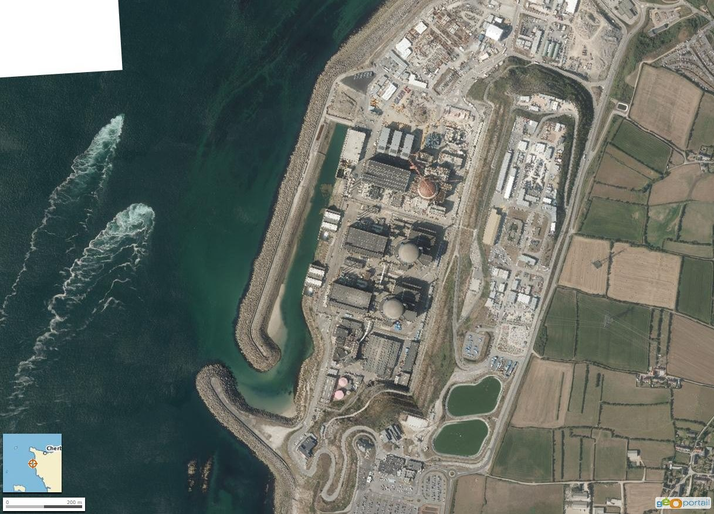{height="360" fig-alt="Orthophotographie d'un site industriel en bord de mer"}
:::
::: {.column width="58%"}
Rangez chaque énoncé : est-il **sur** l'image, ou **tiré** de l'image ?

::: {.classer}
### Je vois

- Deux disques gris
- Des taches blanches au large
- De longues formes fines autour d'un disque

### J'en déduis

- Ce sont des dômes
- L'eau est agitée au large
- Un chantier est en cours
:::

[Voir, c'est décrire. Déduire, c'est déjà interpréter : cela demande des preuves.]{.a-retenir}
:::
::::

## Induction, déduction, abduction {.socle competences="C3"}

::: {.fiche n="1.3" etat="a-revoir"}
Intention : Le processus cognitif de l'enquête. Définitions de Marc : l'induction dégage une règle de faits répétés (forte probabilité, pas de certitude absolue) ; la déduction tire une conclusion de règles ou de prémisses (certaine si elles sont vraies) ; l'abduction propose des hypothèses face à un fait observé (aucune certitude, des pistes, surtout quand le fait surprend). La « déduction » de Sherlock Holmes est surtout une abduction. [Retour V0 : définitions de Marc ; les exemples sortent des cases et forment le faisceau d'indices, à la place de forme / site / association / temps ; le QCM, qu'il suffisait de lire, devient un classement de trois raisonnements courts sur un même exemple.]
Expérience : schéma ; classer trois raisonnements sur un même exemple
Demande :
:::

:::: {.columns}
::: {.column width="60%"}
::: {.schema fichier="images/schemas/raisonnements.svg" hauteur="440"}
:::
:::
::: {.column width="40%"}
Trois raisonnements sur un même champ. Lequel est lequel ?

::: {.classer}
### Induction

- Les cent champs de colza vus en avril étaient jaunes : le colza fleurit en avril.

### Déduction

- Le colza fleurit en avril ; l'image est d'avril : ses champs de colza sont jaunes.

### Abduction

- Un champ jaune vif, au printemps : peut-être du colza en fleur.
:::
:::
::::

## Un métier né de la guerre {.appui competences="C1"}

::: {.fiche n="1.4" etat="a-revoir"}
Intention : Les débuts : la photographie aérienne née des ballons, des cerfs-volants et des pigeons, essor en 1914-1918, renseignement en 1939-1945 (Constance Babington Smith repère le V-1 sur une photo de Peenemünde, 1943), satellites espions de la guerre froide (Corona). Les étudiants ouvrent un dossier « top secret » qui montre la frise de Marc en plein écran, puis remettent les étapes en ordre. Bonus : la série uchronique « Star City » et la visite du musée de la photographie aérienne. [Retour V0 : pour répondre, il faut une donnée : la frise de Marc, dans un dossier qui s'ouvre en plein écran ; lien avec « Star City ».]
Expérience : ouvrir le dossier (brique « dossier ») ; remettre en ordre six étapes ; bonus : Star City, visite virtuelle (défiler)
Demande :
:::

:::: {.columns}
::: {.column width="30%"}
Un dossier vient d'arriver. Ouvrez-le, puis remettez l'histoire en ordre.

::: {.dossier titre="Le renseignement vu du ciel, 1858-2020"}
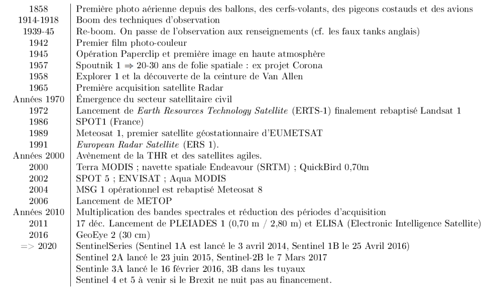{fig-alt="Frise chronologique de la photographie aérienne et satellitaire, de 1858 à 2020"}
:::
:::
::: {.column width="70%"}
::: {.ordre}
1. Première photo aérienne, en ballon
2. L'observation aérienne explose (1914-1918)
3. Le renseignement : Peenemünde, faux chars
4. Spoutnik, puis les satellites espions Corona
5. Landsat 1, premier satellite civil
6. Pléiades : des images à 70 cm
:::
:::
::::

::: {.plus titre="Pour aller plus loin"}
**Une autre série, uchronique : *Star City*.** Le programme spatial soviétique, dérivée de l'uchronie *For All Mankind* (Apple TV+, 2026) : on y interprète, aussi, des images vues de l'espace.

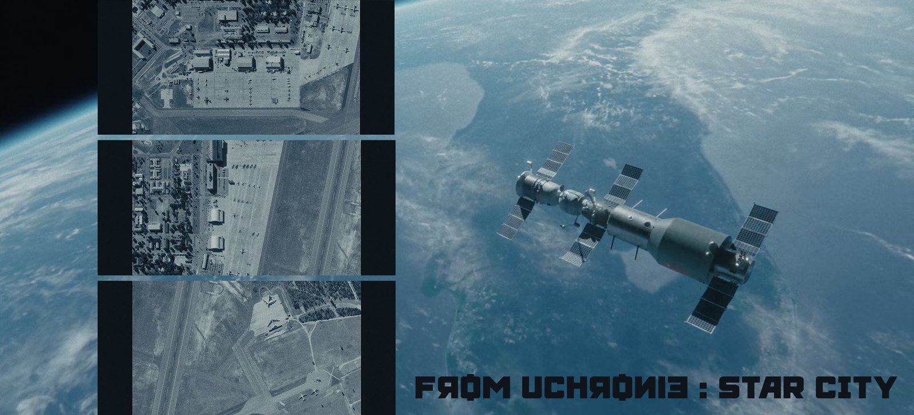{height="190" fig-alt="Une station spatiale en orbite et des images satellite d'une base, dans la série Star City"}

**Visite du musée de la photographie aérienne**

::: {.defiler commande="haut"}
- 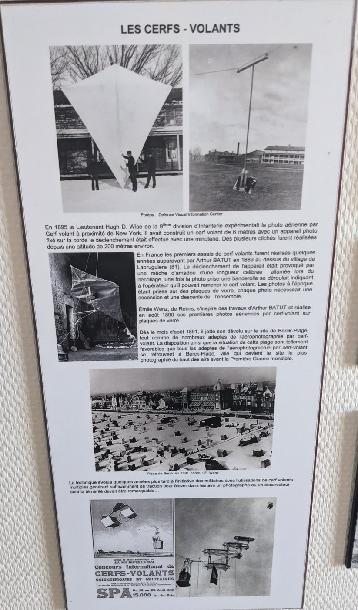
- 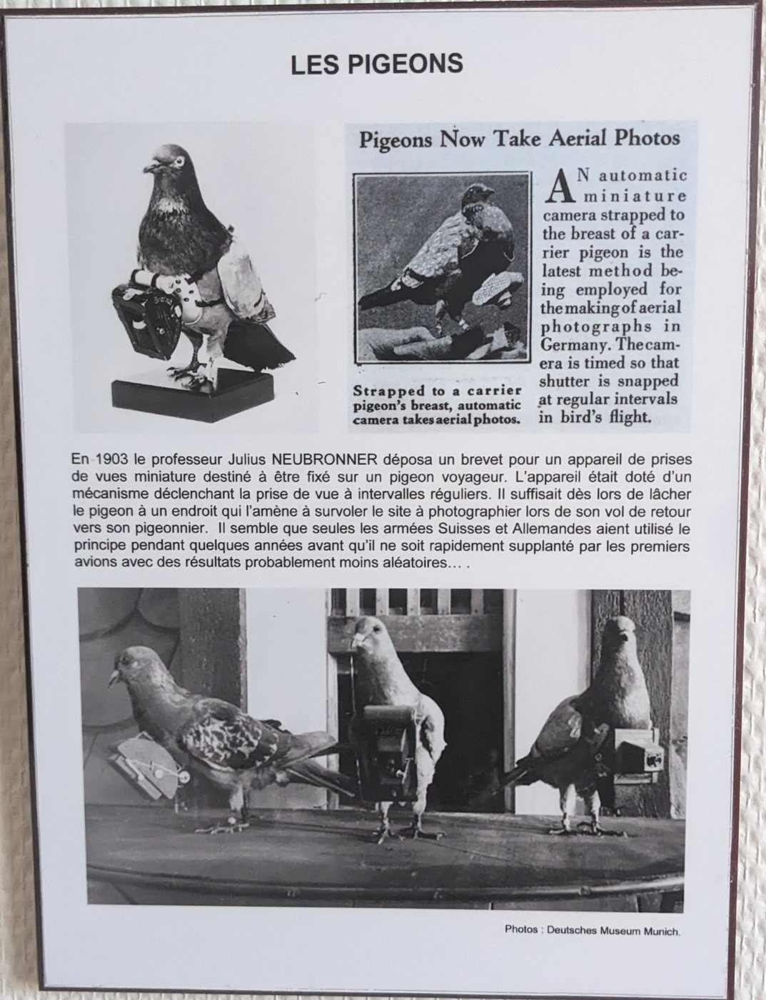
- 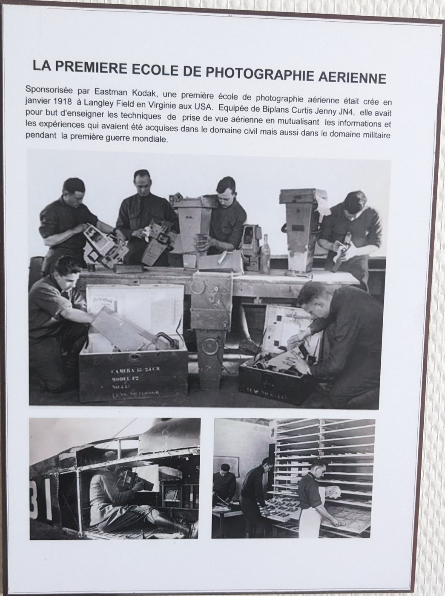
- 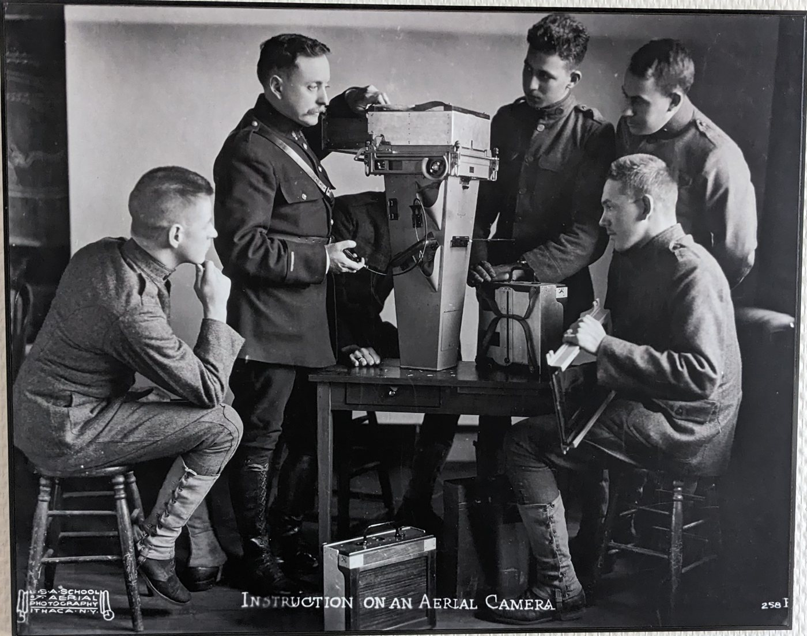
- 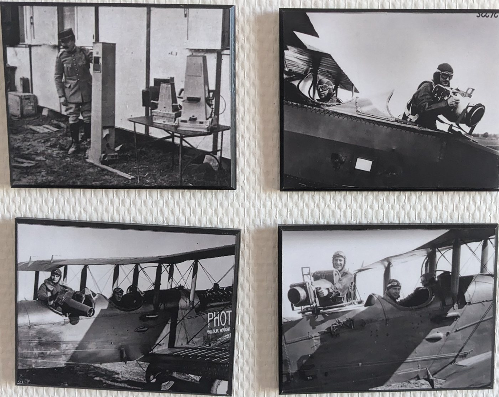
- 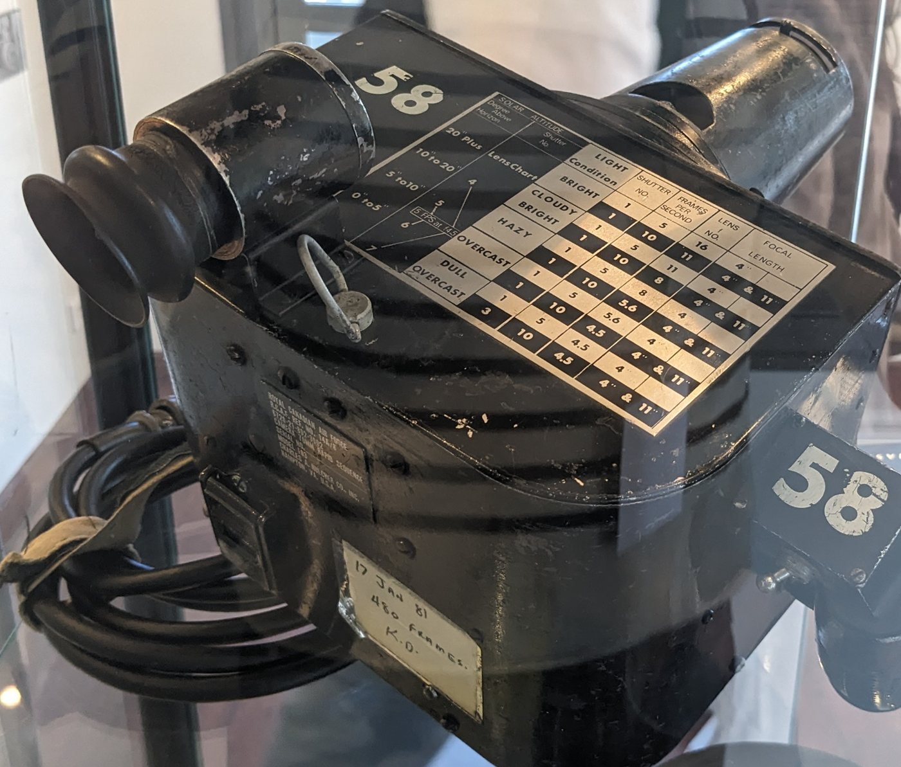
- 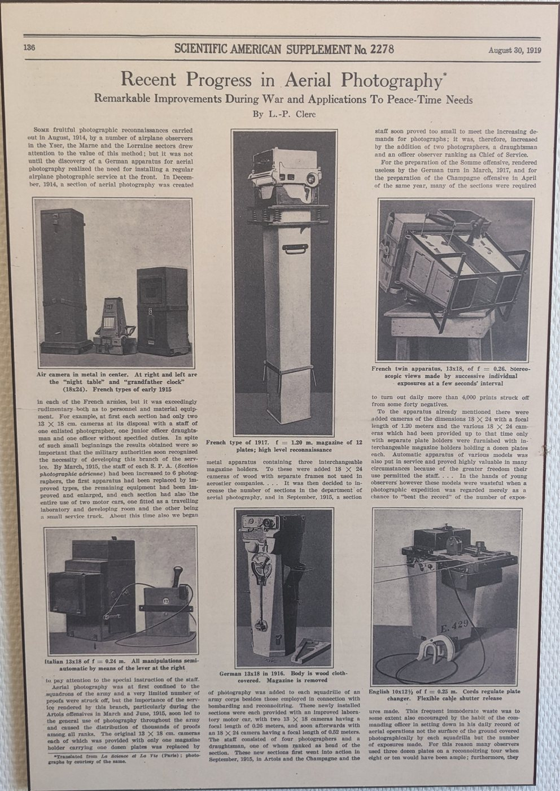
- 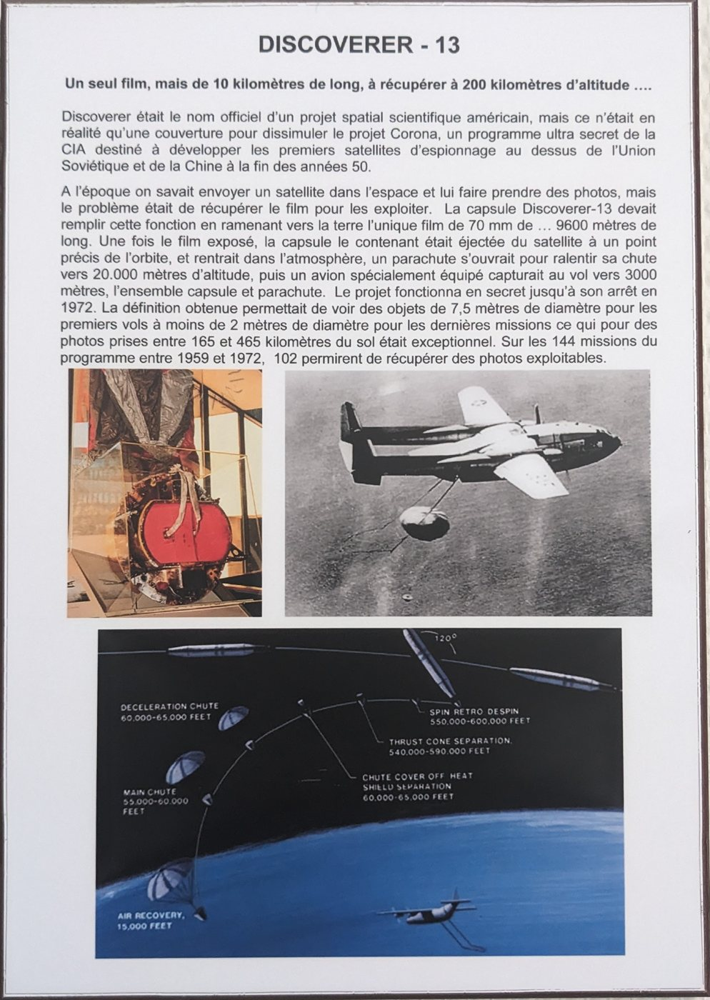
:::

[Musée de la photographie aérienne de l'entreprise L'Europe vue du Ciel. Photos : Marc Poupée.]{.legende}
:::

## À vous : qu'est-ce que c'est ? {.appui competences="C1 C2 C3"}

::: {.fiche n="1.5" etat="a-revoir"}
Intention : Rejouer la scène sur une vraie image, révélée indice par indice ; on ne nomme l'objet qu'à la fin. La conclusion n'apparaît plus avec le dernier indice, mais au clic suivant, après la certitude. [Retour V0 : le radiotélescope FAST est réservé à la coupe topographique (il en casserait le suspense) ; un autre exemple est à choisir. Propositions : une photo RAF de Peenemünde (si elle ne dévoile pas le jeu sérieux), les maquettes de porte-avions dans le désert du Taklamakan (Maxar, 2021), un site d'Area 51.]
Expérience : énigme à indices progressifs, avec la certitude à chaque indice (brique « indices »)
Demande : choisir l'image de l'énigme
:::

[Énigme à venir : l'image reste à choisir (le radiotélescope est gardé pour la coupe topographique).]{.legende}

Le principe : une image, des indices qui viennent un à un, et à chaque indice, votre certitude. On ne nomme l'objet qu'à la fin.

## Dire son degré de certitude {.socle competences="C3"}

::: {.fiche n="1.6" etat="a-revoir"}
Intention : Une interprétation sans degré de confiance est une opinion. Les « mots de probabilité estimative » de Sherman Kent (CIA, 1964) ; le GIEC fait de même dans ses rapports. L'exercice associe la certitude de l'étudiant et celle de l'énoncé : chaque phrase se complète avec un mot de certitude, sur l'image du radiotélescope, encore anonyme. [Retour V0 : lien avec l'échelle du GIEC ; une seule certitude, dans les phrases, au lieu de deux ; quatre phrases proposées par Marc.]
Expérience : phrases à compléter par un mot de certitude (brique « phrases ») ; bonus : l'échelle du GIEC
Demande :
:::

:::: {.columns}
::: {.column width="38%"}
En 1964, Sherman Kent, analyste de la CIA, propose d'accorder les mots et les chances :

| Mot | Chances |
|---|---|
| Presque certain | 9 sur 10 environ |
| Probable | 3 sur 4 environ |
| Possible | 1 sur 2 environ |
| Peu probable | 1 sur 3 environ |

[Un mot de certitude engage : il dit au lecteur quel risque il prend en vous croyant.]{.a-retenir}
:::
::: {.column width="62%"}
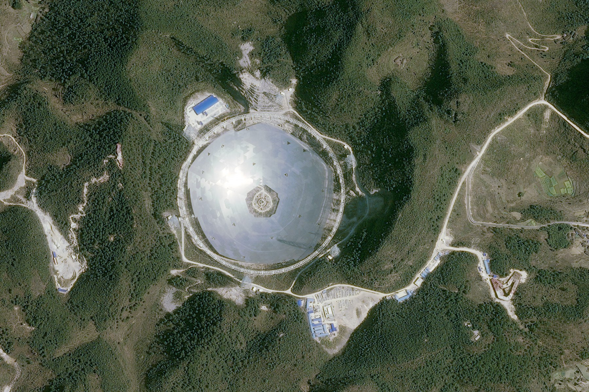{height="235" fig-alt="Image satellite d'un grand disque argenté au fond d'une cuvette boisée, avec des bâtiments aux toits bleus"}

::: {.phrases}
- Il est {presque certain|=probable|possible|peu probable} qu'il y ait des ouvriers sur le site : on ne voit personne, mais la base vie aux toits bleus est là.
- Il est {=presque certain|=probable|possible|peu probable} qu'un chantier soit en cours : remblais nus, pistes neuves, base vie : les indices convergent.
- Il est {presque certain|probable|possible|=peu probable} que nous soyons aux États-Unis : ces collines en pains de sucre et ces toits bleus disent plutôt le sud de la Chine.
- Il est {presque certain|probable|possible|=peu probable} que cette image soit issue d'une IA : les routes mènent quelque part, les ombres sont cohérentes.
:::
:::
::::

::: {.plus titre="Le GIEC, lui aussi"}
Les rapports du GIEC qualifient la probabilité d'un résultat par des termes fixes, en italique dans le texte : *presque certain* (99 à 100 %), *très probable* (90 à 100 %), *probable* (66 à 100 %), *plus probable qu'improbable* (plus de 50 %), *aussi probable qu'improbable* (33 à 66 %), *improbable* (0 à 33 %), *très improbable* (0 à 10 %), *exceptionnellement improbable* (0 à 1 %). Cette terminologie est appliquée de façon cohérente depuis le cinquième rapport (AR5).

[Source : SPF Santé publique, climat.be, « Rapports du GIEC ».](https://climat.be/changements-climatiques/changements-observes/rapports-du-giec)
:::

## Quand l'image trompe {.veille competences="C3"}

::: {.fiche n="1.7" etat="a-revoir"}
Intention : Le contre-exemple : le 5 février 2003, au Conseil de sécurité de l'ONU, Colin Powell, secrétaire d'État américain, présente des images satellite comme preuves d'armes chimiques en Irak ; elles ne seront jamais trouvées. Le biais de confirmation : on voit ce que l'on cherche. [Retour V0 : une image d'archive (une des diapositives satellite présentées ce jour-là, à fournir : non téléchargeable depuis cet environnement) ; le portrait de Colin Powell (Wikipédia).]
Expérience : question : quelle étape de la méthode a manqué ?
Demande : fournir une image d'archive de la présentation du 5 février 2003
:::

:::: {.columns}
::: {.column width="24%"}
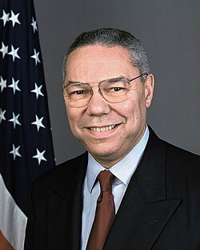{height="250" fig-alt="Portrait officiel de Colin Powell, secrétaire d'État"}

[Colin Powell, secrétaire d'État des États-Unis (portrait officiel).]{.legende}
:::
::: {.column width="76%"}
Le 5 février 2003, au Conseil de sécurité de l'ONU, **Colin Powell** présente des images satellite comme la preuve d'armes chimiques en Irak. Ces armes ne seront jamais trouvées.

[Image d'archive à venir : une des diapositives satellite présentées ce jour-là.]{.legende}

::: {.question}
**Quelle étape de la méthode a manqué ?**
:::

::: {.reponse}
Chercher l'indice qui **contredit**, et dire la **certitude** réelle. Un camion près d'un bunker peut avoir bien des explications ; on choisit celle que l'on attendait. C'est le **biais de confirmation**.
:::
:::
::::

## De l'image à la donnée {.intercalaire}

::: {.fiche n="2.0" etat="a-revoir"}
Intention : L'interprétation ne sert pas qu'au renseignement : elle fabrique la plupart des données géographiques. [nouvelle]
Expérience : aucune
Demande :
:::

L'interprétation ne sert pas qu'au renseignement : elle fabrique la plupart des cartes.

## Interpréter pour bâtir une base {.socle competences="C5"}

::: {.fiche n="2.1" etat="a-revoir"}
Intention : Des bases nationales nées de l'interprétation d'images : la BD TOPO (restitution photogrammétrique), la BD Forêt V2 (orthophotos infrarouge couleur, 0,5 ha, 32 postes, 2007-2018, segmentation automatique puis contrôle par photo-interprètes), CORINE Land Cover en Europe (25 ha). [nouvelle]
Expérience : question : pourquoi trois bases ne disent-elles pas la même chose du même lieu ?
Demande :
:::

:::: {.columns}
::: {.column width="55%"}
- La **BD TOPO** : bâtiments, routes, rivières, restitués à partir de photos aériennes en relief.
- La **BD Forêt V2** (IGN, 2007-2018) : les forêts interprétées sur des photos infrarouge couleur, 32 types, aucune tache de moins de **0,5 ha**.
- **CORINE Land Cover** : l'occupation du sol de l'Europe, aucune tache de moins de **25 ha**.
:::
::: {.column width="45%"}
::: {.question}
**Pourquoi trois bases ne disent-elles pas la même chose d'un même lieu ?**
:::

::: {.reponse}
Elles n'ont ni la même question, ni la même nomenclature, ni la même **unité minimale**. Une base est une interprétation, faite selon des règles.
:::
:::
::::

## L'unité minimale de collecte {.socle competences="C5"}

::: {.fiche n="2.2" etat="a-revoir"}
Intention : Toute base fixe une surface en dessous de laquelle on ne saisit pas. Sur des données réelles fournies par Marc, autour de la forêt de L'Isle-Adam (8,5 × 7,9 km) : CORINE Land Cover (25 ha) et la BD Forêt V2 (0,5 ha). Calculé sur les deux captures : 50 % et 52 % de forêt, mais 12 % de la zone en désaccord (320 ha de forêt pour CLC seule, 510 ha pour la BD Forêt seule) ; 7 taches de forêt contre 139. [Retour V0 : des données réelles, et une question plus complexe.]
Expérience : comparer les deux cartes (curseur) ; question en deux temps
Demande :
:::

:::: {.columns}
::: {.column width="50%"}
::: {.comparer}
- 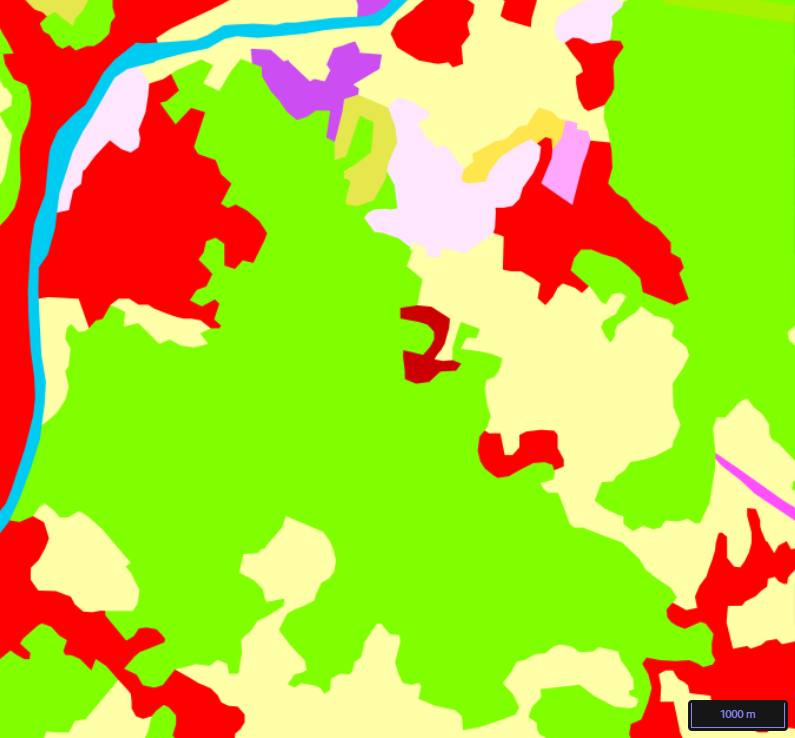
- 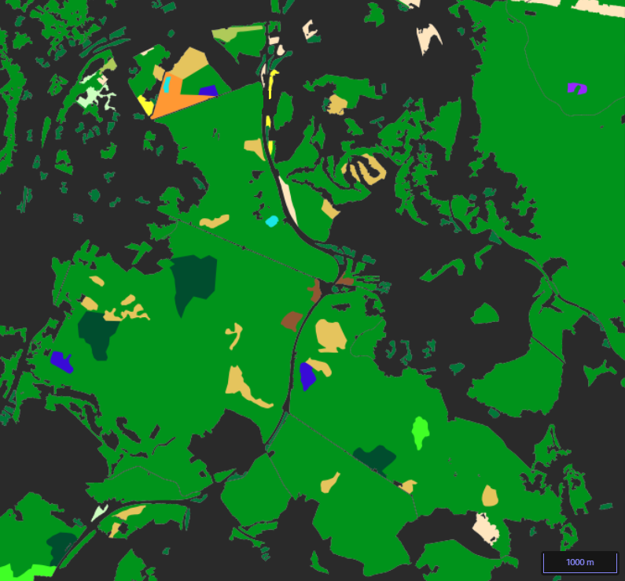
:::
:::
::: {.column width="50%"}
Forêt de L'Isle-Adam : **CORINE Land Cover** (25 ha minimum ; forêt en vert clair) et **BD Forêt V2** (0,5 ha ; forêts en verts).

::: {.question}
**50 % de forêt pour l'une, 52 % pour l'autre : d'accord ? Laquelle pour une commune, laquelle pour comparer l'Europe ?**
:::

::: {.reponse}
D'accord sur le total, pas sur les lieux : elles divergent sur **12 %** de la zone (830 ha). CORINE dessine 7 taches de forêt, la BD Forêt **139**. Commune : BD Forêt ; Europe : CORINE, mêmes règles partout. [Calculé sur les captures.]{.legende}
:::
:::
::::

## Qu'est-ce qu'une forêt ? {.appui competences="C5"}

::: {.fiche n="2.3" etat="a-revoir"}
Intention : Une nomenclature commence par des définitions. L'étudiant compose une définition de la forêt avec trois critères (surface minimale, hauteur des arbres, couvert), puis découvre si une définition de ce type existe : FAO, CCNUCC (Kyoto), BD Forêt V2, CORINE Land Cover, COMIFAC. Seuils vérifiés : FAO 0,5 ha, 5 m, 10 % ; CCNUCC, chaque pays choisit entre 0,05 et 1 ha, 2 et 5 m, 10 et 30 % ; BD Forêt V2 0,5 ha, 5 m, 20 m de large, alignée sur la FAO ; CORINE 25 ha, plus de 5 m, au moins 30 % ; COMIFAC (Ernst et al., 2010) 5 ha, 5 m, 70 %. [Retour V0 : la nomenclature de l'image du cours devient la définition de la forêt, proposée par Marc : trois séries d'éléments à associer.]
Expérience : composer une définition, puis la confronter aux définitions officielles (brique « combiner »)
Demande :
:::

Composez **votre** définition de la forêt : un choix par ligne. Puis voyez si elle existe.

::: {.combiner}
### Surface minimale

- 0,05 ha [kyoto]
- 0,5 ha [fao, kyoto, bdforet]
- 5 ha [comifac]
- 25 ha [clc]

### Hauteur des arbres

- 2 m [kyoto]
- 5 m [fao, kyoto, bdforet, clc, comifac]
- 15 m []

### Couvert des arbres

- 10 % [fao, kyoto, bdforet]
- 30 % [kyoto, clc]
- 70 % [comifac]

#### fao | La FAO (statistiques mondiales)

Plus de 0,5 ha, des arbres de plus de 5 m, un couvert de plus de 10 %.

#### kyoto | Le climat (CCNUCC, protocole de Kyoto)

Chaque pays choisit ses seuils dans des fourchettes : 0,05 à 1 ha, 2 à 5 m, 10 à 30 % de couvert.

#### bdforet | La BD Forêt V2 (IGN)

0,5 ha, des arbres de plus de 5 m, 20 m de large au moins ; alignée sur la FAO.

#### clc | CORINE Land Cover

Une unité minimale de 25 ha ; une forêt a des arbres de plus de 5 m et un couvert d'au moins 30 %.

#### comifac | Les forêts d'Afrique centrale (COMIFAC)

Au moins 70 % de couvert, des arbres de 5 m au moins, une unité minimale de 5 ha.

#### * | Aucune définition connue

Aucune des définitions retenues ici ne réunit ces trois choix. Il en existe pourtant des centaines : chaque pays, chaque base, chaque convention fixe ses seuils. Une carte de « la » forêt dit toujours **quelle** forêt.
:::

## La précision des experts {.appui competences="C5 C6"}

::: {.fiche n="2.4" etat="a-revoir"}
Intention : Une diapo de Marc sur la précision des experts. On commence par « Quel est votre niveau de certitude avec vous-même ? », voté au curseur : la réponse attendue approche 95 % (selon l'âge, la progression dans un domaine, la fatigue, on n'est pas toujours d'accord avec soi-même : points développés à l'oral). Un expert est considéré comme tel à 95 %. Puis quatre catégories de précision en production d'information géographique, ordres de grandeur donnés par Marc : photo-interprète expert 95 %, classification experte très variable, apprentissage machine 80 à 85 %, réseau de neurones 92 %. La question sur les désaccords entre interprètes reste. [Retour V0 : remplace « Deux interprètes, deux cartes » ; bonus : Colwell, 1952, sur les liens entre photo-interprétation militaire et forestière.]
Expérience : voter au curseur ; réponse, et le graphique apparaît ; question sur les désaccords ; bonus
Demande :
:::

:::: {.columns}
::: {.column width="44%"}
::: {.question}
**Quel est votre niveau de certitude avec vous-même ?** Si vous interprétiez deux fois la même image, à un mois d'écart, sur combien de points seriez-vous d'accord ?
:::

::: {.curseur min="50" max="100" pas="1" valeur="75" unite="%" etiquette="Mon accord avec moi-même"}
:::

::: {.reponse}
Environ **95 %** : âge, pratique, fatigue… on n'est pas toujours d'accord avec soi-même. C'est le seuil d'un expert.
:::
:::
::: {.column width="56%"}
::: {.schema fichier="images/schemas/precision.svg" hauteur="250"}
:::

[Ordres de grandeur de la production d'information géographique (Marc Poupée).]{.legende}

::: {.question}
**Deux interprètes : où sont, le plus souvent, leurs désaccords ?**
:::

::: {.reponse}
Aux **limites**, sur les **petits objets**, sur les **cas que les règles n'ont pas prévus**.
:::
:::
::::

::: {.plus titre="Militaires et forestiers"}
Les photo-interprètes militaires et forestiers ont beaucoup échangé : mêmes clés, mêmes méthodes. R. N. Colwell (US Naval Photographic Interpretation Center), « Relationships Between Military and Forest Photo Interpretation », *Journal of Forestry*, 50 (4), 1952, p. 271-276. [L'article](https://academic.oup.com/jof/article/50/4/271/4684240)
:::

## Des données pour apprendre aux machines {.appui competences="C6"}

::: {.fiche n="2.5" etat="a-revoir"}
Intention : L'IA apprend sur des images étiquetées par des humains. FLAIR (Garioud, Gonthier, Landrieu, De Wit, Valette, Poupée, Giordano, Wattrelos, NeurIPS 2023) : plus de 20 milliards de pixels étiquetés, 817 km² d'images aériennes à 20 cm, avec des séries temporelles satellitaires. L'interprète devient annotateur. Réflexion de Marc, gardée ici et non dans la diapo : l'IA intègre des données étiquetées, pas en train de l'être ; le processus de décision de l'interprète n'est pas connu. Intégrer la marge de certitude dans les données d'apprentissage serait une piste intéressante. [Retour V0 : l'IA apprend les erreurs, pas les hésitations ; l'orthophoto et ses étiquettes côte à côte.]
Expérience : regarder l'image et ses étiquettes ; question ; bonus : l'article
Demande :
:::

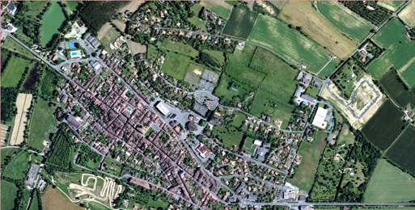{height="215" fig-alt="Orthophotographie d'un bourg entouré de champs"} 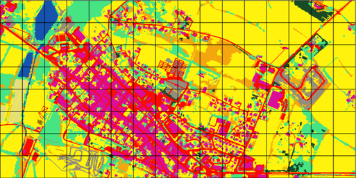{height="215" fig-alt="La même zone, chaque pixel coloré selon son occupation du sol"}

[L'image, et ses étiquettes pixel par pixel. Le jeu de données **FLAIR** (IGN, 2023) : plus de 20 milliards de pixels étiquetés, sur 817 km² d'images à 20 cm.]{.legende}

::: {.question}
**Qui fabrique ces étiquettes, et que la machine en apprend-elle ?**
:::

::: {.reponse}
Des interprètes, pixel par pixel, selon des règles. La machine apprend leurs décisions finales, **erreurs comprises** ; leurs hésitations, elle ne les voit pas.
:::

::: {.plus titre="L'article FLAIR"}
A. Garioud, N. Gonthier, L. Landrieu, A. De Wit, M. Valette, M. Poupée, S. Giordano, B. Wattrelos, « FLAIR : a Country-Scale Land Cover Semantic Segmentation Dataset From Multi-Source Optical Imagery », *NeurIPS 2023, Datasets and Benchmarks*. [L'article](https://arxiv.org/abs/2310.13336) · [les données](https://ignf.github.io/FLAIR/)
:::

## L'interprète contrôle la machine {.appui competences="C6"}

::: {.fiche n="2.6" etat="a-revoir"}
Intention : La validation d'un résultat automatique repose sur un échantillon interprété à la main : on compte bonnes et mauvaises classifications (la matrice de confusion, en mots simples). Illustration : une détection du bâti par un réseau U-Net, travaux de 2019. [Retour V0 : les deux illustrations U-Net de Marc, datées de 2019.]
Expérience : regarder la détection ; QCM avec barre de certitude
Demande :
:::

:::: {.columns}
::: {.column width="46%"}
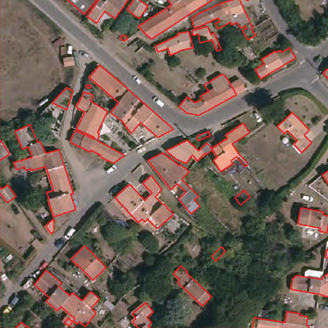{height="230" fig-alt="Orthophotographie d'un quartier pavillonnaire, les bâtiments cernés de rouge"} 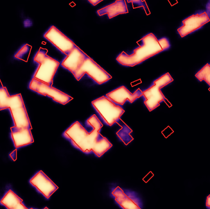{height="230" fig-alt="La détection du bâti par le réseau : des taches claires sur fond noir, les contours de référence en rouge"}

[À gauche, le bâti de référence (en rouge) ; à droite, ce que détecte un réseau U-Net : plus c'est clair, plus il est sûr. Travaux de 2019.]{.legende}
:::
::: {.column width="54%"}
Une IA cartographie les bâtiments. Sur 100 points tirés au hasard, un interprète vérifie : **90 sont justes**.

::: {.confiance}
::: {.qcm .serre}
Que peut-on en conclure ?

- [ ] La carte est juste à 90 %, partout
    - Non : l'erreur peut se concentrer quelque part (les toits sombres, les zones denses).
- [x] Sur ce territoire, environ 9 points sur 10 sont justes ; il faut regarder où sont les erreurs
    - Oui : le chiffre global ne suffit pas, il faut la répartition des erreurs, classe par classe.
- [ ] L'interprète n'est plus nécessaire
    - Non : c'est lui qui a produit la vérification.
:::
:::
:::
::::

## Suivre les changements {.appui competences="C4"}

::: {.fiche n="2.7" etat="a-revoir"}
Intention : Le suivi des changements, ici par radar (Baltimore) : une composition colorée de plusieurs dates. Le radar voit de nuit et à travers les nuages, mais ne se lit pas comme une photo. Source et dates de l'image à préciser par Marc. [nouvelle]
Expérience : question
Demande :
:::

:::: {.columns}
::: {.column width="52%"}
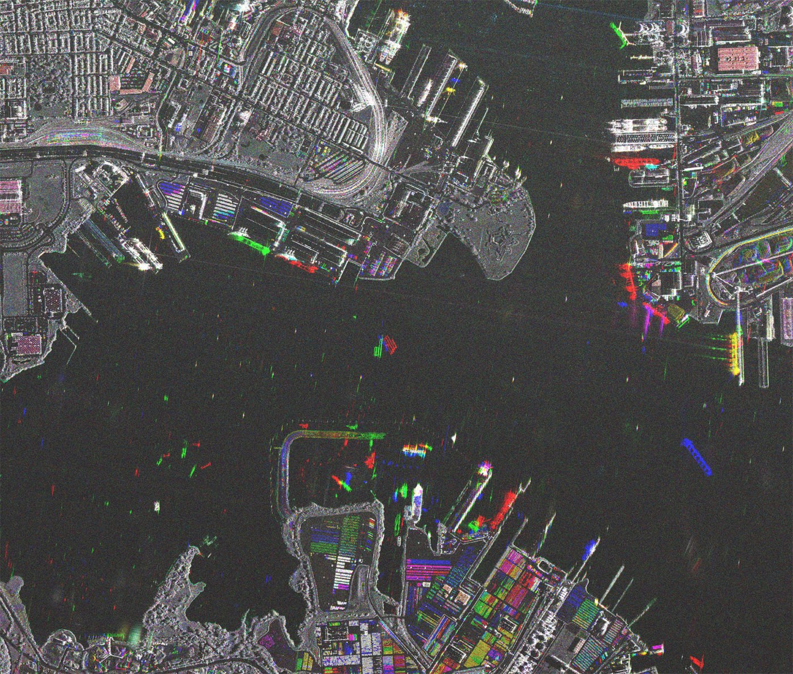{height="430" fig-alt="Image radar du port de Baltimore, en gris avec des taches de couleur"}

[Port de Baltimore, image radar, plusieurs dates. Source à préciser.]{.legende}
:::
::: {.column width="48%"}
Cette image superpose plusieurs dates radar, chacune dans une couleur.

::: {.question}
**Que signifient le gris et les couleurs ?**
:::

::: {.reponse}
Le **gris**, ce qui n'a pas changé entre les dates. Les **couleurs**, ce qui a bougé : navires, conteneurs, véhicules. Le radar voit de nuit et à travers les nuages, mais il faut apprendre à le lire.
:::
:::
::::

## L'archéologie sous la forêt {.appui competences="C4"}

::: {.fiche n="2.8" etat="a-revoir"}
Intention : Le LiDAR aéroporté révèle sous la forêt les villes khmères autour d'Angkor (campagne de 2012 ; Evans et al., PNAS, 2013). Image de Marc, source Wired (juin 2013). Le lien avec l'IGN reste à préciser par Marc. [Retour V0 : l'image du LiDAR d'Angkor.]
Expérience : question
Demande : préciser le lien avec l'IGN
:::

:::: {.columns}
::: {.column width="58%"}
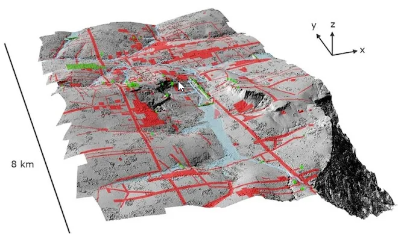{width="100%" fig-alt="Modèle en relief du sol autour d'Angkor, avec un réseau de lignes rouges droites"}

[Le relief du sol autour d'Angkor, révélé par le LiDAR ; en rouge, les tracés anciens. Source : Wired, juin 2013.]{.legende}
:::
::: {.column width="42%"}
En 2012, un **LiDAR** aéroporté survole Angkor. Ses impulsions laser passent entre les feuilles et touchent le sol : sous la forêt apparaissent des rues, des bassins, des quartiers entiers.

::: {.question}
**Pourquoi une photo aérienne ne suffisait-elle pas ?**
:::

::: {.reponse}
Elle ne montre que le toit de la forêt. Le LiDAR mesure aussi ce qui est dessous : le relief du sol, et les traces des aménagements anciens.
:::
:::
::::

## Bien d'autres usages {.appui competences="C4"}

::: {.fiche n="2.9" etat="a-revoir"}
Intention : La galerie des usages, pour un public large, en quatre catégories de même registre : gestion de crise, suivi de l'occupation du sol, contrôle qualité, géopolitique. [Retour V0 : « suivi et contrôle » et « vérification » étaient vagues et pas du même registre ; les exemples sont gardés, rangés dans les quatre catégories de Marc.]
Expérience : classer huit questions selon l'usage
Demande :
:::

Rangez chaque question selon l'usage de l'interprétation.

::: {.classer}
### Gestion de crise

- Quels bâtiments l'inondation a-t-elle détruits ?
- Jusqu'où le feu est-il allé ?

### Suivi de l'occupation du sol

- Combien de champs ont été artificialisés en dix ans ?
- Où la forêt a-t-elle été coupée cette année ?

### Contrôle qualité

- Cette photo a-t-elle vraiment été prise ici, ce jour-là ?
- Cette carte produite par une IA est-elle juste ?

### Géopolitique

- Un camp de réfugiés s'étend-il ?
- Une base militaire s'agrandit-elle ?
:::

## Les clés d'identification {.intercalaire}

::: {.fiche n="3.0" etat="a-revoir"}
Intention : Ce qu'est l'objet. L'image du cours : la centrale de Flamanville (Manche), pendant la construction de l'EPR, une image qui réunit toutes les clés. [nouvelle]
Expérience : aucune
Demande :
:::

Ce qu'est l'objet.

## L'image du cours

::: {.fiche n="3.1" etat="a-revoir"}
Intention : L'image entière, explorée librement avant toute clé. L'étudiant décrit, puis propose pour chaque élément une interprétation prudente, avec un mot de certitude. La lecture experte est décomposée de la même façon, sans dire ce qu'est le site. Description reprise dans la note finale. Exemple, sans niveau. [Retour V0 : décomposer la lecture experte : une observation ⇒ une interprétation et sa certitude, sur le modèle de Marc (« des surfaces de tailles importantes, a priori planes, de couleurs variant du brun au vert ⇒ très probablement des champs »).]
Expérience : loupe ; zone d'écriture (brique « observer »)
Demande :
:::

:::: {.columns}
::: {.column width="46%"}
::: {.loupe zoom="3"}
{height="460" fig-alt="Orthophotographie d'un site industriel au bord de la mer"}
:::
:::
::: {.column width="54%"}
Explorez l'image à la loupe. **Décrivez** ce que vous voyez : formes, couleurs, tailles, positions. Puis, pour chaque élément, ce que c'est **sans doute**, avec un mot de certitude. Vous retrouverez ce texte à la fin.

::: {.observer cle="description-image" invite="Je vois… ⇒ c'est probablement…"}
- De grandes surfaces, a priori planes, du brun au vert, bordées de lignes sombres ⇒ **très probablement** des champs entourés de haies.
- Une ligne de gros blocs clairs qui ferme un plan d'eau turquoise ⇒ **très probablement** une digue et un bassin.
- Des taches blanches filamenteuses en mer, loin du bord ⇒ **probablement** de l'eau agitée.
- Deux disques gris d'une cinquantaine de mètres, un troisième cuivré, entouré de longues formes fines ⇒ **probablement** des dômes, dont un en chantier, entouré de grues.
- De longs volumes rectangulaires, alignés à angle droit ⇒ **très probablement** des bâtiments industriels.
- Des rangées de petits rectangles colorés sur du gris ⇒ **presque certainement** des voitures sur des parkings.
:::
:::
::::

## Ton et couleur {.socle competences="C2 C4"}

::: {.fiche n="3.2" etat="a-revoir"}
Intention : La première clé, la plus simple : le ton (clair, sombre) et la couleur. L'eau turquoise du bassin, les remous blancs, le dôme cuivré du chantier. En infrarouge couleur, la végétation vivante devient rouge. [nouvelle]
Expérience : QCM : que trahit le blanc des remous ?
Demande :
:::

:::: {.columns}
::: {.column width="45%"}
{height="380" fig-alt="L'image du cours"}
:::
::: {.column width="55%"}
Le **ton** (clair ou sombre) et la **couleur** sont les premières clés que l'œil lit. En **infrarouge couleur**, la végétation vivante devient rouge : on y voit les plantes malades.

::: {.qcm .serre}
En mer, à gauche, deux grandes taches blanches. Que dit leur blancheur ?

- [x] De l'eau agitée, chargée de bulles : de la turbulence
    - Oui : l'écume renvoie la lumière. Reste à savoir ce qui agite l'eau.
- [ ] Du sable sous l'eau
    - Non : le sable donnerait une teinte claire et unie, sans ces filaments.
- [ ] Des nuages
    - Non : ils auraient leur ombre portée sur l'eau.
:::
:::
::::

## Taille et forme {.socle competences="C2"}

::: {.fiche n="3.3" etat="a-revoir"}
Intention : La taille se lit avec l'échelle (200 m ≈ 130 pixels sur l'image : environ 1,5 m par pixel, mesuré) ; la forme distingue le naturel de l'humain. Un dôme mesure environ 50 m (mesuré). [Retour V0 : pour garder la tension, la réponse ne dit pas encore qu'il s'agit d'un réacteur.]
Expérience : question de mesure
Demande :
:::

:::: {.columns}
::: {.column width="45%"}
::: {.loupe zoom="3"}
{height="400" fig-alt="L'image du cours, avec son échelle"}
:::
:::
::: {.column width="55%"}
La **taille** se lit avec l'échelle ; la **forme** sépare le naturel (contours irréguliers) de l'humain (géométrie). Une coupole parfaite de cette taille n'a pas beaucoup d'explications.

::: {.question}
L'échelle en bas à gauche fait 200 m. **Quel diamètre ont les dômes ?**
:::

::: {.reponse}
Environ **50 m** : un quart de l'échelle. Une coupole de cette taille, au bord de la mer… Gardez votre hypothèse pour vous : les clés d'interprétation vont la mettre à l'épreuve.
:::
:::
::::

## Texture et structure {.socle competences="C2"}

::: {.fiche n="3.4" etat="a-revoir"}
Intention : La texture (le grain) et la structure (l'arrangement répété). La digue de gros blocs, rugueuse ; le bocage en mailles ; les parkings en lignes. [nouvelle]
Expérience : classer six détails selon la clé qui les révèle
Demande :
:::

La **texture**, c'est le grain d'une surface ; la **structure**, l'arrangement d'éléments qui se répètent.

::: {.classer}
### La texture

- La digue, rugueuse comme du gravier
- La mer, lisse au large et filamenteuse près des remous
- Le chantier, granuleux

### La structure

- Les champs en mailles, bordés de haies
- Les voitures en rangées sur les parkings
- Les bâtiments alignés, à angle droit
:::

## L'ombre dit la forme {.socle competences="C2"}

::: {.fiche n="3.5" etat="a-revoir"}
Intention : Les ombres portées : vu d'avion, un objet haut et fin n'est qu'un point ; son ombre en dessine la silhouette. Schémas faits pour le cours : une éolienne, un château d'eau, un pylône électrique, une grue, ombres allongées par un soleil bas au sud-est ; il faut déduire l'objet de son ombre. L'étude des ombres a un nom : la sciographie (indices sciographiques, repris en archéologie). [Retour V0 : élément important du support de Marc qui avait disparu ; schémas refaits ex nihilo.]
Expérience : associer chaque ombre à son objet (classer) ; les noms apparaissent sur le schéma avec la correction
Demande :
:::

Vu d'avion, un objet haut et fin n'est qu'un point. Son **ombre portée**, elle, dessine sa silhouette : lire les ombres s'appelle la **sciographie**.

::: {.schema fichier="images/schemas/ombres-portees.svg" hauteur="225"}
:::

::: {.classer}
### Ombre A

- Une éolienne

### Ombre B

- Un château d'eau

### Ombre C

- Un pylône électrique

### Ombre D

- Une grue
:::

## Ombre et relief {.socle competences="C2 C4"}

::: {.fiche n="3.6" etat="a-revoir"}
Intention : L'ombre et la lumière donnent le relief. Mini-jeu (demande de Marc) : sur l'image du radiotélescope, encore anonyme, un marcheur va de A à B en passant par le centre ; l'étudiant le fait monter ou descendre avec les flèches du clavier, et marque les crêtes vives (touche C) : la courbe s'arrondit d'elle-même ailleurs. Il compare ensuite à la coupe de référence. Le profil de référence est indicatif, à valider (ou à tirer d'un MNT). [Retour V0 : départ au milieu des ordonnées ; d'après les lacets, la première pente monte fort jusqu'à une crête, puis l'on redescend vers le centre ; courbe lissée en direct, crêtes qui cassent et fonds arrondis distingués ; la déduction de la forme de la parabole suit, diapo suivante.]
Expérience : mini-jeu de coupe topographique (brique « coupe »)
Demande :
:::

Tracez la coupe de **A** à **B** : à chaque pas, faites monter ou descendre le marcheur d'après l'image ; marquez les **crêtes vives** (touche C) : ailleurs, la courbe s'arrondit. Les lacets, les ombres et les éclats de lumière disent où sont les pentes.

::: {.coupe image="images/fast-2016.jpg" alt="Un grand disque argenté au fond d'une cuvette boisée, entre des collines" depart="2,49" arrivee="98,49" pas="24" profil="donnees/fast-profil.json" style="--hauteur-coupe: 320px"}
::: {.apres-jeu}
En tirets, le profil de référence : une pente forte jusqu'à une crête, puis la descente vers le disque. **Au centre, un creux ou une bosse ?** Prouvez-le, diapo suivante. [Profil indicatif, lu sur l'image.]{.legende}
:::
:::

## Creux ou bosse ? {.socle competences="C2 C3"}

::: {.fiche n="3.7" etat="a-revoir"}
Intention : L'étape de déduction de la forme de la parabole (demande de Marc) : 1. savoir où est le soleil ; 2. trouver un cadran solaire (la tour en bas à droite du disque et son ombre) ; 3. en déduire la forme : le reflet du soleil est du côté opposé au soleil, donc la parabole est concave. Sur un dôme, le reflet serait du côté du soleil. L'objet est enfin nommé : le radiotélescope FAST. [Retour V0 : étape de déduction qui manquait après la coupe.]
Expérience : énigme à indices, avec la certitude à chaque indice (brique « indices »)
Demande :
:::

::: {.indices image="images/fast-2016.jpg" alt="Le grand disque argenté, sa tour et son reflet" confiance="oui" style="--hauteur-indices: 420px"}
- 46,59,13,8 : Un cadran solaire : la tour en bas à droite du disque, et son ombre fine qui file vers la gauche, sur le disque.
- Le soleil est donc à droite de l'image, un peu en bas : à l'opposé de l'ombre.
- 34,38,9,11 : Le reflet du soleil sur le disque est en haut à gauche du centre : du côté opposé au soleil.
- Sur une bosse, le reflet serait du côté du soleil ; dans un creux, il est du côté opposé.

Le disque est **concave** : un creux de 500 m de diamètre, posé au fond d'une dépression karstique. C'est le **radiotélescope FAST** (Guizhou, Chine), la plus grande antenne unique au monde, saisi par Pléiades le 2 mars 2016, en fin de chantier.
:::

## La date compte {.appui competences="C2 C4"}

::: {.fiche n="3.8" etat="a-revoir"}
Intention : La date d'une image fixe ce que l'on peut y voir : un chantier en cours, la saison, la marée, l'heure (la longueur et le sens des ombres). Un rappel en images est prévu (image de Marc à venir). Bonus : l'OSINT et la chronolocation. [Retour V0 : un rappel avec des images ; lien vers l'OSINT et la chronolocation ; l'image n'est plus nommée.]
Expérience : QCM avec barre de certitude ; bonus
Demande : fournir l'image du rappel
:::

La date dit l'**état** d'un lieu : un chantier, une saison, une marée, une heure.

[Rappel en images à venir (image de Marc).]{.legende}

::: {.confiance}
::: {.qcm .serre}
Sur l'image du cours, les ombres des bâtiments tombent vers la droite (l'est). Qu'en tirez-vous ?

- [ ] La photo a été prise le matin
    - Non : le matin, le soleil est à l'est et les ombres tombent vers l'ouest.
- [x] La photo a été prise l'après-midi
    - Oui : le soleil est à l'ouest ou au sud-ouest, les ombres partent vers l'est.
- [ ] On ne peut rien dire de l'heure
    - Si : le sens des ombres donne la position du soleil.
:::
:::

::: {.plus titre="OSINT et chronolocation"}
L'**OSINT** (*open source intelligence*) est le renseignement tiré de sources ouvertes : images publiées, vidéos, cartes. La **chronolocation** en est une branche : dater une image par ses indices, la longueur et le sens des ombres en premier. Des outils comme [SunCalc](https://www.suncalc.org) donnent la position du soleil pour un lieu, un jour, une heure ; le collectif [Bellingcat](https://www.bellingcat.com) publie ses enquêtes et ses méthodes.
:::

## Quelle clé pour quelle question ? {.socle competences="C2"}

::: {.fiche n="3.9" etat="a-revoir"}
Intention : Le récapitulatif des clés d'identification, mélangées (pratique entrelacée). [nouvelle]
Expérience : QCM avec barre de certitude
Demande :
:::

::: {.confiance}
::: {.qcm .serre}
Pour savoir si une haute cheminée est plus haute qu'un immeuble voisin, sur une seule photo verticale, quelle clé ?

- [ ] Le ton
    - Non : il dit la matière ou l'éclairage, pas la hauteur.
- [ ] La forme
    - Non : vue d'en haut, une cheminée n'est qu'un disque.
- [x] L'ombre
    - Oui : à la même heure, l'ombre la plus longue appartient à l'objet le plus haut.
- [ ] La structure
    - Non : elle concerne des éléments répétés.
:::
:::

[Ton et couleur, taille, forme, texture, structure, ombre, date : sept clés pour dire **ce qu'est** un objet.]{.a-retenir}

## Les clés d'interprétation {.intercalaire}

::: {.fiche n="4.0" etat="a-revoir"}
Intention : Ce qui se passe. Des objets reconnus aux mécanismes qui les relient. [nouvelle]
Expérience : aucune
Demande :
:::

Ce qui se passe.

## L'association {.socle competences="C3"}

::: {.fiche n="4.1" etat="a-revoir"}
Intention : Des objets qui vont ensemble : dômes, salles des machines, prise d'eau, rejet en mer, chantier. Un objet seul est ambigu, une association ne l'est presque plus. C'est ici que la nature du site est révélée. Coordonnées des zones à vérifier. [Retour V0 : question et réponse étaient ambiguës ; l'association passe avant le site, pour que la révélation vienne de l'association ; la question sur un nouveau lieu suit, diapo suivante.]
Expérience : zones à cliquer : retrouver ce qui va avec les dômes ; question : que forment-ils ?
Demande :
:::

:::: {.columns}
::: {.column width="50%"}
Une **association**, ce sont des objets qui vont ensemble. Un dôme seul peut être un planétarium, un silo, un radôme… Cherchez sur l'image ce qui va avec les dômes : par où l'eau entre, par où elle sort, ce qui se construit.

::: {.question}
**Ensemble, que forment ces objets ?**
:::

::: {.reponse}
Une **centrale nucléaire** en bord de mer : Flamanville (Manche), avec son troisième réacteur, l'EPR, en chantier. Aucun objet seul ne le prouvait ; leur association, presque.
:::
:::
::: {.column width="50%"}
::: {.zones image="images/flamanville.jpg" alt="L'image du cours" hauteur="440"}
- [x] 53,46,7,17 : Les deux dômes : des bâtiments réacteurs.
- [x] 47,43,6,18 : Les longs bâtiments à côté : les salles des machines, turbines et condenseurs.
- [x] 42,23,7,46 : Le bassin fermé par la digue : la prise d'eau de mer.
- [x] 1,22,22,52 : Les remous au large : le rejet de l'eau de refroidissement.
- [x] 56,31,8,10 : Le troisième dôme, en chantier : un réacteur de plus, l'EPR.
- [ ] 84,26,14,22 : Le bocage : il était là avant le site.
:::
:::
::::

## À vous : quel est ce lieu ? {.appui competences="C3"}

::: {.fiche n="4.2" etat="a-revoir"}
Intention : Transférer la clé d'association sur un autre lieu : un centre équestre adamois (image de Marc). Question de Marc : « Quelles associations nous permettent de déduire la nature de ce lieu ? » [Retour V0 : la question ajoutée après l'association, sur l'image Centre_equestre de Marc. Choix : une diapo à part plutôt qu'une question qui apparaît sur la même diapo, pour garder l'image en grand et le PDF lisible.]
Expérience : question, puis réponse
Demande :
:::

:::: {.columns}
::: {.column width="56%"}
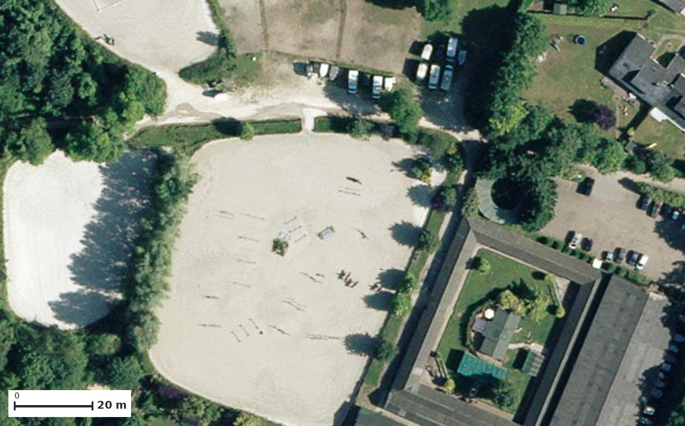{width="100%" fig-alt="Vue aérienne : deux grandes surfaces de sable clair, de longs bâtiments autour d'une cour, un parking"}
:::
::: {.column width="44%"}
::: {.question}
**Quelles associations nous permettent de déduire la nature de ce lieu ?**
:::

::: {.reponse}
Des pistes de sable semées de **barres d'obstacles** ; de petites silhouettes (**des cavaliers ?**) ; des bâtiments autour d'une cour (**des boxes ?**) ; de longs véhicules garés (**des vans ?**). Ensemble : un **centre équestre**.
:::
:::
::::

## Le site {.socle competences="C3"}

::: {.fiche n="4.3" etat="a-revoir"}
Intention : La position d'un objet dans son milieu explique ce qui lui arrive. Pourquoi une centrale ici ? L'eau de mer ; un sol rocheux ; et l'éloignement de la population : la presqu'île du Cotentin, la falaise protectrice, et sans doute (supposition de Marc) la proximité de la Hague. Carte faite pour le cours : Flamanville, un cercle de 100 km, la population des communes (INSEE, via Etalab) et des îles Anglo-Normandes (ordres de grandeur). Calculé : environ 730 000 habitants à moins de 100 km, dont près d'un quart dans les îles ; le cercle est aux quatre cinquièmes en mer. [Retour V0 : préciser l'éloignement de la population, avec une carte simple et un cercle de 100 km ; le site passe après l'association, qui révèle la nature du lieu.]
Expérience : carte ; question
Demande :
:::

:::: {.columns}
::: {.column width="48%"}
Le **site** : la place d'un objet dans son milieu.

::: {.question}
**Pourquoi construire une centrale ici ?**
:::

::: {.reponse}
- L'**eau de mer**, abondante et froide ;
- un sol **rocheux**, sous une **falaise** qui protège ;
- l'**éloignement de la population** : le cercle de 100 km est aux 4/5 en mer (environ 730 000 habitants) ;
- sans doute la **Hague**, à 15 km : une région déjà nucléaire (hypothèse).
:::
:::
::: {.column width="52%"}
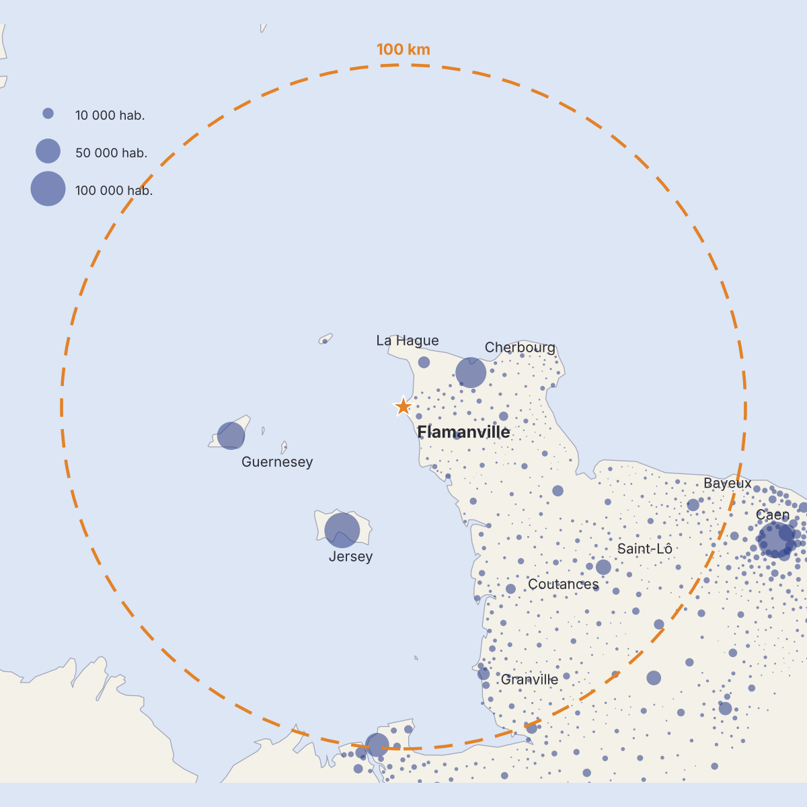{height="430" fig-alt="Carte du Cotentin et des îles Anglo-Normandes : un cercle de 100 km autour de Flamanville, des cercles proportionnels à la population des communes"}

[Population : INSEE, via Etalab ; îles : ordres de grandeur ; terres : Natural Earth.]{.legende}
:::
::::

## Le temps {.socle competences="C3 C4"}

::: {.fiche n="4.4" etat="a-revoir"}
Intention : Le temps : une image fixe un instant d'un processus ; la comparaison de plusieurs dates d'un même lieu révèle une dynamique. Marc propose un GIF animé de la crise ukrainienne, où des bases russes grossissent : la question portera sur ce qui change, et dans quel ordre. [Retour V0 : la question était trop simple ; GIF de Marc à venir.]
Expérience : regarder l'animation ; question
Demande : fournir le GIF des bases russes
:::

Une image fige un **instant**. Pour comprendre un mécanisme, on cherche ce qui dit l'avant et l'après : un chantier, une crue, une coupe, une repousse. Plusieurs dates d'un même lieu révèlent une **dynamique**.

[Animation à venir : des bases russes qui grossissent, avant l'invasion de l'Ukraine (GIF de Marc).]{.legende}

::: {.question}
**Qu'est-ce qui change d'une image à l'autre, et dans quel ordre ?**
:::

::: {.reponse}
Réponse à écrire avec l'animation.
:::

## Les connaissances personnelles et les réflexes {.appui competences="C1 C4"}

::: {.fiche n="4.5" etat="a-revoir"}
Intention : Ce que l'interprète apporte de lui-même : ses connaissances et ses réflexes. L'image Cambrai-1917, la plus visible possible ; « Que voyez-vous ? », puis « Quelles questions se poser ? » : quel lieu (Cambrai) ? quelle date (1917) ? quel signal (du panchromatique) ? quelle référence cinématographique (« À l'Ouest, rien de nouveau » ou « Wonder Woman », au choix) ? [Retour V0 : nouvelle diapo demandée par Marc, après le temps. Titre de Marc « Les connaissances personnelles et des réflexes », ajusté en « … et les réflexes » : à confirmer. Marc a écrit « À l'est rien de nouveau » : le film s'intitule « À l'Ouest, rien de nouveau ».]
Expérience : deux questions, chacune suivie de sa réponse
Demande :
:::

:::: {.columns}
::: {.column width="56%"}
::: {.loupe zoom="2.5"}
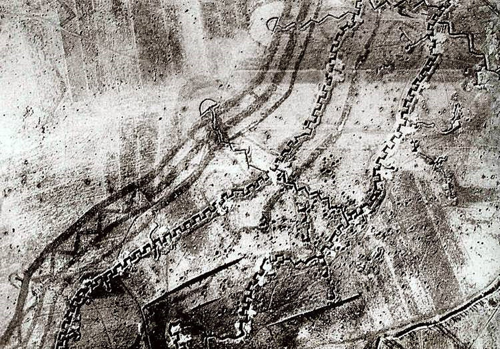{height="285" fig-alt="Photographie aérienne ancienne en noir et blanc : des lignes crénelées en zigzag sur un sol criblé de trous"}
:::

::: {.question}
**Que voyez-vous ?**
:::

::: {.reponse}
Des **tranchées** crénelées, des **trous d'obus**, de larges bandes sombres : **sans doute des barbelés**.
:::
:::
::: {.column width="44%"}
::: {.question}
**Quelles questions se poser ?**
:::

::: {.reponse}
- **Quel lieu ?** Cambrai.
- **Quelle date ?** 1917.
- **Quel signal ?** Du panchromatique.
- **Quel film ?** *À l'Ouest, rien de nouveau* ou *Wonder Woman*, au choix.
:::
:::
::::

## Ce que la végétation et la lumière rasante révèlent {.socle competences="C2 C3"}

::: {.fiche n="4.6" etat="a-revoir"}
Intention : Les indices indirects de l'archéologie aérienne : phytographiques (la culture pousse mieux sur un fossé comblé, plus haute et plus verte ; mal sur un mur enfoui, plus basse et jaunissant tôt, surtout en été sec) et sciographiques (un relief arasé fait une ombre sous une lumière rasante, tôt le matin ou tard le soir). Il en existe d'autres : pédologiques (couleur des labours, en hiver), hydrographiques (humidité). Schéma fait pour le cours. [Retour V0 : éléments importants du support de Marc qui avaient disparu.]
Expérience : schéma ; QCM ; question
Demande :
:::

:::: {.columns}
::: {.column width="52%"}
::: {.schema fichier="images/schemas/indices-archeo.svg" hauteur="300"}
:::
:::
::: {.column width="48%"}
::: {.qcm .serre}
Été sec, champ de blé : un cercle plus vert et plus haut se dessine. Qu'y a-t-il dessous ?

- [x] Un fossé comblé, qui garde l'humidité
    - Oui : un indice phytographique positif ; un ancien enclos, peut-être.
- [ ] Un mur enfoui
    - Non : sur un mur, la culture pousse mal et jaunit.
- [ ] Rien : un arrosage
    - Peu probable : un arrosage ne dessine pas un cercle fin et régulier.
:::

::: {.question}
**Quand photographier un talus arasé de 30 cm ?**
:::

::: {.reponse}
Sous une **lumière rasante**, tôt le matin ou tard le soir : le moindre relief fait une ombre. C'est l'**indice sciographique**.
:::
:::
::::

## La chronologie des phénomènes {.socle competences="C3"}

::: {.fiche n="4.7" etat="a-revoir"}
Intention : Lire la chronologie relative sur une seule image : ce qui recoupe est plus récent que ce qui est recoupé ; ce qui s'aligne sur un tracé lui est postérieur. Paysage inventé, schéma fait pour le cours : un méandre comblé, une voie droite, des parcelles en lanières alignées sur la voie, une voie ferrée qui coupe les lanières, une autoroute qui la franchit par un pont, un lotissement en chantier. [Retour V0 : élément important du support de Marc qui avait disparu.]
Expérience : schéma ; remettre six tracés dans l'ordre
Demande :
:::

:::: {.columns}
::: {.column width="56%"}
::: {.schema fichier="images/schemas/chronologie.svg" hauteur="340"}
:::

[**Ce qui recoupe est plus récent** que ce qui est recoupé ; ce qui s'aligne sur un tracé lui est postérieur.]{.a-retenir}
:::
::: {.column width="44%"}
::: {.ordre}
Du plus ancien au plus récent :

1. A, le méandre comblé
2. B, la voie droite
3. C, les parcelles en lanières
4. D, la voie ferrée
5. E, l'autoroute
6. F, le lotissement en chantier
:::
:::
::::

## Reconstituer un mécanisme {.socle competences="C3"}

::: {.fiche n="4.8" etat="a-revoir"}
Intention : La convergence des indices raconte un mécanisme complet : le circuit de l'eau de refroidissement, de la prise d'eau au rejet, et l'électricité qui part. Chaque étape est reliée à un indice de l'image. Fonctionnement du rejet de Flamanville à valider par Marc. [nouvelle]
Expérience : remettre en ordre les étapes
Demande :
:::

::: {.ordre}
Remettez le mécanisme de la centrale dans l'ordre. Chaque étape a son indice sur l'image du cours.

1. L'eau de mer entre dans le bassin fermé par la digue
2. Des pompes l'envoient vers les salles des machines
3. Elle refroidit la vapeur qui a fait tourner les turbines
4. Réchauffée, elle repart en mer par des galeries
5. Elle remonte au large : les remous blancs
6. L'électricité part par les lignes à haute tension
:::

## Raisonner pas à pas {.socle competences="C1 C3"}

::: {.fiche n="4.9" etat="a-revoir"}
Intention : Un arbre de déduction sur la rade de Brest : que se passe-t-il dans les tirets rouges ? Chaque choix est un indice ; le chemin parcouru reste affiché, comme un faisceau. Première version : l'arbre sera reconstruit avec les réponses des étudiants de Marc, et ses conclusions validées par lui. [nouvelle]
Expérience : arbre de déduction (brique « arbre »)
Demande :
:::

Que se passe-t-il dans les **tirets rouges** ? Répondez pas à pas : chaque réponse est un indice.

::: {.arbre image="images/rade-de-brest.jpg" alt="Orthophotographie de la rade de Brest, une zone en tirets rouges sur l'eau" style="--hauteur-arbre: 390px"}
### depart | Quelle taille font les petits points blancs ? (l'échelle : 200 m)
- Quelques mètres → petits
- Plusieurs dizaines de mètres → grands

### grands ! Mesurez de nouveau
Avec l'échelle, 200 m valent environ 126 pixels : un point de 3 ou 4 pixels mesure quelques mètres. Revenez d'un pas.

### petits | Comment sont-ils répartis ?
- Dispersés, assez régulièrement espacés → espaces
- Alignés en rangées droites → rangees
- Serrés en groupe, tous dans le même sens → groupe

### espaces | Sont-ils tous orientés de la même façon ?
- Oui, tous dans le même sens → mouillage
- Non, au hasard → flottants

### mouillage ! Hypothèse : une zone de mouillage
Des bateaux sur leurs corps-morts, tous tournés par le même courant ou le même vent, près de la côte. À confirmer : une cale, un club, un port à proximité ? Conclusion à valider.

### rangees ! Hypothèse : des cultures marines
Des bouées alignées en filières. À confirmer : des parcs à terre, des chemins d'accès ? Conclusion à valider.

### groupe ! Hypothèse : une régate
Des voiliers en mouvement, en flotte. À confirmer : des sillages, une bouée de parcours ? Conclusion à valider.

### flottants ! Hypothèse : des objets flottants
Des bouées, des débris ou des oiseaux. À confirmer avec une seconde date. Conclusion à valider.
:::

## Les pièges {.appui competences="C3"}

::: {.fiche n="4.10" etat="a-revoir"}
Intention : Les faux amis (une ombre prise pour de l'eau, une prairie pour un chantier) et le biais de confirmation. La parade : chercher l'indice qui contredit. [nouvelle]
Expérience : QCM avec barre de certitude ; la calibration en fin de cours montre si l'on est trop sûr de soi
Demande :
:::

::: {.confiance}
::: {.qcm .serre}
Une large tache sombre, au pied d'un grand bâtiment, sur une image prise en fin d'après-midi. Qu'est-ce que c'est ?

- [ ] Un bassin, sans aucun doute
    - Trop vite : une ombre portée est aussi sombre, et elle a la forme du bâtiment.
- [x] Probablement son ombre : il faut vérifier sa forme et son sens
    - Oui : à cette heure, les ombres sont longues ; si la tache prolonge le bâtiment dans le sens des autres ombres, c'est une ombre.
- [ ] Un parking
    - Rien ne l'indique : pas de voitures, pas de marquage.
:::
:::

[La parade au biais de confirmation : chercher l'indice qui **contredit** votre hypothèse.]{.a-retenir}

## Vraie ou générée ? {.intercalaire}

::: {.fiche n="5.0" etat="a-revoir"}
Intention : La détection des images générées par IA : les clés de l'interprète s'y appliquent. Troisième grand volet du cours (demande de Marc) ; placé après les clés, qui servent à détecter. [nouvelle]
Expérience : aucune
Demande :
:::

Les clés de l'interprète servent aussi à démasquer les images générées.

## Il y a quatre ans {competences="C6"}

::: {.fiche n="5.1" etat="a-revoir"}
Intention : En janvier 2022, une « vue aérienne » générée par Wombo Dream : les étudiants de Marc y voyaient un paysage asiatique, parce qu'il était impensable qu'une image soit fabriquée. On ne détecte pas ce que l'on n'imagine pas. Exemple, sans niveau. [Retour V0 : image recadrée sans les mentions de l'application, et agrandie ; de façon générale, maximiser les visuels.]
Expérience : question avant la réponse
Demande :
:::

:::: {.columns}
::: {.column width="40%"}
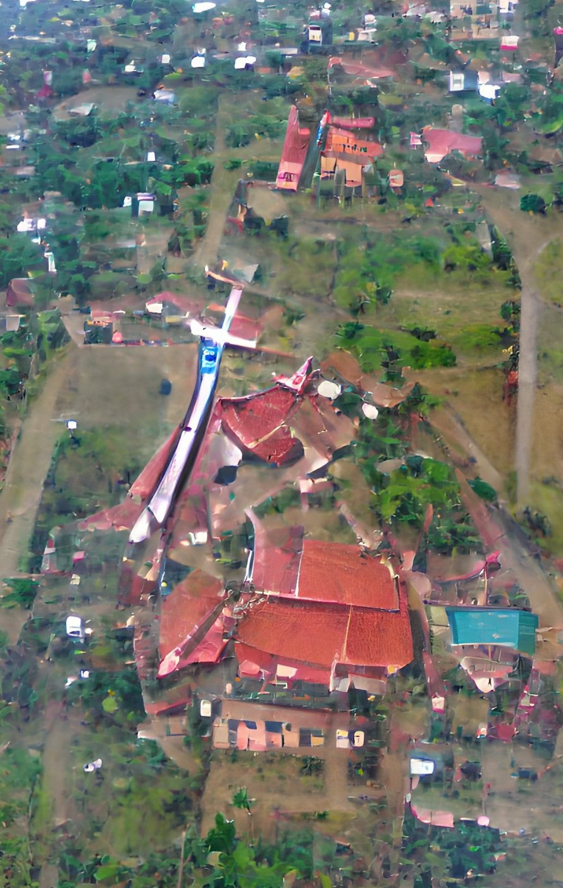{height="540" fig-alt="Une vue aérienne de village aux toits rouges"}
:::
::: {.column width="60%"}
::: {.question}
**Où a été prise cette vue aérienne ?**
:::

::: {.reponse}
Nulle part : elle a été générée en janvier 2022 par une application, à partir des seuls mots *aerial view*. À l'époque, les étudiants y voyaient un paysage asiatique : il était impensable qu'une image soit fabriquée.
:::

[On ne détecte pas ce que l'on n'imagine pas possible.]{.a-retenir}
:::
::::

## Les erreurs physiques {.socle competences="C6 C3"}

::: {.fiche n="5.2" etat="a-revoir"}
Intention : Les incohérences physiques et topographiques, que les clés d'interprétation révèlent : des rivières qui franchissent des crêtes, un éclairage contradictoire, des reliefs froissés comme du papier (DALL·E, 2024). [Retour V0 : images agrandies.]
Expérience : défiler ; question
Demande :
:::

:::: {.columns}
::: {.column width="54%"}
::: {.defiler commande="haut" style="--hauteur-image: 420px"}
- 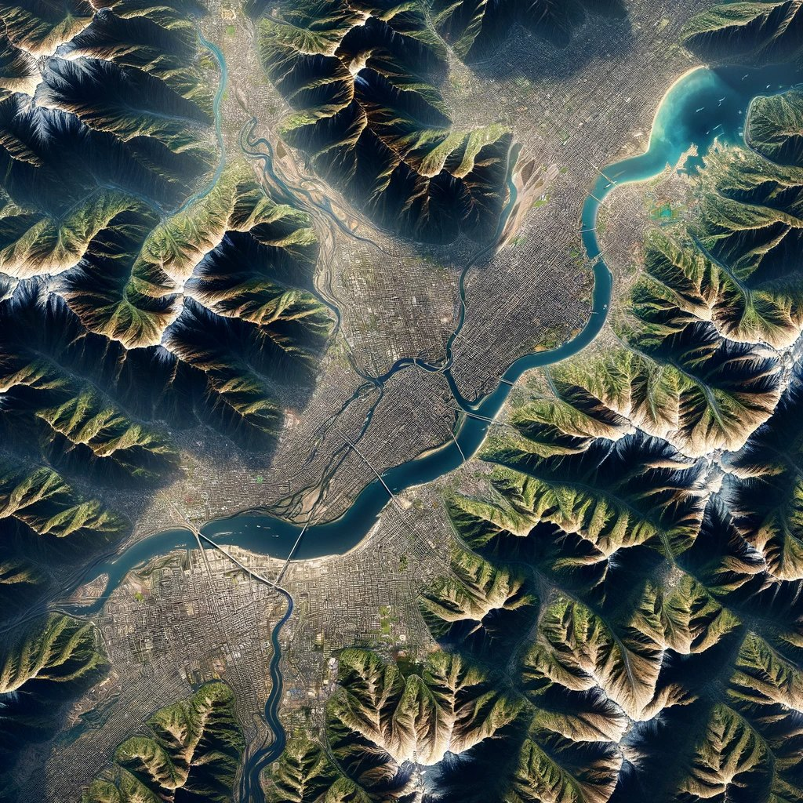
- 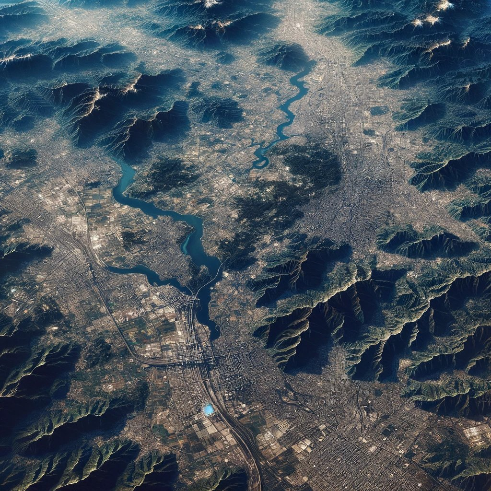
- 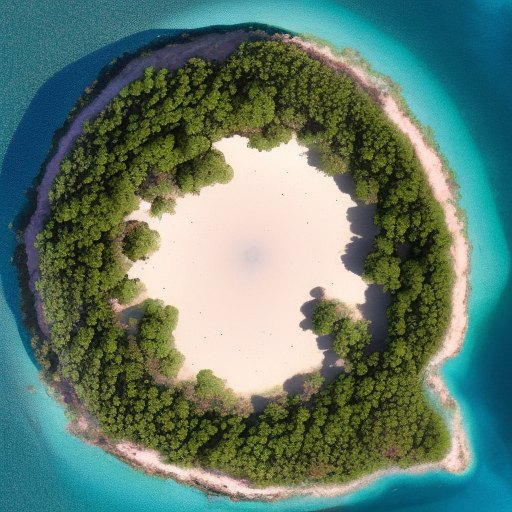
:::
:::
::: {.column width="46%"}
::: {.question}
Ces vues d'en haut ont été générées. **Qu'est-ce qui les trahit ?**
:::

::: {.reponse}
- Des **rivières** qui ne suivent pas les vallées, ou franchissent les crêtes.
- Un **éclairage** qui vient de plusieurs côtés à la fois.
- Des **reliefs** sans logique d'érosion, froissés comme du papier.
- Une **ville** sans réseau : les routes ne mènent nulle part.
:::
:::
::::

## L'invraisemblable {.appui competences="C6"}

::: {.fiche n="5.3" etat="a-revoir"}
Intention : Une image « historique » fabriquée : la place Tian'anmen vue d'un drone. Anachronisme (pas de drone grand public en 1989), chars aux formes incohérentes. Les clés du temps et de la forme. Date de génération à préciser. [Retour V0 : image agrandie.]
Expérience : question
Demande :
:::

:::: {.columns}
::: {.column width="52%"}
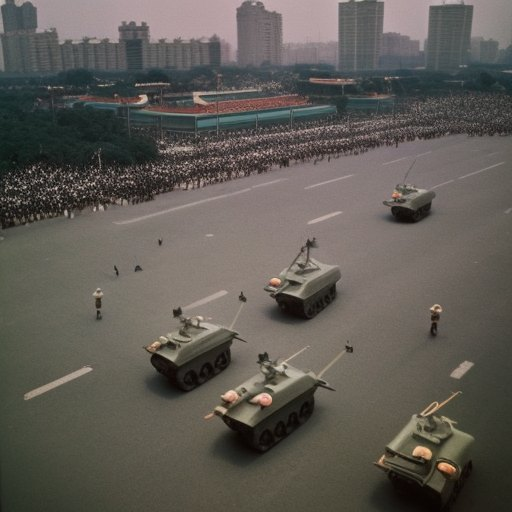{height="520" fig-alt="Des chars sur une grande place, vus d'en haut"}
:::
::: {.column width="48%"}
::: {.question}
Une image légendée « Tian'anmen, 1989, vue d'un drone ». **Combien d'indices la contredisent ?**
:::

::: {.reponse}
- La **date** : en 1989, aucun drone ne filme ainsi une manifestation.
- Les **formes** : des chars aux tourelles et aux chenilles incohérentes.
- Les **personnes** : des silhouettes sans ombre juste.

Trois incohérences qui convergent : l'image est fausse.
:::
:::
::::

## Le manque d'émotion {.appui competences="C6"}

::: {.fiche n="5.4" etat="a-revoir"}
Intention : Le manque d'émotion dans les visages et les scènes générées : les affiches d'un kiosque photographiées par Marc (PXL_20250930_173652676~2). [Retour V0 : l'image de Marc, en grand.]
Expérience : question
Demande : confirmer quelles affiches sont générées
:::

:::: {.columns}
::: {.column width="66%"}
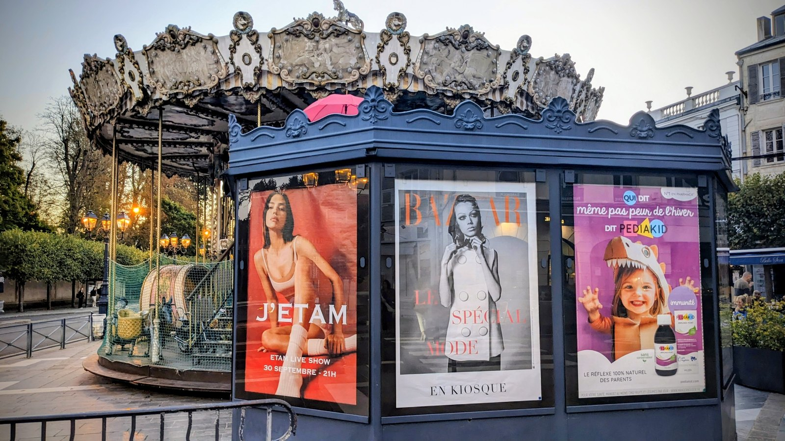{width="100%" fig-alt="Un kiosque couvert d'affiches publicitaires, devant un manège"}
:::
::: {.column width="34%"}
::: {.question}
**Regardez les visages des affiches. Que leur manque-t-il pour paraître vrais ?**
:::

::: {.reponse}
L'**émotion** : des visages lisses et figés, un regard qui ne répond à rien. Un indice faible seul, mais fréquent dans les images générées.
:::
:::
::::

## Ce qui trahit encore l'IA {.socle competences="C6 C2"}

::: {.fiche n="5.5" etat="a-revoir"}
Intention : Ce qui reste aujourd'hui : les textures difficiles (fourrures, rides), les arrière-plans flous incohérents, les structures simplifiées des hautes fréquences spatiales, propres aux réseaux convolutifs. Images de Marc : PXL_20261006_182859009 et PXL_20261006_182903643. [Retour V0 : les deux images de Marc, en grand.]
Expérience : regarder les deux images ; liste des points faibles
Demande :
:::

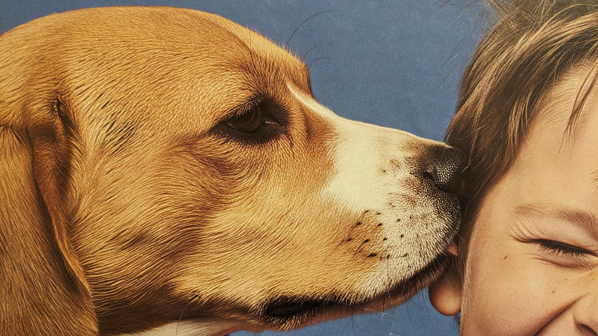{height="290" fig-alt="Un chien lèche la joue d'un garçon"} {height="290" fig-alt="Un garçon rit, les yeux plissés"}

Les points faibles qui restent, à chercher à la loupe :

- les **textures** fines et désordonnées : fourrures, cheveux, rides ;
- les **arrière-plans flous**, dont le flou ne suit pas la distance ;
- les **détails fins** (hautes fréquences), simplifiés en motifs trop réguliers : la signature des réseaux convolutifs.

## Le réel qui paraît faux {competences="C6"}

::: {.fiche n="5.6" etat="a-revoir"}
Intention : Le clin d'œil : une image insolite, réelle, qui paraît maintenant générée (IMG-20261029-WA0000, image de Marc). Le doute s'étend aux vraies images. Exemple, sans niveau. [Retour V0 : l'image de Marc, en grand.]
Expérience : question
Demande :
:::

:::: {.columns}
::: {.column width="36%"}
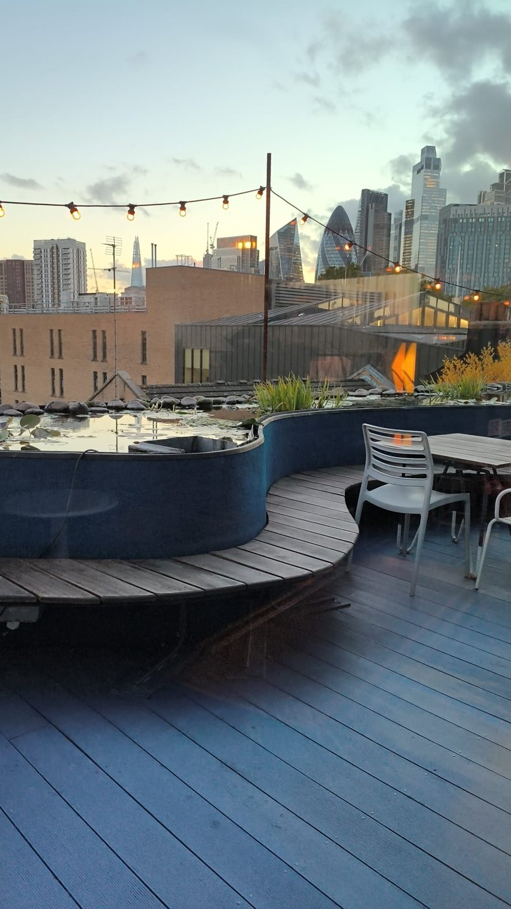{height="540" fig-alt="Une terrasse en bois, des guirlandes lumineuses et des gratte-ciel au loin"}
:::
::: {.column width="64%"}
::: {.question}
**Générée, ou réelle ?**
:::

::: {.reponse}
Réelle. Désormais, une image insolite paraît fausse : le doute s'étend aux vraies images. La seule réponse est la méthode : la source, la date, les indices qui convergent.
:::
:::
::::

## À vous : vraie ou générée ? {.appui competences="C6"}

::: {.fiche n="5.7" etat="a-revoir"}
Intention : Le test : des images réelles (Pléiades, orthophotos, radar) et générées (2022 à 2024), une par une, avec la certitude à chaque fois. À enrichir avec les images de 2025 et 2026 de Marc. [nouvelle]
Expérience : brique « vrai-ia », avec barre de certitude et score
Demande :
:::

Pour chaque image : réelle, ou générée ? Dites d'abord votre certitude.

::: {.vrai-ia style="--hauteur-vraiia: 420px"}
- 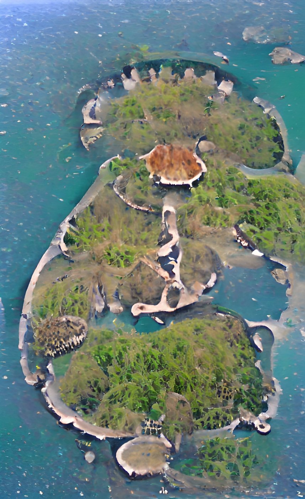 [ia] : Des rives en dentelle sans logique, des bâtiments fondus dans la végétation, aucune route.
-  [vrai] : Une image Pléiades : les routes mènent quelque part, les ombres sont cohérentes, le chantier a une logique.
-  [ia] : Un lagon blanc et plat, sans fond ni passe, une végétation en boule : physiquement improbable.
- 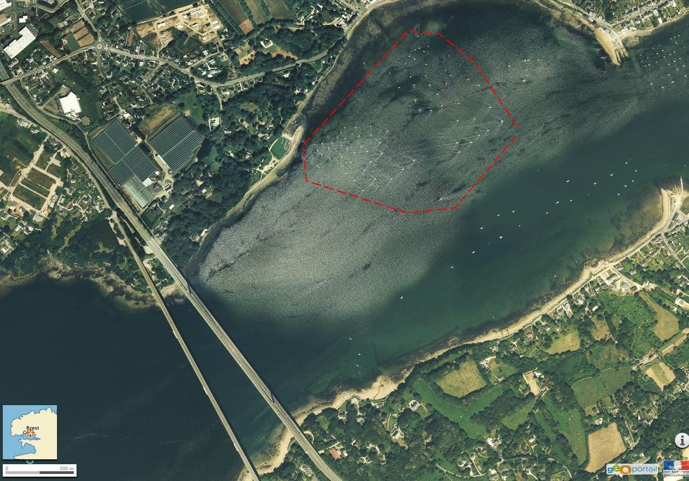 [vrai] : Une orthophotographie : réseau routier continu, ombres alignées, détails irréguliers.
-  [ia] : Des rivières qui franchissent les crêtes et un relief sans érosion.
-  [vrai] : Une image radar multi-dates : ses défauts sont ceux du capteur, pas d'un générateur.
:::

## La méthode {.socle competences="C6 C3"}

::: {.fiche n="5.8" etat="a-revoir"}
Intention : La méthode de vérification : la source et la provenance (métadonnées, certificats de contenu), la recherche inversée, la cohérence avec d'autres images du même lieu et du même jour, la convergence des indices. Jamais un indice seul. [nouvelle]
Expérience : remettre en ordre les étapes
Demande :
:::

::: {.ordre}
Remettez la vérification d'une image dans l'ordre.

1. D'où vient-elle ? Qui l'a publiée, quand, avec quelles métadonnées ?
2. A-t-elle déjà circulé ? (recherche d'image inversée)
3. Le lieu et la date sont-ils cohérents ? (d'autres images, le soleil, la saison)
4. Les clés d'identification et d'interprétation tiennent-elles ? (formes, textures, ombres, physique)
5. Conclure avec un degré de certitude
:::

[Aucun indice ne prouve seul : un faisceau, et une certitude dite.]{.a-retenir}

## La note d'interprétation {.intercalaire}

::: {.fiche n="6.0" etat="a-revoir"}
Intention : Mettre l'enquête au propre. [nouvelle]
Expérience : aucune
Demande :
:::

Mettre l'enquête au propre.

## Rédiger une note {.socle competences="C1 C3"}

::: {.fiche n="6.1" etat="a-revoir"}
Intention : La note en quatre rubriques (observations, interprétations, certitude, sources et limites), sur l'image du cours. La description écrite en 3.1 revient. Lien avec « Cartography : Basics » : clairement, honnêtement. [nouvelle]
Expérience : la description revient ; l'étudiant écrit sa note, puis la compare à celle de l'expert (brique « observer »)
Demande :
:::

Une note d'interprétation a **quatre rubriques** : ce que je vois ; ce que j'en déduis ; avec quelle certitude ; sur quelles sources, avec quelles limites.

::: {.observer cle="note-image" rappel="description-image" invite="Observations… Interprétations… Certitude… Sources et limites…"}
**Observations.** Une côte rocheuse, une digue qui ferme un bassin, deux dômes d'environ 50 m et un troisième en chantier, de longs bâtiments, des remous au large, des lignes électriques.

**Interprétations.** Une centrale nucléaire en bord de mer, refroidie par l'eau de mer (prise d'eau dans le bassin, rejet au large), avec un troisième réacteur en construction.

**Certitude.** Presque certain pour la centrale (faisceau d'indices) ; probable pour le circuit de l'eau (les galeries ne se voient pas).

**Sources et limites.** Une orthophotographie, une seule date ; le rejet est déduit, pas vu.
:::

## À vous : une nouvelle image {.appui competences="C1 C2 C3 C4"}

::: {.fiche n="6.2" etat="a-revoir"}
Intention : Le transfert sur une image d'un autre capteur : le port de Baltimore en radar. Note d'interprétation sans guide, puis lecture experte. Lecture à compléter par Marc. [nouvelle]
Expérience : zone d'écriture, puis lecture experte (brique « observer »)
Demande :
:::

:::: {.columns}
::: {.column width="45%"}
{height="430" fig-alt="Image radar multi-dates du port de Baltimore"}
:::
::: {.column width="55%"}
Écrivez votre note sur cette image radar, avec ses quatre rubriques.

::: {.observer cle="note-baltimore" invite="Observations… Interprétations… Certitude… Sources et limites…"}
**Observations.** Des quais, des bassins, une ville en damier ; du gris presque partout ; des taches de couleur sur l'eau et sur les terre-pleins.

**Interprétations.** Les couleurs marquent ce qui a changé entre les dates : des navires arrivés ou partis, des conteneurs déplacés. Le gris, l'immuable.

**Certitude.** Probable : il faudrait savoir quelle couleur correspond à quelle date.

**Sources et limites.** Une image radar, dont la source et les dates sont à préciser.
:::
:::
::::

## Réviser {.intercalaire}

::: {.fiche n="7.0" etat="a-revoir"}
Intention : Ce qui reste, et comment le faire durer. [nouvelle]
Expérience : aucune
Demande :
:::

Ce qui reste, et comment le faire durer.

## À retenir

::: {.fiche n="7.1" etat="a-revoir"}
Intention : Les diapos du socle, en une liste.
Expérience : liens vers chaque diapo
Demande :
:::

::: {.carte-du-cours niveaux="socle"}
:::

[Voir, puis déduire ; croiser les indices ; dire sa certitude.]{.a-retenir}

## Votre bilan

::: {.fiche n="7.2" etat="a-revoir"}
Intention : La grille d'entrée revient : l'étudiant se situe de nouveau, voit l'écart, et les diapos à reprendre ; sa calibration (certitude et réussite). [nouvelle]
Expérience : bilan de fin (brique « bilan ») ; tableau de calibration (brique « calibration »)
Demande :
:::

:::: {.columns}
::: {.column width="62%"}
::: {.bilan moment="fin"}
- C1 | Décrire avant d'interpréter
- C2 | Identifier avec les clés d'identification
- C3 | Reconstituer un mécanisme et dire sa certitude
- C4 | Choisir l'image qui répond à la question
- C5 | Transformer une interprétation en donnée
- C6 | Distinguer une image réelle d'une image générée
:::
:::
::: {.column width="38%"}
**Votre calibration**

::: {.calibration}
:::
:::
::::

## Le programme de révision

::: {.fiche n="7.3" etat="a-revoir"}
Intention : Le mode révision : toutes les questions du cours, mélangées ; une carte sue s'espace (un jour, une semaine, un mois), une carte manquée revient. Principe : récupérer en mémoire, espacer, entrelacer, se juger. [nouvelle]
Expérience : brique « revision » ; l'adresse ?revision ouvre directement cette diapo
Demande :
:::

:::: {.columns}
::: {.column width="40%"}
Toutes les questions du cours deviennent des **cartes**, mélangées.

- Vous la saviez : elle revient dans **un jour**, puis **une semaine**, puis **un mois**.
- Vous l'aviez oubliée : elle revient tout de suite.

Rouvrez ce support demain, puis dans une semaine. Ajoutez `?revision` à son adresse pour arriver ici directement.
:::
::: {.column width="60%"}
::: {.revision}
:::
:::
::::

## À vous {.fin}

::: {.fiche n="7.4" etat="a-revoir"}
Intention : Le pont vers le TP de photo-interprétation.
Expérience : aucune
Demande :
:::

Une image ne parle pas seule : on la **regarde**, on la **questionne**, on **croise** ses indices, et l'on **dit** ce que l'on sait, avec sa certitude.

## Sources et crédits {.petit}

::: {.fiche n="7.5" etat="a-revoir"}
Intention : Les références : FLAIR (l'article de Marc), Ressources naturelles Canada, le GIS&T Body of Knowledge, les manuels, Kent, le GIEC, Colwell, l'histoire (Babington Smith, Cuba), Angkor, les définitions de la forêt, l'archéologie aérienne, les images et leurs droits. Le PDF de cours de Marc à ajouter (non reçu). [Retour V0 : Wikipédia pour le portrait de Colin Powell, Wired pour Angkor, climat.be pour le GIEC, Colwell (1952), les nouvelles images.]
Expérience : aucune
Demande :
:::

:::: {.columns}
::: {.column width="50%"}
| Document | Origine |
|---|---|
| Éléments d'interprétation | Ressources naturelles Canada, *Éléments d'interprétation visuelle* ; S. Myint, GIS&T BoK, DC-04-012, 2024 ; Lillesand, Kiefer et Chipman, 2015 |
| FLAIR | Garioud *et al.*, NeurIPS 2023 ; images FLAIR, IGN |
| Certitude | S. Kent, 1964 ; GIEC, d'après climat.be |
| Experts | R. N. Colwell, *Journal of Forestry*, 1952 ; ordres de grandeur : M. Poupée |
| Histoire | C. Babington Smith ; Smithsonian ; frise : M. Poupée |
| Angkor | D. Evans *et al.*, PNAS, 2013 ; image : Wired, juin 2013 |
| Forêt | FAO ; CCNUCC ; IGN, BD Forêt V2 (conférence du 19 janvier 2021) ; Copernicus, CLC ; COMIFAC, d'après l'ATIBT, 2018 |
| Archéologie aérienne | R. Agache ; indices phytographiques et sciographiques |
:::
::: {.column width="50%"}
| Document | Origine |
|---|---|
| Flamanville, rade de Brest, centre équestre | Géoportail, IGN |
| L'Isle-Adam | CORINE Land Cover ; BD Forêt V2, IGN |
| FAST | image Pléiades, 2 mars 2016 (droits à préciser) |
| Baltimore | image radar, source à préciser |
| Colin Powell | portrait officiel, Wikipédia |
| Cambrai, 1917 | photographie aérienne, source à préciser |
| U-Net | travaux de 2019 |
| Images générées | Wombo Dream (2022), DALL·E (2024) ; photos de M. Poupée |
| Musée, Star City | L'Europe vue du Ciel ; *Star City*, Apple TV+ |
| Carte des 100 km | INSEE via Etalab ; Natural Earth |
| Cours de M. Poupée | PDF à ajouter |
:::
::::

<!--
V0. Public : ingénieurs, étudiants en géopolitique, masters ; pas seulement FIRS.

Compétences (diapo 0.3). Le titre de chaque diapo socle porte les compétences qu'elle étaye.
  C1  Décrire avant d'interpréter : séparer ce que l'on voit de ce que l'on en déduit.
  C2  Identifier un objet ou un phénomène avec les clés d'identification.
  C3  Reconstituer un mécanisme en croisant les clés d'interprétation, et dire son degré de certitude.
  C4  Choisir l'image qui répond à la question, et en connaître les limites.
  C5  Transformer une interprétation en donnée.
  C6  Distinguer une image réelle d'une image générée, et situer l'interprète face à l'IA.

Images attendues de Marc : la photo de Peenemünde (couverture), l'image de 14-18, les images
PXL_20250930_173652676~2, PXL_20261006_182859009, PXL_20261006_182903643, IMG-20261029-WA0000,
une image d'Angkor (LiDAR), le PDF de cours dans source/.
-->
