::: {.fiche n="0.1" etat="a-revoir"}
Intention : Couverture. Image de fond prévue : la photo de Peenemünde (1943), au cœur du jeu sérieux de Marc ; en attente du fichier. [nouvelle]
Expérience : aucune
Demande :
:::

## Comment lire ce support

::: {.fiche n="0.2" etat="a-revoir"}
Intention : Le mode d'emploi commun, plus ce qui est propre à ce cours : l'enquête, l'écriture avant la réponse, la barre de certitude, le mode révision. Déclaration de transparence IA. [nouvelle]
Expérience : aucune
Demande :
:::

Ce cours est une **enquête**. Presque chaque diapo vous demande de regarder, d'écrire ou de choisir **avant** de lire la réponse.

- Le **pictogramme** devant chaque titre donne le niveau : **socle**, à maîtriser ; **appui**, pour consolider ; **veille**, pour aller plus loin. Une diapo sans pictogramme est un exemple.
- Les **zones d'écriture** gardent ce que vous écrivez, dans votre navigateur seulement : vous le retrouverez plus loin.
- La **barre de certitude** vous demande, avant de répondre, si vous êtes sûr de vous. À la fin, le cours compare votre certitude et vos réussites.
- La dernière partie contient un **mode révision**, à rouvrir dans un jour, une semaine, un mois.

::: {.transparence-ia profil="✒️ L'Auteur outillé" coordonnees="F2 · R0 · S0" outil="Claude 5"}
:::

## Ce que vous saurez faire

::: {.fiche n="0.3" etat="a-revoir"}
Intention : Les six compétences, chacune avec un verbe d'action ; un bilan d'entrée, repris à la fin. [nouvelle]
Expérience : bilan d'entrée : je ne sais pas / je crois savoir / je sais (brique « bilan »)
Demande :
:::

Situez-vous avant de commencer. La même grille revient à la fin.

::: {.bilan moment="debut"}
- C1 | Décrire avant d'interpréter : séparer ce que je vois de ce que j'en déduis
- C2 | Identifier un objet avec les clés d'identification : ton, taille, forme, texture, structure, ombre, date
- C3 | Reconstituer un mécanisme en croisant les indices, et dire mon degré de certitude
- C4 | Choisir l'image qui répond à une question, et connaître ses limites
- C5 | Transformer une interprétation en donnée : nomenclature, unité minimale, contrôle
- C6 | Distinguer une image réelle d'une image générée, et situer l'interprète face à l'IA
:::

## Carte du cours

::: {.fiche n="0.4" etat="a-revoir"}
Intention : Les sept parties et la légende S / A / V.
Expérience : liens vers chaque diapo
Demande :
:::

::: {.carte-du-cours}
:::

## Voir, puis savoir {.intercalaire}

::: {.fiche n="1.0" etat="a-revoir"}
Intention : L'intelligence d'une image : un mot, deux sens, le renseignement et la compréhension. [nouvelle]
Expérience : aucune
Demande :
:::

*Intelligence* : en anglais, le renseignement ; en français, la compréhension. Ce cours parle des deux.

## La scène {competences="C1"}

::: {.fiche n="1.1" etat="a-revoir"}
Intention : L'ouverture par la scène de la série « Cœurs noirs » (Prime Video, 2023), vue en cours : la détection d'une base secrète sur une image. Le support n'en contient ni extrait ni photogramme ; seulement le renvoi et le débriefing. Épisode et minutage à donner par Marc. Exemple, sans niveau. [nouvelle]
Expérience : trois zones d'écriture : qu'a-t-on vu ? qu'en a-t-on déduit ? avec quelle certitude ? (brique « observer »), puis la lecture de Marc
Demande :
:::

La scène est montrée en cours : série *Cœurs noirs*, saison 1 (Prime Video, 2023), épisode et minutage à préciser. Une équipe repère une base secrète sur une image.

:::: {.columns}
::: {.column width="50%"}
**Qu'a-t-on vu sur l'image ?**

::: {.observer cle="scene-vu" invite="Des formes, des couleurs, des objets…"}
Lecture de Marc à écrire : ce que l'image montre vraiment.
:::
:::
::: {.column width="50%"}
**Qu'en a-t-on déduit, et avec quelle certitude ?**

::: {.observer cle="scene-deduit" invite="Une hypothèse, et ce qui la soutient…"}
Lecture de Marc à écrire : le raisonnement des personnages, et ce qui lui manque.
:::
:::
::::

## Ce que l'on voit, ce que l'on déduit {.socle competences="C1"}

::: {.fiche n="1.2" etat="a-revoir"}
Intention : La distinction fondatrice : l'observation (ce qui est sur l'image) et l'inférence (ce que l'on en conclut). Sur l'image de Flamanville, qui reviendra comme image du cours. Lien avec la compréhension graphique et mentale de « Cartography : Basics ». [nouvelle]
Expérience : classer huit énoncés en « je vois » ou « j'en déduis »
Demande :
:::

:::: {.columns}
::: {.column width="42%"}
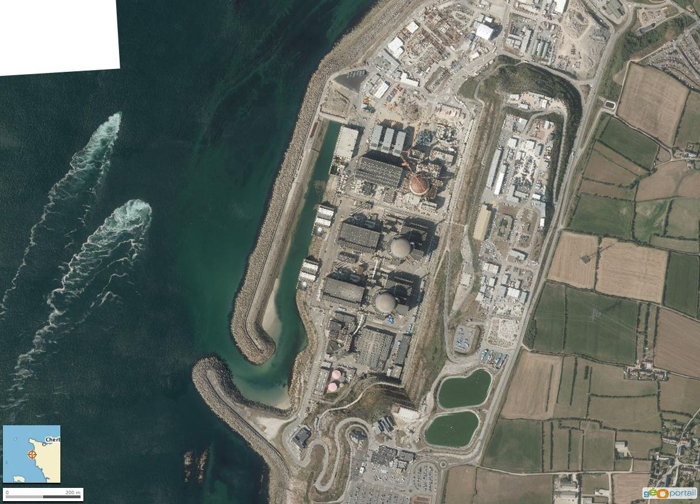{height="360" fig-alt="Orthophotographie d'un site industriel en bord de mer, avec deux dômes et un chantier"}
:::
::: {.column width="58%"}
Rangez chaque énoncé : est-il **sur** l'image, ou **tiré** de l'image ?

::: {.classer}
### Je vois

- Deux dômes gris
- Des remous blancs au large
- Des grues autour d'un dôme

### J'en déduis

- Une centrale nucléaire
- L'eau de mer refroidit
- Un réacteur en chantier
:::

[Voir, c'est décrire. Déduire, c'est déjà interpréter : cela demande des preuves.]{.a-retenir}
:::
::::

## Induction, déduction, abduction {.socle competences="C3"}

::: {.fiche n="1.3" etat="a-revoir"}
Intention : Le processus cognitif de l'enquête (demande de Marc) : l'induction (des cas → une règle), la déduction (une règle + un cas → une conséquence), l'abduction (un indice surprenant → la meilleure explication). La « déduction » de Sherlock Holmes est surtout une abduction. Les indices se croisent en faisceau. [nouvelle]
Expérience : schéma ; QCM : quel raisonnement fait l'interprète qui voit des remous au large ?
Demande :
:::

::: {.schema fichier="images/schemas/raisonnements.svg" hauteur="300"}
:::

::: {.qcm .serre}
L'interprète voit des remous au large d'une centrale et conclut : « sans doute le rejet de l'eau de refroidissement ». Quel raisonnement ?

- [ ] Une induction
    - Non : il ne tire pas une règle de nombreux cas.
- [ ] Une déduction
    - Pas tout à fait : une déduction est certaine si la règle l'est. Ici, rien ne prouve que les remous viennent du rejet.
- [x] Une abduction
    - Oui : la meilleure explication d'un indice surprenant. Elle reste une hypothèse, que d'autres indices confirment ou non.
:::

## Un métier né de la guerre {.appui competences="C1"}

::: {.fiche n="1.4" etat="a-revoir"}
Intention : Les débuts : la photographie aérienne militaire de la Première Guerre mondiale (image de Marc à venir) ; la Central Interpretation Unit de Medmenham, où Constance Babington Smith repère le V-1 sur une photo de Peenemünde (1943) ; la crise de Cuba (le U-2 de Richard Heyser, 14 octobre 1962 ; les sites identifiés par le NPIC le 15). Bonus : la visite du musée de la photographie aérienne. [nouvelle]
Expérience : remettre en ordre cinq étapes ; bonus : visite virtuelle (défiler)
Demande :
:::

À Medmenham, en 1943, Constance Babington Smith repère sur une photo de Peenemünde un objet en croix de moins d'un millimètre : le V-1. Elle travaille au **stéréoscope** et à la **loupe**.

::: {.ordre}
Remettez ces étapes dans l'ordre chronologique.

1. Cerfs-volants et pigeons photographes
2. Les tranchées de 14-18, vues d'avion
3. Peenemünde : le V-1 repéré à la loupe
4. Cuba : les rampes de missiles vues du U-2
5. Les interprètes étiquettent des données pour l'IA
:::

[Image de la Première Guerre mondiale à venir (fichier de Marc).]{.legende}

::: {.plus titre="Visite du musée de la photographie aérienne"}
::: {.defiler commande="haut"}
- 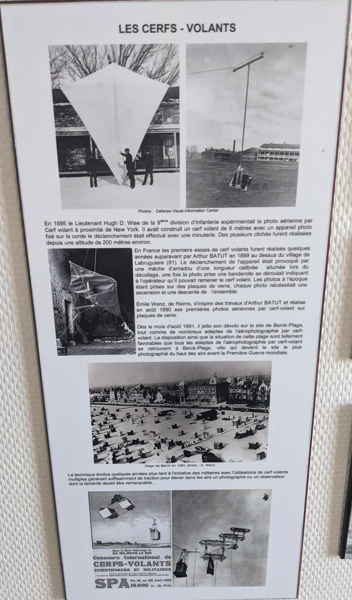
- 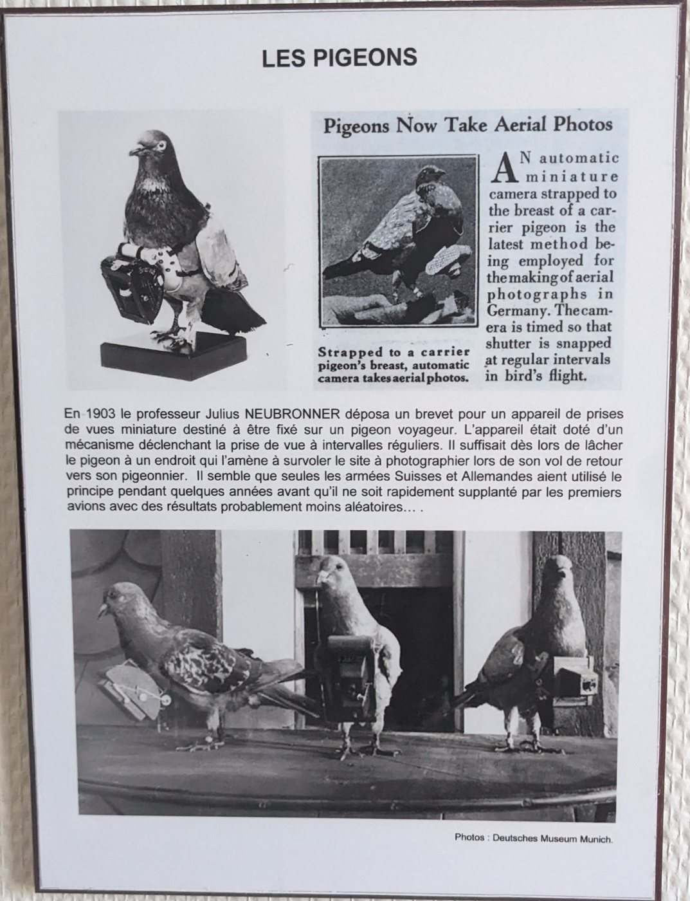
- 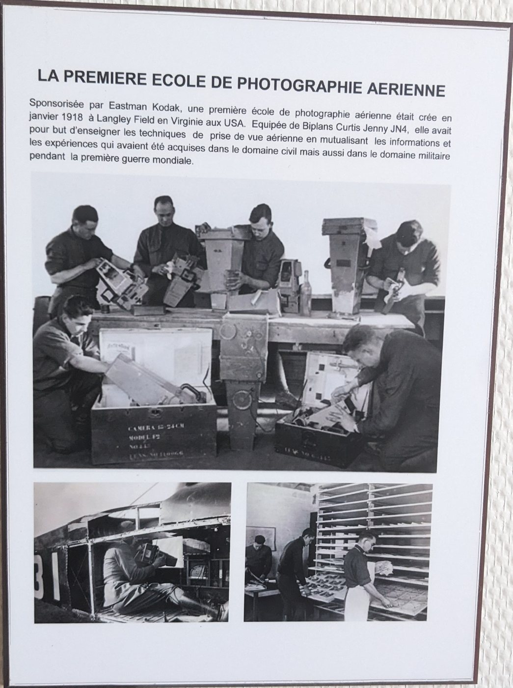
- 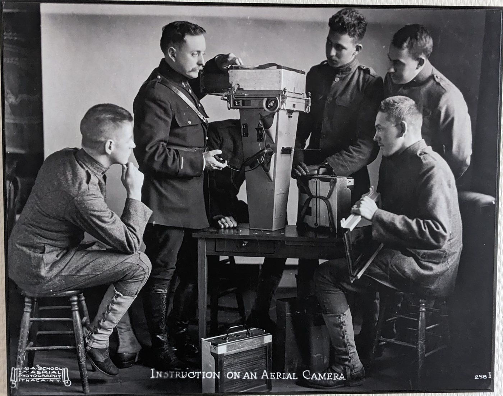
- 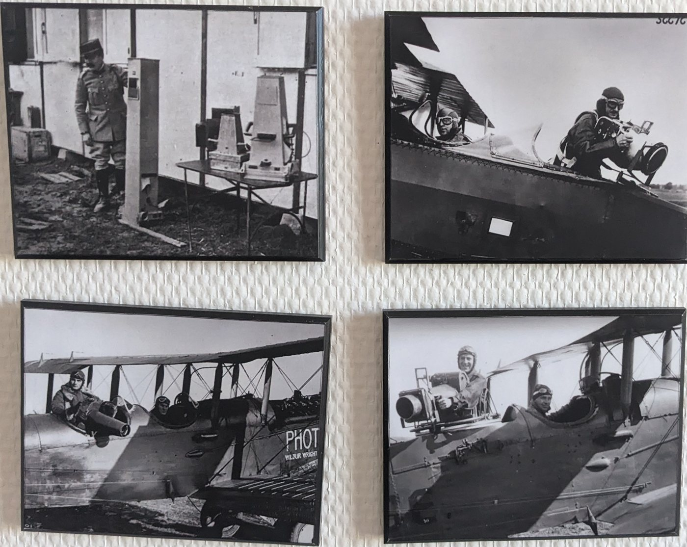
- 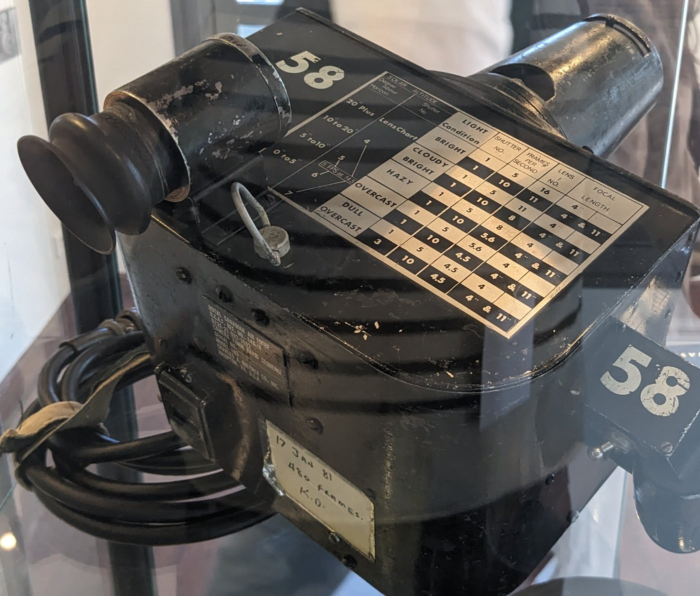
- 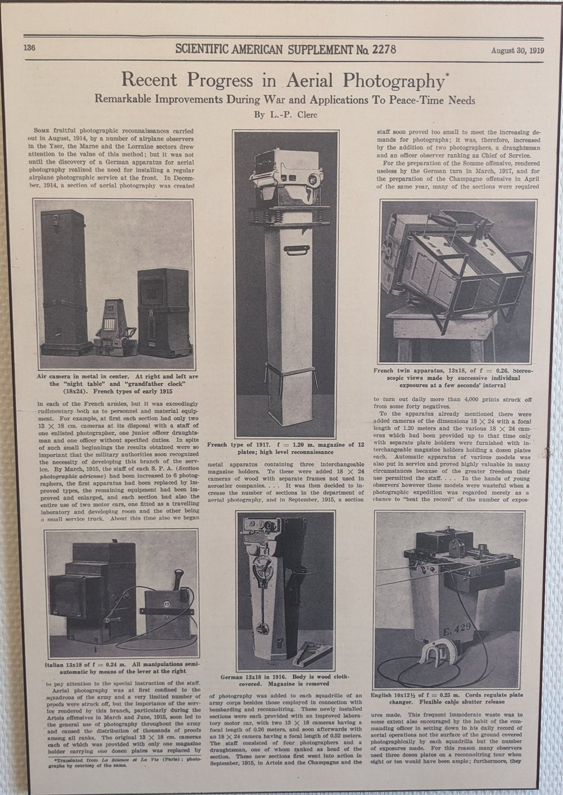
- 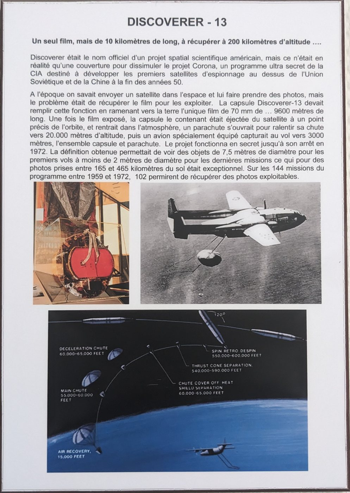
:::

[Musée de la photographie aérienne, L'Europe vue du Ciel. Photos : Marc Poupée.]{.legende}
:::

## À vous : qu'est-ce que c'est ? {.appui competences="C1 C2 C3"}

::: {.fiche n="1.5" etat="a-revoir"}
Intention : Rejouer la scène sur une vraie image : la photo Pléiades du 2 mars 2016 d'un site en Chine, révélée indice par indice. On ne nomme l'objet qu'à la fin. [nouvelle]
Expérience : énigme à indices progressifs, avec la certitude à chaque indice (brique « indices »)
Demande :
:::

::: {.indices image="images/fast-2016.jpg" alt="Image satellite d'un disque argenté au fond d'une cuvette boisée" confiance="oui" style="--hauteur-indices: 400px"}
- 30,28,29,42 : Au fond d'une cuvette entourée de collines boisées, un disque parfait d'environ 500 m de diamètre (l'image fait 1,85 km de large).
- 40,44,10,12 : Au centre, une structure hexagonale ; le disque est fait de panneaux qui reflètent le soleil.
- 40,8,11,18 : Des remblais clairs et des pistes neuves taillées dans les versants.
- 50,71,10,16 : Des bâtiments aux toits bleus, alignés au bord d'une route : une base vie de chantier.
- L'image date du 2 mars 2016, dans le Guizhou, en Chine.

Le **radiotélescope FAST**, la plus grande antenne unique au monde, logée dans une dépression karstique naturelle. Son dernier panneau est posé en juillet 2016 : l'image le saisit en fin de chantier.
:::

## Dire son degré de certitude {.socle competences="C3"}

::: {.fiche n="1.6" etat="a-revoir"}
Intention : Une interprétation sans degré de confiance est une opinion. Les « mots de probabilité estimative » de Sherman Kent (CIA, 1964). Copernicus EMS dit aussi « possiblement endommagé ». [nouvelle]
Expérience : QCM avec barre de certitude (brique « confiance »)
Demande :
:::

:::: {.columns}
::: {.column width="45%"}
En 1964, Sherman Kent, analyste de la CIA, propose d'accorder les mots et les chances :

| Mot | Chances |
|---|---|
| Presque certain | 9 sur 10 environ |
| Probable | 3 sur 4 environ |
| Possible | 1 sur 2 environ |
| Peu probable | 1 sur 3 environ |

[Un mot de certitude engage : il dit au lecteur quel risque il prend en vous croyant.]{.a-retenir}
:::
::: {.column width="55%"}
::: {.confiance}
::: {.qcm .serre}
Sur l'image du FAST, vous voyez une base vie aux toits bleus. Quelle phrase écrire ?

- [ ] « Il y a des ouvriers sur le site. »
    - Trop fort : on ne voit personne. Au mieux, c'est probable.
- [x] « Un chantier est probablement en cours. »
    - Oui : plusieurs indices convergent (base vie, remblais, pistes neuves), et le mot dit la part d'incertitude.
- [ ] « On ne peut rien dire. »
    - Trop prudent : les indices existent, il faut les peser.
:::
:::
:::
::::

## Quand l'image trompe {.veille competences="C3"}

::: {.fiche n="1.7" etat="a-revoir"}
Intention : Le contre-exemple : le 5 février 2003, au Conseil de sécurité de l'ONU, des images satellite appuient l'existence d'armes chimiques en Irak ; elles ne seront jamais trouvées. Le biais de confirmation : on voit ce que l'on cherche. Sources à ajouter. [nouvelle]
Expérience : question : quelle étape de la méthode a manqué ?
Demande :
:::

Le 5 février 2003, au Conseil de sécurité de l'ONU, des images satellite sont présentées comme la preuve d'armes chimiques en Irak. Ces armes ne seront jamais trouvées.

::: {.question}
**Quelle étape de la méthode a manqué ?**
:::

::: {.reponse}
Chercher l'indice qui **contredit**, et dire la **certitude** réelle. Un camion près d'un bunker peut avoir bien des explications ; on choisit celle que l'on attendait. C'est le **biais de confirmation**.
:::

## De l'image à la donnée {.intercalaire}

::: {.fiche n="2.0" etat="a-revoir"}
Intention : L'interprétation ne sert pas qu'au renseignement : elle fabrique la plupart des données géographiques. [nouvelle]
Expérience : aucune
Demande :
:::

L'interprétation ne sert pas qu'au renseignement : elle fabrique la plupart des cartes.

## Interpréter pour bâtir une base {.socle competences="C5"}

::: {.fiche n="2.1" etat="a-revoir"}
Intention : Des bases nationales nées de l'interprétation d'images : la BD TOPO (restitution photogrammétrique), la BD Forêt V2 (orthophotos infrarouge couleur, 0,5 ha, 32 postes, 2007-2018, segmentation automatique puis contrôle par photo-interprètes), CORINE Land Cover en Europe (25 ha). [nouvelle]
Expérience : question : pourquoi trois bases ne disent-elles pas la même chose du même lieu ?
Demande :
:::

:::: {.columns}
::: {.column width="55%"}
- La **BD TOPO** : bâtiments, routes, rivières, restitués à partir de photos aériennes en relief.
- La **BD Forêt V2** (IGN, 2007-2018) : les forêts interprétées sur des photos infrarouge couleur, 32 types, aucune tache de moins de **0,5 ha**.
- **CORINE Land Cover** : l'occupation du sol de l'Europe, aucune tache de moins de **25 ha**.
:::
::: {.column width="45%"}
::: {.question}
**Pourquoi trois bases ne disent-elles pas la même chose d'un même lieu ?**
:::

::: {.reponse}
Elles n'ont ni la même question, ni la même nomenclature, ni la même **unité minimale**. Une base est une interprétation, faite selon des règles.
:::
:::
::::

## L'unité minimale de collecte {.socle competences="C5"}

::: {.fiche n="2.2" etat="a-revoir"}
Intention : Toute base fixe une surface en dessous de laquelle on ne saisit pas. Sur une zone de 160 ha : 145 taches à l'origine, 39 à 0,5 ha, 14 à 2,25 ha, 2 à 25 ha ; à 25 ha, 61 % de la zone change de classe (calculé). Comme la discrétisation dans « Cartography : Basics », le choix change la carte. [nouvelle]
Expérience : comparer trois unités minimales sur la même zone
Demande :
:::

:::: {.columns}
::: {.column width="62%"}
::: {.comparer}
- 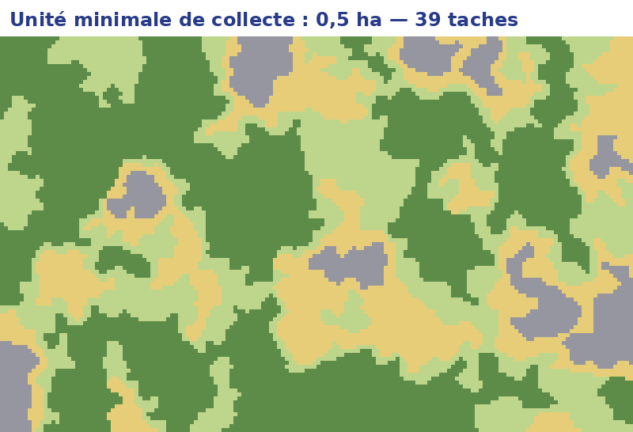
- 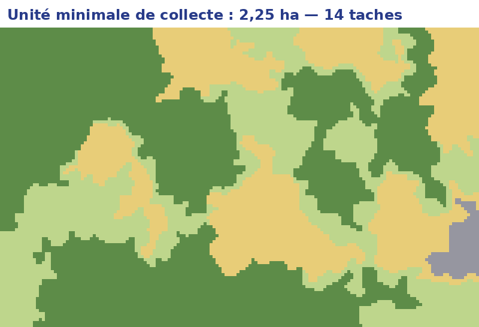
- 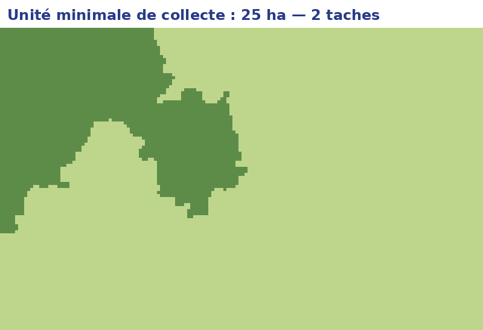
:::
:::
::: {.column width="38%"}
La même zone de 160 ha, avec trois unités minimales : les taches trop petites sont fondues dans leur voisine.

::: {.question}
**À 25 ha, que reste-t-il ?**
:::

::: {.reponse}
Deux taches. 61 % de la zone a changé de classe : les bosquets, les hameaux, les petites cultures ont disparu.
:::
:::
::::

## Une nomenclature, des règles {.appui competences="C5"}

::: {.fiche n="2.3" etat="a-revoir"}
Intention : Une nomenclature emboîtée et des règles de saisie (que faire d'une coupe récente ? d'un chantier ?). Sans règles écrites, deux interprètes produisent deux cartes. Exemples généralistes. [nouvelle]
Expérience : classer huit objets de l'image du cours dans une nomenclature simple, dont des cas ambigus
Demande :
:::

Rangez ces objets de l'image du cours. Certains demandent une **règle** : laquelle écririez-vous ?

::: {.classer}
### Bâti

- Un dôme de réacteur
- Une salle des machines

### Chantier

- Le troisième dôme, entouré de grues
- Des remblais nus

### Eau

- Le bassin de prise d'eau
- Les deux bassins verts

### Agricole

- Les champs entourés de haies
- Une prairie fauchée
:::

[Un chantier devient-il du bâti ? Un bassin artificiel, de l'eau ? Sans règle écrite, chacun tranche à sa façon.]{.a-retenir}

## Deux interprètes, deux cartes {.appui competences="C5"}

::: {.fiche n="2.4" etat="a-revoir"}
Intention : L'accord entre interprètes mesure la qualité d'une saisie : on fait interpréter la même zone deux fois et l'on compare. [nouvelle]
Expérience : question
Demande :
:::

Deux interprètes saisissent la même zone. Ils s'accordent sur 9 points sur 10.

::: {.question}
**Où sont, le plus souvent, les désaccords ?**
:::

::: {.reponse}
Aux **limites** (où finit la forêt ?), sur les **petits objets** (près de l'unité minimale) et sur les **cas que les règles n'ont pas prévus**. Mesurer l'accord, c'est mesurer la clarté des règles autant que l'habileté des interprètes.
:::

## Des données pour apprendre aux machines {.appui competences="C6"}

::: {.fiche n="2.5" etat="a-revoir"}
Intention : L'IA apprend sur des images étiquetées par des humains. FLAIR (Garioud, Gonthier, Landrieu, De Wit, Valette, Poupée, Giordano, Wattrelos, NeurIPS 2023) : plus de 20 milliards de pixels étiquetés, 817 km² d'images aériennes à 20 cm, avec des séries temporelles satellitaires. L'interprète devient annotateur. [nouvelle]
Expérience : question ; bonus : l'article
Demande :
:::

:::: {.columns}
::: {.column width="55%"}
Un réseau de neurones apprend à reconnaître l'occupation du sol sur des **exemples étiquetés** à la main.

Le jeu de données **FLAIR** (IGN, 2023) : plus de **20 milliards de pixels** étiquetés, sur 817 km² d'images aériennes à 20 cm, avec des séries d'images satellite.
:::
::: {.column width="45%"}
::: {.question}
**Qui fabrique ces étiquettes, et pourquoi est-ce difficile ?**
:::

::: {.reponse}
Des interprètes. Chaque pixel demande une décision, selon une nomenclature et des règles. Leurs erreurs et leurs hésitations, la machine les apprendra aussi.
:::
:::
::::

::: {.plus titre="L'article FLAIR"}
A. Garioud, N. Gonthier, L. Landrieu, A. De Wit, M. Valette, M. Poupée, S. Giordano, B. Wattrelos, « FLAIR : a Country-Scale Land Cover Semantic Segmentation Dataset From Multi-Source Optical Imagery », *NeurIPS 2023, Datasets and Benchmarks*. [L'article](https://arxiv.org/abs/2310.13336) · [les données](https://ignf.github.io/FLAIR/)
:::

## L'interprète contrôle la machine {.appui competences="C6"}

::: {.fiche n="2.6" etat="a-revoir"}
Intention : La validation d'un résultat automatique repose sur un échantillon interprété à la main : on compte bonnes et mauvaises classifications (la matrice de confusion, en mots simples). [nouvelle]
Expérience : QCM avec barre de certitude
Demande :
:::

Une IA cartographie les bâtiments. Sur 100 points tirés au hasard, un interprète vérifie : **90 sont justes**.

::: {.confiance}
::: {.qcm .serre}
Que peut-on en conclure ?

- [ ] La carte est juste à 90 %, partout
    - Non : l'erreur peut se concentrer quelque part (les toits sombres, les zones denses).
- [x] Sur ce territoire, environ 9 points sur 10 sont justes ; il faut regarder où sont les erreurs
    - Oui : le chiffre global ne suffit pas, il faut la répartition des erreurs, classe par classe.
- [ ] L'interprète n'est plus nécessaire
    - Non : c'est lui qui a produit la vérification.
:::
:::

## Suivre les changements {.appui competences="C4"}

::: {.fiche n="2.7" etat="a-revoir"}
Intention : Le suivi des changements, ici par radar (Baltimore) : une composition colorée de plusieurs dates. Le radar voit de nuit et à travers les nuages, mais ne se lit pas comme une photo. Source et dates de l'image à préciser par Marc. [nouvelle]
Expérience : question
Demande :
:::

:::: {.columns}
::: {.column width="52%"}
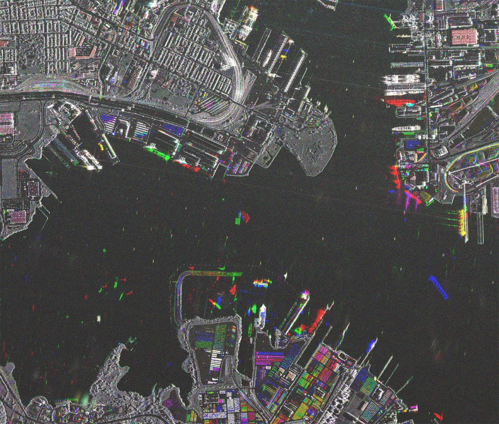{height="430" fig-alt="Image radar du port de Baltimore, en gris avec des taches de couleur"}

[Port de Baltimore, image radar, plusieurs dates. Source à préciser.]{.legende}
:::
::: {.column width="48%"}
Cette image superpose plusieurs dates radar, chacune dans une couleur.

::: {.question}
**Que signifient le gris et les couleurs ?**
:::

::: {.reponse}
Le **gris**, ce qui n'a pas changé entre les dates. Les **couleurs**, ce qui a bougé : navires, conteneurs, véhicules. Le radar voit de nuit et à travers les nuages, mais il faut apprendre à le lire.
:::
:::
::::

## L'archéologie sous la forêt {.appui competences="C4"}

::: {.fiche n="2.8" etat="a-revoir"}
Intention : Le LiDAR aéroporté révèle sous la forêt les villes khmères autour d'Angkor (campagnes de 2012 et 2015 ; Evans et al., PNAS, 2013). Le lien avec l'IGN est à préciser par Marc ; image à fournir. [nouvelle]
Expérience : question
Demande :
:::

En 2012, un **LiDAR** aéroporté survole Angkor. Ses impulsions laser passent entre les feuilles et touchent le sol : sous la forêt apparaissent des rues, des bassins, des quartiers entiers.

[Image du LiDAR d'Angkor à venir.]{.legende}

::: {.question}
**Pourquoi une photo aérienne ne suffisait-elle pas ?**
:::

::: {.reponse}
Elle ne montre que le toit de la forêt. Le LiDAR mesure aussi ce qui est dessous : le relief du sol, et les traces des aménagements anciens.
:::

## Bien d'autres usages {.appui competences="C4"}

::: {.fiche n="2.9" etat="a-revoir"}
Intention : La galerie des usages, pour un public large : crise, suivi des changements, contrôle, vérification d'images, archéologie, écologie, géopolitique. [nouvelle]
Expérience : classer huit questions selon l'usage
Demande :
:::

Rangez chaque question selon l'usage de l'interprétation.

::: {.classer}
### Crise

- Quels bâtiments l'inondation a-t-elle détruits ?
- Jusqu'où le feu est-il allé ?

### Suivi et contrôle

- Combien de champs ont été artificialisés en dix ans ?
- Cette coupe d'arbres était-elle autorisée ?

### Vérification

- Cette photo a-t-elle vraiment été prise ici, ce jour-là ?
- Cette image a-t-elle été générée par IA ?

### Géopolitique

- Un camp de réfugiés s'étend-il ?
- Une base militaire s'agrandit-elle ?
:::

## Les clés d'identification {.intercalaire}

::: {.fiche n="3.0" etat="a-revoir"}
Intention : Ce qu'est l'objet. L'image du cours : la centrale de Flamanville (Manche), pendant la construction de l'EPR, une image qui réunit toutes les clés. [nouvelle]
Expérience : aucune
Demande :
:::

Ce qu'est l'objet.

## L'image du cours

::: {.fiche n="3.1" etat="a-revoir"}
Intention : L'image entière, explorée librement avant toute clé ; description sans interprétation, reprise dans la note finale. Exemple, sans niveau. [nouvelle]
Expérience : loupe ; zone d'écriture (brique « observer »)
Demande :
:::

:::: {.columns}
::: {.column width="50%"}
::: {.loupe zoom="3"}
{height="440" fig-alt="Orthophotographie de la centrale de Flamanville, au bord de la Manche"}
:::
:::
::: {.column width="50%"}
Explorez l'image à la loupe. Puis **décrivez ce que vous voyez, sans interpréter** : formes, couleurs, tailles, positions. Vous retrouverez ce texte à la fin.

::: {.observer cle="description-image" invite="Je vois…"}
Une côte rocheuse ; une digue de gros blocs qui ferme un bassin d'eau turquoise ; deux dômes gris d'une cinquantaine de mètres et un troisième, cuivré, entouré de grues ; de longs bâtiments rectangulaires ; des remous blancs en mer ; deux bassins verts ; des champs bordés de haies.
:::
:::
::::

## Ton et couleur {.socle competences="C2 C4"}

::: {.fiche n="3.2" etat="a-revoir"}
Intention : La première clé, la plus simple : le ton (clair, sombre) et la couleur. L'eau turquoise du bassin, les remous blancs, le dôme cuivré du chantier. En infrarouge couleur, la végétation vivante devient rouge. [nouvelle]
Expérience : QCM : que trahit le blanc des remous ?
Demande :
:::

:::: {.columns}
::: {.column width="45%"}
{height="380" fig-alt="La centrale de Flamanville"}
:::
::: {.column width="55%"}
Le **ton** (clair ou sombre) et la **couleur** sont les premières clés que l'œil lit. En **infrarouge couleur**, la végétation vivante devient rouge : on y voit les plantes malades.

::: {.qcm .serre}
En mer, à gauche, deux grandes taches blanches. Que dit leur blancheur ?

- [x] De l'eau agitée, chargée de bulles : de la turbulence
    - Oui : l'écume renvoie la lumière. Reste à savoir ce qui agite l'eau.
- [ ] Du sable sous l'eau
    - Non : le sable donnerait une teinte claire et unie, sans ces filaments.
- [ ] Des nuages
    - Non : ils auraient leur ombre portée sur l'eau.
:::
:::
::::

## Taille et forme {.socle competences="C2"}

::: {.fiche n="3.3" etat="a-revoir"}
Intention : La taille se lit avec l'échelle (200 m ≈ 130 pixels sur l'image : environ 1,5 m par pixel, mesuré) ; la forme distingue le naturel de l'humain. Un dôme mesure environ 50 m (mesuré). [nouvelle]
Expérience : question de mesure
Demande :
:::

:::: {.columns}
::: {.column width="45%"}
::: {.loupe zoom="3"}
{height="400" fig-alt="La centrale de Flamanville, avec son échelle"}
:::
:::
::: {.column width="55%"}
La **taille** se lit avec l'échelle ; la **forme** sépare le naturel (contours irréguliers) de l'humain (géométrie). Une coupole parfaite de cette taille n'a pas beaucoup d'explications.

::: {.question}
L'échelle en bas à gauche fait 200 m. **Quel diamètre ont les dômes ?**
:::

::: {.reponse}
Environ **50 m** : un quart de l'échelle. Une coupole de cette taille, en béton, au bord de la mer : un bâtiment réacteur.
:::
:::
::::

## Texture et structure {.socle competences="C2"}

::: {.fiche n="3.4" etat="a-revoir"}
Intention : La texture (le grain) et la structure (l'arrangement répété). La digue de gros blocs, rugueuse ; le bocage en mailles ; les parkings en lignes. [nouvelle]
Expérience : classer six détails selon la clé qui les révèle
Demande :
:::

La **texture**, c'est le grain d'une surface ; la **structure**, l'arrangement d'éléments qui se répètent.

::: {.classer}
### La texture

- La digue, rugueuse comme du gravier
- La mer, lisse au large et filamenteuse près des remous
- Le chantier, granuleux

### La structure

- Les champs en mailles, bordés de haies
- Les voitures en rangées sur les parkings
- Les bâtiments alignés, à angle droit
:::

## Ombre et relief {.socle competences="C2 C4"}

::: {.fiche n="3.5" etat="a-revoir"}
Intention : L'ombre et la lumière donnent le relief. Mini-jeu (demande de Marc) : sur l'image du FAST, un marcheur va de A à B en passant par le centre du radiotélescope ; l'étudiant le fait monter ou descendre avec les flèches du clavier, puis compare à la coupe réelle. Le profil de référence est indicatif, à valider (ou à tirer d'un MNT). [nouvelle]
Expérience : mini-jeu de coupe topographique (brique « coupe »)
Demande :
:::

Tracez la coupe de **A** à **B** : à chaque pas, faites monter ou descendre le marcheur d'après l'image. Les ombres et les éclats de lumière disent où sont les pentes.

::: {.coupe image="images/fast-2016.jpg" alt="Le radiotélescope FAST dans sa cuvette" depart="2,49" arrivee="98,49" pas="24" profil="donnees/fast-profil.json" style="--hauteur-coupe: 320px"}
::: {.apres-jeu}
La parabole est **creuse** : son centre est le point le plus bas. Elle est posée dans une **dépression karstique** naturelle, entre des collines plus hautes que son bord. [Profil indicatif, lu sur l'image.]{.legende}
:::
:::

## La date compte {.appui competences="C2 C4"}

::: {.fiche n="3.6" etat="a-revoir"}
Intention : La date d'une image fixe ce que l'on peut y voir : un chantier en cours (l'EPR à Flamanville, le FAST en mars 2016), la saison, la marée, l'heure (la longueur et le sens des ombres). [nouvelle]
Expérience : QCM avec barre de certitude
Demande :
:::

La date dit l'**état** d'un lieu : un chantier, une saison, une marée, une heure.

::: {.confiance}
::: {.qcm .serre}
Sur l'image de Flamanville, les ombres des bâtiments tombent vers la droite (l'est). Qu'en tirez-vous ?

- [ ] La photo a été prise le matin
    - Non : le matin, le soleil est à l'est et les ombres tombent vers l'ouest.
- [x] La photo a été prise l'après-midi
    - Oui : le soleil est à l'ouest ou au sud-ouest, les ombres partent vers l'est.
- [ ] On ne peut rien dire de l'heure
    - Si : le sens des ombres donne la position du soleil.
:::
:::

## Quelle clé pour quelle question ? {.socle competences="C2"}

::: {.fiche n="3.7" etat="a-revoir"}
Intention : Le récapitulatif des clés d'identification, mélangées (pratique entrelacée). [nouvelle]
Expérience : QCM avec barre de certitude
Demande :
:::

::: {.confiance}
::: {.qcm .serre}
Pour savoir si une haute cheminée est plus haute qu'un immeuble voisin, sur une seule photo verticale, quelle clé ?

- [ ] Le ton
    - Non : il dit la matière ou l'éclairage, pas la hauteur.
- [ ] La forme
    - Non : vue d'en haut, une cheminée n'est qu'un disque.
- [x] L'ombre
    - Oui : à la même heure, l'ombre la plus longue appartient à l'objet le plus haut.
- [ ] La structure
    - Non : elle concerne des éléments répétés.
:::
:::

[Ton et couleur, taille, forme, texture, structure, ombre, date : sept clés pour dire **ce qu'est** un objet.]{.a-retenir}

## Les clés d'interprétation {.intercalaire}

::: {.fiche n="4.0" etat="a-revoir"}
Intention : Ce qui se passe. Des objets reconnus aux mécanismes qui les relient. [nouvelle]
Expérience : aucune
Demande :
:::

Ce qui se passe.

## Le site {.socle competences="C3"}

::: {.fiche n="4.1" etat="a-revoir"}
Intention : La position d'un objet dans son milieu restreint ce qu'il peut être et explique ce qui lui arrive. Pourquoi une centrale au pied d'une falaise, au bord de la mer ? [nouvelle]
Expérience : question
Demande :
:::

Le **site**, c'est la place d'un objet dans son milieu : bord de mer, fond de vallée, crête, bord de route.

::: {.question}
**Pourquoi construire une centrale ici, au pied d'une falaise, au bord de la Manche ?**
:::

::: {.reponse}
Pour l'**eau de mer**, abondante et froide, qui refroidit l'installation ; pour un sol **rocheux** ; pour l'éloignement des villes. Le site explique déjà une partie du mécanisme.
:::

## L'association {.socle competences="C3"}

::: {.fiche n="4.2" etat="a-revoir"}
Intention : Des objets qui vont ensemble : réacteurs, salles des machines, prise d'eau, rejet en mer, lignes à haute tension, chantier. Un objet seul est ambigu, une association ne l'est presque plus. Coordonnées des zones à vérifier. [nouvelle]
Expérience : zones à cliquer : retrouver les éléments du circuit de l'eau et de l'électricité
Demande :
:::

:::: {.columns}
::: {.column width="50%"}
Une **association**, ce sont des objets qui vont ensemble. Retrouvez sur l'image ce qui fait fonctionner une centrale : l'eau qui entre, la chaleur, l'eau qui sort, l'électricité qui part.

::: {.question}
**Quel objet, seul, serait ambigu ?**
:::

::: {.reponse}
Un dôme : un planétarium, un silo, un radôme… Avec la prise d'eau, le rejet et les lignes à haute tension, il n'y a presque plus de doute.
:::
:::
::: {.column width="50%"}
::: {.zones image="images/flamanville.jpg" alt="La centrale de Flamanville" hauteur="440"}
- [x] 53,46,7,17 : Les deux bâtiments réacteurs, sous leurs dômes.
- [x] 47,43,6,18 : Les salles des machines : les turbines et les condenseurs.
- [x] 42,23,7,46 : Le bassin de prise d'eau, fermé par la digue.
- [x] 1,22,22,52 : Les remous du rejet de l'eau de refroidissement, au large.
- [x] 56,31,8,10 : Le troisième réacteur, l'EPR, en chantier.
- [ ] 84,26,14,22 : Le bocage : il était là avant la centrale.
:::
:::
::::

## Le temps {.socle competences="C3 C4"}

::: {.fiche n="4.3" etat="a-revoir"}
Intention : Le temps : une image fixe un instant d'un processus. Les indices d'un chantier (grues, remblais, dôme ouvert) disent un avant et un après ; la comparaison de deux dates (diachronie) révèle une dynamique. [nouvelle]
Expérience : QCM avec barre de certitude
Demande :
:::

Une image fige un **instant**. Pour comprendre un mécanisme, on cherche ce qui dit l'avant et l'après : un chantier, une crue, une coupe, une repousse. Deux dates d'un même lieu révèlent une **dynamique**.

::: {.confiance}
::: {.qcm .serre}
Sur l'image, quel indice montre le mieux qu'un réacteur est **en construction** ?

- [ ] Ses dimensions
    - Non : un réacteur achevé a la même taille.
- [x] Les grues, les remblais nus et le dôme encore cuivré, sans le gris du béton
    - Oui : plusieurs indices d'un état provisoire convergent.
- [ ] Sa place près de la mer
    - Non : c'est vrai de tous les réacteurs du site.
:::
:::

## Reconstituer un mécanisme {.socle competences="C3"}

::: {.fiche n="4.4" etat="a-revoir"}
Intention : La convergence des indices raconte un mécanisme complet : le circuit de l'eau de refroidissement, de la prise d'eau au rejet, et l'électricité qui part. Chaque étape est reliée à un indice de l'image. Fonctionnement du rejet de Flamanville à valider par Marc. [nouvelle]
Expérience : remettre en ordre les étapes
Demande :
:::

::: {.ordre}
Remettez le mécanisme de la centrale dans l'ordre. Chaque étape a son indice sur l'image du cours.

1. L'eau de mer entre dans le bassin fermé par la digue
2. Des pompes l'envoient vers les salles des machines
3. Elle refroidit la vapeur qui a fait tourner les turbines
4. Réchauffée, elle repart en mer par des galeries
5. Elle remonte au large : les remous blancs
6. L'électricité part par les lignes à haute tension
:::

## Raisonner pas à pas {.socle competences="C1 C3"}

::: {.fiche n="4.5" etat="a-revoir"}
Intention : Un arbre de déduction sur la rade de Brest : que se passe-t-il dans les tirets rouges ? Chaque choix est un indice ; le chemin parcouru reste affiché, comme un faisceau. Première version : l'arbre sera reconstruit avec les réponses des étudiants de Marc, et ses conclusions validées par lui. [nouvelle]
Expérience : arbre de déduction (brique « arbre »)
Demande :
:::

Que se passe-t-il dans les **tirets rouges** ? Répondez pas à pas : chaque réponse est un indice.

::: {.arbre image="images/rade-de-brest.jpg" alt="Orthophotographie de la rade de Brest, une zone en tirets rouges sur l'eau" style="--hauteur-arbre: 390px"}
### depart | Quelle taille font les petits points blancs ? (l'échelle : 200 m)
- Quelques mètres → petits
- Plusieurs dizaines de mètres → grands

### grands ! Mesurez de nouveau
Avec l'échelle, 200 m valent environ 126 pixels : un point de 3 ou 4 pixels mesure quelques mètres. Revenez d'un pas.

### petits | Comment sont-ils répartis ?
- Dispersés, assez régulièrement espacés → espaces
- Alignés en rangées droites → rangees
- Serrés en groupe, tous dans le même sens → groupe

### espaces | Sont-ils tous orientés de la même façon ?
- Oui, tous dans le même sens → mouillage
- Non, au hasard → flottants

### mouillage ! Hypothèse : une zone de mouillage
Des bateaux sur leurs corps-morts, tous tournés par le même courant ou le même vent, près de la côte. À confirmer : une cale, un club, un port à proximité ? Conclusion à valider.

### rangees ! Hypothèse : des cultures marines
Des bouées alignées en filières. À confirmer : des parcs à terre, des chemins d'accès ? Conclusion à valider.

### groupe ! Hypothèse : une régate
Des voiliers en mouvement, en flotte. À confirmer : des sillages, une bouée de parcours ? Conclusion à valider.

### flottants ! Hypothèse : des objets flottants
Des bouées, des débris ou des oiseaux. À confirmer avec une seconde date. Conclusion à valider.
:::

## Les pièges {.appui competences="C3"}

::: {.fiche n="4.6" etat="a-revoir"}
Intention : Les faux amis (une ombre prise pour de l'eau, une prairie pour un chantier) et le biais de confirmation. La parade : chercher l'indice qui contredit. [nouvelle]
Expérience : QCM avec barre de certitude ; la calibration en fin de cours montre si l'on est trop sûr de soi
Demande :
:::

::: {.confiance}
::: {.qcm .serre}
Une large tache sombre, au pied d'un grand bâtiment, sur une image prise en fin d'après-midi. Qu'est-ce que c'est ?

- [ ] Un bassin, sans aucun doute
    - Trop vite : une ombre portée est aussi sombre, et elle a la forme du bâtiment.
- [x] Probablement son ombre : il faut vérifier sa forme et son sens
    - Oui : à cette heure, les ombres sont longues ; si la tache prolonge le bâtiment dans le sens des autres ombres, c'est une ombre.
- [ ] Un parking
    - Rien ne l'indique : pas de voitures, pas de marquage.
:::
:::

[La parade au biais de confirmation : chercher l'indice qui **contredit** votre hypothèse.]{.a-retenir}

## Vraie ou générée ? {.intercalaire}

::: {.fiche n="5.0" etat="a-revoir"}
Intention : La détection des images générées par IA : les clés de l'interprète s'y appliquent. Troisième grand volet du cours (demande de Marc) ; placé après les clés, qui servent à détecter. [nouvelle]
Expérience : aucune
Demande :
:::

Les clés de l'interprète servent aussi à démasquer les images générées.

## Il y a quatre ans {competences="C6"}

::: {.fiche n="5.1" etat="a-revoir"}
Intention : En janvier 2022, une « vue aérienne » générée par Wombo Dream : les étudiants de Marc y voyaient un paysage asiatique, parce qu'il était impensable qu'une image soit fabriquée. On ne détecte pas ce que l'on n'imagine pas. Exemple, sans niveau. [nouvelle]
Expérience : question avant la réponse
Demande :
:::

:::: {.columns}
::: {.column width="38%"}
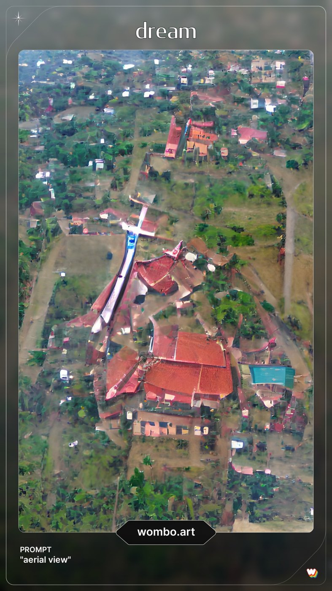{height="440" fig-alt="Une vue aérienne de village aux toits rouges"}
:::
::: {.column width="62%"}
::: {.question}
**Où a été prise cette vue aérienne ?**
:::

::: {.reponse}
Nulle part : elle a été générée en janvier 2022 par une application, à partir des seuls mots *aerial view*. À l'époque, les étudiants y voyaient un paysage asiatique : il était impensable qu'une image soit fabriquée.
:::

[On ne détecte pas ce que l'on n'imagine pas possible.]{.a-retenir}
:::
::::

## Les erreurs physiques {.socle competences="C6 C3"}

::: {.fiche n="5.2" etat="a-revoir"}
Intention : Les incohérences physiques et topographiques, que les clés d'interprétation révèlent : des rivières qui franchissent des crêtes, un éclairage contradictoire, des reliefs froissés comme du papier (DALL·E, 2024). [nouvelle]
Expérience : défiler ; question
Demande :
:::

:::: {.columns}
::: {.column width="50%"}
::: {.defiler commande="haut"}
- 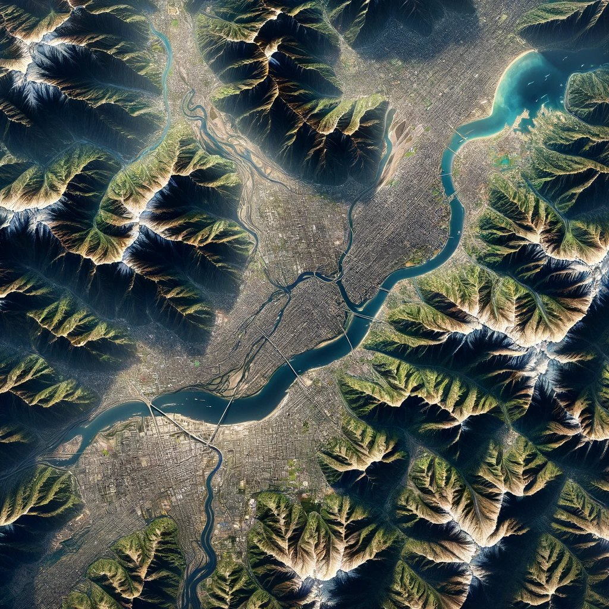
- 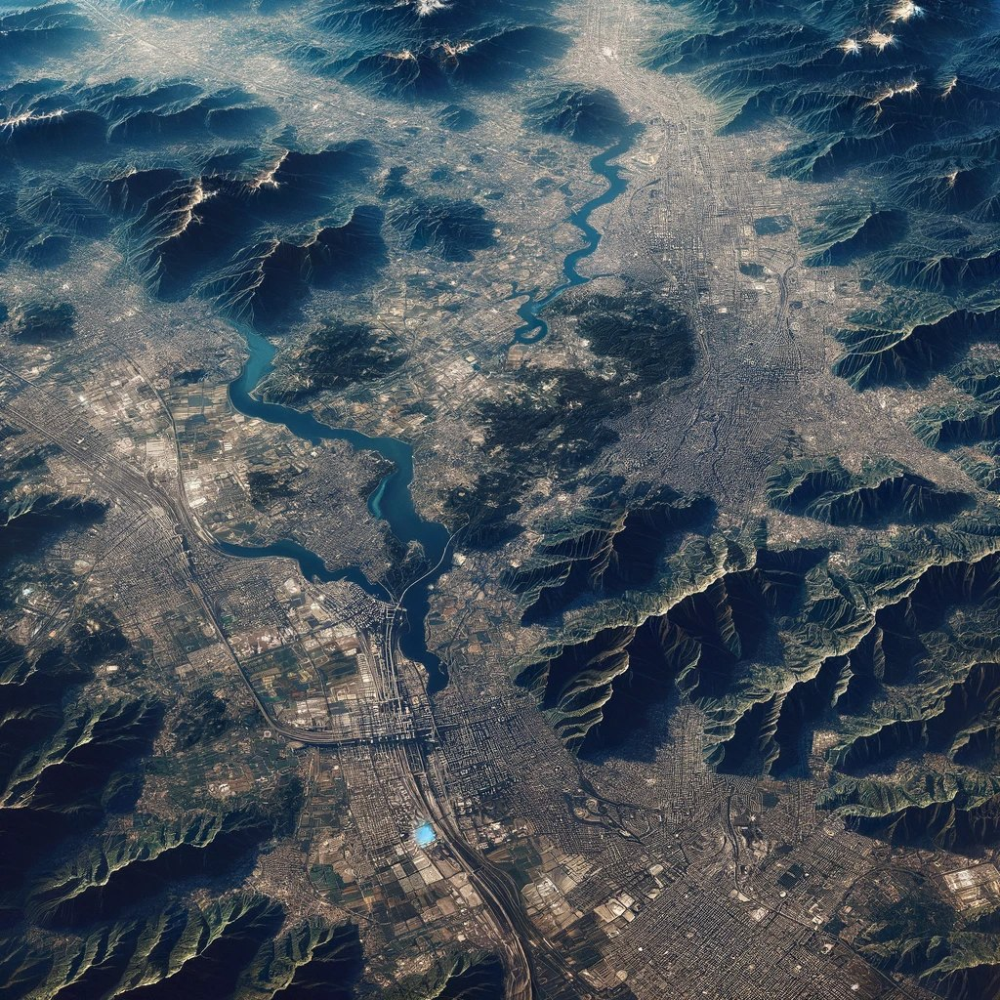
- 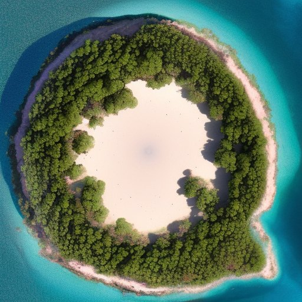
:::
:::
::: {.column width="50%"}
::: {.question}
Ces vues d'en haut ont été générées. **Qu'est-ce qui les trahit ?**
:::

::: {.reponse}
- Des **rivières** qui ne suivent pas les vallées, ou franchissent les crêtes.
- Un **éclairage** qui vient de plusieurs côtés à la fois.
- Des **reliefs** sans logique d'érosion, froissés comme du papier.
- Une **ville** sans réseau : les routes ne mènent nulle part.
:::
:::
::::

## L'invraisemblable {.appui competences="C6"}

::: {.fiche n="5.3" etat="a-revoir"}
Intention : Une image « historique » fabriquée : la place Tian'anmen vue d'un drone. Anachronisme (pas de drone grand public en 1989), chars aux formes incohérentes. Les clés du temps et de la forme. Date de génération à préciser. [nouvelle]
Expérience : question
Demande :
:::

:::: {.columns}
::: {.column width="45%"}
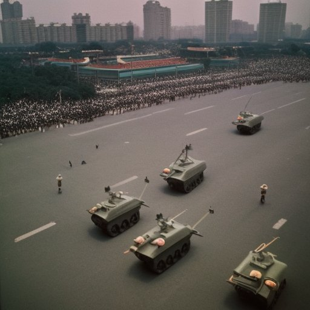{height="400" fig-alt="Des chars sur une grande place, vus d'en haut"}
:::
::: {.column width="55%"}
::: {.question}
Une image légendée « Tian'anmen, 1989, vue d'un drone ». **Combien d'indices la contredisent ?**
:::

::: {.reponse}
- La **date** : en 1989, aucun drone ne filme ainsi une manifestation.
- Les **formes** : des chars aux tourelles et aux chenilles incohérentes.
- Les **personnes** : des silhouettes sans ombre juste.

Trois incohérences qui convergent : l'image est fausse.
:::
:::
::::

## Le manque d'émotion {.appui competences="C6"}

::: {.fiche n="5.4" etat="a-revoir"}
Intention : Le manque d'émotion dans les visages et les scènes générées (PXL_20250930_173652676~2, image de Marc à venir). [nouvelle]
Expérience : question
Demande :
:::

[Image à venir : PXL_20250930_173652676~2.]{.legende}

::: {.question}
**Qu'est-ce qui manque à cette scène pour paraître vraie ?**
:::

::: {.reponse}
Réponse à écrire avec l'image : l'émotion des visages, l'interaction entre les personnes.
:::

## Ce qui trahit encore l'IA {.socle competences="C6 C2"}

::: {.fiche n="5.5" etat="a-revoir"}
Intention : Ce qui reste aujourd'hui : les textures difficiles (fourrures, rides), les arrière-plans flous incohérents, les structures simplifiées des hautes fréquences spatiales, propres aux réseaux convolutifs (PXL_20261006_182859009 et PXL_20261006_182903643, images de Marc à venir). [nouvelle]
Expérience : question ; images à venir
Demande :
:::

[Images à venir : PXL_20261006_182859009 et PXL_20261006_182903643.]{.legende}

En 2026, les images générées ont fait d'énormes progrès. Il reste des points faibles :

- les **textures** fines et désordonnées : fourrures, cheveux, rides ;
- les **arrière-plans flous**, dont le flou ne suit pas la distance ;
- les **détails fins** (les hautes fréquences), simplifiés en motifs trop réguliers : la signature des réseaux qui génèrent les images.

[Les clés d'identification, texture et structure en tête, restent les meilleures armes.]{.a-retenir}

## Le réel qui paraît faux {competences="C6"}

::: {.fiche n="5.6" etat="a-revoir"}
Intention : Le clin d'œil : une image insolite, réelle, qui paraît maintenant générée (IMG-20261029-WA0000, image de Marc à venir). Le doute s'étend aux vraies images. Exemple, sans niveau. [nouvelle]
Expérience : question
Demande :
:::

[Image à venir : IMG-20261029-WA0000.]{.legende}

::: {.question}
**Générée, ou réelle ?**
:::

::: {.reponse}
Réelle. Désormais, une image insolite paraît fausse : le doute s'étend aux vraies images. La seule réponse est la méthode : la source, la date, les indices qui convergent.
:::

## À vous : vraie ou générée ? {.appui competences="C6"}

::: {.fiche n="5.7" etat="a-revoir"}
Intention : Le test : des images réelles (Pléiades, orthophotos, radar) et générées (2022 à 2024), une par une, avec la certitude à chaque fois. À enrichir avec les images de 2025 et 2026 de Marc. [nouvelle]
Expérience : brique « vrai-ia », avec barre de certitude et score
Demande :
:::

Pour chaque image : réelle, ou générée ? Dites d'abord votre certitude.

::: {.vrai-ia style="--hauteur-vraiia: 420px"}
- 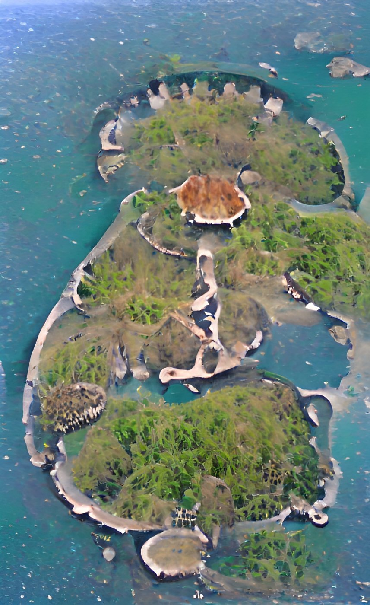 [ia] : Des rives en dentelle sans logique, des bâtiments fondus dans la végétation, aucune route.
- 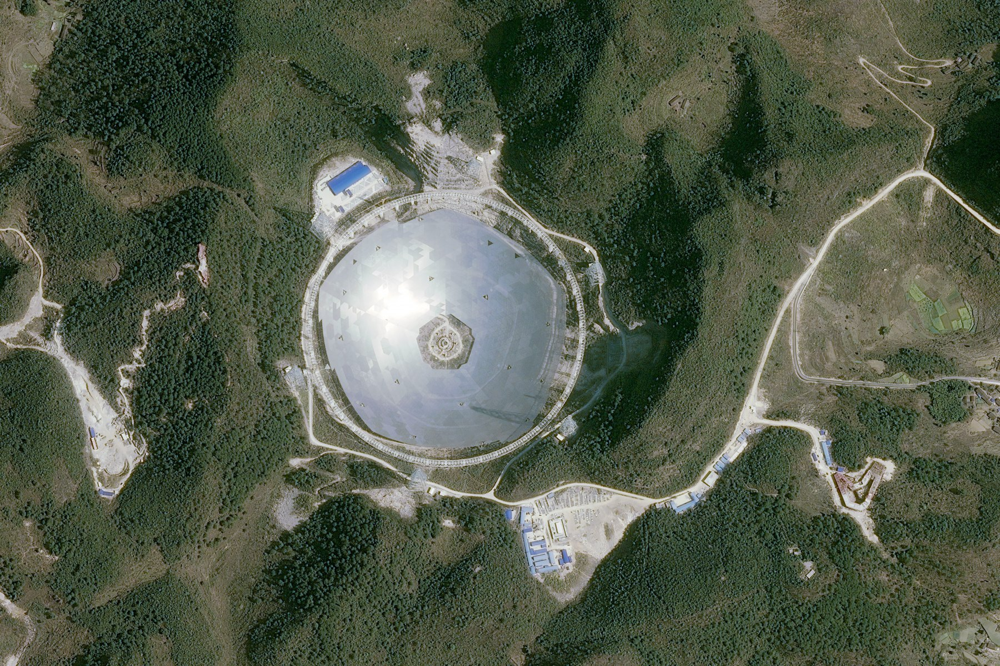 [vrai] : Une image Pléiades : les routes mènent quelque part, les ombres sont cohérentes, le chantier a une logique.
-  [ia] : Un lagon blanc et plat, sans fond ni passe, une végétation en boule : physiquement improbable.
- 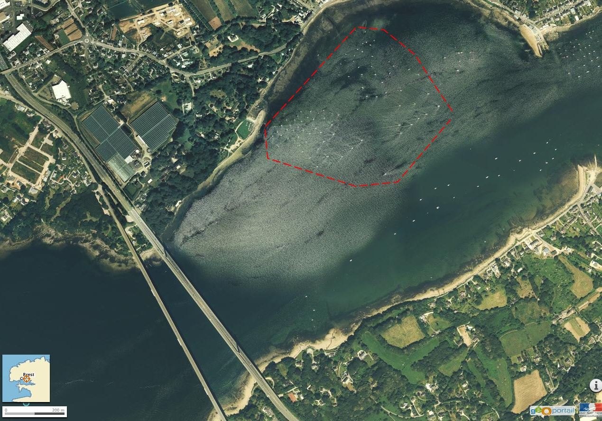 [vrai] : Une orthophotographie : réseau routier continu, ombres alignées, détails irréguliers.
-  [ia] : Des rivières qui franchissent les crêtes et un relief sans érosion.
-  [vrai] : Une image radar multi-dates : ses défauts sont ceux du capteur, pas d'un générateur.
:::

## La méthode {.socle competences="C6 C3"}

::: {.fiche n="5.8" etat="a-revoir"}
Intention : La méthode de vérification : la source et la provenance (métadonnées, certificats de contenu), la recherche inversée, la cohérence avec d'autres images du même lieu et du même jour, la convergence des indices. Jamais un indice seul. [nouvelle]
Expérience : remettre en ordre les étapes
Demande :
:::

::: {.ordre}
Remettez la vérification d'une image dans l'ordre.

1. D'où vient-elle ? Qui l'a publiée, quand, avec quelles métadonnées ?
2. A-t-elle déjà circulé ? (recherche d'image inversée)
3. Le lieu et la date sont-ils cohérents ? (d'autres images, le soleil, la saison)
4. Les clés d'identification et d'interprétation tiennent-elles ? (formes, textures, ombres, physique)
5. Conclure avec un degré de certitude
:::

[Aucun indice ne prouve seul : un faisceau, et une certitude dite.]{.a-retenir}

## La note d'interprétation {.intercalaire}

::: {.fiche n="6.0" etat="a-revoir"}
Intention : Mettre l'enquête au propre. [nouvelle]
Expérience : aucune
Demande :
:::

Mettre l'enquête au propre.

## Rédiger une note {.socle competences="C1 C3"}

::: {.fiche n="6.1" etat="a-revoir"}
Intention : La note en quatre rubriques (observations, interprétations, certitude, sources et limites), sur l'image du cours. La description écrite en 3.1 revient. Lien avec « Cartography : Basics » : clairement, honnêtement. [nouvelle]
Expérience : la description revient ; l'étudiant écrit sa note, puis la compare à celle de l'expert (brique « observer »)
Demande :
:::

Une note d'interprétation a **quatre rubriques** : ce que je vois ; ce que j'en déduis ; avec quelle certitude ; sur quelles sources, avec quelles limites.

::: {.observer cle="note-image" rappel="description-image" invite="Observations… Interprétations… Certitude… Sources et limites…"}
**Observations.** Une côte rocheuse, une digue qui ferme un bassin, deux dômes d'environ 50 m et un troisième en chantier, de longs bâtiments, des remous au large, des lignes électriques.

**Interprétations.** Une centrale nucléaire en bord de mer, refroidie par l'eau de mer (prise d'eau dans le bassin, rejet au large), avec un troisième réacteur en construction.

**Certitude.** Presque certain pour la centrale (faisceau d'indices) ; probable pour le circuit de l'eau (les galeries ne se voient pas).

**Sources et limites.** Une orthophotographie, une seule date ; le rejet est déduit, pas vu.
:::

## À vous : une nouvelle image {.appui competences="C1 C2 C3 C4"}

::: {.fiche n="6.2" etat="a-revoir"}
Intention : Le transfert sur une image d'un autre capteur : le port de Baltimore en radar. Note d'interprétation sans guide, puis lecture experte. Lecture à compléter par Marc. [nouvelle]
Expérience : zone d'écriture, puis lecture experte (brique « observer »)
Demande :
:::

:::: {.columns}
::: {.column width="45%"}
{height="430" fig-alt="Image radar multi-dates du port de Baltimore"}
:::
::: {.column width="55%"}
Écrivez votre note sur cette image radar, avec ses quatre rubriques.

::: {.observer cle="note-baltimore" invite="Observations… Interprétations… Certitude… Sources et limites…"}
**Observations.** Des quais, des bassins, une ville en damier ; du gris presque partout ; des taches de couleur sur l'eau et sur les terre-pleins.

**Interprétations.** Les couleurs marquent ce qui a changé entre les dates : des navires arrivés ou partis, des conteneurs déplacés. Le gris, l'immuable.

**Certitude.** Probable : il faudrait savoir quelle couleur correspond à quelle date.

**Sources et limites.** Une image radar, dont la source et les dates sont à préciser.
:::
:::
::::

## Réviser {.intercalaire}

::: {.fiche n="7.0" etat="a-revoir"}
Intention : Ce qui reste, et comment le faire durer. [nouvelle]
Expérience : aucune
Demande :
:::

Ce qui reste, et comment le faire durer.

## À retenir

::: {.fiche n="7.1" etat="a-revoir"}
Intention : Les diapos du socle, en une liste.
Expérience : liens vers chaque diapo
Demande :
:::

::: {.carte-du-cours niveaux="socle"}
:::

[Voir, puis déduire ; croiser les indices ; dire sa certitude.]{.a-retenir}

## Votre bilan

::: {.fiche n="7.2" etat="a-revoir"}
Intention : La grille d'entrée revient : l'étudiant se situe de nouveau, voit l'écart, et les diapos à reprendre ; sa calibration (certitude et réussite). [nouvelle]
Expérience : bilan de fin (brique « bilan ») ; tableau de calibration (brique « calibration »)
Demande :
:::

:::: {.columns}
::: {.column width="62%"}
::: {.bilan moment="fin"}
- C1 | Décrire avant d'interpréter
- C2 | Identifier avec les clés d'identification
- C3 | Reconstituer un mécanisme et dire sa certitude
- C4 | Choisir l'image qui répond à la question
- C5 | Transformer une interprétation en donnée
- C6 | Distinguer une image réelle d'une image générée
:::
:::
::: {.column width="38%"}
**Votre calibration**

::: {.calibration}
:::
:::
::::

## Le programme de révision

::: {.fiche n="7.3" etat="a-revoir"}
Intention : Le mode révision : toutes les questions du cours, mélangées ; une carte sue s'espace (un jour, une semaine, un mois), une carte manquée revient. Principe : récupérer en mémoire, espacer, entrelacer, se juger. [nouvelle]
Expérience : brique « revision » ; l'adresse ?revision ouvre directement cette diapo
Demande :
:::

:::: {.columns}
::: {.column width="40%"}
Toutes les questions du cours deviennent des **cartes**, mélangées.

- Vous la saviez : elle revient dans **un jour**, puis **une semaine**, puis **un mois**.
- Vous l'aviez oubliée : elle revient tout de suite.

Rouvrez ce support demain, puis dans une semaine. Ajoutez `?revision` à son adresse pour arriver ici directement.
:::
::: {.column width="60%"}
::: {.revision}
:::
:::
::::

## À vous {.fin}

::: {.fiche n="7.4" etat="a-revoir"}
Intention : Le pont vers le TP de photo-interprétation.
Expérience : aucune
Demande :
:::

Une image ne parle pas seule : on la **regarde**, on la **questionne**, on **croise** ses indices, et l'on **dit** ce que l'on sait, avec sa certitude.

## Sources et crédits {.petit}

::: {.fiche n="7.5" etat="a-revoir"}
Intention : Les références : FLAIR (l'article de Marc), Ressources naturelles Canada, le GIS&T Body of Knowledge, les manuels, Kent, l'histoire (Babington Smith, Cuba), Angkor, les images et leurs droits. Le PDF de cours de Marc à ajouter. [nouvelle]
Expérience : aucune
Demande :
:::

:::: {.columns}
::: {.column width="50%"}
| Document | Origine |
|---|---|
| Éléments d'interprétation | Ressources naturelles Canada, *Éléments d'interprétation visuelle* ; S. Myint, GIS&T Body of Knowledge, DC-04-012, 2024 |
| Manuels | Lillesand, Kiefer et Chipman, *Remote Sensing and Image Interpretation*, 2015 ; Jensen, 2013 ; Estes, Hajic et Tinney, 1983 |
| FLAIR | Garioud *et al.*, NeurIPS 2023 |
| Certitude | S. Kent, « Words of Estimative Probability », 1964 |
| Medmenham, Cuba | C. Babington Smith ; Smithsonian, NSArchive |
| Angkor | D. Evans *et al.*, PNAS, 2013 |
| BD Forêt V2 | IGN, conférence du 19 janvier 2021 |
:::
::: {.column width="50%"}
| Document | Origine |
|---|---|
| Flamanville, rade de Brest | Géoportail, IGN |
| FAST | image Pléiades, 2 mars 2016 (droits à préciser) |
| Baltimore | image radar, source à préciser |
| Images générées | Wombo Dream (2022), DALL·E (2024), autres à préciser |
| Musée | Musée de la photographie aérienne, L'Europe vue du Ciel ; photos de Marc Poupée |
| Unité minimale, schémas, profil | réalisés pour ce cours |
| Cours de Marc Poupée | PDF à ajouter |
:::
::::

<!--
V0. Public : ingénieurs, étudiants en géopolitique, masters ; pas seulement FIRS.

Compétences (diapo 0.3). Le titre de chaque diapo socle porte les compétences qu'elle étaye.
  C1  Décrire avant d'interpréter : séparer ce que l'on voit de ce que l'on en déduit.
  C2  Identifier un objet ou un phénomène avec les clés d'identification.
  C3  Reconstituer un mécanisme en croisant les clés d'interprétation, et dire son degré de certitude.
  C4  Choisir l'image qui répond à la question, et en connaître les limites.
  C5  Transformer une interprétation en donnée.
  C6  Distinguer une image réelle d'une image générée, et situer l'interprète face à l'IA.

Images attendues de Marc : la photo de Peenemünde (couverture), l'image de 14-18, les images
PXL_20250930_173652676~2, PXL_20261006_182859009, PXL_20261006_182903643, IMG-20261029-WA0000,
une image d'Angkor (LiDAR), le PDF de cours dans source/.
-->
